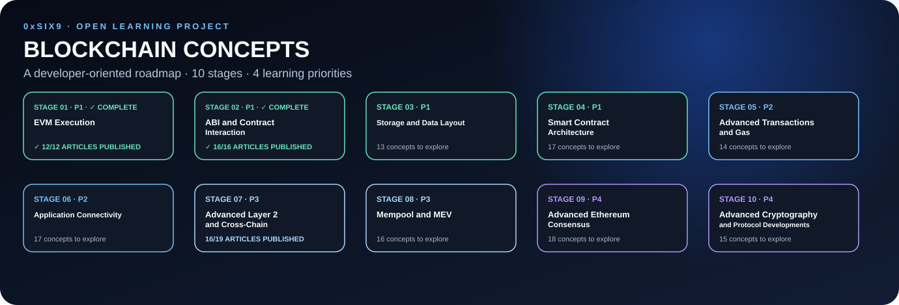

<div align="center">
  
  <br/>
  <p>
    <a href="roadmap/roadmap.md"></a>
    <a href="roadmap/learning-priorities.md"></a>
    <a href="LICENSE"></a>
  </p>
  <h3>A practical map of the concepts behind Ethereum, smart contracts, and blockchain infrastructure.</h3>
  <p>Created and maintained by <a href="https://github.com/0xSix9">0xSix9</a>.</p>
</div>

---

## What is this?

**Blockchain Concepts Learning Roadmap** is a structured, developer-oriented learning plan for understanding how Ethereum and EVM-based applications work beneath the surface.

The roadmap starts with EVM execution and contract interaction, then moves through storage, contract architecture, transactions, gas, RPC, Layer 2, cross-chain systems, MEV, consensus, and advanced cryptography.

This repository is designed as both a **learning checklist** and a **growing technical reference**. Every stage has its own index, and the complete roadmap keeps all concepts in one place.

> **Current state:** The roadmap, navigation, templates, project guidelines, and the first three Stage 01 concept articles are published. The remaining concept articles will be researched and added one by one by the author.

## Start here

- **[Full roadmap — all 157 concepts](roadmap/roadmap.md)** — browse the complete checklist.
- **[EVM Opcodes](concepts/01-evm-execution/01-evm-opcodes.md)**, **[Stack, Memory, and Calldata](concepts/01-evm-execution/02-stack-memory-and-calldata.md)**, and **[Execution Context](concepts/01-evm-execution/03-execution-context.md)** — the first three published Stage 01 articles.
- **[Learning priorities](roadmap/learning-priorities.md)** — understand the four-stage groups and suggested order.
- **[Concept article template](templates/concept-template.md)** — a starting structure for writing each article later.
- **[Sources and research policy](references/sources.md)** — recommended primary sources and documentation rules.
- **[Contributing guide](CONTRIBUTING.md)** — naming, quality, and review conventions.
- **[Changelog](CHANGELOG.md)** — notable repository changes.

## Roadmap at a glance

| Stage | Focus | Concepts | Priority |
|---|---|---:|:---:|
| [Stage 01 — EVM Execution](concepts/01-evm-execution/README.md) | 12 | Priority 1 |
| [Stage 02 — ABI and Contract Interaction](concepts/02-abi-contract-interaction/README.md) | 16 | Priority 1 |
| [Stage 03 — Storage and Data Layout](concepts/03-storage-data-layout/README.md) | 13 | Priority 1 |
| [Stage 04 — Smart Contract Architecture](concepts/04-smart-contract-architecture/README.md) | 17 | Priority 1 |
| [Stage 05 — Advanced Transactions and Gas](concepts/05-advanced-transactions-gas/README.md) | 14 | Priority 2 |
| [Stage 06 — Application Connectivity](concepts/06-application-connectivity/README.md) | 17 | Priority 2 |
| [Stage 07 — Advanced Layer 2 and Cross-Chain](concepts/07-layer2-cross-chain/README.md) | 19 | Priority 3 |
| [Stage 08 — Mempool and MEV](concepts/08-mempool-mev/README.md) | 16 | Priority 3 |
| [Stage 09 — Advanced Ethereum Consensus](concepts/09-ethereum-consensus/README.md) | 18 | Priority 4 |
| [Stage 10 — Advanced Cryptography and Protocol Developments](concepts/10-advanced-cryptography-protocol/README.md) | 15 | Priority 4 |

**157 roadmap entries across 10 stages.** This count represents topics in the learning plan, not completed articles.

## Learning priorities

| Priority | Stages | Focus |
|---|---|---|
| **P1** | 01–04 | Core foundations: EVM execution, contract interaction, storage, and smart-contract architecture. |
| **P2** | 05–06 | Transactions, gas accounting, RPC, clients, and application connectivity. |
| **P3** | 07–08 | Layer 2, cross-chain architecture, mempool mechanics, transaction ordering, and MEV. |
| **P4** | 09–10 | Ethereum consensus, advanced cryptography, and protocol-level developments. |

Priority describes the suggested learning order, not the overall importance of a topic. The first four stages establish the most direct foundations for smart-contract development; later stages broaden protocol and infrastructure understanding.

## How to use the roadmap

1. Open a stage index and choose a concept.
2. Research it using primary sources before writing.
3. Explain the mechanism in your own words and connect it to developer use cases.
4. Add a diagram, code experiment, or trace when it genuinely improves understanding.
5. Record references and review dates, especially for protocol topics that evolve.
6. Mark a topic complete only after the article has been checked.

### Status convention

- ⬜ **Not started** — checklist only; no article yet.
- 🟡 **In progress** — research or drafting is underway.
- ✅ **Reviewed** — article is written and checked against its references.
- 🔄 **Needs update** — a specification, implementation, or source may have changed.

## Repository structure

```text
.
├── README.md
├── roadmap/
│   ├── roadmap.md
│   └── learning-priorities.md
├── concepts/
│   ├── 01-evm-execution/
│   ├── 02-abi-contract-interaction/
│   ├── 03-storage-data-layout/
│   ├── 04-smart-contract-architecture/
│   ├── 05-advanced-transactions-gas/
│   ├── 06-application-connectivity/
│   ├── 07-layer2-cross-chain/
│   ├── 08-mempool-mev/
│   ├── 09-ethereum-consensus/
│   └── 10-advanced-cryptography-protocol/
├── templates/
├── references/
├── assets/
│   ├── diagrams/
│   ├── images/
│   └── roadmap-overview.svg
└── .github/
    ├── ISSUE_TEMPLATE/
    └── PULL_REQUEST_TEMPLATE.md
```

## Project principles

- **Concept-first:** explain mechanisms, not just definitions.
- **Developer-oriented:** connect ideas to implementation, debugging, architecture, gas, and security.
- **Traceable:** support technical claims with relevant sources.
- **Visual where useful:** diagram execution flows, data layouts, and protocol boundaries when they clarify the idea.
- **Incremental:** empty checklists are not presented as finished content.
- **Maintainable:** update documentation when relevant specifications or protocol behavior change.

## Scope and accuracy

The roadmap is Ethereum/EVM-centered. Some ideas apply more broadly, but behavior can vary by chain, client, fork, standard, or version. Future articles should clearly distinguish protocol rules from client-specific behavior and common practice.

This is an independent educational project, not official Ethereum documentation, an audit, or a security guarantee.

---

<div align="center"><sub>Learn the mechanism. Trace the execution. Understand the protocol.</sub></div>
