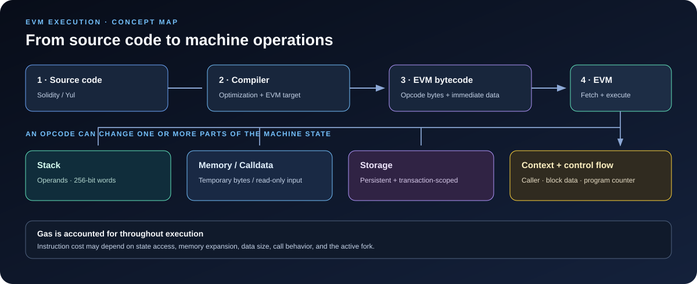

# EVM Opcodes: The Instructions Behind Smart Contract Execution

> **Stage:** 01 — EVM Execution  
> **Priority:** 1  
> **Status:** Reviewed  
> **Last reviewed:** 2026-10-17

## 1. What Is an EVM Opcode?

An **EVM opcode** (Ethereum Virtual Machine operation code) is an instruction understood by the Ethereum Virtual Machine. A deployed smart contract is executed as bytecode, and that bytecode contains opcodes that tell the EVM what to do: add values, read input, access storage, call another contract, emit a log, return data, or stop execution.

Solidity is a high-level language designed for developers. The EVM does not directly execute Solidity source code. A compiler translates Solidity (or another EVM-compatible source language) into EVM bytecode. The EVM interprets that bytecode according to the protocol rules.

For example, the Solidity expression:

```solidity
uint256 result = a + b;
```

may compile to an instruction sequence that loads values, performs arithmetic, and stores or returns a result. The exact sequence depends on the compiler version, optimization settings, surrounding code, and target EVM version. A source-level expression does **not** necessarily map to one opcode.



## 2. How the EVM Executes Opcodes

The EVM is a **stack-based virtual machine**. Rather than relying on a general-purpose set of CPU registers, most opcodes read their operands from a stack and push their results back onto it.

An EVM stack item is 256 bits (32 bytes), and the stack can contain at most 1,024 items. During execution, the EVM also tracks a program counter, available gas, the current execution context, and the machine's memory and state-related data.

At a high level, execution repeatedly follows this pattern:

1. Read the instruction at the current program counter.
2. Determine the instruction and any immediate data associated with it.
3. Check the required stack operands and execution conditions.
4. Charge the applicable gas.
5. Perform the operation, updating the stack, memory, execution context, or state as specified.
6. Advance or change the program counter, or halt if the instruction requires it.

This is a conceptual model. Actual execution rules, gas charging, exceptional halting conditions, and state changes are defined by the applicable Ethereum execution specification.

### Opcodes and immediate data are not the same thing

Most opcode instructions are represented by one byte. Some instructions are followed by additional bytes that represent data rather than new instructions.

For example, `PUSH1` pushes the next one byte of data onto the stack; `PUSH32` can push the next 32 bytes. Those following bytes are immediate data. A bytecode disassembler must know this distinction so it does not mistakenly decode a `PUSH` value as another opcode.

The `PUSH0` instruction pushes the constant zero without reading an immediate data byte. Opcode availability depends on the EVM rules active for the target chain and fork.

## 3. The Main Opcode Groups

Developers do not need to memorize every opcode before writing useful contracts. It is more valuable to understand the major groups, recognize common instructions in bytecode, and know where to look up precise semantics.

### 3.1 Arithmetic and comparison

These instructions perform numeric operations on 256-bit stack words.

| Opcode | Purpose |
|---|---|
| `ADD`, `MUL`, `SUB` | Addition, multiplication, and subtraction |
| `DIV`, `SDIV` | Unsigned and signed division |
| `MOD`, `SMOD` | Unsigned and signed remainder |
| `ADDMOD`, `MULMOD` | Modular addition and multiplication |
| `EXP` | Exponentiation |
| `LT`, `GT`, `SLT`, `SGT` | Comparisons, with unsigned or signed interpretation |
| `EQ`, `ISZERO` | Equality and zero checks |

EVM arithmetic operates on 256-bit words. Many operations therefore have word-level semantics rather than behaving exactly like arbitrary-precision integers in a high-level language. Signed operations interpret a word according to the relevant signed representation; the bits themselves are still a 256-bit word.

Comparison instructions normally push a Boolean result represented as the word `0` or `1`.

### 3.2 Bitwise operations and shifts

Bitwise instructions work directly with the bits in stack words. Common examples are `AND`, `OR`, `XOR`, and `NOT`. `SHL`, `SHR`, and `SAR` shift bits left or right, with `SAR` preserving the signed interpretation during a right shift.

These operations are useful for masks, packed values, flag checks, and low-level optimizations. They also help when inspecting compiler output for Solidity bitwise expressions.

### 3.3 Hashing

`KECCAK256` calculates the Keccak-256 hash of a byte range in memory. Solidity exposes this operation through `keccak256(...)`.

It is important to understand its inputs: the instruction reads a memory offset and a length from the stack, then hashes the selected bytes. It does not hash a Solidity variable in some abstract form—the compiler first represents the relevant data as bytes in memory.

Hashing is used throughout Ethereum, including for mapping storage-slot derivation, data integrity, and many application-level commitments. Keccak-256 should not be confused with the later SHA3-256 standard: despite their relation, they use different padding conventions and do not produce identical outputs for the same input.

### 3.4 Stack manipulation

These opcodes move or duplicate values without requiring a Solidity-level variable assignment.

| Opcode family | Purpose |
|---|---|
| `PUSH0`, `PUSH1`–`PUSH32` | Push a constant or immediate value |
| `POP` | Remove the top stack item |
| `DUP1`–`DUP16` | Duplicate an item at a specified depth |
| `SWAP1`–`SWAP16` | Swap the top stack item with an item deeper in the stack |

These are among the most common instructions in compiled bytecode. They are also a good starting point when learning to trace execution manually.

### 3.5 Input, code, and return data

A contract call can include input bytes—commonly called calldata. The EVM has instructions for reading and copying this data:

- `CALLDATALOAD` reads a 32-byte word starting at a calldata offset.
- `CALLDATASIZE` returns the calldata length.
- `CALLDATACOPY` copies a range of calldata into memory.
- `CODESIZE` and `CODECOPY` inspect or copy the currently executing code.
- `RETURNDATASIZE` and `RETURNDATACOPY` inspect or copy the return data from the most recent external call.

Calldata is read-only during execution. When a contract needs to manipulate input bytes using memory operations, it can copy them into memory first.

The first four bytes of the calldata are commonly used as a function selector in Solidity's external function dispatch. Understanding calldata-related opcodes helps explain how calls reach function logic, although ABI decoding and selector dispatch are separate concepts in this roadmap.

### 3.6 Memory operations

EVM memory is a temporary, byte-addressable workspace for a single execution frame. It does not persist as contract state after execution.

| Opcode | Purpose |
|---|---|
| `MLOAD` | Load a 32-byte word from memory |
| `MSTORE` | Write a 32-byte word to memory |
| `MSTORE8` | Write one byte to memory |
| `MSIZE` | Read the current memory size in bytes |
| `MCOPY` | Copy a memory region to another memory region |

Memory expands as execution accesses higher memory ranges, and expansion can add gas cost. Because the gas calculation is not limited to the instruction's base cost, copying or returning a large amount of data can cost more than a small example suggests.

### 3.7 Persistent and transient storage

Storage opcodes are particularly important for smart-contract developers because they interact with data beyond the immediate computation.

- `SLOAD` reads a value from the executing contract's persistent storage.
- `SSTORE` writes a value to persistent storage.
- `TLOAD` reads from transient storage.
- `TSTORE` writes to transient storage.

Persistent storage is retained as part of the blockchain state, subject to transaction success and the protocol's state-transition rules. A revert rolls back state changes made in the reverted execution scope.

Transient storage, introduced by EIP-1153, is temporary state available during a transaction. It can be useful for passing temporary values across internal calls, but it is not committed to persistent contract storage and is cleared at the end of the transaction. Its ownership and behavior across calls differ from ordinary memory, so developers should consult the specification before relying on a specific pattern.

Storage operations can have important gas implications. The applicable cost may depend on factors such as the slot's access status and the original, current, and new values. Do not assume that every `SLOAD` or `SSTORE` has one universal cost independent of context.

### 3.8 Execution context and block information

These opcodes expose values from the current call or execution environment.

| Opcode | Familiar Solidity-level counterpart |
|---|---|
| `ADDRESS` | `address(this)` |
| `CALLER` | `msg.sender` |
| `CALLVALUE` | `msg.value` |
| `ORIGIN` | `tx.origin` |
| `TIMESTAMP` | `block.timestamp` |
| `NUMBER` | `block.number` |
| `CHAINID` | `block.chainid` |
| `BASEFEE` | `block.basefee` |
| `GAS` | Remaining gas at that point in execution |

These pairs are useful mental shortcuts, but always consider the current execution context. For instance, `CALLER` identifies the sender of the current message call, while `ORIGIN` refers to the transaction origin. Using `tx.origin` as an authorization substitute for `msg.sender` can create security vulnerabilities.

### 3.9 Control flow and halting

The EVM has instructions that change which instruction executes next or finish the current execution.

- `JUMP` changes the program counter to a valid jump destination.
- `JUMPI` jumps only if its condition is nonzero.
- `JUMPDEST` marks a valid legacy jump destination.
- `PC` exposes the current program-counter position.
- `STOP` halts without returning data.
- `RETURN` halts successfully and returns a selected memory range.
- `REVERT` halts the current execution and signals failure, with optional return data.
- `INVALID` represents an invalid instruction and causes exceptional halting.

A stack underflow, invalid jump destination, or out-of-gas condition can also cause exceptional halting. When execution reverts, state changes made in the reverted scope do not persist, though gas and transaction-level behavior follow their own rules.

### 3.10 External calls, contract creation, and logs

Some opcodes connect one execution frame to another or produce data that can be observed outside the contract's storage.

- `CALL` makes a message call to another account or contract.
- `STATICCALL` performs a call in a static context, where state-changing operations are disallowed.
- `DELEGATECALL` executes code from another address while retaining the caller's execution context, including its storage context. This is a key building block of proxy architectures and a major security boundary.
- `CREATE` and `CREATE2` create contracts using initialization code, with different address-derivation rules.
- `LOG0`–`LOG4` emit logs with zero to four indexed topics. Solidity events compile to log operations.

These instructions are central to composability. They are also worth recognizing during security reviews because external calls, delegated code execution, state context, revert data, and gas forwarding can affect the safety of the whole contract system.

The `SELFDESTRUCT` opcode also exists, but its behavior was restricted by EIP-6780. Do not assume that calling it on an already-existing contract will generally delete that contract's code and storage. Review the current rules for the relevant chain and fork before depending on its semantics.

## 4. A Small Opcode Walkthrough

The following assembly illustrates how a few instructions work together. It computes `2 + 3`, stores the result in memory at offset zero, then returns a 32-byte memory range.

```text
PUSH1 0x02
PUSH1 0x03
ADD
PUSH1 0x00
MSTORE
PUSH1 0x20
PUSH1 0x00
RETURN
```

This is illustrative EVM assembly, not Solidity source. It can be read step by step:

1. The two `PUSH1` instructions put `2` and `3` on the stack.
2. `ADD` consumes the two operands and pushes `5`.
3. `PUSH1 0x00` places the memory offset `0` on the stack.
4. `MSTORE` writes the 32-byte word representing `5` into memory at byte offset `0`.
5. The final two `PUSH1` instructions prepare a size of `0x20` (32 bytes) and a starting offset of `0`.
6. `RETURN` returns the 32-byte range at memory offsets `0` through `31`.

When tracing the stack, write down the stack after each instruction and be explicit about which item is on top. This habit makes instructions with operand order—such as `SUB`, `MSTORE`, and `JUMPI`—much easier to reason about.

## 5. How Opcodes Relate to Gas

Gas is the protocol's unit for measuring computational and resource usage. Executed operations incur gas charges, but a contract's total gas is not simply the number of opcodes multiplied by one constant.

Cost can depend on:

- the opcode's own gas schedule;
- the amount of data copied or hashed;
- memory expansion;
- storage-slot access and state changes;
- whether an account or storage slot is warm or cold under the applicable rules;
- calls, value transfer, and the behavior of the called code; and
- the active network fork and execution rules.

This is why two functions with similar-looking Solidity code can have different gas usage, and why a source-level estimate may differ from actual execution. For accurate analysis, inspect compiled output and measure with the correct compiler settings and target EVM version.

Gas cost tables are version-sensitive. Use a current opcode reference together with the applicable execution specifications instead of relying on memorized values from an older fork.

## 6. Why Opcodes Matter to Smart Contract Developers

You do not need to write every contract in assembly. Learning opcodes gives you a lower-level view that helps in several practical situations:

1. **Understand compiler output.** You can recognize what the compiler does with arithmetic, conditions, storage reads, and external calls.
2. **Debug execution.** Stack traces, memory inspection, and opcode stepping make failures less mysterious.
3. **Reason about gas.** You can identify costly storage operations, memory growth, data copies, and repeated work.
4. **Review security-sensitive code.** Instructions such as `CALL`, `DELEGATECALL`, `SSTORE`, and `ORIGIN` highlight where context or state changes need close attention.
5. **Understand proxies and contract interactions.** Low-level calls explain how execution crosses contract boundaries and how storage context is preserved or changed.
6. **Read traces and bytecode.** This is useful when source code is unavailable, when verifying deployed behavior, or when reviewing compiler-generated output.

Opcodes are one layer of the larger picture. Their behavior is easier to understand when studied alongside the stack, memory, calldata, execution context, storage layout, gas accounting, and contract-call semantics.

## 7. Recommended Learning Exercises

- **Trace a simple arithmetic expression.** Write down the stack after each `PUSH`, `ADD`, and `MSTORE`.
- **Compare source and bytecode.** Compile a small Solidity contract with and without optimization, then compare the opcode sequences.
- **Inspect a storage write.** Use a debugger to find where `SLOAD` and `SSTORE` appear and observe the state before and after execution.
- **Compare call types.** Build a minimal example to explore the differences among `CALL`, `STATICCALL`, and `DELEGATECALL`.
- **Check the active gas schedule.** Look up the opcodes in a current reference and verify any dynamic costs against the specification for the target fork.

For interactive exploration, [evm.codes](https://www.evm.codes/) lets you inspect opcode descriptions, stack effects, bytecode, and gas information. A local debugger or execution trace is valuable for confirming what happens in a real compiled example.

## Key Takeaways

- Opcodes are the low-level instructions executed from EVM bytecode.
- The EVM is a stack machine built around 256-bit words and a stack depth limit of 1,024 items.
- Different opcode groups operate on the stack, memory, calldata, persistent storage, transient storage, execution context, and control flow.
- An opcode's gas cost may depend on state, data size, memory expansion, and the active fork.
- Understanding opcodes helps developers reason about compiler output, gas usage, external calls, storage, and security.
- The precise rule for an opcode should be checked against the specification and fork that apply to the target chain.

## References

1. [Opcodes for the EVM — ethereum.org](https://ethereum.org/developers/docs/evm/opcodes/) — practical opcode table and stack effects.
2. [Ethereum Virtual Machine — ethereum.org](https://ethereum.org/developers/docs/evm/) — EVM execution model, stack, storage, and transient storage.
3. [Ethereum Execution Layer Specifications](https://steel.ethereum.foundation/docs/execution-specs/) — executable reference specifications for execution-layer behavior.
4. [EVM Codes](https://www.evm.codes/) — interactive opcode and gas reference.
5. [EIP-1153: Transient storage opcodes](https://eips.ethereum.org/EIPS/eip-1153) — semantics of `TLOAD` and `TSTORE`.
6. [EIP-5656: MCOPY — Memory copying instruction](https://eips.ethereum.org/EIPS/eip-5656) — semantics of `MCOPY`.
7. [EIP-6780: SELFDESTRUCT only in same transaction](https://eips.ethereum.org/EIPS/eip-6780) — restricted `SELFDESTRUCT` behavior.
