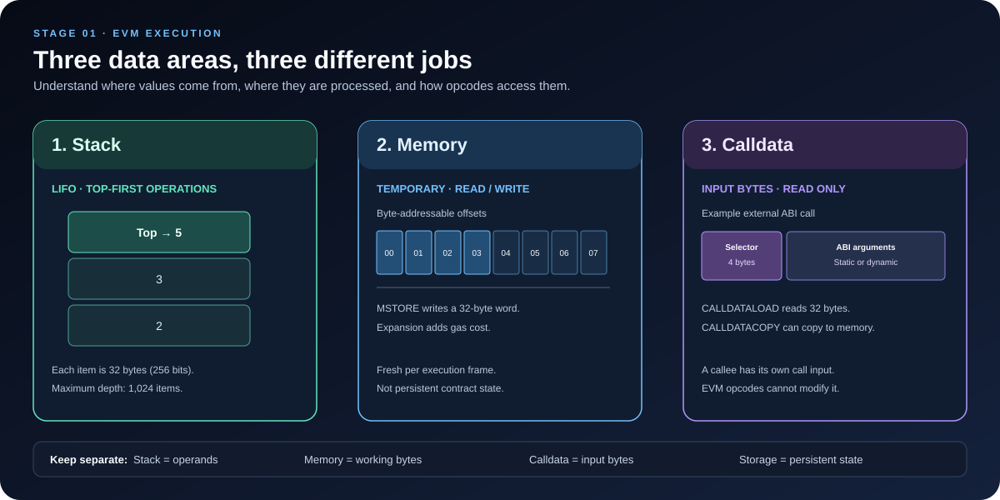

# Stack, Memory, and Calldata: How the EVM Handles Data

> **Stage:** 01 — EVM Execution  
> **Priority:** 1  
> **Status:** Reviewed  
> **Last reviewed:** 2026-10-17

## 1. Why These Three Concepts Matter

The Ethereum Virtual Machine (EVM) needs places to hold values while code executes. Three areas appear constantly when reading EVM instructions and compiled Solidity bytecode:

- **Stack** — the EVM's primary workspace for operands and intermediate results.
- **Memory** — temporary, byte-addressable workspace used by an executing call.
- **Calldata** — the byte sequence supplied as input to the current message call; it is read-only from the EVM's perspective.

They are related, but they are not interchangeable. Confusing them makes it harder to understand opcode traces, ABI decoding, gas usage, and Solidity data locations.

An important distinction: the **stack** is part of the EVM machine model, while <code>memory</code> and <code>calldata</code> are also data-location keywords used in Solidity. They are related but not identical concepts. A Solidity variable does not always map neatly to one physical region based only on its source declaration. The compiler decides which values stay on the stack, what gets copied, and how complex data is represented.

## 2. The Stack

The EVM is a stack-based virtual machine. Most opcodes obtain their operands from the top of the stack and place their results back on it.

A stack follows **last in, first out (LIFO)**: the last value pushed is the first value removed.

### Key properties

- Every stack item is a 256-bit word (32 bytes).
- The EVM stack can contain at most 1,024 items.
- Instructions such as <code>PUSH</code>, <code>POP</code>, <code>DUP</code>, and <code>SWAP</code> manipulate stack items.
- Arithmetic and comparison instructions consume operands and push results.
- Attempting to use a missing operand (stack underflow), or to exceed the stack limit, causes exceptional execution.

The stack is not persistent storage. It is part of the current EVM execution frame, and its contents are not written to the blockchain's long-term state.

### A small stack trace

Consider this EVM assembly:

~~~text
PUSH1 0x02
PUSH1 0x03
ADD
~~~

Read the stack from **bottom to top**:

| Instruction | Stack after execution (bottom → top) | Meaning |
|---|---|---|
| Start | [] | Empty stack |
| PUSH1 0x02 | [2] | Push 2 |
| PUSH1 0x03 | [2, 3] | Push 3 on top |
| ADD | [5] | Consume 2 and 3, then push 5 |

The EVM has not created a Solidity variable called <code>result</code>. It has executed instructions that transform the stack. A compiler may use <code>DUP</code>, <code>SWAP</code>, and other operations to keep values available for later instructions, so real traces can be more complex.

### Why the stack matters

When debugging bytecode, the stack shows the operands an opcode is about to consume. If an operation receives the wrong operands, a trace can reveal the problem. Stack knowledge is also important for inline assembly and for understanding why low-level code must respect operand order.

## 3. Memory

EVM memory is a temporary, byte-addressable area available to the current execution frame. Unlike the stack, it is addressed by byte offsets rather than by stack positions.

Memory is commonly used for intermediate data, ABI encoding and decoding, hashing inputs, and constructing return data.

### Key properties

- Memory is **temporary**: it does not persist as contract state after the call finishes.
- Memory is byte-addressable, so instructions can refer to offsets such as byte 0, byte 32, or byte 96.
- EVM memory starts out empty; reads from untouched memory are defined as zero.
- Memory expands when execution accesses a range beyond the memory already allocated.
- Expanding memory costs gas, so touching a larger memory range can make execution more expensive.

An EVM call frame gets its own memory. A nested external message call has a distinct execution frame and memory; it does not simply share the caller's memory buffer. Data needed by the callee must be represented in the call input, while data it returns is handled as return data.

### Common memory opcodes

| Opcode | What it does |
|---|---|
| <code>MLOAD</code> | Loads a 32-byte word from memory at a given byte offset |
| <code>MSTORE</code> | Writes a 32-byte word to memory at a given byte offset |
| <code>MSTORE8</code> | Writes the least significant byte of a value to one memory byte |
| <code>MSIZE</code> | Reports the size of memory currently allocated by the EVM, in bytes |
| <code>MCOPY</code> | Copies a region of memory to another region of memory |

For example, <code>MSTORE</code> writes a full 32-byte word. If code writes the number 5 at memory offset 0, the word occupies byte positions 0 through 31. Memory is not a compact, variable-length collection of Solidity values; it is a byte-addressable area, and compiler conventions determine how objects are laid out there.

### Solidity's conventional memory layout

The EVM itself defines memory as a byte-addressable space. Solidity's compiler follows additional conventions when laying out objects in memory. In current Solidity documentation, the initial region is commonly described as follows:

| Range | Solidity convention |
|---|---|
| <code>0x00–0x3f</code> | 64-byte scratch space for temporary operations, such as hashing |
| <code>0x40–0x5f</code> | The 32-byte free-memory pointer |
| <code>0x60–0x7f</code> | The 32-byte zero slot, used as the initial value for dynamic memory arrays and not intended to be written to |
| Starting at <code>0x80</code> | Initial free-memory area for newly allocated objects |

These are **Solidity compiler conventions**, not special memory sections enforced by the EVM opcode set. Compiler versions or code-generation details can affect implementation patterns, so verify them when writing inline assembly that depends on memory layout.

### Why memory matters

Memory matters when inspecting <code>MLOAD</code>, <code>MSTORE</code>, <code>KECCAK256</code>, <code>CALLDATACOPY</code>, <code>CODECOPY</code>, <code>RETURNDATACOPY</code>, <code>RETURN</code>, and <code>REVERT</code>. Many of these instructions use offsets and lengths, so mistakes about byte positions can change the data being hashed, returned, or interpreted.

Memory expansion also affects gas. An operation touching a high memory offset may cost more than a similar operation touching a small range. The precise cost follows the active EVM gas rules; do not estimate it from the opcode name alone.

## 4. Calldata

Calldata is the input byte sequence for the current EVM message call. When a user calls a Solidity contract externally, the call data normally contains ABI-encoded function input. For a standard Solidity external function call, the first four bytes are normally the function selector, followed by encoded arguments.

Calldata is byte-addressable and read-only from the EVM's point of view. Instructions can load data from it or copy it elsewhere, but they do not modify the original calldata bytes.

A crucial detail: a contract's calldata is the input to **that call frame**. If Contract A makes an external call to Contract B, B receives the new call's input data. It does not automatically receive A's original calldata unchanged.

### Common calldata opcodes

| Opcode | What it does |
|---|---|
| <code>CALLDATASIZE</code> | Returns the number of bytes in the current call's input data |
| <code>CALLDATALOAD</code> | Loads a 32-byte word beginning at a given calldata byte offset |
| <code>CALLDATACOPY</code> | Copies a selected range of calldata into memory |

<code>CALLDATALOAD</code> reads 32 bytes even when the intended value is smaller. ABI decoding and the compiler's generated instructions interpret the relevant bytes as the intended value. Reading beyond the end of calldata yields zero bytes for the unavailable part, according to EVM semantics.

### Static and dynamic ABI arguments

For a simple external function such as:

~~~solidity
function setValue(uint256 value) external;
~~~

the calldata layout is conceptually:

~~~text
[ 4-byte function selector ][ 32-byte uint256 argument ]
          byte 0–3                     byte 4–35
~~~

A low-level <code>CALLDATALOAD(4)</code> can therefore load the word containing this first static argument. Do **not** generalize that offset to every function signature.

For a dynamic argument such as <code>bytes</code>, <code>string</code>, or a dynamic array, ABI encoding normally includes an offset in the head of the encoding and the actual data in a tail region. The value loaded at the argument's head position may be an offset, not the data itself. ABI decoding rules determine how to follow those offsets.

This is why calldata layout should be studied together with **ABI Encoding and Decoding** and **Function Selectors**, which are separate topics in this roadmap.

## 5. Solidity Data Locations: <code>calldata</code> vs <code>memory</code>

Solidity uses data-location keywords to describe how reference-type values are accessed and handled. Two common choices for function parameters and temporary data are <code>calldata</code> and <code>memory</code>.

~~~solidity
// SPDX-License-Identifier: MIT
pragma solidity ^0.8.24;

contract DataLocations {
    function sumCalldata(uint256[] calldata values)
        external
        pure
        returns (uint256 total)
    {
        for (uint256 i = 0; i < values.length; i++) {
            total += values[i];
        }
    }

    function sumMemory(uint256[] memory values)
        public
        pure
        returns (uint256 total)
    {
        for (uint256 i = 0; i < values.length; i++) {
            total += values[i];
        }
    }
}
~~~

Both functions sum an array. The important difference is how the input array is represented and accessed:

- <code>calldata</code> provides a read-only view of the encoded external input. The compiler can access elements without first creating a mutable memory copy.
- <code>memory</code> represents a memory object that can be modified during the call. For reference types such as arrays, moving data from calldata to memory may require copying and allocation.
- <code>memory</code> and <code>calldata</code> do not make data persistent. They are not substitutes for a state variable in <code>storage</code>.

The exact code generated and gas difference depend on the types, what the function does with them, compiler version, and optimizer settings. <code>calldata</code> is often a good choice for read-only external parameters, especially large arrays and byte strings, but it is not a universal rule that makes every function cheaper.

### A direct calldata-to-memory copy

When a function needs to modify a copy of its input, it can create a memory object. For example, code receiving <code>bytes calldata input</code> can copy that data into <code>bytes memory workingCopy</code> and modify the copy. The original calldata remains unchanged.

This is a data-location rule in Solidity, while the EVM-level mechanism may involve instructions such as <code>CALLDATACOPY</code> and memory operations. The exact instruction sequence is compiler-dependent.

### What about value types?

The words <code>memory</code> and <code>calldata</code> are mainly relevant to Solidity reference types—such as arrays, structs, <code>bytes</code>, and <code>string</code>. Simple value types such as <code>uint256</code> and <code>address</code> do not generally need an explicit data-location keyword. During execution, the compiler may keep scalar values on the EVM stack regardless of how source-level parameters are declared.

## 6. Compare the Three Areas

| Property | Stack | Memory | Calldata |
|---|---|---|---|
| Main role | Opcode operands and intermediate values | Temporary working data | Input bytes for the current call |
| Addressing model | Stack position (top-first operations) | Byte offset | Byte offset |
| Typical unit | 256-bit word per stack item | Arbitrary bytes, commonly accessed in words | Arbitrary input bytes; <code>CALLDATALOAD</code> returns a 32-byte word |
| Mutability | Changed by opcodes that manipulate it | Read and written during execution | Read-only from the EVM's perspective |
| Persistence | Not persistent | Not persistent | Not persistent contract state |
| Common operations | <code>PUSH</code>, <code>POP</code>, <code>DUP</code>, <code>SWAP</code>, <code>ADD</code> | <code>MLOAD</code>, <code>MSTORE</code>, <code>MCOPY</code> | <code>CALLDATASIZE</code>, <code>CALLDATALOAD</code>, <code>CALLDATACOPY</code> |
| Typical gas concern | Opcode costs and stack validity | Memory expansion and data processing | Input decoding and any copies into memory |

**Persistent storage is a fourth, separate concept.** Storage is part of the contract's persistent state and is accessed using instructions such as <code>SLOAD</code> and <code>SSTORE</code>. Do not confuse the EVM stack with Solidity's <code>storage</code> data location: the similar names refer to different things.

## 7. Common Mistakes

1. **Treating calldata as ordinary writable memory.** Calldata cannot be overwritten. Copy it to memory if mutable working data is required.
2. **Assuming a source-level type tells you its exact runtime location.** The compiler can keep scalar values on the stack, use memory for objects, or generate copies as needed.
3. **Forgetting that offsets are measured in bytes.** A memory offset of <code>0x20</code> is 32 bytes from the start, not necessarily the second item of a Solidity array.
4. **Reading calldata without considering the ABI.** The first four bytes are commonly the selector, and dynamic arguments use offsets. A raw word load is not the same as decoding an ABI argument.
5. **Assuming memory is free.** Memory is temporary, but expansion and data operations consume gas.
6. **Assuming an external call shares its caller's memory or calldata.** Each external message call has its own execution frame and input data.
7. **Assuming Solidity's memory layout is an EVM protocol guarantee.** EVM opcodes define memory behavior; Solidity's object layout and reserved regions are compiler conventions.

## 8. Suggested Experiments

- **Trace the stack:** Compile a function that adds two numbers, inspect its bytecode, and write down the stack after every opcode.
- **Compare <code>calldata</code> and <code>memory</code>:** Compile the two array-summing functions above with the same compiler and optimizer settings. Compare generated instructions and measured gas.
- **Inspect dynamic ABI data:** Encode a function call that accepts a <code>bytes</code> argument and identify the selector, offset, length, and payload.
- **Observe memory expansion:** Use a local EVM debugger to compare writes to low and high memory offsets.
- **Inspect call boundaries:** Have one contract call another and examine the callee's input, memory, and return data separately from the caller's.

## Key Takeaways

- The **stack** is the EVM's LIFO workspace for 256-bit values and opcode operands.
- **Memory** is temporary, byte-addressable working space for one execution frame; expanding it can cost gas.
- **Calldata** is the read-only input byte sequence for the current call, often containing ABI-encoded function arguments.
- Solidity's <code>calldata</code> and <code>memory</code> keywords define data locations for reference types; they are not the same kind of concept as the EVM operand stack.
- ABI layout, compiler behavior, and memory expansion matter when analyzing bytecode and gas.
- Persistent <code>storage</code> is separate from all three and is covered later in Storage and Data Layout.

## References

1. [Ethereum Virtual Machine — ethereum.org](https://ethereum.org/developers/docs/evm/) — EVM execution model, stack, memory, and data areas.
2. [Understanding the Yellow Paper's EVM Specifications — ethereum.org](https://ethereum.org/developers/tutorials/yellow-paper-evm/) — stack and calldata fundamentals.
3. [Solidity: Types and Data Location](https://docs.soliditylang.org/en/latest/types.html#data-location) — <code>memory</code>, <code>storage</code>, and <code>calldata</code> semantics.
4. [Solidity: Layout in Memory](https://docs.soliditylang.org/en/latest/internals/layout_in_memory.html) — Solidity's memory conventions.
5. [Solidity Inline Assembly](https://docs.soliditylang.org/en/latest/assembly.html) — working with EVM-level values and memory in assembly.
6. [Opcodes for the EVM — ethereum.org](https://ethereum.org/developers/docs/evm/opcodes/) — opcode details and stack effects.
