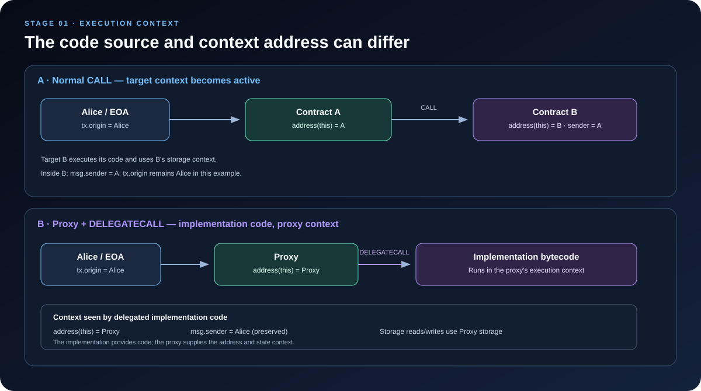

# EVM Execution Context: Who Is Calling, Which Contract Is Running?

> **Stage:** 01 — EVM Execution  
> **Priority:** 1  
> **Status:** Reviewed  
> **Last reviewed:** 2026-10-17

## 1. What Is the Execution Context?

When the Ethereum Virtual Machine (EVM) executes code, it needs more than bytecode and the current stack. It also needs to know which account context is active, who initiated the current message call, what value and input data were supplied, which block and transaction information is available, how much gas remains, and whether state changes are permitted.

These surrounding values and rules are commonly discussed as the **execution context**. In formal EVM descriptions, related information is represented through the execution environment, machine state, and message-call parameters. The phrase “execution context” is useful for developers, but it should not be treated as one Solidity variable or one isolated data structure.

Understanding context helps answer questions such as:

- What does <code>address(this)</code> return right now?
- Why can <code>msg.sender</code> change when one contract calls another?
- Why does a proxy execute implementation code while using the proxy's storage?
- Why can code execute normally in one call but fail when invoked through <code>STATICCALL</code>?
- Why is <code>tx.origin</code> different from <code>msg.sender</code>?

## 2. The Main Parts of an Execution Context

A useful developer mental model is to group context information into the following categories. These categories are explanatory rather than a replacement for the formal EVM specification.

### 2.1 Current account and code being executed

The EVM needs to know which code it is executing and which account context applies to that execution.

- <code>address(this)</code> is the address of the account in the current execution context.
- With a normal <code>CALL</code> to another contract, the target contract's context becomes active.
- With <code>DELEGATECALL</code>, code from another address executes while the caller's context is retained. This is the foundation of many proxy patterns.

A subtle but important distinction: **the address whose bytecode is being executed is not always the same as <code>address(this)</code>.** In a proxy using <code>DELEGATECALL</code>, the implementation supplies the code, but <code>address(this)</code> and the storage context refer to the proxy.

### 2.2 Message-call information

The current message call supplies data that Solidity exposes through <code>msg</code>:

| Solidity value | Meaning |
|---|---|
| <code>msg.sender</code> | Sender of the current message call |
| <code>msg.value</code> | Amount of native currency supplied with the current message call, denominated in wei |
| <code>msg.data</code> | Input bytes for the current message call |
| <code>msg.sig</code> | The first four bytes of <code>msg.data</code>, commonly used as the external function selector |

These values describe the **current call frame**, not necessarily the original user who submitted the transaction.

### 2.3 Transaction-level information

The <code>tx</code> namespace exposes transaction-wide information, such as:

- <code>tx.origin</code> — the address that originated the transaction;
- <code>tx.gasprice</code> — the effective gas price available to the execution environment.

For a normal user-submitted transaction, <code>tx.origin</code> is typically the externally owned account that began the transaction. It remains the same as execution enters ordinary nested contract calls. However, <code>tx.origin</code> is not a reliable authorization mechanism; security-sensitive permission checks should generally be based on a well-designed caller or role model rather than assuming the transaction origin is the intended user.

### 2.4 Block and chain information

The <code>block</code> namespace exposes values associated with the block or chain environment, for example:

- <code>block.number</code>
- <code>block.timestamp</code>
- <code>block.chainid</code>
- <code>block.basefee</code>

These are environmental inputs, not values chosen freely by the calling contract. Code must use them according to their actual protocol guarantees. For example, a timestamp can be useful for time-based logic, but it should not be treated as a source of secure randomness.

### 2.5 Machine state, gas, and execution restrictions

While code runs, the EVM also maintains machine state such as:

- the stack;
- temporary memory;
- the program counter;
- the gas remaining for the current execution;
- return data and halting status.

A call can also run in a **static context**, where state-changing operations are prohibited. <code>STATICCALL</code> creates this kind of context, and the static restriction also applies to nested calls made from it. This is why code that tries to write storage or emit a log can fail when reached through a static call.

The stack, memory, and calldata are covered in the previous article in this repository. Here, the focus is how the wider execution context changes as code interacts with other contracts.

## 3. Follow the Context Through a Normal CALL

Imagine Alice calls Contract A, and Contract A makes a normal <code>CALL</code> to Contract B.

At the first call frame:

- <code>address(this)</code> is Contract A;
- <code>msg.sender</code> is Alice;
- <code>tx.origin</code> is Alice.

When A makes a normal <code>CALL</code> to B, the EVM creates a new message-call frame for B. In that frame:

- <code>address(this)</code> is Contract B;
- <code>msg.sender</code> is Contract A;
- <code>tx.origin</code> remains Alice;
- <code>msg.value</code> is the value supplied in A's call to B, which may be different from the value Alice supplied to A.

The called contract has its own execution frame, stack, and memory. State access under the normal call is associated with the target contract's account context.

This is why <code>msg.sender</code> often identifies the **immediate caller**, not the original transaction sender.

### Example

~~~solidity
// SPDX-License-Identifier: MIT
pragma solidity ^0.8.24;

contract ContextTarget {
    function inspect()
        external
        payable
        returns (
            address currentContract,
            address immediateCaller,
            address transactionOrigin,
            uint256 receivedValue
        )
    {
        return (
            address(this),
            msg.sender,
            tx.origin,
            msg.value
        );
    }
}

contract Caller {
    function callTarget(ContextTarget target)
        external
        payable
        returns (
            address currentContract,
            address immediateCaller,
            address transactionOrigin,
            uint256 receivedValue
        )
    {
        return target.inspect{value: msg.value}();
    }
}
~~~

If Alice calls <code>Caller.callTarget</code> and the call forwards the full value to <code>ContextTarget.inspect</code>, the target reports:

| Value inside <code>ContextTarget.inspect</code> | Result |
|---|---|
| <code>address(this)</code> | Address of <code>ContextTarget</code> |
| <code>msg.sender</code> | Address of <code>Caller</code> |
| <code>tx.origin</code> | Alice's address for this ordinary EOA-originated transaction |
| <code>msg.value</code> | The value forwarded by <code>Caller</code> |

The contracts in this example are intentionally simple. In production, the caller must have the ability to forward the value, and the exact value forwarded is determined by the call expression.

## 4. CALL vs DELEGATECALL vs STATICCALL

These instructions all make an external message-style call, but they establish different execution conditions. Understanding their context behavior is critical for smart-contract architecture.

| Property | <code>CALL</code> | <code>DELEGATECALL</code> | <code>STATICCALL</code> |
|---|---|---|---|
| Code executed | Target's code | Code at the target address | Target's code |
| <code>address(this)</code> | Target account | Calling context's address | Target account |
| <code>msg.sender</code> in target code | Calling contract | Preserved from the current caller context | Calling contract |
| <code>msg.value</code> in target code | Value passed to the call | Preserved from the current caller context | Zero |
| Storage context | Target's storage | Calling context's storage | Target's storage, but writes are prohibited |
| State-changing behavior | Permitted if other rules allow | Permitted in the caller's context if other rules allow | Prohibited in the static call tree |

### CALL: switch to the target's context

<code>CALL</code> asks the EVM to execute code at a target address using the target account's context. The called contract sees the calling contract as <code>msg.sender</code>. A value transfer may accompany the call, subject to balance and execution rules.

### DELEGATECALL: borrow code, keep the caller's context

<code>DELEGATECALL</code> is different: the caller asks the EVM to execute code located at another address while preserving the caller's context. Important consequences include:

- <code>address(this)</code> remains the caller's execution-context address;
- storage reads and writes refer to the caller's storage;
- <code>msg.sender</code> and <code>msg.value</code> are preserved from the current call context rather than reset to the implementation's address and a new transfer amount.

This behavior is useful for proxy contracts, modular contract systems, and libraries designed for delegated execution. It also means that delegated code has powerful access to the caller's state. Selecting an incorrect implementation, allowing arbitrary delegatecall targets, or misunderstanding storage layout can create serious vulnerabilities.

### STATICCALL: execute under a read-only restriction

<code>STATICCALL</code> starts an external call with the static restriction enabled. The target can read state, but state-changing operations are not allowed. The restriction propagates to nested calls, so a function cannot evade static execution simply by calling another contract.

Solidity's <code>view</code> and <code>pure</code> declarations help the compiler enforce source-level restrictions in supported situations, but whether a particular low-level call uses static execution is also determined by how the call is made. When making low-level integrations, understand the actual EVM call type rather than relying only on a function's name or intended use.

## 5. Why Execution Context Matters for Proxies

A proxy normally holds the contract address users interact with, while a separate implementation contract contains logic. When the proxy receives a call, it can delegate execution to the implementation using <code>DELEGATECALL</code>.

Suppose Alice calls a proxy, and the proxy delegates to its implementation. From the implementation code's point of view:

- <code>address(this)</code> is the **proxy address**;
- <code>msg.sender</code> is Alice, assuming the proxy received Alice's direct call;
- <code>tx.origin</code> is the transaction origin;
- storage operations refer to the **proxy's storage**;
- the code being executed comes from the implementation.

This is exactly why implementation contracts are not simply called with <code>CALL</code>: a normal call would change the context to the implementation contract and use its storage, which is not the intended behavior of a conventional storage-based proxy.

### The critical security implication

Delegated code is not isolated from the caller's state. Its <code>SLOAD</code> and <code>SSTORE</code> operations act on the caller's storage slots. Therefore, proxy systems need compatible storage layouts, careful initialization, controlled implementation upgrades, and robust access control.

Some particularly important failure modes include:

- a storage-layout mismatch that makes one variable overlap with another;
- an initializer that can be invoked by an unintended account;
- an unrestricted or incorrectly validated delegatecall target;
- an implementation that assumes <code>address(this)</code> is its own deployed address;
- authorization logic that assumes <code>msg.sender</code> is the implementation or the original transaction origin without analyzing the call path.

This topic connects directly to **DELEGATECALL**, **Proxy Contracts**, **Storage Compatibility**, **Initializers**, and **Storage Collisions in Proxies** later in the roadmap.

## 6. The Difference Between msg.sender and tx.origin

This is one of the most important execution-context distinctions for developers.

- <code>msg.sender</code> identifies the immediate caller of the current message call.
- <code>tx.origin</code> identifies the transaction origin and normally remains the same throughout the nested call chain.

For example, in Alice → Contract A → Contract B, Contract B normally sees:

~~~text
msg.sender = Contract A
tx.origin  = Alice
~~~

<code>tx.origin</code> should not be used as a substitute for proper access control. An attacker can build a malicious contract that tricks a user into initiating a transaction. If a vulnerable target authorizes an action because <code>tx.origin</code> matches the user, the action may pass through the attacker's contract even though the immediate caller is not the authorized user.

For access control, prefer well-defined authorization mechanisms based on <code>msg.sender</code>, explicit roles, signatures with appropriate replay protection, or other deliberately designed permission models. The right design depends on the application, but it should not rely on the assumption that a direct-looking transaction origin means the current call is safe.

## 7. Other Context Values Worth Recognizing

| Value or concept | Why it matters |
|---|---|
| <code>address(this)</code> | Determines the current account context; highly relevant to proxies and delegated code |
| <code>msg.sender</code> | Immediate caller for the active call frame |
| <code>msg.value</code> | Value associated with the active message call |
| <code>msg.data</code> and <code>msg.sig</code> | Raw input bytes and the common function selector |
| <code>tx.origin</code> | Transaction origin; not a replacement for authorization |
| <code>block.timestamp</code> | Time-related application logic; not secure randomness |
| <code>block.chainid</code> | Chain identification and cross-chain/replay-protection considerations |
| <code>block.basefee</code> | Base fee information under the active fee-market rules |
| <code>gasleft()</code> | Remaining gas at the point it is evaluated |
| Static flag | Whether state-changing operations are prohibited in the active call tree |
| Call depth | How deeply execution is nested through message calls or contract creation |

Not every context-related value is constant for the entire transaction. Message-call values can change at each external call boundary; block and transaction-level values generally refer to the same execution environment. Always identify which layer a value belongs to.

## 8. Internal Calls Are Not the Same as External Calls

A Solidity **internal function call** normally stays within the current execution frame. It does not create a new external message call just because one function calls another. Accordingly, the current message-call context—such as <code>msg.sender</code>, <code>msg.value</code>, and <code>address(this)</code>—does not automatically change for an ordinary internal function call.

By contrast, an external call to another contract creates a new execution frame and establishes the target call's context according to the opcode used.

This distinction is useful when reading Solidity code: a function call that looks like <code>helper()</code> may compile into jumps and stack operations, while <code>otherContract.helper()</code> typically involves an external message call. Compiler output is implementation-dependent, so inspect bytecode or a trace when the exact mechanism matters.

## 9. Practical Debugging Checklist

When debugging a contract interaction, write down the following for each relevant call frame:

1. **Code source:** Which deployed bytecode is executing?
2. **Current account:** What should <code>address(this)</code> be?
3. **Immediate caller:** Who should <code>msg.sender</code> be in this frame?
4. **Value and input:** What are <code>msg.value</code> and <code>msg.data</code> for this particular call?
5. **Persistent state:** Which account's storage will <code>SLOAD</code> and <code>SSTORE</code> access?
6. **Restrictions:** Is execution static? Are state-changing operations prohibited?
7. **Gas and nesting:** How much gas remains, and how deep is the call chain?
8. **Origin assumptions:** Is the code using <code>tx.origin</code> for authorization or relying on an unsafe assumption about the caller?

For a proxy or library using delegated execution, add a separate note for the code address and the context address. This avoids the common mistake of assuming they are always identical.

## Key Takeaways

- Execution context describes the environment and call-specific information under which EVM code runs; formal specifications represent these details across the execution environment, machine state, and message-call parameters.
- <code>address(this)</code> describes the current account context, while <code>msg.sender</code> identifies the immediate caller and <code>tx.origin</code> identifies the transaction origin.
- <code>CALL</code> switches to the target's account context; <code>DELEGATECALL</code> runs target code in the caller's context; <code>STATICCALL</code> enforces read-only execution.
- Proxies rely on <code>DELEGATECALL</code> so implementation code can operate on proxy storage.
- Context confusion is a common source of proxy bugs and authorization vulnerabilities.
- Ordinary internal Solidity calls do not by themselves create a new external call frame.

## References

1. [Understanding the Yellow Paper's EVM Specifications — ethereum.org](https://ethereum.org/developers/tutorials/yellow-paper-evm/) — execution environment, message-call context, machine state, and static execution.
2. [Ethereum Virtual Machine — ethereum.org](https://ethereum.org/developers/docs/evm/) — overall EVM execution model.
3. [Opcodes for the EVM — ethereum.org](https://ethereum.org/developers/docs/evm/opcodes/) — behavior of <code>ADDRESS</code>, <code>CALLER</code>, <code>ORIGIN</code>, <code>CALLVALUE</code>, and the call opcodes.
4. [Solidity: Units and Globally Available Variables](https://docs.soliditylang.org/en/latest/units-and-global-variables.html) — meanings of <code>msg</code>, <code>tx</code>, and <code>block</code> values.
5. [EIP-7: DELEGATECALL](https://eips.ethereum.org/EIPS/eip-7) — delegated-call semantics.
6. [Solidity: Security Considerations](https://docs.soliditylang.org/en/latest/security-considerations.html) — security pitfalls and contract design guidance.
