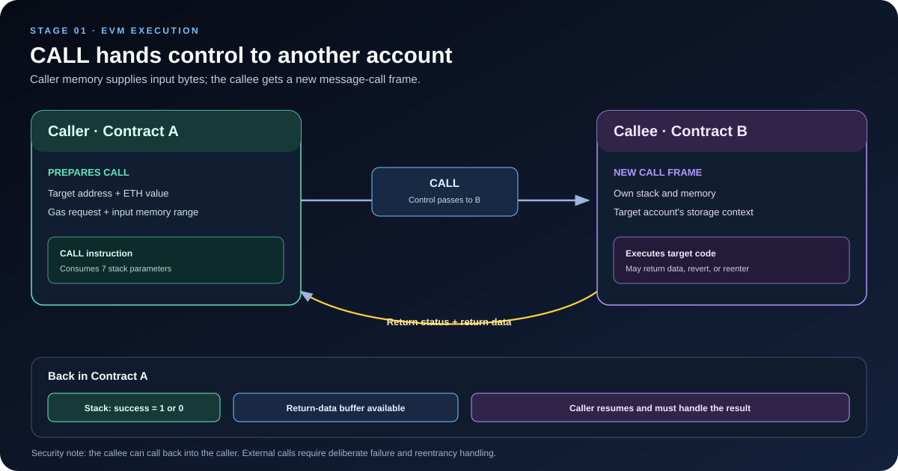

# EVM CALL Opcode: External Calls, Value Transfer, and Control Flow

> **Stage:** 01 — EVM Execution  
> **Priority:** 1  
> **Status:** Reviewed  
> **Last reviewed:** 2026-10-17

## 1. What Is the CALL Opcode?

<code>CALL</code> is an EVM instruction that starts a message call to another account. That account may contain smart-contract bytecode, or it may be an externally owned account (EOA) with no contract code. A call can optionally transfer ETH and can pass input bytes to the target.

From a smart-contract developer's perspective, <code>CALL</code> is one of the most important instructions because it lets a contract interact with other contracts and accounts. It is used directly by low-level Solidity calls such as <code>target.call(payload)</code> and commonly appears underneath typed external contract calls that the compiler generates.

A <code>CALL</code> is more than a jump to another function. It creates a new message-call execution frame, provides the target with input data and some amount of gas, establishes a new execution context, and eventually returns a success status and any output data.

## 2. What CALL Receives

The traditional EVM <code>CALL</code> opcode consumes seven stack parameters. Conceptually, they describe:

| Parameter | Meaning |
|---|---|
| Gas | The amount of gas requested for the child call, subject to the active gas rules |
| Target address | The account to call |
| Value | The amount of ETH to transfer, in wei |
| Input memory offset | Byte offset in the caller's memory where input data begins |
| Input memory length | Number of input bytes |
| Output memory offset | Byte offset in the caller's memory where output should be copied |
| Output memory length | Maximum number of return-data bytes to copy into that memory region |

These are logical parameters; when reading an opcode trace, remember that EVM stack operands are consumed according to the instruction's defined stack convention. The values are typically prepared by earlier <code>PUSH</code>, memory, or computation instructions.

Two details are especially useful:

1. **CALL's input and output buffers are in the caller's memory.** The target gets its own execution frame and memory. The EVM passes the selected input bytes into the child call rather than sharing the caller's memory region.
2. **The output memory length is a copy limit, not a promise about the total return-data length.** The child may return more data than the caller's chosen output region can hold. The caller can inspect the full return-data size and copy data with <code>RETURNDATASIZE</code> and <code>RETURNDATACOPY</code>.

## 3. How CALL Executes

A typical call follows these conceptual steps:

1. The caller prepares the target address, value, gas request, and input/output memory ranges.
2. The EVM checks the relevant conditions and charges the required costs, including applicable account-access, value-transfer, and memory costs.
3. A child message-call frame is created with the target execution context and provided input.
4. The target code executes, if code exists at the target address. The child may read state, change state if permitted, make further calls, return data, or revert.
5. When the child finishes, its execution result is reported to the caller.
6. The opcode pushes a success status onto the caller's stack: **1 for success, 0 for failure**. Return data from the last call is made available to the caller, and the configured output memory region receives up to the requested amount.
7. Execution resumes in the caller after the <code>CALL</code> instruction.

This sequence is a conceptual guide; the protocol specifies the exact gas charges, state-transition rules, exceptional cases, and return-data behavior.

### The caller resumes after the call

A <code>CALL</code> does not permanently transfer execution away from the caller. The caller pauses while the child frame runs, then resumes if the call returns normally to it. The caller can inspect the success result and decide whether to continue, retry, return data, or revert.

However, the called contract may itself call back into the caller before it returns. This matters for reentrancy and is discussed later in this article.

## 4. The Execution Context Changes

Suppose Alice calls Contract A, and A uses <code>CALL</code> to invoke Contract B.

Inside A, the context may look like this:

- <code>address(this)</code> is Contract A;
- <code>msg.sender</code> is Alice;
- <code>tx.origin</code> is Alice for this ordinary EOA-originated transaction.

When B is called with a normal <code>CALL</code>, B runs with a new context:

- <code>address(this)</code> is Contract B;
- <code>msg.sender</code> is Contract A;
- <code>msg.value</code> is the value supplied by A in that call;
- storage operations refer to B's storage context;
- B has its own stack and memory.

The <code>tx.origin</code> remains the transaction origin during ordinary nested calls, but it should not be used as a replacement for robust authorization. The direct caller of B is A, not Alice.

If A calls B with zero value, then the current call's <code>msg.value</code> in B is zero, even when Alice originally sent ETH to A. A must explicitly forward value if the target is meant to receive it.

This normal context switch distinguishes <code>CALL</code> from <code>DELEGATECALL</code>, which executes target code in the caller's context.

## 5. CALL in Solidity

Solidity developers usually work with high-level interfaces rather than writing raw opcode parameters. For example:

~~~solidity
// SPDX-License-Identifier: MIT
pragma solidity ^0.8.24;

interface ITarget {
    function setNumber(uint256 value) external;
}

contract Caller {
    function updateTarget(address target, uint256 value) external {
        ITarget(target).setNumber(value);
    }
}
~~~

The compiler encodes the function call according to the contract interface and generates the appropriate EVM interaction. Under standard EVM execution, a mutable external message call commonly uses <code>CALL</code>; the exact generated code depends on call properties and compiler output.

### Low-level call

Solidity also provides the low-level <code>.call</code> interface, which passes arbitrary bytes and optionally ETH:

~~~solidity
(bool success, bytes memory returndata) =
    target.call{value: amount}(payload);
~~~

- <code>payload</code> is the raw input byte sequence supplied to the target, often ABI-encoded.
- <code>amount</code> is the ETH value to send, in wei.
- <code>success</code> tells you whether the EVM call completed successfully at the message-call level.
- <code>returndata</code> contains the bytes returned by the target.

The caller must handle failure deliberately. Low-level <code>.call</code> does **not** automatically revert the caller simply because the callee reverts; it returns <code>success == false</code> and exposes revert data when available. By contrast, a typical high-level typed external call normally propagates a callee revert unless it is caught or handled by the source-level construct being used.

Do not mistake <code>success == true</code> for proof that the target performed the business operation you intended. A call to an account with no code may succeed and return empty data; the same can happen if you accidentally target the wrong address. If your protocol requires a particular contract response, validate the target and decode/check return data as appropriate.

### Sending ETH with CALL

The <code>{value: amount}</code> call option attaches ETH to the message call. The target can observe the amount through <code>msg.value</code>. If the target is a contract, its code may run and may call back into the sender. If the target is an EOA, there is no contract bytecode to execute, but the value transfer can still occur if the call is otherwise valid.

Do not rely on an old rule of thumb that ETH can only be sent with Solidity's <code>transfer</code> or <code>send</code>. Low-level <code>call</code> is a widely used way to transfer ETH, but it must be used with correct failure handling and reentrancy-safe state updates.

## 6. Return Data and Failure Handling

The EVM <code>CALL</code> opcode pushes a status word onto the stack:

- <code>1</code> means the child call succeeded;
- <code>0</code> means the child call failed.

That result does not itself contain the returned bytes. The return data from the most recent call is available through the EVM's return-data mechanism. The instructions <code>RETURNDATASIZE</code> and <code>RETURNDATACOPY</code> can inspect and copy it, subject to their rules.

### What happens when the target reverts?

If the child frame reverts, its state changes are rolled back within that reverted scope, and the call reports failure to the caller. The caller may inspect the revert data and decide what to do next. If the caller then continues successfully, the overall transaction may still succeed; if the caller reverts, the transaction's state changes are rolled back according to normal transaction semantics.

A low-level Solidity pattern is:

~~~solidity
(bool success, bytes memory returndata) = target.call(payload);

if (!success) {
    // Handle failure deliberately.
    // The revert payload may contain a revert reason or custom error data.
    revert("Target call failed");
}
~~~

This example shows the decision point, not a universal error-handling policy. Production code may need to bubble the original revert data, decode a custom error, apply a retry policy, or intentionally tolerate a specific failure. Whatever strategy is chosen should match the application's requirements.

## 7. CALL and Gas

The gas passed to a child call is not necessarily the exact amount that becomes available to the child. The effective amount depends on the requested gas, the caller's remaining gas, call overhead, memory costs, account-access costs, value transfer, and the protocol rules active on the target chain.

Important concepts include:

- **The 63/64 rule (EIP-150):** under the traditional CALL rules introduced by EIP-150, the amount of gas forwarded is limited so that the caller retains a portion of the available gas after relevant costs. This helps bound nesting and leaves gas for the caller to resume.
- **Warm and cold account access (EIP-2929):** the cost associated with touching a target account depends in part on whether that account has already been accessed in the transaction.
- **Memory expansion:** preparing a larger input region or output region can increase the caller's gas cost.
- **Value transfer:** a nonzero-value CALL has additional cost considerations and traditionally includes a 2,300-gas stipend in the child-call accounting rules. Do not treat this stipend as a reliable security boundary.
- **Child execution:** the callee spends gas on its own instructions and any nested work. It can run out of gas, revert, or return before using all available gas.

The exact schedule is fork-dependent. For accurate gas analysis, consult the execution specification and EIPs relevant to the target network and fork, and test the actual compiled code.

## 8. The Main Security Risk: Reentrancy

<code>CALL</code> transfers control to another account. When the target is a contract, that code can execute arbitrary logic allowed by the EVM. It may call another contract, call back into the original contract, or try to invoke another public entry point before the original call has finished.

Consider this unsafe withdrawal pattern:

~~~solidity
// UNSAFE: illustrates a reentrancy mistake. Do not use as-is.
function withdraw() external {
    uint256 amount = balances[msg.sender];
    (bool ok, ) = payable(msg.sender).call{value: amount}("");
    require(ok, "Transfer failed");
    balances[msg.sender] = 0;
}
~~~

The contract updates the user's balance **after** making the external call. A malicious receiver could call <code>withdraw</code> again before that balance is reset, potentially withdrawing more than the intended amount.

A safer ordering is to complete the necessary state updates before the external interaction:

~~~solidity
function withdraw() external {
    uint256 amount = balances[msg.sender];
    balances[msg.sender] = 0;

    (bool ok, ) = payable(msg.sender).call{value: amount}("");
    require(ok, "Transfer failed");
}
~~~

This demonstrates the **Checks-Effects-Interactions** pattern:

1. **Checks:** validate access and preconditions.
2. **Effects:** update internal state.
3. **Interactions:** call the external account or contract after the relevant state changes are complete.

This ordering is a core defense, but it is not a blanket guarantee for every system. Complex protocols may require a reentrancy guard, explicit state-machine design, careful handling of cross-contract dependencies, or other protections. Reentrancy is possible through calls other than ETH transfers, so review every external interaction, not just payment functions.

## 9. CALL vs Other Call Opcodes

| Opcode | Main behavior | Context consequence |
|---|---|---|
| <code>CALL</code> | Calls the target and can transfer value | Uses the target account's context |
| <code>STATICCALL</code> | Calls the target under a static, read-only restriction | Uses the target account context; state-changing operations are prohibited in the static call tree |
| <code>DELEGATECALL</code> | Executes target code in the current caller context | Preserves the caller context, including storage context and the current sender/value information |

Use <code>CALL</code> for ordinary message calls where the target should operate using its own account context. Use <code>STATICCALL</code> when the interaction must be read-only. Use <code>DELEGATECALL</code> only when delegated code execution is specifically intended and the target code is trusted and compatible with the caller's storage layout.

These opcodes share some mechanics, but they are not interchangeable. Choosing the wrong one can change authorization behavior, state writes, ETH transfers, and security assumptions.

## 10. Practical Debugging Checklist

When you inspect a <code>CALL</code> in a trace, ask:

1. **Target:** Is the address correct, and does it contain code if code is required?
2. **Value:** Is the call sending the expected amount of ETH?
3. **Input:** Are the input offset, length, and ABI bytes correct?
4. **Context:** What will <code>address(this)</code>, <code>msg.sender</code>, and <code>msg.value</code> be inside the callee?
5. **Gas:** Is the request realistic after call overhead and fork-specific rules?
6. **Result:** Did the opcode return a success status of 1 or 0?
7. **Return data:** Is the returned byte sequence long enough and correctly decoded?
8. **State:** What will happen if the child reverts or reenters the caller?
9. **Authorization:** Can user-controlled input cause the contract to call an unintended target?

For low-level calls, it is especially important to inspect both the EVM-level success status and the application-level meaning of the return data.

## Key Takeaways

- <code>CALL</code> starts a new EVM message-call frame and can optionally transfer ETH.
- It passes input bytes from the caller's memory and can copy a chosen amount of the callee's return data back into caller memory.
- The opcode pushes a status word: 1 for success and 0 for failure.
- In a normal CALL, the callee uses the target account's context; <code>msg.sender</code> is normally the calling contract.
- Gas forwarding and call costs depend on the active protocol rules, account access, memory, value transfer, and child execution.
- Low-level <code>.call</code> requires deliberate failure handling; success does not guarantee that the expected business operation occurred.
- Because CALL hands control to external code, reentrancy and untrusted target behavior must be considered.

## References

1. [Opcodes for the EVM — ethereum.org](https://ethereum.org/developers/docs/evm/opcodes/) — CALL stack parameters, success result, and EVM opcode overview.
2. [EVM Codes](https://www.evm.codes/) — interactive opcode reference and fork-sensitive gas information.
3. [EIP-150: Gas cost changes for IO-heavy operations](https://eips.ethereum.org/EIPS/eip-150) — gas forwarding limit and call-related gas changes.
4. [EIP-2929: Gas cost increases for state access opcodes](https://eips.ethereum.org/EIPS/eip-2929) — warm/cold account access costs, including call variants.
5. [Solidity: Expressions and Control Structures](https://docs.soliditylang.org/en/latest/control-structures.html#function-calls) — high-level and low-level function-call behavior.
6. [Solidity: Security Considerations](https://docs.solidity.org/en/latest/security-considerations.html) — reentrancy, external calls, and Checks-Effects-Interactions.
