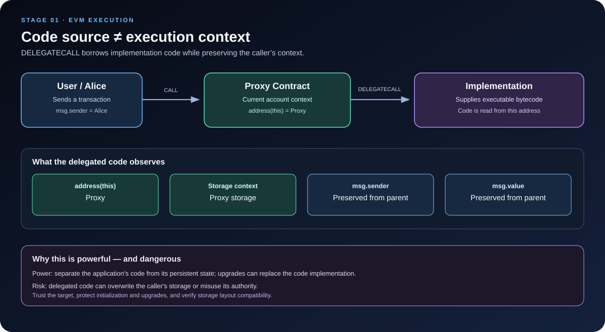

# EVM DELEGATECALL: Execute External Code in the Caller’s Context

> **Stage:** 01 — EVM Execution  
> **Priority:** 1  
> **Status:** Reviewed  
> **Last reviewed:** 2026-10-17

## 1. What Is DELEGATECALL?

`DELEGATECALL` is an EVM opcode that executes code located at another address while keeping the **current caller’s execution context**. The target address supplies the code, but the calling contract supplies the account context in which that code runs.

This is different from an ordinary `CALL`. With `CALL`, execution switches to the target contract’s account context. With `DELEGATECALL`, code from the target runs as though it were part of the caller’s current execution context: storage reads and writes, the current account address, and the account balance refer to the caller. The current `msg.sender` and `msg.value` are preserved from the parent call context.

This behavior is a foundation of proxy contracts, upgradeable smart contracts, and some library-style code reuse. It is also a powerful security boundary: delegated code can operate on the caller’s state, so delegating to untrusted or incompatible code can compromise the calling contract.

## 2. How DELEGATECALL Works

The easiest way to understand the opcode is to separate two questions:

1. **Where does the code come from?** The address supplied to `DELEGATECALL` identifies the account whose code is executed.
2. **Whose context is used?** The current calling contract's account context is retained.

For example, imagine Alice sends a transaction to a proxy contract, and the proxy delegates the input to an implementation contract. If the implementation code reads a state variable or writes to a storage slot, it accesses the proxy's storage. If it evaluates `address(this)`, it gets the proxy address. Assuming Alice called the proxy directly, the delegated implementation sees Alice as `msg.sender`; it also sees the `msg.value` associated with the call that entered the proxy.

The implementation is supplying instructions—not the address context or storage database.

### Context in a proxy call

| Expression inside delegated implementation code | Typical result |
|---|---|
| `address(this)` | Proxy address |
| `msg.sender` | Sender seen by the proxy's current call frame |
| `msg.value` | Value attached to the proxy's current call frame |
| `address(this).balance` | Proxy's ETH balance |
| `SLOAD` / `SSTORE` | Read/write the proxy's storage |
| Executed bytecode | Code loaded from the implementation address |

The result depends on the call chain. If another contract calls the proxy, then the immediate caller inside the delegated implementation will normally be that other contract—not necessarily the end user. Context values must always be reasoned about from the active call frame.

## 3. The DELEGATECALL Opcode Parameters

The EVM `DELEGATECALL` instruction uses six stack parameters:

| Parameter | Meaning |
|---|---|
| Gas | Gas requested for the child execution, subject to the active protocol rules |
| Target address | Account whose bytecode will be executed |
| Input memory offset | Byte offset in the caller’s memory where input data begins |
| Input memory length | Number of input bytes |
| Output memory offset | Byte offset in the caller’s memory where output should be copied |
| Output memory length | Maximum number of return-data bytes to copy into that output region |

Notice what is **not** in this list: there is no ETH value parameter. Unlike `CALL`, the opcode does not initiate a new value transfer. Instead, `msg.value` is preserved from the current call context.

The input is a slice of the caller's **memory**. `DELEGATECALL` does not magically forward the caller's original calldata by itself. A proxy usually copies the incoming calldata into memory and passes that memory range to the opcode. The return data is then copied or returned to the original caller according to the proxy's code.

As with `CALL`, the output memory length is a copy limit rather than a guarantee about total return-data length. The full return-data buffer can be inspected with `RETURNDATASIZE` and copied using `RETURNDATACOPY`.

## 4. DELEGATECALL vs CALL

These two opcodes both execute code at another address, but the context rules are different.

| Property | `CALL` | `DELEGATECALL` |
|---|---|---|
| Code source | Target address | Target address |
| Current account context | Changes to target | Preserves caller's context |
| `address(this)` | Target account | Calling context's account |
| Storage access | Target account's storage | Caller account's storage |
| `msg.sender` | The calling contract in the child frame | Preserved from the parent context |
| `msg.value` | Value explicitly supplied to this call | Preserved from the parent context |
| ETH transfer started by this opcode | Possible | No value parameter; no new value transfer |
| Common use | Ordinary contract interaction | Proxy dispatch and delegated code reuse |

### Example call chain

Suppose Alice calls `Proxy`, and the proxy then uses `DELEGATECALL` to execute `Implementation`:

~~~text
Alice --CALL--> Proxy --DELEGATECALL--> Implementation code

Inside implementation code:
    address(this) = Proxy
    msg.sender    = Alice       (if Alice directly called Proxy)
    msg.value     = value sent to Proxy
    storage       = Proxy storage
    code source   = Implementation
~~~

If Alice instead calls Contract A, and Contract A calls the proxy, then `msg.sender` inside the delegated code is normally Contract A. The transaction origin does not make every nested call's `msg.sender` equal to Alice.

## 5. A Minimal Proxy Example

The following example illustrates the context behavior. It is **educational code, not a production-ready proxy**: it intentionally omits the access-control, initialization, code-validation, upgrade, and other design concerns that a real proxy system requires.

~~~solidity
// SPDX-License-Identifier: MIT
pragma solidity ^0.8.24;

contract Logic {
    uint256 public count;

    function increment() external payable {
        count += 1;
    }

    function context()
        external
        view
        returns (address current, address sender, uint256 value)
    {
        return (address(this), msg.sender, msg.value);
    }
}

contract ExampleProxy {
    // Immutable: this demonstration proxy does not support upgrades.
    address private immutable _implementation;

    constructor(address implementation_) {
        _implementation = implementation_;
    }

    fallback() external payable {
        _delegate();
    }

    receive() external payable {
        _delegate();
    }

    function _delegate() private {
        address implementation_ = _implementation;

        assembly {
            calldatacopy(0, 0, calldatasize())

            let success := delegatecall(
                gas(),
                implementation_,
                0,
                calldatasize(),
                0,
                0
            )

            let size := returndatasize()
            returndatacopy(0, 0, size)

            switch success
            case 0 { revert(0, size) }
            default { return(0, size) }
        }
    }
}
~~~

### What happens when increment is called through the proxy?

1. A user sends a transaction to `ExampleProxy` using the calldata for `increment()`.
2. The proxy fallback copies the incoming calldata into memory.
3. The proxy executes `DELEGATECALL` using the implementation's address and that memory range.
4. The implementation's `increment()` logic executes in the proxy's storage context, so its `count` slot is updated in the proxy.
5. The proxy copies the return data and returns or reverts according to the delegated call's result.

Because this demonstration uses an immutable implementation address, it does not provide upgrade functionality. It also has no initializer flow or access controls. Do not deploy it to handle real assets as-is.

### What if the implementation is called directly?

If a user calls the `Logic` contract itself, then `address(this)` is the implementation contract and `count` reads or writes the implementation's own storage.

If the user calls the proxy, the same implementation bytecode operates on the proxy's storage instead. These are separate storage accounts even though the code is the same.

## 6. Why Proxies Use DELEGATECALL

A proxy pattern separates an application's state from its logic:

- **Proxy:** the stable address users interact with; it owns the persistent state.
- **Implementation:** contains the logic executed for the proxy's callers.
- **Delegated execution:** the proxy passes input to the implementation using `DELEGATECALL` and returns the output to the original caller.

For an upgradeable proxy, changing the implementation address can change which code executes while leaving the proxy address and stored application state in place. This is useful, but it introduces a strict compatibility requirement: new implementation code must interpret the proxy's existing storage correctly.

A common pattern is to keep the implementation address in a designated, collision-resistant storage slot rather than an ordinary variable that might conflict with the implementation's own storage layout. The details depend on the proxy standard in use; ERC-1967 is one widely used specification for proxy implementation and administration slots.

Delegated execution is also used by library mechanisms and modular systems. In every case, the essential property is the same: the target supplies code, but the caller's context supplies the state and identity under which that code runs.

## 7. Security Risks

`DELEGATECALL` is powerful because delegated code can act with the authority of the calling contract. This makes control over the target code and its storage assumptions crucial.

### 7.1 Untrusted target / arbitrary delegatecall

If a contract lets an untrusted user choose the address used for `DELEGATECALL`, the user may cause arbitrary code to execute in the caller's context. The delegated code may overwrite important storage slots, alter access-control variables, or move assets controlled by that contract.

**Rule of thumb:** do not let untrusted input choose arbitrary delegated code unless the entire architecture is deliberately designed and audited for that threat model.

### 7.2 Storage collisions

The implementation's code assumes particular meanings for storage slots. If proxy-specific variables occupy the same slots, delegated logic might read or overwrite them unexpectedly.

For example, if the proxy stores its implementation address in slot 0 but the implementation expects slot 0 to contain `count`, writing a new count could corrupt the implementation pointer. Real proxy designs use established patterns such as ERC-1967 slots and apply storage-compatibility checks to upgrades.

### 7.3 Incorrect assumptions about the caller

The implementation must not assume that `msg.sender` is always the proxy or always the end user. Under delegated execution it is preserved from the current parent context. With a user calling the proxy directly, it is typically the user; through a router or another contract, it can be that intermediate contract.

Authorization checks that do not account for the real call path can grant or deny permissions incorrectly.

### 7.4 Initialization and upgrade authorization

Proxy deployments typically do not run the implementation's constructor against proxy storage. State required by the proxy instance normally needs a properly protected initializer or equivalent initialization flow. If initialization can be repeated or seized by an unauthorized account, the proxy may be taken over.

For upgradeable systems, the mechanism that changes the implementation pointer must also be strongly access-controlled and correctly validated.

### 7.5 Reentrancy and shared state

`DELEGATECALL` itself is not synonymous with reentrancy, but delegated code can make further external calls and share the proxy's state context. As with other external interactions, analyze control flow, state updates, and callback paths. Use appropriate checks-effects-interactions ordering and other protections where needed.

### 7.6 Static context is still restrictive

If execution is already in a static context, a delegated call does not remove the restriction. State-changing operations remain prohibited in that call tree. The fact that the target code is executing in the caller's context does not grant permission to modify state in a static execution.

## 8. Return Data and Failure Handling

Like `CALL`, `DELEGATECALL` pushes a success status onto the stack:

- `1` indicates successful child execution.
- `0` indicates failure.

The output bytes are exposed through the return-data mechanism. A proxy often returns the delegated output unchanged so the original caller receives the same return value—or revert payload—it would receive from the implementation logic.

In Solidity, a low-level call can be written as:

~~~solidity
(bool success, bytes memory returndata) = implementation.delegatecall(data);
~~~

This API returns the EVM-level success status and return data. It does not automatically guarantee that the returned value is what the application expected. If the delegated call fails, the caller should handle the failure deliberately, often by bubbling the revert data in proxy code.

Do not confuse a successful delegatecall with a secure operation. It only tells you the delegated execution completed without an EVM-level failure; it does not verify that the target was trustworthy, that storage was compatible, or that business rules were enforced correctly.

## 9. Gas and Call Depth

The opcode specifies a gas amount, target address, input memory range, and output memory range. The actual amount the child can consume follows the active EVM call-gas rules, including relevant overhead and forwarding limits. Unlike a value-bearing `CALL`, `DELEGATECALL` has no value parameter and does not receive the value-transfer stipend associated with value-bearing calls.

The delegated execution still consumes gas for its instructions, storage operations, memory expansion, and any nested calls. It also creates another call frame, so normal call-depth limits apply.

Avoid hardcoding gas assumptions when building low-level integrations. The correct behavior depends on the fork rules, the input and storage paths, and the code that ultimately executes.

## 10. Practical Debugging Checklist

When debugging a delegated call, ask:

1. **Code address:** Which account supplies the bytecode being executed?
2. **Context address:** What is `address(this)` in the delegated code?
3. **Storage:** Which account's slots do `SLOAD` and `SSTORE` access?
4. **Sender and value:** What are the current `msg.sender` and `msg.value` in the parent context?
5. **Input data:** Which bytes did the caller copy into memory and pass to the delegatecall?
6. **Return data:** Does the caller propagate successful output and revert data correctly?
7. **Target trust:** Who controls the implementation address, and can an attacker change or influence it?
8. **Storage layout:** Do the proxy and implementation agree on the storage layout and reserved slots?
9. **Initialization:** Can an unauthorized party initialize or reinitialize the proxy?
10. **State safety:** Could delegated code corrupt critical state, bypass authorization, or enter a dangerous callback path?

For proxy code, record the **code address** and **context address** separately in your trace. That simple habit helps prevent one of the most common misunderstandings around `DELEGATECALL`.

## Key Takeaways

- `DELEGATECALL` executes code from another address while retaining the caller's account context.
- Storage operations, `address(this)`, and the relevant balance refer to the calling context; `msg.sender` and `msg.value` are preserved from the parent scope.
- The opcode has six parameters and no value-transfer parameter.
- A proxy typically copies calldata to memory, delegates to implementation code, and returns or reverts with the delegated result.
- This enables state/code separation and upgradeable designs, but makes storage layout, target validation, initialization, and access control critical.
- Do not allow arbitrary untrusted delegatecall targets without a carefully designed threat model and security review.

## References

1. [EIP-7: DELEGATECALL](https://eips.ethereum.org/EIPS/eip-7) — motivation, six stack operands, and sender/value propagation.
2. [Opcodes for the EVM — ethereum.org](https://ethereum.org/developers/docs/evm/opcodes/) — opcode parameters and effects.
3. [Solidity: Types and Data Location / low-level calls](https://docs.soliditylang.org/en/latest/types.html) — semantics of `delegatecall` and its return values.
4. [Solidity: Security Considerations](https://docs.solidity.org/en/latest/security-considerations.html) — delegated-call authorization risks and other security pitfalls.
5. [OpenZeppelin: Proxy API](https://docs.openzeppelin.com/contracts/5.x/api/proxy) — proxy mechanics, ERC-1967 slots, and upgradeable proxy patterns.
6. [OpenZeppelin: Upgrading Smart Contracts](https://docs.openzeppelin.com/contracts/5.x/learn/upgrading-smart-contracts) — state/code separation and upgrade model.
