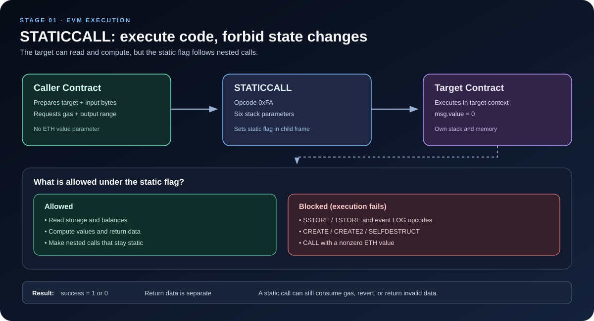

# EVM STATICCALL: External Calls Under a Read-Only Restriction

> **Stage:** 01 — EVM Execution  
> **Priority:** 1  
> **Status:** Reviewed  
> **Last reviewed:** 2026-10-17

## 1. What Is STATICCALL?

<code>STATICCALL</code> is an EVM opcode used to call another account while enforcing a **static, read-only execution context**. The target can execute code and read blockchain state, but EVM state-changing operations are prohibited in that call and its nested calls.

The opcode was introduced by [EIP-214](https://eips.ethereum.org/EIPS/eip-214). Its core purpose is to let a caller request execution that cannot alter Ethereum state through normal EVM state-changing instructions. If code attempts a prohibited operation, that execution fails rather than applying the change.

For developers, <code>STATICCALL</code> is especially important for read-only contract interactions, view-style queries, and understanding how Solidity enforces state mutability at runtime.

A crucial distinction: **STATICCALL does not mean “run a function that someone claims is read-only.”** It activates an EVM-level restriction. The EVM does not trust the target's function name or Solidity declaration; it enforces the restriction on the execution path itself.

## 2. How STATICCALL Works

A <code>STATICCALL</code> starts a new message-call frame for the target account. The target normally runs in its own account context:

- <code>address(this)</code> refers to the target account;
- <code>msg.sender</code> is the calling contract;
- <code>msg.value</code> is zero, because STATICCALL has no value-transfer parameter;
- the target receives the input bytes prepared by the caller;
- state-changing EVM operations are forbidden throughout the static call tree.

If the target attempts a prohibited state change, that execution frame fails. The caller receives a failure status and can inspect any returned revert data. The caller is not forced to revert just because a low-level staticcall failed; it must handle the returned status appropriately.

The static restriction is inherited by subcalls. A target cannot evade the restriction merely by using a normal <code>CALL</code> to invoke another contract. That nested call remains within the static call tree, and state-changing operations are still forbidden.

### What STATICCALL does and does not guarantee

| It guarantees | It does not guarantee |
|---|---|
| The static call tree cannot successfully perform prohibited EVM state changes. | The returned data is correct, valid ABI data, or meaningful to the caller. |
| Attempts at prohibited state-changing operations fail. | The target is trustworthy or free of bugs. |
| The call has no ETH value-transfer parameter. | The call cannot revert, consume gas, or deliberately return misleading data. |
| Nested calls inherit the static restriction. | The function reads no state or is deterministic like a mathematical pure function. |

A static call can read storage and environmental values. The result can therefore depend on the current blockchain state, block context, or other permitted inputs. **Read-only is not the same as pure or deterministic.**

## 3. The Six STATICCALL Parameters

The EVM <code>STATICCALL</code> opcode (<code>0xfa</code>) consumes six stack parameters:

| Parameter | Meaning |
|---|---|
| Gas | Gas requested for the child execution, subject to applicable call-gas rules |
| Target address | Account whose code and context will be used |
| Input memory offset | Byte offset in the caller's memory where input data begins |
| Input memory length | Number of input bytes to pass to the child |
| Output memory offset | Byte offset in caller memory where return data may be copied |
| Output memory length | Maximum number of return-data bytes to copy into that region |

Compared with <code>CALL</code>, the **value parameter is absent**. The callee receives <code>msg.value == 0</code> for the static call.

The input and output buffers are in the caller's memory. The target receives its own execution frame and memory; the caller and target do not share the same memory area. As with other call opcodes, output memory length is a copy limit, not necessarily the total return-data size. The caller can use <code>RETURNDATASIZE</code> and <code>RETURNDATACOPY</code> to inspect and copy the most recent call's return data.

The opcode produces a success word on the caller's stack: <code>1</code> on success and <code>0</code> on failure. Return data is handled separately.

## 4. What Is Forbidden in a Static Context?

EIP-214 introduced a static flag in the EVM execution environment. When the flag is active, instructions that would modify state fail rather than making the change.

Important examples include:

- <code>SSTORE</code> — writing persistent storage;
- <code>TSTORE</code> — writing transient storage;
- <code>CREATE</code> and <code>CREATE2</code> — creating a contract;
- <code>LOG0</code> through <code>LOG4</code> — emitting event logs;
- <code>SELFDESTRUCT</code>;
- <code>CALL</code> with a nonzero ETH value.

This list highlights common cases rather than replacing the relevant execution specification. The active protocol rules define the exact behavior, including how exceptional execution propagates through nested calls.

Reading storage with <code>SLOAD</code>, checking balances, and computing values are allowed in a static context. A contract can return values based on its current state; it simply cannot successfully commit state changes through the prohibited operations while the static flag is active.

### Example: a write attempted during STATICCALL

Imagine a target contract has a function that tries to increment a counter. If a caller reaches that code under a static context, its <code>SSTORE</code> operation fails. The attempted state change does not take effect.

The caller may receive failure from the low-level static call. It should not assume the function worked merely because the target address exists or because the call returned some bytes.

## 5. STATICCALL in Solidity

Solidity's <code>view</code> and <code>pure</code> declarations express source-level restrictions. For EVM targets that support <code>STATICCALL</code> (Byzantium and later), the compiler uses static calls for ordinary external calls to <code>view</code> functions. This supplies a runtime restriction as well as the compiler's checks.

A <code>view</code> function may read state but must not modify it. A <code>pure</code> function is more restrictive at the Solidity level and promises not to read or modify contract or blockchain state, subject to Solidity's language rules.

Example:

~~~solidity
// SPDX-License-Identifier: MIT
pragma solidity ^0.8.24;

contract PriceSource {
    uint256 private price = 125;

    function getPrice() external view returns (uint256) {
        return price;
    }
}

contract PriceReader {
    function readPrice(address source) external view returns (uint256) {
        return PriceSource(source).getPrice();
    }

    function readPriceLowLevel(address source)
        external
        view
        returns (bool success, bytes memory returndata)
    {
        bytes memory input = abi.encodeWithSignature("getPrice()");
        (success, returndata) = source.staticcall(input);
    }
}
~~~

The typed call to <code>getPrice()</code> expresses the interface and return type at the Solidity level. The low-level <code>staticcall</code> passes a raw byte sequence and returns a Boolean status plus untyped return bytes.

With a low-level staticcall, the caller is responsible for validating and decoding returned bytes if it needs a particular type. A successful call does not prove the target implements the expected interface: a call to an account with no code may return success with empty return data, depending on the target and execution path. Production integrations should validate target assumptions and handle decoding failures.

### A limitation for library view functions

Solidity documentation notes a special case: library <code>view</code> functions use <code>DELEGATECALL</code> because the EVM has no opcode combining the context-preserving behavior of <code>DELEGATECALL</code> with the static restriction of <code>STATICCALL</code>. Such calls do not get the same EVM runtime static flag from the opcode itself; Solidity relies on its compile-time restrictions for the library code. This is a reason to understand both the source language and the actual call opcode when analyzing a trace.

## 6. STATICCALL vs CALL vs DELEGATECALL

| Property | <code>CALL</code> | <code>STATICCALL</code> | <code>DELEGATECALL</code> |
|---|---|---|---|
| Primary purpose | Ordinary message call | Message call under static restriction | Execute other code in caller context |
| Code source | Target address | Target address | Target address |
| Account context | Target account | Target account | Calling context |
| Storage context | Target storage | Target storage | Calling context's storage |
| <code>msg.sender</code> in child | Calling contract | Calling contract | Preserved from parent context |
| <code>msg.value</code> in child | Value supplied to call | Zero | Preserved from parent context |
| State changes | Allowed if other rules permit | Prohibited in the static call tree | Allowed if other rules permit |
| Value-transfer parameter | Yes | No | No |

Use <code>STATICCALL</code> when reading state from another contract under an EVM-enforced no-state-change restriction. Use <code>CALL</code> for regular contract interactions that may change state or transfer ETH. Use <code>DELEGATECALL</code> only when executing another account's code in the current context is intended, as in proxy designs.

The choice is not merely about function naming: the call opcode determines runtime context and restrictions.

## 7. STATICCALL and Security

Static execution is a valuable safety property, but it should not be mistaken for complete application security.

### 7.1 Read-only calls can still return untrusted data

A malicious or incorrect contract can return a misleading number, invalidly encoded bytes, or data inconsistent with the interface your application expects. The fact that the call was static means the EVM prevented state changes; it does not mean that the output is honest.

When consuming return data, validate it against your protocol's assumptions. For low-level calls, check the success flag and decode the bytes deliberately.

### 7.2 A static call can still fail

A target can run out of gas, revert, encounter invalid execution, or return data that cannot be decoded by the caller. A robust integration should define how such failures are handled instead of assuming every view-style call succeeds.

### 7.3 Static execution is not the same as no external code execution

The target still executes code. It may make nested calls, and those calls may read state and consume gas. The static flag propagates, so they cannot successfully perform prohibited EVM state changes, but the path can still be complex or expensive.

### 7.4 STATICCALL is not a complete reentrancy defense

The static restriction blocks state-changing operations throughout its call tree, which can prevent a callback from modifying state during that static execution. However, do not treat the mere existence of a static call somewhere in an application as a general reentrancy defense. Other non-static external calls may still be reentrant, and callers must reason about control flow, shared state, and the whole transaction.

### 7.5 View and pure are language declarations, not security proofs

A function marked <code>view</code> may read state, and its output may change as state changes. A <code>pure</code> declaration is stricter, but neither keyword is a substitute for understanding the compiled call mechanism, validating results, and reviewing the complete application design.

## 8. STATICCALL vs eth_call

These names are related but describe different layers:

- **EVM <code>STATICCALL</code>:** an opcode executed by the EVM that creates a child execution with the static flag enabled.
- **JSON-RPC <code>eth_call</code>:** an RPC method a client exposes to execute a message call as a simulation without submitting a transaction to the blockchain.

A user or application can use <code>eth_call</code> to query a contract without publishing a transaction. During that simulation, the EVM may execute the target code using normal message-call semantics; whether nested contract calls use <code>CALL</code>, <code>STATICCALL</code>, or another opcode depends on the compiled code and call path.

Therefore, <code>eth_call</code> is not simply another name for the <code>STATICCALL</code> opcode. One is a JSON-RPC request for simulated execution; the other is an EVM instruction with a runtime state-change restriction.

This distinction matters when debugging an application: a function can be queried through <code>eth_call</code> even if the actual code path would perform a normal state-changing call when invoked through a transaction. The RPC simulation does not publish those simulated state changes.

## 9. Gas and Performance Considerations

<code>STATICCALL</code> still consumes gas. Its cost can depend on call overhead, target-account access, memory expansion for input/output buffers, the amount of gas forwarded, and the target's execution.

Important implications:

- A read-only call is not free simply because it cannot write state.
- Copying large input or return-data buffers can increase the gas used by the caller.
- A target can perform expensive computation or make many nested calls while remaining within the static restriction.
- Account warm/cold access rules and gas-forwarding behavior depend on the active protocol rules.
- An off-chain <code>eth_call</code> does not require a user to pay an on-chain transaction fee in the same way as submitting a transaction, but the node still performs work and may enforce RPC-specific resource limits.

Avoid quoting one universal gas value for <code>STATICCALL</code>. Use a current opcode reference and the applicable fork's execution rules for exact costs.

## 10. Practical Debugging Checklist

When reviewing a <code>STATICCALL</code> trace, ask:

1. **Target:** Is the target address correct, and is contract code expected there?
2. **Input:** Are the input bytes and ABI encoding correct?
3. **Context:** What should <code>address(this)</code> and <code>msg.sender</code> be inside the target?
4. **Static restriction:** Does the target or any nested call attempt a prohibited operation?
5. **Result:** Did the opcode push success (<code>1</code>) or failure (<code>0</code>)?
6. **Return data:** Is the returned data present, correctly encoded, and safely decoded?
7. **Gas:** Could the target's work, account accesses, or data copying explain the gas usage or failure?
8. **RPC versus EVM:** Are you looking at a node's <code>eth_call</code> simulation or an actual <code>STATICCALL</code> opcode in a trace?

These questions separate EVM guarantees from application assumptions and make read-only integration failures easier to diagnose.

## Key Takeaways

- <code>STATICCALL</code> (<code>0xfa</code>) calls an account under an EVM-enforced static restriction.
- It consumes six stack parameters; unlike <code>CALL</code>, it has no value-transfer parameter, and the callee sees <code>msg.value == 0</code>.
- Prohibited operations such as persistent or transient storage writes, event logs, contract creation, and nonzero-value calls fail in a static call tree.
- Static calls may read state, execute code, consume gas, revert, and return untrusted or malformed data.
- Solidity commonly uses <code>STATICCALL</code> for external <code>view</code> calls on EVM targets that support it, with a documented exception for library view calls.
- EVM <code>STATICCALL</code> is different from the JSON-RPC <code>eth_call</code> method.
- Read-only execution is a useful guarantee, not a substitute for input validation, return-data validation, and broader security review.

## References

1. [EIP-214: New opcode STATICCALL](https://eips.ethereum.org/EIPS/eip-214) — the static flag, opcode parameters, and state-change restrictions.
2. [Opcodes for the EVM — ethereum.org](https://ethereum.org/developers/docs/evm/opcodes/) — opcode value and stack behavior.
3. [Solidity: Contracts — State Mutability](https://docs.solidity.org/en/latest/contracts.html#state-mutability) — <code>view</code> and runtime use of <code>STATICCALL</code>.
4. [Solidity: Types and Low-Level Calls](https://docs.solidity.org/en/latest/types.html) — staticcall interface and return values.
5. [Ethereum JSON-RPC API](https://ethereum.org/developers/docs/apis/json-rpc/#eth_call) — the separate <code>eth_call</code> RPC method.
6. [EIP-1153: Transient storage opcodes](https://eips.ethereum.org/EIPS/eip-1153) — static-context restrictions for transient storage.
7. [EVM Codes](https://www.evm.codes/) — interactive opcode reference and fork-sensitive gas details.
