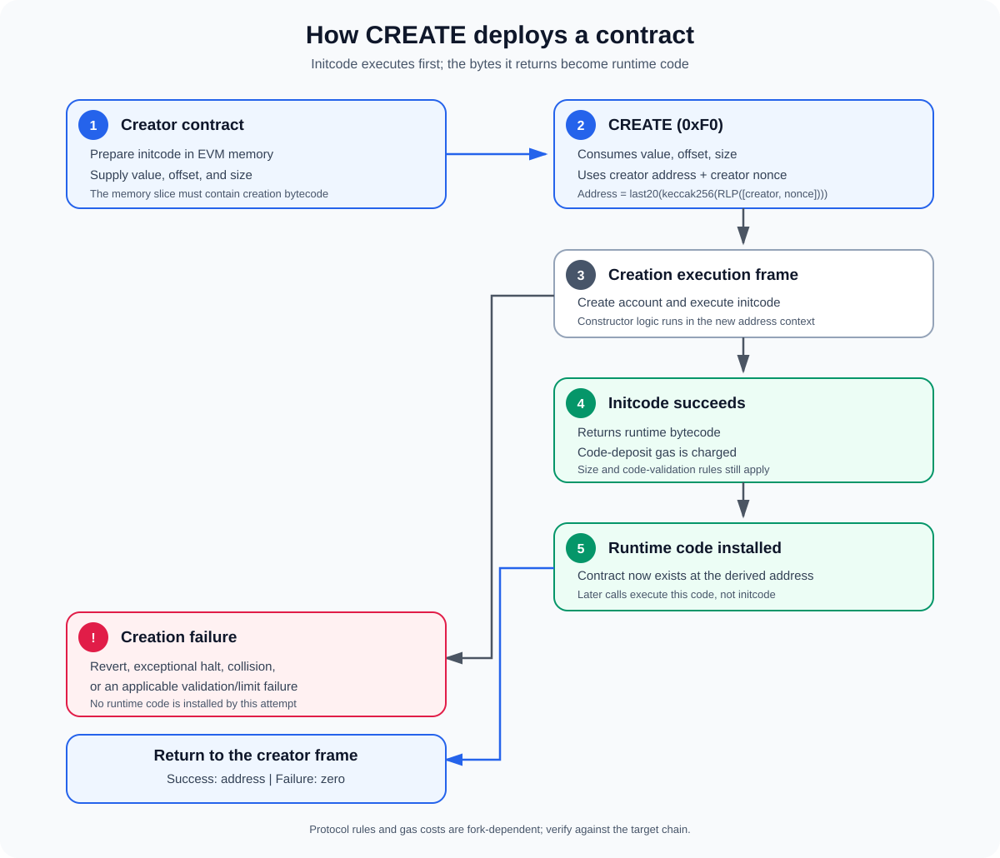

# CREATE Opcode — Contract Creation Inside the EVM

**Stage:** 01 — EVM Execution  
**Priority:** 1  
**Topic:** Contract creation from an executing contract  
**Last reviewed:** 2026-10-17

## 1. What is CREATE?

`CREATE` is an EVM opcode that lets a contract deploy another contract during execution. Rather than sending a separate top-level contract-creation transaction, a contract can execute `CREATE` to create a new account, run that account's initialization code, and install the runtime bytecode returned by that initialization.

The opcode is used by Solidity's ordinary contract-creation path, such as `new Child(...)`, unless a different deployment mechanism such as `CREATE2` is selected.

**The key distinction:** `CREATE` does not take already-deployed runtime bytecode and simply save it. It executes **initcode** first. That code performs constructor-time work and returns the **runtime bytecode** that will live at the new address.

## 2. Mental model

A factory contract can deploy a child contract roughly as follows:

1. The factory prepares the child's initcode in EVM memory.
2. It executes `CREATE` with the ETH value, memory offset, and initcode size.
3. The EVM derives the new address from the creating account and its nonce.
4. Initcode runs in the new contract's creation context.
5. If initcode succeeds and returns valid runtime bytecode, the EVM charges the code-deposit cost and installs that code.
6. The creating frame receives the new address on its stack. If creation fails, the opcode pushes the zero address value instead.

This sequence is useful when reading Solidity compiler output, debugging factories, estimating deployment gas, and reasoning about proxy-based deployment.

## 3. Opcode inputs and output

The opcode byte is `0xF0`.

| Item | Meaning |
|---|---|
| `value` | Amount of ETH, in wei, to endow the new contract with |
| `offset` | Byte offset in the current frame's memory where initcode begins |
| `size` | Length of the initcode in bytes |
| Result | The created contract address, or zero if creation fails |

Conceptually, its Yul form is:

~~~solidity
create(value, offset, size)
~~~

The offset and size refer to **memory**, not calldata and not the creator's deployed runtime code. The EVM expands memory if necessary, and memory expansion can add gas.

## 4. The deployment pipeline

### Step 1 — Prepare initcode in memory

The caller must make the initialization bytecode available in memory. In Solidity, the compiler typically packages constructor logic and the code needed to return runtime bytecode into the initcode. When using low-level assembly, the caller is responsible for passing the correct memory slice.

Passing runtime bytecode where initcode is expected is a common conceptual mistake: the initcode must execute and return the runtime code to install.

### Step 2 — Derive the address

For the traditional `CREATE` opcode, the address is derived from the creating account's address and its nonce:

~~~text
address = last20Bytes(keccak256(RLP([creator_address, creator_nonce])))
~~~

Here, `creator_nonce` is the nonce used for this creation in the address derivation. It is not a salt and it is not a hash of the initcode.

This has several consequences:

- The same creator and the same consumed nonce produce the same address on a given chain state.
- Changing the creator or its nonce changes the derived address.
- The initcode is **not** an input to the `CREATE` address formula.
- Creation can fail if the derived address already has a nonzero nonce or non-empty code, as specified by the account-collision rule.

The nonce is part of the creator's account state, so deployment order matters. A factory's previous creations can affect the addresses of later creations.

### Step 3 — Create the account and run initcode

The EVM creates the account and executes the supplied initcode in a new execution frame. The new frame has the new contract address as its execution address; the creator is the message caller, and the supplied value becomes the creation call's `msg.value`.

The initcode can perform constructor logic, initialize storage, inspect constructor arguments embedded in the deployment data, and return the bytes intended to become the contract's runtime code.

The account's nonce initialization follows the active protocol rules. Under EIP-161's state-clearing rules, a newly created contract account's nonce is set to one before its initcode executes. This matters to state semantics and is separate from the creator nonce used to derive the address.

### Step 4 — Install runtime bytecode

If initcode finishes successfully, its returned bytes are treated as the proposed runtime bytecode. The EVM charges code-deposit gas and installs that code at the new address, subject to the active protocol's code-validation and size rules.

After deployment, ordinary calls execute the installed runtime bytecode—not the original initcode. Constructor logic does not run again on later calls.

### Step 5 — Return to the creator

On success, `CREATE` pushes the new address as a 160-bit address represented on the EVM stack. A Solidity expression such as `new Child()` generally converts this successful result into a typed contract reference.

On failure, `CREATE` pushes zero. Depending on the failure path, return/revert data may also be available through the EVM return-data buffer. The caller can check the result and decide whether to continue, handle the failure, or revert its own frame.

## 5. A minimal Yul example

The following example assumes `initCode` is a Solidity `bytes memory` variable containing valid creation bytecode, including any constructor arguments required by that bytecode.

~~~solidity
assembly {
    let deployed := create(
        0,
        add(initCode, 0x20),
        mload(initCode)
    )

    if iszero(deployed) {
        revert(0, 0)
    }
}
~~~

Why these arguments?

- `0` sends no ETH to the newly created contract.
- A dynamic `bytes memory` value stores its length in the first 32-byte word, so `add(initCode, 0x20)` points to the first byte of its contents.
- `mload(initCode)` reads the byte length.
- The result is checked because creation failure is represented by zero.

This is a low-level illustration, not a complete factory. Production code should validate how initcode is sourced, how constructor arguments are encoded, what happens on failure, and whether the resulting address/code matches the intended deployment.

## 6. Gas and protocol limits

Contract creation can be expensive because the EVM must execute initcode, create account state, expand memory as needed, and pay to store the resulting runtime code.

Important cost and limit considerations include:

- **Base creation cost:** `CREATE` has a base cost of 32,000 gas under the widely used EVM gas schedule; the total cost is higher once memory expansion, initcode execution, value transfer, and code deposit are included.
- **Initcode metering:** EIP-3860 adds a charge of 2 gas per 32-byte initcode word (rounded up) and limits initcode to 49,152 bytes for creation transactions and `CREATE`/`CREATE2` execution.
- **Runtime-code size:** EIP-170 limits deployed runtime code to 24,576 bytes.
- **Code deposit:** returning runtime bytes costs gas to deposit the code; the commonly specified code-deposit rate is 200 gas per byte.
- **Forwarded execution gas:** the child creation frame does not receive unlimited gas. Gas forwarding follows the applicable call-gas rules, including EIP-150's 63/64 rule.
- **Failure consumes gas:** a failed creation can still consume substantial gas. The exact remaining gas depends on where and why the operation fails.

Limits and gas rules are protocol-version dependent, so a gas estimate should be checked against the fork and chain that will execute the deployment.

## 7. CREATE vs. CREATE2 vs. a creation transaction

| Mechanism | Who initiates creation? | Address basis | Where initcode comes from |
|---|---|---|---|
| Contract-creation transaction | An externally originated transaction | Sender address + sender nonce | Transaction data |
| `CREATE` opcode | An executing contract | Creator address + creator nonce | Memory slice in the current EVM frame |
| `CREATE2` opcode | An executing contract | Creator address + salt + hash of initcode | Memory slice in the current EVM frame |

A contract-creation transaction and the `CREATE` opcode both result in contract creation, but they enter through different paths. A top-level creation transaction does not execute the `CREATE` opcode inside an already-running contract frame.

`CREATE2` exists for address derivation that can be predicted from a creator, a salt, and initcode hash. Read [EIP-1014](https://eips.ethereum.org/EIPS/eip-1014) for the exact formula and collision behavior. This article focuses on `CREATE`; deterministic deployment with `CREATE2` is a separate concept in the roadmap.

## 8. Important edge cases

### The initcode reverts

If initcode reverts, creation does not install the proposed runtime code, and the opcode returns zero to the creator frame. The caller may inspect revert data or explicitly revert its own execution.

### Initcode runs out of gas or halts exceptionally

Creation fails if initcode cannot complete successfully, including cases such as out-of-gas or an exceptional halt. Gas already spent is not generally refunded merely because deployment failed.

### The returned runtime code is invalid for the active rules

Even successfully executed initcode may fail to deploy if the returned runtime code violates applicable validation or size constraints. For example, EIP-170 introduced the runtime-code size limit, and EIP-3541 rejects deployed code beginning with byte `0xEF` under its specified rules.

### The creator executes through DELEGATECALL

The code being executed does not by itself determine the creator address. Because `DELEGATECALL` preserves the caller's execution context, a `CREATE` executed in delegated code creates from the current context account (for example, the proxy), rather than from the address where the implementation bytecode is stored. That can affect address derivation and deployment authority.

### The caller ignores the returned address

Low-level creation returns zero on failure. Factory code that assumes a deployment always succeeds can store or emit a wrong value, or proceed into an invalid state. Check the result and define the failure policy explicitly.

## 9. Common misconceptions

- **“CREATE stores the bytes I pass to it.”** It executes initcode and installs the runtime bytes returned by that code.
- **“The new address depends on the initcode.”** Not for `CREATE`; its formula uses the creator and nonce. `CREATE2` incorporates a salt and the initcode hash.
- **“The constructor is the runtime code.”** Constructor/initcode runs during creation; the returned runtime bytecode is what remains deployed.
- **“A failed CREATE always reverts the whole transaction.”** The opcode can return zero to its caller. The entire transaction reverts only if the failure propagates into a reverting top-level execution.
- **“CREATE's total gas is always 32,000.”** That is only the base creation cost, not the total gas for deploying a contract.

## 10. Developer checklist

Before relying on a `CREATE` path, be able to answer these questions:

- Where is initcode stored, and what exact offset and length are passed?
- How are constructor arguments encoded into the initcode?
- Which account is the creator in the current execution context?
- Can the derived address collide with an existing account?
- What is the expected runtime bytecode, and does it satisfy active size/validation rules?
- Is the full deployment cost accounted for, including initcode execution and code deposit?
- Does the caller handle a zero result and any relevant revert data?
- Are the chain and protocol fork assumptions explicit?

## References

1. [Ethereum.org — EVM Opcodes](https://ethereum.org/developers/docs/evm/opcodes/) — opcode reference and CREATE address derivation.
2. [Ethereum Execution Layer Specifications](https://github.com/ethereum/execution-specs) — executable protocol specifications and fork-specific behavior.
3. [EIP-161 — State trie clearing](https://eips.ethereum.org/EIPS/eip-161) — nonce initialization for newly created contract accounts.
4. [EIP-170 — Contract code size limit](https://eips.ethereum.org/EIPS/eip-170) — maximum deployed runtime-code size.
5. [EIP-3541 — Reject new contract code starting with 0xEF](https://eips.ethereum.org/EIPS/eip-3541) — runtime-code prefix restriction.
6. [EIP-3860 — Limit and meter initcode](https://eips.ethereum.org/EIPS/eip-3860) — initcode size and metering rules.
7. [EIP-1014 — Skinny CREATE2](https://eips.ethereum.org/EIPS/eip-1014) — contrast with deterministic CREATE2 address derivation.

---

**Next concept:** [CREATE2](./08-create2.md) (article not published yet).
