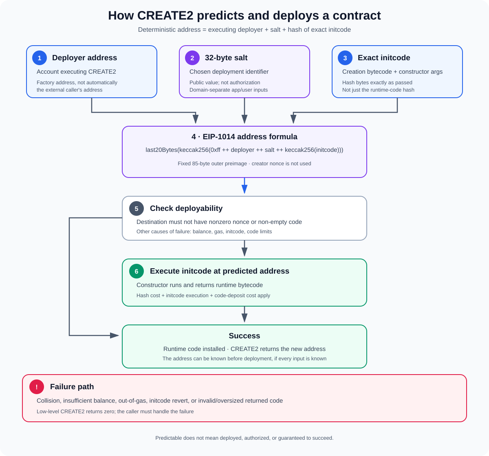

# CREATE2 Opcode — Deterministic Contract Deployment

**Stage:** 01 — EVM Execution  
**Priority:** 1  
**Status:** Reviewed  
**Topic:** Deterministic contract-address derivation  
**Last reviewed:** 2026-10-17

## 1. What is CREATE2?

`CREATE2` is an EVM opcode that creates a contract at an address determined by three inputs: the address of the account executing the opcode, a 32-byte salt, and the hash of the exact initialization bytecode (initcode). It was introduced by [EIP-1014](https://eips.ethereum.org/EIPS/eip-1014).

The major difference from `CREATE` is address derivation. `CREATE` uses the creator's address and nonce; `CREATE2` does not use the creator nonce. If the deployer address, salt, and initcode bytes are known, the destination address can be calculated before the contract is deployed.

This property enables **deterministic deployment** and **counterfactual interactions**: software can calculate and reference the address of a contract that does not exist on-chain yet, then deploy it later at that same address if the required conditions are met.

`CREATE2` is not a different execution environment. After choosing the destination address, it largely follows the same contract-creation process as `CREATE`: it executes initcode, and the bytes returned by initcode become the deployed runtime code, subject to protocol rules and gas limits.

## 2. The address formula

EIP-1014 defines the destination address as the last 20 bytes of the Keccak-256 hash of a fixed-format preimage:

~~~text
address = last20Bytes(
    keccak256(
        0xff
        ++ deployer_address
        ++ salt
        ++ keccak256(initcode)
    )
)
~~~

The fields have exact sizes:

- `0xff` is a single prefix byte.
- `deployer_address` is the 20-byte address of the account executing `CREATE2`.
- `salt` is a 32-byte value popped from the EVM stack.
- `keccak256(initcode)` is a 32-byte hash of the exact initcode byte sequence.
- The outer Keccak-256 hash is computed over the 85-byte concatenation. Its rightmost 20 bytes are used as the address.

The exact byte encoding matters. The deployer address is not ABI-encoded as a 32-byte address inside this formula; the EIP specifies a packed sequence of fixed-size fields. The formula is not simply the hash of the salt or a hash of the runtime bytecode.

### Why the nonce does not matter

The creator's nonce is not an input to this formula. The same creator can create other contracts between prediction and deployment without changing the predicted address for the same salt and initcode. However, changing the creator account changes the address, and changing the salt or any byte of the initcode changes the hash input and therefore normally changes the resulting address.

This makes `CREATE2` useful for deployment systems where an address must be known in advance, but only when the factory/deployer address and the exact creation bytes are controlled.

## 3. What exactly is initcode?

Initcode is the bytecode executed during contract creation. It performs constructor-time work and returns the runtime bytecode to install at the new address.

In Solidity, the initcode hash commonly depends on both:

1. The compiler-generated creation bytecode for the contract.
2. The ABI-encoded constructor arguments appended to that bytecode.

For example, conceptually:

~~~solidity
bytes memory initCode = abi.encodePacked(
    type(Vault).creationCode,
    abi.encode(owner, asset)
);
~~~

If `owner` or `asset` changes the encoded constructor arguments, the initcode bytes change. That changes `keccak256(initcode)` and therefore the predicted address.

This is why a correct off-chain or on-chain address predictor must use the actual deployment initcode, including constructor parameters—not merely `type(Vault).runtimeCode` or the deployed runtime bytecode hash.

Compiler version, optimizer settings, metadata settings, linked library addresses, constructor parameters, and other build details can affect the creation bytecode. A predictor based on a slightly different initcode hash may produce the wrong address.

## 4. The CREATE2 deployment flow

### Step 1 — Choose the deployer and salt

The address that matters is the account that executes the opcode. If a factory contract runs `CREATE2`, the factory is the deployer in the formula; the externally owned account that called the factory is not used directly in the formula.

The salt is a 32-byte value selected by the caller/factory logic. It can be a constant, a user identifier, a hash of application-specific inputs, or another deterministic value. A salt does not need to be secret.

### Step 2 — Build the exact initcode

The factory prepares the initcode in its EVM memory. Constructor arguments are part of this byte sequence if the compiler's creation format includes them. The memory offset and byte length supplied to the opcode must refer to the full initcode.

### Step 3 — Hash and calculate the destination

The EVM uses the fixed `CREATE2` formula to derive the address. This calculation does not consult the creator nonce. The hash of initcode is an explicit input, so different initcode normally means a different address even if the deployer and salt are unchanged.

### Step 4 — Check whether creation can succeed

A predictable address is not automatically deployable. Contract creation fails if the destination has a nonzero nonce or non-empty code, as described in [EIP-684](https://eips.ethereum.org/EIPS/eip-684). The creation can also fail because of insufficient balance, depth limits, out-of-gas, initcode failure, or code-validation and size rules.

An address may have been prefunded with ETH without code. A balance alone is not the collision condition specified by EIP-684; creation may proceed, subject to the other protocol rules.

### Step 5 — Execute initcode and install runtime code

Initcode executes at the derived address. If it completes successfully and returns acceptable runtime bytes, the EVM charges the relevant code-deposit gas and installs the runtime code. The creator frame receives the deployed address on the stack. On low-level creation failure, the opcode returns zero.

## 5. Predicting the address in Solidity

Here is a common address-prediction helper. The formula mirrors EIP-1014 and assumes `initCode` is the exact byte sequence that will be supplied to `CREATE2`.

~~~solidity
function computeAddress(
    bytes32 salt,
    bytes memory initCode
) public view returns (address predicted) {
    bytes32 digest = keccak256(
        abi.encodePacked(
            bytes1(0xff),
            address(this),
            salt,
            keccak256(initCode)
        )
    );

    predicted = address(uint160(uint256(digest)));
}
~~~

In this example, `address(this)` is the factory address. If another contract executes `CREATE2`, that other address must be used. Passing the externally owned account's address instead of the factory's address is a common predictor bug.

A deployment can then use the same salt and initcode:

~~~solidity
function deploy(
    bytes32 salt,
    bytes memory initCode
) external returns (address deployed) {
    assembly {
        deployed := create2(
            0,
            add(initCode, 0x20),
            mload(initCode),
            salt
        )
    }

    if (deployed == address(0)) {
        revert("CREATE2 deployment failed");
    }
}
~~~

The dynamic byte array stores its length in the first 32-byte word. Therefore, `add(initCode, 0x20)` points to the contents, and `mload(initCode)` reads the byte length. The example sends zero ETH; a factory that supports endowment must handle the value and balance requirements deliberately.

This low-level code demonstrates the opcode interface, not a production-ready factory. Real code should validate authorization, constructor arguments, allowed bytecode, error handling, and the application's initialization invariants.

## 6. CREATE vs. CREATE2

| Property | `CREATE` | `CREATE2` |
|---|---|---|
| Opcode | `0xf0` | `0xf5` |
| Address inputs | Creator address and creator nonce | Creator address, salt, and initcode hash |
| Depends on creator nonce? | Yes | No |
| Depends on initcode hash? | Not in the address formula | Yes |
| Can predict address before deployment? | Yes, if the creator nonce is known | Yes, if creator, salt, and exact initcode are known |
| Main advantage | Standard contract creation | Stable address derived from explicit deployment inputs |

Both opcodes execute initcode and install the returned runtime code. Neither opcode bypasses the account-collision rules, the gas schedule, or the protocol's initcode/runtime-code constraints.

## 7. What CREATE2 enables

### Counterfactual contract addresses

An application can calculate a contract address before deploying it. For some designs, assets or application state can be associated with the address in advance, and the contract can be deployed only when needed. This is one of the motivations described by EIP-1014.

A counterfactual address is still only an address until code is deployed there. Predictability does not mean the contract already exists, that its intended deployment will definitely succeed, or that calls made before deployment will execute its future code.

### Deterministic deployment across chains

If multiple chains use the same deployer address, salt, and exact initcode, the calculated address is the same on each chain. This can simplify deployments and tooling across EVM networks.

The condition is strict: identical contract source code alone is not sufficient. Compiler output, constructor arguments, linked libraries, the factory address, and salt must line up. Even when an address matches, the state, chain environment, constructor-observed external state, and surrounding protocol behavior can differ.

### Factory patterns and predictable integrations

A factory can expose an address-prediction method so other contracts and off-chain clients can know where a new instance will live. That can simplify integrations and enable a contract to be referenced before deployment. The factory still needs clear rules for which bytecode and configuration it will deploy.

## 8. Gas and size constraints

`CREATE2` shares the base creation-cost structure with `CREATE`, but it adds a charge for hashing the initcode used in address derivation.

Key points include:

- **Creation base cost:** the familiar base creation cost is 32,000 gas, before additional work and other applicable charges.
- **Hash cost:** EIP-1014 specifies an additional 6 gas per 32-byte word of initcode, rounded up, to meter the hash work.
- **Initcode metering:** EIP-3860 adds 2 gas per 32-byte initcode word for `CREATE` and `CREATE2` after its activation.
- **Maximum initcode size:** EIP-3860 sets the maximum initcode size to 49,152 bytes. An oversized initcode causes the creation opcode to exceptionally abort.
- **Memory expansion:** preparing or reading a larger memory range may add memory-expansion gas.
- **Initcode execution and code deposit:** the constructor runs and returned runtime code must be deposited. Deployed runtime code is limited by EIP-170 to 24,576 bytes.
- **Failure still costs gas:** address hashing, memory expansion, and other work can be charged even if deployment ultimately fails.

The total cost is not a single fixed number. It depends on initcode length, memory expansion, execution, value transfer, returned runtime size, and the current fork's rules. Check the rules of the target chain when estimating cost.

## 9. Security and design pitfalls

### A public salt is not authorization

The salt is an address-derivation input, not a permission check. If a factory lets arbitrary callers deploy arbitrary initcode, an attacker may be able to consume a deterministic destination first or grief a deployment flow. Where deployment ownership matters, bind the intended user or configuration into validated salt/initcode inputs and enforce authorization in the factory.

A good salt scheme often uses domain separation, for example hashing an application identifier together with a user address and a user-chosen salt. This avoids accidental reuse across unrelated deployment purposes. It does not replace access control.

### The deployer context can be surprising

The opcode uses the current executing account as the deployer. A `CREATE2` executed from delegated code under `DELEGATECALL` uses the current execution context (such as a proxy), not automatically the implementation contract's stored-code address. That affects every prediction for that path.

### Same address does not always imply identical runtime bytes

The address formula commits to initcode bytes, not directly to the final runtime bytecode. If initcode reads external state while constructing its return value, identical initcode can in principle return different runtime bytes when run against different state. Therefore, validate the constructor and initialization logic rather than assuming the address formula is a direct hash of the deployed runtime code.

### Do not rely on old SELFDESTRUCT redeployment patterns

Older EVM patterns used `CREATE2` and `SELFDESTRUCT` to destroy and redeploy code at the same address. On Ethereum after [EIP-6780](https://eips.ethereum.org/EIPS/eip-6780), `SELFDESTRUCT` generally no longer deletes the code, storage, and account when called in a later transaction; the previous deletion behavior is preserved only when the contract self-destructs in the same transaction in which it was created. Reusing an address this way is therefore not a general upgradeability strategy on modern Ethereum. Use explicit upgrade patterns, such as carefully designed proxies, where upgradeability is required.

### A predicted address may already be occupied

Always handle creation failure. A prior deployment or an account collision can make the intended destination unavailable. A factory should not assume that a computed address guarantees a successful create.

## 10. Developer checklist

Before using `CREATE2`, verify that you can answer the following:

- Which account actually executes `CREATE2`?
- What exact 32-byte salt is passed?
- Does the initcode hash include the encoded constructor arguments and match the deployed build?
- Is the address helper using the fixed-width EIP-1014 encoding?
- Can another caller front-run or grief the factory's deployment flow?
- Are the target address's nonce/code collision conditions understood?
- Does the code handle a zero address returned by low-level creation?
- Have initcode size, runtime-code size, hash cost, memory expansion, and constructor execution gas been considered?
- Does the design depend on redeployment after `SELFDESTRUCT`? If so, is that behavior actually allowed by the target chain's current fork rules?

## References

1. [EIP-1014 — Skinny CREATE2](https://eips.ethereum.org/EIPS/eip-1014) — opcode behavior, exact address formula, hash cost, and rationale.
2. [EIP-684 — Revert creation in case of collision](https://eips.ethereum.org/EIPS/eip-684) — creation collision rules.
3. [EIP-3860 — Limit and meter initcode](https://eips.ethereum.org/EIPS/eip-3860) — initcode word cost and maximum size.
4. [EIP-170 — Contract code size limit](https://eips.ethereum.org/EIPS/eip-170) — maximum deployed runtime-code size.
5. [EIP-6780 — SELFDESTRUCT only in same transaction](https://eips.ethereum.org/EIPS/eip-6780) — modern self-destruct semantics and implications for redeployment patterns.
6. [Solidity documentation — Salted contract creations / CREATE2](https://docs.soliditylang.org/en/latest/control-structures.html#salted-contract-creations-create2) — high-level Solidity behavior.

---

**Next concept:** [Call Stack and Call Depth](./09-call-stack-and-call-depth.md) — article published.
