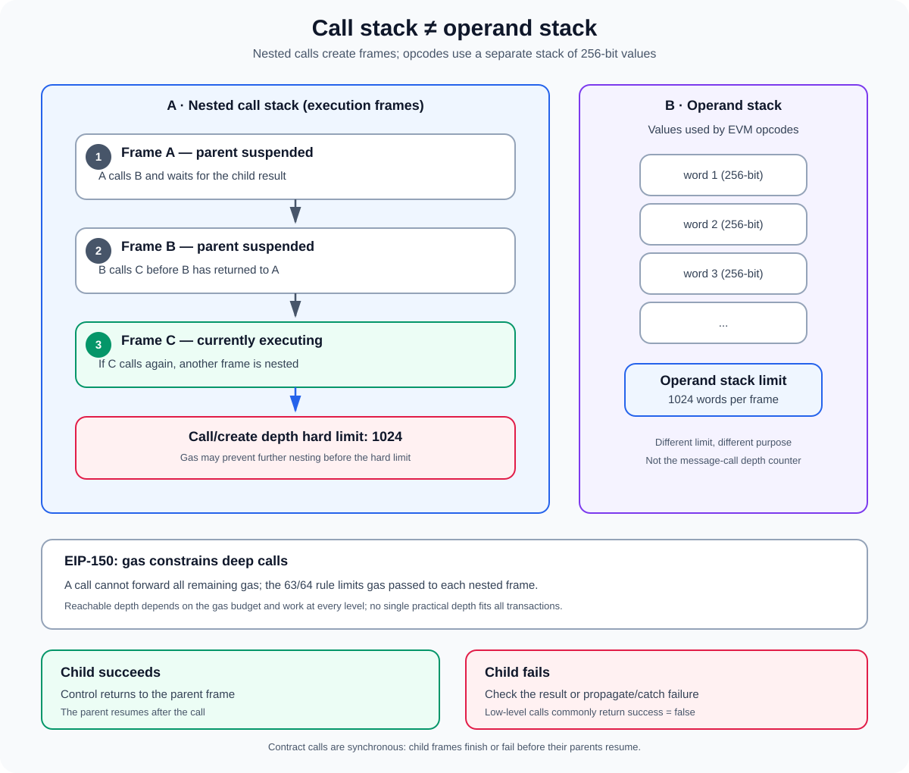

# Call Stack and Call Depth in the EVM

**Stage:** 01 — EVM Execution  
**Priority:** 1  
**Topic:** Nested message calls and contract-creation frames  
**Last reviewed:** 2026-10-17

## 1. What are call stack and call depth?

When an EVM execution calls another contract, the current execution pauses while the EVM runs a new message-call frame. That child frame may call another contract, which can create another frame. The nested execution frames form the **call stack**; **call depth** describes how deeply nested the current execution is.

The commonly specified hard limit is **1024 frames of call/create depth**. A call or creation that would exceed the permitted depth cannot start successfully. The practical depth reached in a transaction can be lower because calls also need gas, and [EIP-150](https://eips.ethereum.org/EIPS/eip-150) introduced the 63/64 gas-forwarding rule for call-like operations.

This topic matters when designing recursive contracts, factories, routers, proxies, account-abstraction flows, and any system where a contract makes an external call whose success is required for the rest of the operation.

## 2. Three different meanings of “stack”

The word “stack” is used for several different concepts. Mixing them up causes debugging mistakes.

### The EVM operand stack

The operand stack is the data area used by EVM instructions to perform operations. It holds 256-bit words and has a maximum height of 1024 items. Opcodes pop values from the top and push results back onto this stack.

### The call stack

The call stack tracks nested message-call and contract-creation execution frames. When contract A calls B, A's frame is suspended and B's frame becomes active. If B calls C, another frame is entered. As each call returns, the child frame is removed and the parent resumes.

### Solidity’s “Stack too deep” diagnostic

A compiler error such as “Stack too deep” is not the same as reaching the EVM runtime call-depth limit. It typically means the compiler cannot allocate or arrange too many simultaneously live values for the EVM operand stack in the generated code. It may happen before deployment, at compile time.

**Rule of thumb:** operand stack = values used by instructions; call stack = nested execution frames; “Stack too deep” = a compiler/code-generation problem involving live values.

## 3. What is inside a call frame?

A message-call frame has its own execution state. Conceptually, it includes:

- the code and program counter being executed;
- the EVM operand stack and memory for that frame;
- the call data supplied to the frame;
- the execution context, including the current account and caller information;
- the gas available to the frame and the return or revert result produced when it finishes.

A child call is synchronous. The parent initiates the call, the EVM executes the child frame, and then control returns to the parent. The parent can inspect success and copy returned data into its own memory.

A new message-call frame has fresh memory; it does not simply share the caller's memory. The child receives its input as calldata. Each active frame has its own operand stack and memory, while the call-depth limit constrains how many nested frames may be active.

## 4. How nested calls grow the call stack

Imagine a transaction that begins by executing contract A:

1. A calls B.
2. B calls C.
3. C calls A again.
4. That second execution of A calls another contract.
5. Each unfinished parent remains suspended until the child frame returns or fails.

The active chain becomes deeper with every nested message call or contract creation. It is not the number of contracts in the system, the total number of calls made during a transaction, or the total number of functions in the source file. Sequential calls that finish one after another do not all remain active at once.

For example, A may call B, B may return, and then A may call C. Those two child calls are sequential, so they do not create the same depth as A calling B, B calling C, and C calling D before any earlier frame returns.

## 5. Which operations can increase call depth?

Operations that begin new execution frames include:

- `CALL` — executes a message call using the target account's code and a new message-call context.
- `DELEGATECALL` — executes code from another account while preserving important caller and value context from the parent.
- `STATICCALL` — starts a message call in a read-only execution context.
- `CALLCODE` — a legacy opcode that executes another account's code in the current account's context; modern Solidity normally uses other patterns.
- `CREATE` and `CREATE2` — execute initcode inside a contract-creation frame.

These operations differ in context, value handling, and state-modification rules, but they all enter nested execution and are subject to call/create depth constraints.

By contrast, an ordinary internal Solidity function call is commonly compiled into jumps within the same EVM execution frame. It does not necessarily create a new external message-call frame. However, internal recursion still consumes execution resources and can place pressure on the EVM operand stack or gas budget.

## 6. The 1024 limit and the 63/64 gas rule

### The hard protocol limit

The EVM has a maximum call/create depth of 1024 under the commonly used protocol rules. When an attempt to start another nested call or creation would exceed the allowed depth, the child execution cannot begin successfully.

For low-level call operations, this is generally exposed to the caller as a failed call result rather than an automatic unconditional revert of the entire transaction. Higher-level Solidity calls usually propagate failure as an exception unless the code explicitly handles it. For contract-creation opcodes, a failed creation is indicated by a zero address on the EVM stack.

Exact failure behavior depends on the opcode and calling abstraction; always check the interface being used.

### EIP-150's 63/64 rule

[EIP-150](https://eips.ethereum.org/EIPS/eip-150) changed gas accounting for call-like operations. In broad terms, after paying the relevant costs, a caller cannot forward all of its remaining gas to a child frame: the forwarded amount is capped at all but one sixty-fourth of the available gas, subject to the opcode's rules.

This matters for call depth because each nested frame has less gas available when the caller forwards its maximum amount. As nesting grows, gas eventually prevents another useful call even before the absolute 1024 depth boundary is reached. The actual reachable depth depends on the initial gas, costs paid at each level, requested gas, and what each frame executes; there is no single practical depth number that applies to every transaction.

The 63/64 rule was an important mitigation against historical call-stack-depth attacks. It does not mean developers can ignore the success status of external calls, recursion, gas exhaustion, or denial-of-service behavior.

## 7. A recursive-call example

The following illustrative contracts create an external call chain. The function deliberately has no meaningful business purpose; do not deploy it as application logic.

~~~solidity
// SPDX-License-Identifier: MIT
pragma solidity ^0.8.20;

contract RecursiveCaller {
    function descend(address next, uint256 remaining) external {
        if (remaining == 0) {
            return;
        }

        // This is an external message call to another execution frame.
        RecursiveCaller(next).descend(next, remaining - 1);
    }
}
~~~

Each external invocation creates a nested message-call frame. As the recursion continues, the chain consumes gas and adds call depth. Real constructor, authorization, and target-selection logic can make recursive pathways more complex than this illustration.

The example is intentionally minimal and is not a safe recursion pattern. Unrestricted target selection and unbounded recursion should not be added to production contract logic.

Compare this with an internal function:

~~~solidity
function sumDown(uint256 n) internal pure returns (uint256) {
    if (n == 0) return 0;
    return n + sumDown(n - 1);
}
~~~

The internal recursive call is usually compiled within the same message-call frame rather than as a new external message call. It can still exhaust gas or run into operand-stack/runtime limits depending on compiler output and recursion depth. The distinction is the execution mechanism, not whether the source code visually contains a function calling itself.

For work with a known finite bound, an iterative loop can be easier to reason about than recursion. This is not a universal rule: choose the structure that is clear and safe for the algorithm, and bound untrusted input.

## 8. Failure handling: low-level calls and high-level Solidity calls

A low-level call returns a boolean success flag and return data. If a call cannot start due to depth constraints, or if the child frame reverts or otherwise fails, the success flag may be false. The caller must not assume the target operation occurred.

~~~solidity
(bool ok, bytes memory result) = target.call(payload);

if (!ok) {
    // Handle or deliberately propagate the failure.
    revert("External call failed");
}
~~~

This example deliberately propagates failure. Other applications may record the failure, retry later, or continue only if the failed operation is optional. The correct choice depends on the contract's invariants; silently ignoring a failed call can leave the application in an inconsistent state.

Higher-level calls, such as invoking a typed external contract function, generally bubble an exception when the call fails unless the code explicitly uses a failure-catching construct such as `try/catch` where applicable. `send` is a legacy Ether-transfer API that returns `false` on failure instead of reverting and is deprecated in modern Solidity guidance. `transfer` reverts when it cannot complete, including relevant call failures. For Ether distribution, withdrawal patterns are generally preferable to assuming every recipient can be paid during the current transaction.

A robust developer should know whether each external operation is:
- required for the transaction's invariant to hold;
- optional and safe to fail;
- recoverable through a later retry;
- controlled by an untrusted recipient or caller.

## 9. Security implications

### Historical call-stack-depth attacks

Historically, an attacker could construct a deep chain of calls and then invoke a vulnerable target. If the target attempted another external call but failed to check whether that call succeeded, the target might continue under a false assumption. This became known as a call-stack-depth attack.

EIP-150's gas-forwarding changes made this style of attack impractical under typical conditions, but the underlying engineering lesson remains valid: **external calls can fail**. Contracts should explicitly check success and maintain correct state when a dependency is unavailable.

### Reentrancy and recursive call graphs

Reentrancy and call depth are related but not identical. Reentrancy occurs when an external call transfers control to another contract and that contract calls back into the original contract before the original operation has completed. The call stack grows during the callback, but reentrancy risks primarily concern state transitions and the order in which effects occur.

Depth limits are not a substitute for reentrancy protection. Use checks-effects-interactions where appropriate, reentrancy guards when justified, and invariants that remain sound across callbacks.

### Unbounded user-controlled recursion

If user input controls recursion depth, a caller may cause excessive gas consumption or make the operation unusable. Bound recursive inputs, prefer bounded loops for naturally iterative work, and analyze worst-case gas in paths reachable by untrusted users.

### Ignoring call return values

If an application records a payment, deployment, or external state change as successful without checking the outcome, a failed subcall may break the protocol's accounting or workflow. State updates and emitted events should accurately represent what actually succeeded.

### Catching an error does not make the operation successful

Failure handling can keep the parent frame alive when a child fails. That can be useful, but continuing safely requires a deliberate recovery path. A catch block that simply continues with assumptions from the failed operation is not a fix.

## 10. Practical debugging checklist

When debugging a nested-call failure, ask:

1. Which operation started the current frame: `CALL`, `DELEGATECALL`, `STATICCALL`, `CREATE`, or `CREATE2`?
2. Which contracts or callbacks are in the active call chain?
3. Is the chain recursive, reentrant, or merely a sequence of completed calls?
4. Is the failure actually call depth, or is it out-of-gas, a revert, invalid calldata, or another child-frame failure?
5. Does the caller inspect the low-level success flag or catch the high-level exception?
6. Is the gas forwarded to each nested frame sufficient for its work?
7. Is any recursion depth determined by untrusted user input?
8. Are operand-stack limits or a Solidity compiler “Stack too deep” error being confused with message-call depth?

Use transaction traces when available. A trace that shows the parent-child call tree often reveals whether the failing frame is reached through a proxy, router, callback, or recursive pathway. Read revert data as well as the success flag where your client or tool exposes it.

## 11. Key takeaways

- Call depth is the nesting depth of EVM message-call and contract-creation frames.
- The commonly specified hard call/create depth limit is 1024, but available gas may cap useful depth earlier.
- EIP-150's 63/64 rule limits forwarded gas and mitigated historical call-stack-depth attacks.
- The EVM operand stack is a different structure, also limited to 1024 words.
- Solidity's “Stack too deep” diagnostic is a compiler/code-generation problem, not proof that a transaction reached call depth 1024.
- External calls may fail; robust contracts check success and preserve their invariants.
- Call-depth limits do not replace good recursion bounds, reentrancy defenses, or gas analysis.

## References

1. [Solidity Documentation — Security Considerations, Call Stack Depth](https://docs.solidity.org/en/latest/security-considerations.html#call-stack-depth) — depth limit, failed external calls, and relationship to EIP-150.
2. [EIP-150 — Gas cost changes for IO-heavy operations](https://eips.ethereum.org/EIPS/eip-150) — the 63/64 call-gas forwarding rule and rationale.
3. [Ethereum.org — Ethereum Virtual Machine](https://ethereum.org/developers/docs/evm/) — EVM operand stack and execution model.
4. [Solidity Documentation — Introduction to Smart Contracts](https://docs.solidity.org/en/latest/introduction-to-smart-contracts.html#message-calls) — message calls, execution frames, and gas forwarding.
5. [Solidity Documentation — Types](https://docs.solidity.org/en/latest/types.html) — Ether-transfer APIs and failure behavior.

---

**Next concept:** [Return Data and Revert Data](./10-return-data-and-revert-data.md) (article not published yet).
