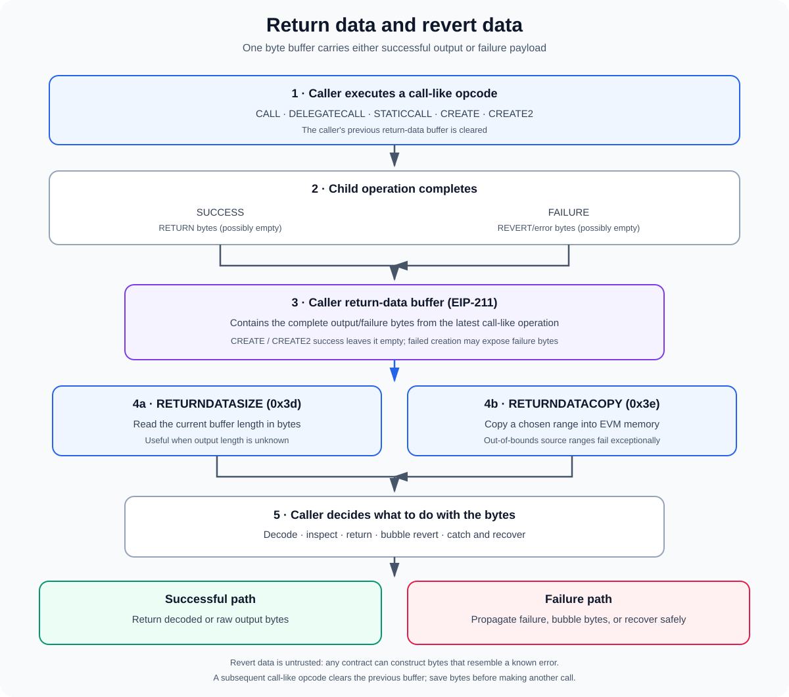

# Return Data and Revert Data in the EVM

**Stage:** 01 — EVM Execution  
**Priority:** 1  
**Status:** Reviewed  
**Topic:** Retrieving return bytes and handling failed calls  
**Last reviewed:** 2026-10-17

## 1. What is return data?

When an EVM contract calls another contract, the called execution can finish successfully and produce output bytes, or fail and produce revert/error bytes. The caller often does not know the length or exact shape of those bytes in advance.

**Return data** is the byte sequence produced by a call-like operation. [EIP-211](https://eips.ethereum.org/EIPS/eip-211) introduced a per-execution-frame return-data buffer and two opcodes:

- `RETURNDATASIZE` (`0x3d`) reports the current buffer's byte length.
- `RETURNDATACOPY` (`0x3e`) copies a chosen range of that buffer into the caller's memory.

The buffer can contain ordinary successful output or data describing a failure. When a child execution reverts using `REVERT`, its revert payload becomes available to the caller as return data.

The key idea is that return data is **raw bytes**. The EVM does not automatically know whether those bytes represent a returned integer, an encoded tuple, a custom error, or arbitrary data. Solidity and other tooling interpret the bytes using an expected ABI.

## 2. Normal return data vs. revert data

These terms are related but describe different outcomes.

### Successful return data

When a function completes successfully using Solidity's normal return path or the EVM `RETURN` opcode, it may return ABI-encoded bytes. For a function declared to return a `uint256`, those bytes typically contain the ABI encoding of that 32-byte value. For a tuple or dynamic type, the encoding can be longer and more involved.

A successful low-level call reports success and exposes the output bytes:

~~~solidity
(bool success, bytes memory result) = target.call(payload);
~~~

If the child execution succeeds, `success` is true and `result` contains the returned bytes. The bytes can be empty if the function returns no values or if the target has no code and the low-level call otherwise completes without error.

### Revert data

When execution fails through `REVERT` or a Solidity exception that uses it, the child frame's state changes are rolled back and the caller receives a failure status plus any revert bytes that were provided. The caller may bubble the revert, inspect it, catch it, or choose a deliberate recovery path.

~~~solidity
(bool success, bytes memory result) = target.call(payload);

if (!success) {
    // result may contain encoded revert/error data.
}
~~~

A failed operation does **not** guarantee non-empty revert data. An explicit empty revert, out-of-gas, an exceptional halt, or other failure paths can produce no useful structured payload.

### Return vs. revert at a glance

| Outcome | Child frame result | State changes in that path | Bytes available to caller |
|---|---|---|---|
| Successful `RETURN` | Success | Retained unless a parent frame later reverts | Ordinary return data, possibly empty |
| `REVERT` | Failure | Reverted in the current frame and its subcalls | Revert data, possibly empty |
| Other exceptional failure | Failure | Reverted in the failed frame | Often empty; do not assume structured bytes |

If a parent catches a child's failure and continues, the parent's own state changes can still be committed. If the failure propagates and the outer transaction reverts, the wider transaction's changes are rolled back.

## 3. The return-data buffer and EIP-211

Each active EVM execution frame has its own return-data buffer. After a call-like opcode completes, the full returned bytes—or the failure data from the child—are made available in the caller's buffer, subject to the opcode's specific behavior.

Important rules from EIP-211:

1. **A call-like operation clears the caller's previous return-data buffer before the new operation.** The buffer is not a history of every call made.
2. **After the operation finishes, its complete returned or failure data is available in that buffer.** The legacy output-memory area of `CALL` and related opcodes can be smaller than the complete return data; the buffer allows code to retrieve the full bytes.
3. **Use `RETURNDATASIZE` to learn the length.** A generic forwarder can handle outputs whose size it cannot predict in advance.
4. **Use `RETURNDATACOPY` to copy bytes into memory.** It can copy a selected range; an attempt to read beyond the buffer's bounds causes an exceptional halt.
5. **`CREATE` and `CREATE2` are special cases.** A successful creation leaves an empty return-data buffer; if creation fails with failure data, that data can be available to the creator.

Because another call-like opcode clears the prior buffer, retrieve or copy needed bytes before making a subsequent call. Otherwise, the previous result may no longer be available.

## 4. How RETURNDATASIZE and RETURNDATACOPY work

### RETURNDATASIZE

`RETURNDATASIZE` pushes the length, in bytes, of the current frame's return-data buffer onto the EVM operand stack. A generic caller can use this length to address sufficient memory without knowing the result size beforehand.

### RETURNDATACOPY

`RETURNDATACOPY` copies data from the return-data buffer to EVM memory. Its inputs identify the destination memory offset, source offset in the return-data buffer, and number of bytes to copy. The source range must fit entirely within the available buffer; an out-of-bounds range causes exceptional failure rather than silently returning zero padding.

This is different from copying a fixed output range directly as part of a `CALL` opcode. The return-data buffer holds the complete bytes, while `RETURNDATACOPY` lets the caller choose how much to copy and where to place it.

## 5. A generic low-level forwarder in Yul

The following example shows why EIP-211 is useful for proxy-like or generic forwarding code. The caller sends a byte payload, provides a zero-length output area to `CALL`, and then copies the complete return data after the call finishes.

~~~solidity
assembly {
    let ok := call(
        gas(),
        target,
        0,
        add(input, 0x20),
        mload(input),
        0,
        0
    )

    let size := returndatasize()
    let ptr := mload(0x40)
    returndatacopy(ptr, 0, size)

    if iszero(ok) {
        revert(ptr, size)
    }

    return(ptr, size)
}
~~~

What the example does:

1. Executes a message call to `target`, forwarding the input bytes from memory and sending zero ETH.
2. Sets the `CALL` output area to zero bytes, because the output length is not known in advance.
3. Reads the full result length using `RETURNDATASIZE`.
4. Copies every returned byte from offset zero into memory.
5. If the call failed, reverts the current frame with those same bytes, thereby bubbling the failure data.
6. If the call succeeded, returns the bytes from the current frame.

This is an illustrative forwarding pattern, not a complete production proxy. Real forwarding code must account for value, storage/execution context, gas, memory management, authorization, and the relevant proxy semantics. The example also deliberately forwards raw error bytes without validating their origin.

## 6. Reading revert data in Solidity

For normal Solidity code, a low-level call gives a convenient way to capture revert bytes:

~~~solidity
(bool success, bytes memory result) = target.call(payload);

if (!success) {
    // Bubble the original bytes without changing their encoding.
    assembly {
        revert(add(result, 0x20), mload(result))
    }
}
~~~

The `bytes memory` object stores its length in the first 32-byte word, and the bytes themselves begin at `add(result, 0x20)`. The assembly `revert` above makes the current frame revert with exactly the same bytes contained in `result`. This is often called **bubbling the revert**.

Bubbling is useful for preserving the downstream error for an upstream caller, but it has a trade-off: it preserves whatever the callee supplied, including data that may be misleading or deliberately forged. Wrapping the low-level error in a new custom error can attach context, but it changes the error payload and therefore is not byte-for-byte bubbling.

### Catching high-level call failures

Solidity also supports `try/catch` around eligible external calls and contract creation:

~~~solidity
try oracle.quote(asset, amount) returns (uint256 quote) {
    // Use a successful result.
} catch (bytes memory reason) {
    // Handle arbitrary failure bytes.
}
~~~

The exact catch options depend on the call syntax and Solidity version. A catch clause can handle an external call's failure, but it cannot catch a revert from an internal function call in the same way. A catch block should not continue as though the attempted operation succeeded.

## 7. Common Solidity error encodings

Revert bytes are not a separate EVM data type. Solidity conventions encode them using ABI-style data.

### Error(string)

A revert such as:

~~~solidity
revert("Insufficient balance");
~~~

typically returns ABI-encoded `Error(string)` data. The first four bytes are the selector `0x08c379a0`, followed by the ABI-encoded string argument.

### Panic(uint256)

Certain Solidity-defined failures use the built-in `Panic(uint256)` error. Its selector is `0x4e487b71`, followed by a code describing the panic category. This is commonly associated with compiler-inserted checks such as arithmetic overflow in checked arithmetic, invalid array access, or certain failed assertions.

### Custom errors

Custom errors let contracts use a named error and typed parameters:

~~~solidity
error InsufficientBalance(uint256 available, uint256 required);

function withdraw(uint256 amount) external {
    uint256 available = balances[msg.sender];
    if (amount > available) {
        revert InsufficientBalance(available, amount);
    }

    balances[msg.sender] = available - amount;
    // Continue with the withdrawal.
}
~~~

The custom-error payload consists of the first four bytes of the Keccak-256 hash of the canonical error signature, followed by ABI-encoded arguments. The signature uses the error name and parameter types, not the parameter names. Custom errors can be more gas-efficient than long revert strings, especially when carrying typed values.

Do not assume every failure uses one of these forms. A callee may revert with arbitrary bytes, use an empty revert, or fail without a standard Solidity error payload.

## 8. Error data is not trustworthy

A critical security rule: **never treat revert data as proof of which contract failed or as an authorization signal.**

Error bytes are not cryptographically authenticated as coming from a particular contract. Any contract can construct bytes that look like `Error(string)`, `Panic(uint256)`, or a known custom error. A downstream contract's error bytes can also bubble through intermediate contracts, so the immediate caller may receive an error not defined by the contract it called directly.

Safe practices include:

- Use the call's success flag to identify success or failure, not just the payload shape.
- Do not grant permissions or change trust decisions based solely on an error selector.
- If you decode revert bytes for diagnostics, treat the result as untrusted input and handle malformed or unknown payloads.
- If an application needs a trusted status, design an explicit protocol interface and verify the relevant state or authenticated result.
- Avoid blindly trusting a custom error because its name looks familiar; selectors are only four bytes and can collide.

Revert data is very useful for diagnostics and preserving error context, but it is not a security boundary.

## 9. Common mistakes and edge cases

### Assuming the buffer persists across calls

The buffer represents the latest call-like operation, not a collection. A later call clears it, so copy or process needed bytes before making another call.

### Assuming failed calls always provide error bytes

Failure status can be false while the byte payload is empty. Handle empty data without trying to decode a selector from nonexistent bytes.

### Confusing call success with application-level success

A low-level call to an account with no code may return success with empty data. The call succeeded at the EVM message-call level, but this may not mean the intended function executed. If a target contract must exist, check that requirement separately.

### Decoding before checking the size

Before interpreting the first four bytes as an error selector, verify that enough bytes exist. Even then, a matching selector does not prove the bytes are authentic.

### Assuming revert always rolls back the entire transaction

`REVERT` rolls back changes in the current execution frame and its subcalls. If the caller catches the failure and continues successfully, the caller's own earlier state changes are not automatically undone. The failure only reaches the outer transaction if it is propagated or otherwise causes the outer execution to fail.

### Mixing up the CALL output area and return-data buffer

`CALL` has an output memory offset and length. That area receives at most the requested number of bytes. Under EIP-211, `RETURNDATASIZE` and `RETURNDATACOPY` provide access to the complete returned or failure payload, including bytes beyond the output area specified for the call.

## 10. Developer checklist

When working with low-level calls, proxies, routers, or error handling, verify:

1. Is the operation expected to succeed, and is its success flag checked?
2. Do you know whether the returned bytes are normal output or revert data?
3. Could the return-data buffer be cleared by another call before needed bytes are copied?
4. Is the length obtained with `RETURNDATASIZE` when output length is unknown?
5. Does each `RETURNDATACOPY` source range stay within buffer bounds?
6. Does the code handle empty revert data and malformed/unknown error payloads?
7. Is the code bubbling bytes as-is or wrapping the error with new context?
8. Could those bytes be forged, bubbled from deeper in the call tree, or misidentified?
9. Are state updates and recovery logic safe if a subcall fails but the parent continues?

## References

1. [EIP-211 — New opcodes: RETURNDATASIZE and RETURNDATACOPY](https://eips.ethereum.org/EIPS/eip-211) — per-frame return-data buffer, clearing behavior, and copy bounds.
2. [EIP-140 — REVERT instruction](https://eips.ethereum.org/EIPS/eip-140) — rollback behavior, error bytes, and failed creation behavior.
3. [Solidity Documentation — Error handling: Assert, Require, Revert and Exceptions](https://docs.solidity.org/en/latest/control-structures.html#panic-via-assert-and-error-via-require) — exception propagation and low-level-call failure handling.
4. [Solidity Documentation — Custom Errors](https://docs.solidity.org/en/latest/contracts.html#custom-errors) — custom error encoding and security cautions.
5. [Solidity ABI Specification — Errors](https://docs.solidity.org/en/latest/abi-spec.html#errors) — the ABI form of standard and custom error data.

---

**Next concept:** [Contract Creation and Initialization](./11-contract-creation-and-initialization.md) — article published.
