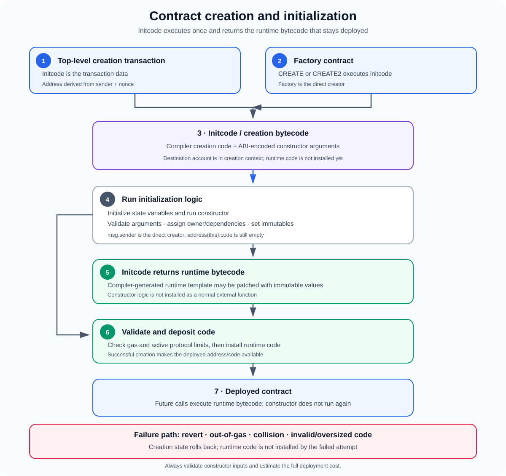

# Contract Creation and Initialization in the EVM

**Stage:** 01 — EVM Execution  
**Priority:** 1  
**Topic:** The full lifecycle from initcode to deployed runtime code  
**Last reviewed:** 2026-10-17

## 1. What happens when a contract is created?

Deploying a smart contract is not simply copying Solidity source code onto Ethereum. The source is compiled into bytecode, and contract creation executes a special program called **initcode**. If initcode completes successfully, it returns the **runtime bytecode** that the EVM stores at the new contract address.

The constructor is part of this creation phase. It runs once, can accept constructor arguments, initialize state, validate deployment parameters, and assign values to `immutable` variables. Once the constructor completes, its returned runtime bytecode is installed. The constructor itself is not an ordinary external function that remains callable after deployment.

The essential lifecycle is:

1. A creation transaction or an executing contract requests contract creation.
2. The EVM determines the destination address and performs required creation checks.
3. Initcode executes in the new account's creation context.
4. Solidity initialization and constructor logic run.
5. Initcode returns the final runtime bytecode.
6. The EVM validates and deposits that code, subject to gas and protocol limits.
7. The newly deployed contract can then be called using its runtime bytecode.

Understanding this lifecycle helps developers reason about constructor arguments, factory contracts, initialization bugs, gas usage, failed deployments, proxy initialization, and code-size constraints.

## 2. Two entry points for contract creation

### Top-level creation transaction

A wallet or another transaction sender can submit a contract-creation transaction. Instead of targeting an existing contract address, the transaction carries initcode in its data field, optionally including ABI-encoded constructor arguments.

At a high level:

- The transaction sender is the creator for address derivation.
- The transaction's data is executed as initcode.
- On success, the transaction receipt can contain the new contract address.
- The deployment consumes transaction gas and is recorded as part of block execution.

The wallet UI often hides the low-level details and makes this look like a single deploy action, but the EVM still runs the creation process.

### Creation from another contract

An already executing contract can create another contract using the `CREATE` or `CREATE2` opcode. In Solidity, this commonly appears as:

~~~solidity
Child child = new Child(argument);
~~~

Here the factory or creator contract runs a creation opcode. The creator contract's address is used for the relevant address calculation; the externally owned account that called the factory is not automatically the direct deployer in the `CREATE`/`CREATE2` formula.

A failed low-level `CREATE` or `CREATE2` reports a zero address to the creating frame. Solidity's typed `new` expression generally propagates creation failure as an exception unless a suitable failure-handling mechanism is used.

## 3. Initcode vs. runtime bytecode

These are different programs with different jobs.

### Initcode (creation bytecode)

Initcode is executed once during creation. It includes the code required to perform constructor-time initialization and to produce the runtime bytecode. With Solidity output, constructor arguments are ABI-encoded and appended to the compiler-generated creation bytecode.

Conceptually, the byte sequence supplied for deployment is:

~~~text
compiler-generated creation bytecode
++
ABI-encoded constructor arguments
~~~

The precise encoding is defined by the compiler and ABI conventions. A factory or off-chain deployment tool must use the actual expected creation bytecode and the correct argument encoding.

### Runtime bytecode (deployed code)

Runtime bytecode is the code that remains installed at the contract address after successful creation. Calls made after deployment execute this code. Runtime code contains the public/external dispatch logic and code reachable from the deployed contract's callable entry points, but it does not retain the constructor as a normal external function.

The initcode executes and returns these runtime bytes. The EVM then validates the returned code and charges code-deposit gas. If creation fails, runtime code is not installed by that failed attempt.

### Why the distinction matters

- Hashing initcode is not the same as hashing deployed runtime code.
- `CREATE2` address derivation depends on the hash of the exact initcode, including constructor arguments.
- A deployment tool may report creation bytecode and deployed bytecode as separate compiler outputs.
- Runtime code can differ from the compiler's unpatched runtime template when `immutable` values are embedded during construction.
- Initcode and runtime code have different protocol size limits.

## 4. Constructor execution and initialization order

A Solidity constructor is an optional function declared with the `constructor` keyword. If one is not written, Solidity provides an implicit default constructor. A contract can define only one constructor; constructors are not inherited as callable functions in the same way as ordinary external functions.

Before the constructor body runs, Solidity performs state-variable initialization as specified by the language and inheritance rules. Variables without explicit initialization receive their default values. Base-constructor arguments and execution follow Solidity's inheritance linearization and constructor-order rules.

A constructor can be used to:

- set the initial owner or administrative address;
- initialize accounting or configuration values;
- validate constructor arguments;
- establish dependencies on already deployed contracts;
- assign `immutable` values;
- revert if deployment parameters violate the protocol's requirements.

Example:

~~~solidity
// SPDX-License-Identifier: MIT
pragma solidity ^0.8.24;

contract Vault {
    address public immutable owner;
    address public immutable asset;
    uint256 public totalDeposits;

    error InvalidAsset(address supplied);

    constructor(address asset_) {
        if (asset_ == address(0)) {
            revert InvalidAsset(asset_);
        }

        owner = msg.sender;
        asset = asset_;
    }
}
~~~

For a direct creation transaction, `msg.sender` in this constructor is the transaction sender. If a factory creates the Vault, `msg.sender` in the constructor is the factory contract. That difference is important when a constructor assigns ownership.

The example validates the asset and assigns two immutables during construction. `totalDeposits` begins at zero because it has no explicit initializer. The actual protocol may require additional validation, such as verifying that the asset address has code or that the factory was authorized.

## 5. What the constructor context looks like

The constructor executes in the context of the address being created, but the final runtime code has not yet been installed there. It is therefore incorrect to treat constructor execution as identical to a normal post-deployment function call.

During construction, several values deserve attention:

- `address(this)` represents the address being created.
- `msg.sender` is the direct creator in the creation frame: often an EOA for a top-level creation transaction, or a factory contract for internal creation.
- `msg.value` is the ETH value supplied for this creation, if any.
- `msg.data` should not be treated as ordinary function-call calldata; the constructor receives its arguments as part of the creation bytecode format.
- Storage writes made during successful construction become part of the deployed account's state.
- The contract's runtime code is not yet available at its address.

### The constructor-time code-size pitfall

During construction, checking `address(this).code.length` will return zero because the runtime code has not yet been deployed. This is expected behavior; it does not prove that the address will remain code-less after successful creation.

A security design that relies on `address(this).code.length` to identify contracts can be bypassed by execution during construction, since a contract can make calls from its constructor before its runtime code is installed. Code-length checks are not a reliable way to prove that a caller is an EOA.

### External self-calls during construction

The contract's runtime functions are not yet installed. Do not assume an external call to `this.someFunction()` will behave as it does after deployment. In particular, constructor code should normally call its own initialization logic internally, rather than attempting to call its not-yet-installed runtime interface externally.

If initialization must interact with another contract, make that dependency and its assumptions explicit. An external dependency may be absent, malicious, or behave differently from the deployment environment expected by the author.

## 6. Storage initialization and immutable variables

### Storage variables

A state variable without an explicit initializer receives the Solidity-defined default value (for example, zero for unsigned integers and the zero address for an address variable). Explicit state-variable initializers and constructor assignments contribute to the initial state recorded when creation succeeds.

If the constructor reverts, its state changes and state changes in its subcalls are rolled back. Successful deployments persist the constructor's state writes; those writes are not re-executed on ordinary later calls.

Initial state is part of a contract's security model. Incorrect ownership, a zero or wrong dependency address, invalid fee parameters, or assumptions about a token can make a contract unsafe from its first block.

### Immutable variables

`immutable` variables may be assigned during construction. The compiler arranges for their values to be embedded in the deployed runtime bytecode. As a result, an immutable is not an ordinary persistent storage slot in the same way as a regular state variable.

This has practical implications:

- Reading an immutable is generally cheaper than reading a value stored in contract storage.
- The value can be selected from constructor inputs or deploy-time state.
- The final deployed runtime bytecode can contain values that were not present in the unpatched runtime template emitted by the compiler.
- Off-chain code comparing bytecode must account for compiler metadata and immutable-reference patching.

By contrast, a `constant` must be fixed at compile time; it cannot be chosen dynamically by a constructor.

## 7. Address creation, value transfer, and collision checks

The exact destination address depends on how creation was initiated:

- A top-level creation transaction derives the address from the transaction sender and the relevant sender nonce.
- `CREATE` derives it from the current creator account and its nonce.
- `CREATE2` uses the creator address, a 32-byte salt, and the hash of the exact initcode.

The opcode and transaction paths differ in their address formulas and call contexts, but the constructor still executes as part of the creation process.

Creation is not guaranteed to succeed merely because a predicted address has been calculated. A destination collision, insufficient balance to endow the contract, exceeded call depth, out-of-gas, initcode failure, or code-validation rule can prevent successful deployment. The protocol's collision rules consider account nonce and code; a balance alone is not the same as non-empty code or a nonzero nonce.

If ETH is sent as part of creation, the value is made available to the new contract's construction context as `msg.value`. A factory using `CREATE`/`CREATE2` must also satisfy the creator's balance and value-transfer conditions. Value sent to a failed creation is not retained as a successful endowment by a deployed contract.

## 8. Successful and failed deployment

### Successful deployment

A successful creation requires initcode to complete normally and return acceptable runtime bytecode. The EVM validates and deposits the returned bytes, and the resulting contract state becomes part of the resulting chain state.

The deployment receipt or creating frame then exposes the new contract address through the appropriate transaction or opcode interface. Calls made afterwards execute runtime bytecode, not the initcode again.

### Constructor revert

If the constructor executes `revert`, the creation fails. State updates made by the failed creation and its subcalls are rolled back, and no runtime code is installed by that attempt. For a top-level creation transaction, there is no successfully deployed contract address in the receipt. A factory using a low-level creation opcode can observe creation failure and decide whether to revert or recover.

### Out-of-gas or exceptional halt

Creation can also fail if initcode runs out of gas or halts exceptionally, if the initcode is oversized under active protocol rules, or if returned runtime code violates code size or validation rules. Such failures can consume the gas used before failure. A deployment transaction that fails still consumes gas; a failed deployment is not the same as an invalidly signed or never-included transaction.

### Deployment rollback and factory behavior

Suppose a factory writes state, tries to create a child, and creation fails. If the factory detects failure and continues successfully, its earlier state writes may persist. If the factory instead reverts, those writes are rolled back as part of the reverting execution. Therefore, factories should define their failure policy explicitly and not record a child as deployed until creation succeeds.

## 9. Code-size limits and gas costs

Deployment cost is not a single fixed opcode price. It includes transaction intrinsic gas or opcode costs, initcode execution, memory expansion when applicable, value transfer when applicable, hashing for `CREATE2`, and the cost of installing runtime bytecode.

Two important EIPs define commonly relevant size constraints on Ethereum:

- **EIP-3860** meters initcode at 2 gas per 32-byte word (rounded up) and specifies a 49,152-byte maximum initcode size after activation. This applies to creation transactions and `CREATE`/`CREATE2` execution.
- **EIP-170** specifies a 24,576-byte maximum size for deployed runtime code after activation.

These constraints describe the protocol rules defined by those EIPs; chains and future forks can differ. As of **2026-10-17**, [EIP-7954](https://eips.ethereum.org/EIPS/eip-7954), which proposes increasing the limits to 65,536 bytes for runtime code and 131,072 bytes for initcode, is in Last Call with a listed deadline of 2026-11-01. Do not assume those proposed limits are active on a target chain merely because the proposal exists—verify the chain's activated fork rules first.

Gas planning should include the full creation path. A large constructor can be expensive even when the final runtime code is small, and a compact initcode can still perform costly computation or external calls during initialization.

## 10. Common misconceptions

- **“A constructor is called every time a user calls the contract.”** No. It runs during contract creation; deployed runtime code serves later calls.
- **“The deployed contract contains its constructor as an ordinary callable function.”** No. The constructor is creation logic; the final returned runtime bytecode is installed.
- **“Constructor `msg.sender` is always the EOA that clicked Deploy.”** Not if a factory contract created the contract. In that case the factory is the direct creator.
- **“`address(this).code.length > 0` during construction.”** It is normally zero because runtime code has not yet been installed.
- **“A predicted address means deployment is guaranteed.”** It is only a prediction. Collision, insufficient gas, constructor failure, or validation can still prevent creation.
- **“All chains have identical code-size limits.”** Do not assume that. Confirm the active protocol rules of the target network and fork.
- **“The runtime bytecode printed by the compiler is always byte-for-byte identical to the deployed code.”** Immutable patching and metadata settings can make comparisons differ; use the correct compiler output and settings.

## 11. Developer checklist

Before deploying a contract or writing a factory, verify:

1. Is this a top-level creation transaction or an internal `CREATE`/`CREATE2` operation?
2. Are the exact initcode and constructor arguments correct?
3. Which address becomes `msg.sender` inside the constructor?
4. Are base constructors and state-variable initializers executed in the expected order?
5. Are owner, access control, dependency addresses, and fee/configuration values initialized safely?
6. Does any logic incorrectly assume the contract's runtime code already exists during construction?
7. Could constructor calls to external contracts fail or return unexpected values?
8. Does the final runtime code satisfy the target chain's current validation and size rules?
9. Is enough gas available for constructor execution, memory expansion, initcode metering, and code deposit?
10. Does the factory handle failed creation without recording a nonexistent contract as deployed?

## References

1. [Solidity Documentation — Contracts: Creating Contracts](https://docs.solidity.org/en/latest/contracts.html#creating-contracts) — constructor execution, creation code, and deployed runtime code.
2. [Solidity Documentation — Constructors](https://docs.solidity.org/en/latest/contracts.html#constructors) — optional constructors, state initialization, and deployment-time behavior.
3. [Ethereum.org — Ethereum Virtual Machine](https://ethereum.org/developers/docs/evm/) — transaction types and state transition context.
4. [EIP-3860 — Limit and meter initcode](https://eips.ethereum.org/EIPS/eip-3860) — initcode metering and the maximum initcode size.
5. [EIP-170 — Contract code size limit](https://eips.ethereum.org/EIPS/eip-170) — deployed runtime-code size constraint.
6. [EIP-7954 — Increase Maximum Contract Size](https://eips.ethereum.org/EIPS/eip-7954) — proposed limits; check status and activation before applying them to a network.
7. [EIP-161 — State trie clearing](https://eips.ethereum.org/EIPS/eip-161) — account-state changes relevant to contract creation.

---

**Next concept:** [State Transition Function](./12-state-transition-function.md) (article not published yet).
