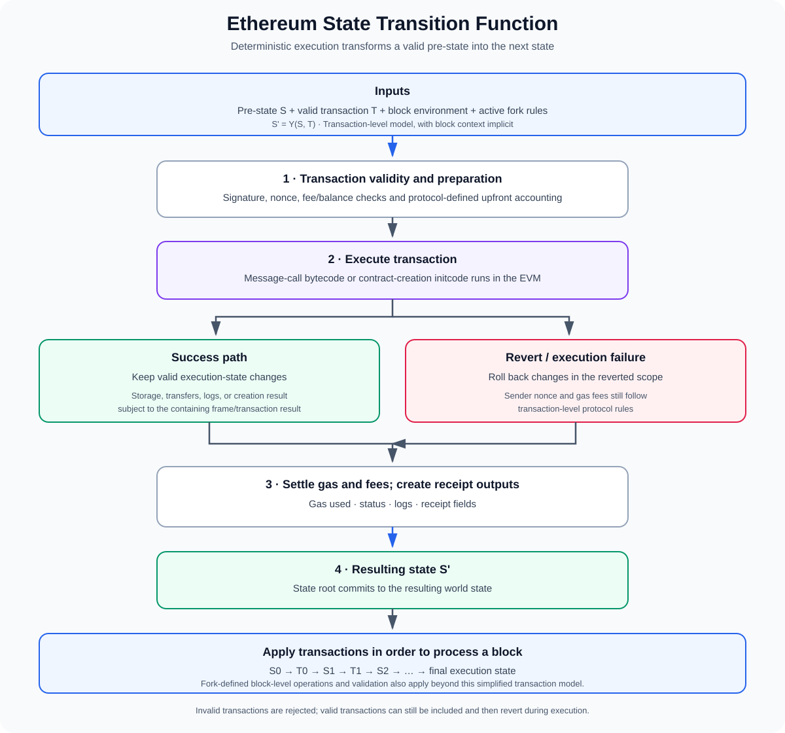

# Ethereum State Transition Function

**Stage:** 01 — EVM Execution  
**Priority:** 1  
**Topic:** How valid transactions transform Ethereum state  
**Last reviewed:** 2026-10-17

## 1. What is the state transition function?

Ethereum is not just a list of transactions. It is a state machine: the network begins with a known state, processes valid protocol inputs under agreed rules, and deterministically derives the next state.

The **state transition function** is a formal way to describe that rule. A simplified transaction-level expression is:

~~~text
S' = Υ(S, T)
~~~

where:

- `S` is the valid pre-state, including account balances, nonces, contract code, and contract storage.
- `T` is a valid transaction interpreted under the active protocol rules and execution environment.
- `Υ` is the state transition function.
- `S'` is the resulting state after applying that transaction.

For a given pre-state, transaction, block environment, chain configuration, and protocol-fork rules, Ethereum clients must derive the same result. This determinism is fundamental to consensus: independent execution clients must agree on the resulting state.

The key distinction is that the state transition function is broader than an individual EVM opcode or Solidity function. The EVM executes computations inside a transaction, while the protocol also defines transaction validation, nonce and fee accounting, gas settlement, receipt information, and block-level processing.

## 2. What is Ethereum state?

Ethereum's world state maps account addresses to account state. Conceptually, each account includes:

- **Nonce:** a protocol-defined counter used for transaction sequencing and contract creation behavior.
- **Balance:** the account's ETH balance, denominated in wei.
- **Storage root:** a cryptographic commitment to the account's persistent contract storage.
- **Code hash:** a hash identifying the account's associated EVM bytecode, where applicable.

An externally owned account (EOA) can sign transactions. A contract account has code that can execute when called, along with its account state. The state also includes storage belonging to contracts; contract storage is separate from the EVM's temporary memory used during one execution frame.

Ethereum organizes the world state using a modified Merkle Patricia Trie. The execution payload's state root commits to that resulting world state. Nodes do not put the entire world state into each block; a compact root provides a cryptographic commitment that clients can verify against the state they computed.

### State is not the same as a block

A block contains ordered transactions and protocol fields, but the state is the result of applying those inputs to the prior state. A block header's state root commits to the resulting execution state after the applicable transaction and block-processing rules have been applied.

This means a transaction by itself does not fully describe the result. The same transaction bytes can have a different outcome against a different pre-state or block environment. For example, a transaction can succeed when an account has enough balance but fail validity checks when that balance is insufficient.

## 3. Transaction-level and block-level transitions

### One transaction

At a simplified level, each transaction transforms the current state into a new state:

~~~text
S0 -- T0 --> S1
S1 -- T1 --> S2
S2 -- T2 --> S3
~~~

The output of one transaction becomes the input to the next transaction in the same block. Execution is ordered, not a collection of independent simulations whose results are merged later.

For transactions that call contracts, the EVM executes bytecode against the current state and may read or update balances, persistent storage, logs, and other execution data. For contract-creation transactions, the transaction data is initcode that executes to produce deployed runtime code.

### A whole block

If a block contains transactions `T0` through `Tn`, a simplified block transaction transition can be written as:

~~~text
S(n+1) = Υ(Υ(...Υ(S0, T0), T1)..., Tn)
~~~

The function is applied in transaction order. This simplified expression highlights the ordered composition of transaction-level transitions, not every detail of block processing.

Actual block processing also includes protocol-defined operations and validations that depend on the active fork and block structure. For example, Ethereum's execution layer must apply relevant block-level system operations, and it must validate that the computed result matches the commitments in the block. Therefore, do not treat the short equation as a complete implementation specification.

## 4. What happens when a transaction is processed?

The following high-level model helps organize the protocol steps. Exact details depend on transaction type and the active fork.

1. **Validate the transaction.** Check the required transaction fields and signatures, chain ID/replay-protection requirements, nonce conditions, gas parameters, balance requirements, and other validity rules.
2. **Prepare the transaction state.** Apply protocol-defined upfront accounting, including consuming the sender nonce and accounting for gas payment as specified by the active rules.
3. **Execute the transaction.** A message-call transaction invokes existing account code or transfers value; a contract-creation transaction executes initcode. The EVM follows deterministic opcode, gas, call-context, and state-access rules.
4. **Handle success or execution failure.** On successful execution, permitted state changes are retained. If execution reverts or fails exceptionally, changes made within the reverted execution scope are rolled back according to the protocol.
5. **Settle gas and fees.** Compute gas used, apply refunds within protocol limits, return unused gas value where applicable, and distribute or burn fee components according to the active fee rules.
6. **Produce execution outputs.** The transaction's result determines receipt status, gas accounting, and logs. These outputs contribute to the execution payload and its commitments.
7. **Continue with the next transaction.** The resulting state becomes the pre-state for the next transaction in that block.

This is a learning-oriented outline, not a replacement for the fork-specific execution specification. Client implementations must follow the exact ordering and conditions in the protocol specification.

## 5. Invalid transaction vs. reverted execution

This is one of the most important distinctions for smart-contract developers.

### Invalid transaction

A transaction that fails protocol validity checks is not a valid state transition to be accepted into the canonical block. Examples can include an invalid signature, incorrect nonce, invalid fee parameters, or an insufficient balance for required upfront conditions.

An execution client validating a block cannot simply accept an invalid transaction and record it as a failed receipt. The block itself would fail validation if it included a transaction that is invalid under the applicable rules.

### Valid transaction whose EVM execution fails

A valid transaction can be included and then fail while executing its call or creation. For example, a contract may execute `revert`, hit an out-of-gas condition, or encounter another exceptional execution failure.

In such cases, the execution changes made inside the reverted scope are undone, but this does **not** mean the transaction never happened. The sender's nonce is consumed, and gas fees for the transaction are still charged under the protocol's fee rules. The receipt indicates failed execution.

This behavior explains a common wallet experience: a transaction can be mined and marked failed, while still costing gas. The transaction was valid enough to be included, but its requested computation did not complete successfully.

### Nested call failure

A low-level call can fail while its parent contract catches the failure and continues. The child frame's changes are rolled back, but the parent frame can still make other changes. If the parent ultimately completes successfully, those parent-level changes may persist.

State rollback follows execution-frame and transaction rules; it is not always identical to "undo absolutely everything the transaction has touched."

## 6. What counts as a state change?

A transaction may affect several parts of execution state.

### Account balances and nonces

A transaction can transfer ETH, update the sender's nonce, and affect fee accounting. Contract execution may also transfer ETH through message calls or creation endowment. The exact accounting rules depend on transaction type and the active fork.

### Persistent contract storage

Opcodes such as `SSTORE` can update contract storage. Those updates become part of the resulting world state if the relevant execution succeeds and the containing frame is not later reverted. EVM memory, by contrast, is temporary execution-frame data and is not committed as persistent contract storage.

### Contract code and creation

Contract creation executes initcode and, on successful completion, installs returned runtime bytecode at the created account. Failed creation does not produce a successful deployed contract from that attempt. Code-size and validation rules are part of the creation transition.

### Logs and events

A contract can emit events, which are represented as EVM logs in execution outputs. Logs from an execution path that reverts are discarded as part of its rollback. Logs produced by a successful transaction are included in the receipt data and committed through the relevant block data structures. They are useful for off-chain applications, but they are not a substitute for reading canonical contract state.

### Transient storage and temporary execution data

Some execution data is deliberately temporary. Memory is scoped to an execution frame. Transient storage introduced by EIP-1153 is scoped to a transaction and does not persist as ordinary storage after the transaction finishes. These data areas can affect execution without becoming permanent account state in the same way as regular storage.

## 7. Gas and fee accounting are part of the transition

Gas limits the computation that a transaction can perform. Every opcode and many protocol actions have gas costs. If execution runs out of gas, the affected execution fails and state changes from that failed execution are rolled back, but protocol-required transaction-level nonce and fee effects remain.

For modern Ethereum transaction types, fee accounting can include:

- the gas limit and the actual gas used;
- the block's base fee per gas;
- a priority fee offered to incentivize inclusion;
- the transaction's maximum fee constraints;
- gas refunds permitted under the active rules.

Under EIP-1559-style fee rules, the base-fee component is burned and the priority-fee component is paid to the block's fee recipient, within the rules and limits for that transaction. A sender's actual payment is based on gas consumed and the effective gas price rather than automatically charging the full gas limit as a final fee.

The exact transaction formats and fee rules are fork-sensitive. Use the relevant EIP and execution specification when analyzing a specific transaction type.

## 8. Receipts, logs, and state roots

A transaction receipt provides important outputs from execution, but it is not a full dump of the state changes.

Common receipt information includes:

- the transaction's success/failure status under the current receipt format;
- cumulative gas used in the block and, through transaction-level interpretation, the gas consumed by a particular transaction;
- logs emitted during successful execution;
- a bloom filter derived from logs;
- additional fields determined by the transaction and block format.

For the modern status-based receipt format, a status value of `1` represents successful execution and `0` represents failed execution. EIP-658 introduced this status code in place of an earlier post-state-root receipt field.

The block's execution state root commits to the resulting world state after applicable processing. A transaction receipt and its logs do not independently prove every storage slot that changed. Developers who need the resulting state should query the relevant storage/account data or use appropriate proofs and traces rather than assuming the receipt is a state-diff document.

## 9. Consensus and deterministic execution

Ethereum's execution clients may use different internal data structures, programming languages, databases, optimizations, and tracing implementations. Nevertheless, for the same valid pre-state, block inputs, chain configuration, and active protocol rules, they must compute the same deterministic state transition.

If different clients computed different state roots for the same valid block input, the network could disagree on whether the block was valid. That is why the execution specification is central: it defines protocol behavior independently of any one client's preferred implementation.

The Ethereum Execution Layer Specifications (EELS) are an executable reference specification intended to help client developers and protocol researchers study block processing. The Yellow Paper is another formal reference, but the current fork's specifications and EIPs should be checked for up-to-date protocol details.

## 10. Visual overview

## 11. A practical mental model

Think of the Ethereum state transition function as a deterministic state-update pipeline:

~~~text
Valid pre-state + valid transaction + block/fork context
                         |
                         v
            Validation and upfront accounting
                         |
                         v
                  EVM execution
                 /             \
                v               v
        Success path        Revert/failure
        Keep valid changes  Roll back execution-scope changes
                 \             /
                  v           v
                Gas and fee settlement
                         |
                         v
        Resulting state + receipt/log outputs
~~~

For block processing, repeat the transaction transition in order and apply all other fork-defined block operations. The resulting execution state is committed by the block's state root.

This model is intentionally simplified: the official fork-specific execution specifications define the exact transition ordering, failure semantics, and all additional operations. Use it to orient yourself before investigating a concrete client trace or protocol rule.

## 12. Developer checklist

When reasoning about a transaction or protocol mechanism, ask:

1. What is the pre-state, and which account balances, nonces, code, or storage locations matter?
2. Is the transaction invalid before execution, or valid but reverted during execution?
3. Which fork and transaction type define the applicable rules?
4. What does the EVM execute: message-call bytecode or creation initcode?
5. Which state changes belong to a reverted child frame, the parent frame, or transaction-level accounting?
6. How much gas was consumed, and how are fees settled?
7. Are logs emitted, and were they retained after any nested or outer reverts?
8. What does the receipt actually prove—and what requires a state query, trace, or proof?
9. Does the resulting state root match the execution outcome computed by a client following the applicable spec?
10. Are you describing a transaction-level rule or a block-level processing rule?

## References

1. [Ethereum.org — Ethereum Virtual Machine and State Transition Function](https://ethereum.org/developers/docs/evm/) — the simplified state transition model and world state.
2. [Ethereum Execution Layer Specifications (EELS)](https://steel.ethereum.foundation/docs/execution-specs/specs/) — executable reference specification for Ethereum execution and block processing.
3. [Ethereum Yellow Paper](https://ethereum.github.io/yellowpaper/paper.pdf) — formal state, transaction, and transition definitions; confirm fork-specific details with current specs.
4. [EIP-1559 — Fee market change](https://eips.ethereum.org/EIPS/eip-1559) — base fee, priority fee, and transaction fee accounting.
5. [EIP-658 — Embedding transaction status code in receipts](https://eips.ethereum.org/EIPS/eip-658) — receipt status code for execution success or failure.
6. [EIP-1153 — Transient storage opcodes](https://eips.ethereum.org/EIPS/eip-1153) — transaction-scoped transient storage behavior.

---

**Stage 01 complete:** all 12 roadmap topics now have articles. Continue with [Stage 02 — ABI and Contract Interaction](../02-abi-contract-interaction/README.md), beginning with Application Binary Interface (ABI).
