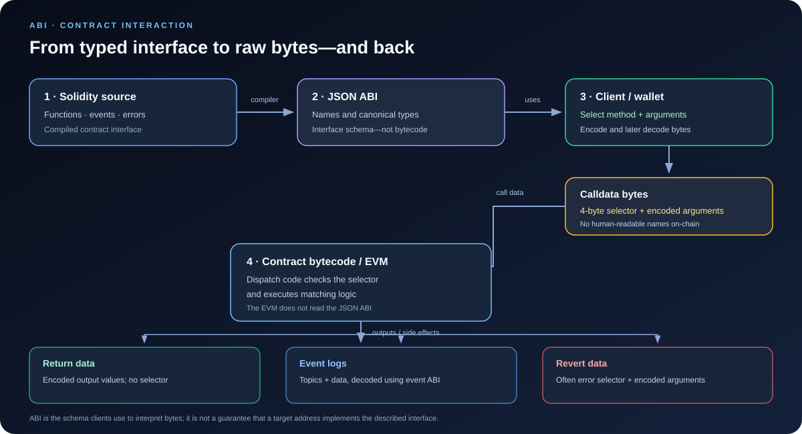

# Application Binary Interface (ABI): How Ethereum Contracts Communicate

> **Stage:** 02 — ABI and Contract Interaction  
> **Priority:** 1  
> **Status:** Reviewed  
> **Last reviewed:** 2026-10-17

## 1. Overview

The **Application Binary Interface (ABI)** is the convention that defines how typed values are represented as bytes when software interacts with an Ethereum contract. It is used by off-chain applications, wallets, scripts, and other contracts to encode function inputs and decode returned data. The ABI also describes the contract's callable functions, events, errors, and special entry points.

The term is often used for two related things:

1. **The ABI encoding rules** — the standard rules for converting values such as `uint256`, `address`, `string`, and tuples into bytes and interpreting those bytes again.
2. **A contract ABI artifact** — usually a JSON array generated by a compiler that describes a contract's interface: function names, parameter and return types, mutability, events, and errors.

These are connected, but they are not the same thing. The JSON file describes the schema that a client can use; the encoding specification defines how values become bytes.

An ABI is **not** the contract's source code, runtime bytecode, storage layout, or implementation. It tells a client how to communicate with an interface, not what the implementation will do.



## 2. Why It Matters to a Smart Contract Developer

Understanding ABI is essential whenever code crosses a contract boundary.

- **Calling contracts:** a frontend or another contract must encode arguments into the expected byte format.
- **Reading results:** returned bytes must be decoded using the expected output types.
- **Debugging transactions:** calldata begins with a selector followed by encoded arguments, so ABI knowledge helps inspect a transaction in an explorer or debugger.
- **Events and indexing:** logs are bytes plus topics; ABI metadata lets tools decode them into named, typed event fields.
- **Errors and reverts:** revert data often carries an error selector and encoded arguments. This helps explain failures, but the error data must not be treated as authenticated proof of which contract caused the error.
- **Interfaces and integrations:** two contracts can interact without sharing source code if each side agrees on the same interface and encoding rules.

An ABI mismatch can cause a client to encode the wrong selector or wrong argument layout, decode bytes incorrectly, or display misleading information. The low-level EVM only receives bytes; it does not receive a JavaScript object or a Solidity function call as such.

## 3. What a JSON ABI Contains

A modern Solidity compiler can emit an ABI as part of compilation. A simplified fragment for a function might look like this:

```json
[
  {
    "type": "function",
    "name": "withdraw",
    "inputs": [
      { "name": "amount", "type": "uint256" }
    ],
    "outputs": [],
    "stateMutability": "nonpayable"
  }
]
```

This entry means that the interface exposes a function named `withdraw`, accepts one `uint256` argument, declares no return values, and is non-payable. It does **not** contain the function's Solidity implementation.

Common ABI entry types include:

- `function` — a callable function with inputs, outputs, and state mutability.
- `constructor` — the constructor inputs used when creating a contract. Constructor arguments are encoded into the deployment input after the creation bytecode; they are not called using a four-byte function selector.
- `receive` — the special entry point for receiving Ether with empty calldata, when present and applicable.
- `fallback` — the special entry point used for unmatched calldata, or for receiving Ether when the conditions for the receive function do not apply.
- `event` — an event name and its parameter types, including which parameters are indexed.
- `error` — a custom error name and its parameter types.

A function entry commonly includes `inputs`, `outputs`, and `stateMutability` (such as `pure`, `view`, `nonpayable`, or `payable`). Event entries may include `indexed` flags and `anonymous`. Tuple-like types can include a `components` array that describes their members.

The exact ABI artifact may contain additional compiler metadata such as `internalType` and may vary across compiler versions. For interoperable encoding, the canonical ABI types and encoding rules matter—not every descriptive JSON field.

## 4. How ABI Encoding Works

The ABI encoding is **not self-describing**. A byte string does not generally tell you its own types or field names. The decoder needs the correct ABI schema to interpret it.

For standard ABI encoding, values are organized in 32-byte words. Static values are encoded in-place; dynamic values such as `string`, `bytes`, and dynamic arrays use an offset in the head followed by their length and contents in the tail. Tuples may contain both static and dynamic values, so the precise layout follows the formal ABI rules rather than a simple concatenation of human-readable values.

For example, consider:

```solidity
function setName(string calldata newName) external;
```

A call contains:

1. A 4-byte function selector.
2. A 32-byte head word holding an offset to the dynamic string data.
3. At that offset, a 32-byte length followed by the string bytes, padded to a 32-byte boundary.

The offset is measured in bytes relative to the beginning of the encoded argument block (the bytes immediately after the selector in a function call). That is why decoding dynamic types requires following offsets; reading the first argument word as if it were the string itself would be wrong.

### Static and dynamic examples

| Type | ABI behavior |
|---|---|
| `uint256` | Encoded as a 32-byte word |
| `address` | Encoded in a 32-byte word, with the address occupying the low 20 bytes |
| `bool` | Encoded as a 32-byte word representing zero or one |
| `bytes32` | Exactly 32 bytes |
| `string` | Offset in the head; length and bytes in the tail |
| `bytes` | Offset in the head; length and bytes in the tail |
| `uint256[]` | Dynamic data containing a length and encoded elements |
| Tuple | Encoded recursively according to its component types |

This table is a mental model, not a substitute for the full rules. Fixed-size arrays, tuples, nested dynamic types, and event-indexed values have additional details that a developer should look up when implementing low-level decoders.

## 5. Function Selectors and Calldata

For a normal external function call, calldata has this general shape:

```text
calldata = 4-byte selector || ABI-encoded arguments
```

A function selector is the first four bytes of the Keccak-256 hash of the function's **canonical signature**. The signature consists of the function name and canonical parameter types, such as:

```text
withdraw(uint256)
```

The return type, parameter names, data-location keywords such as `memory` or `calldata`, and spaces are not part of the selector signature. Some type aliases are canonicalized: for example, `uint` is treated as `uint256`, and `int` as `int256`.

This has several implications:

- Overloaded functions have different selectors only when their canonical parameter-type lists differ.
- Return types do not distinguish overloads.
- A selector is only four bytes, so collisions are possible. A selector is a dispatch identifier, not a globally unique proof of a function's identity.
- A selector alone does not encode argument values; the encoded parameters follow it.

The contract's compiled dispatch logic typically examines the selector and routes matching calldata to the relevant function. The EVM itself does not automatically look up a JSON ABI file or dispatch by a human-readable function name. If calldata does not match a known function, the compiled contract may route it to a fallback function or revert, depending on the contract's code.

## 6. Example: Solidity Contract and a Client

Consider a simplified vault:

```solidity
// SPDX-License-Identifier: MIT
pragma solidity ^0.8.24;

contract SimpleVault {
    mapping(address => uint256) public balances;

    event Deposited(address indexed account, uint256 amount);
    error InsufficientBalance(uint256 available, uint256 requested);

    function deposit() external payable {
        balances[msg.sender] += msg.value;
        emit Deposited(msg.sender, msg.value);
    }

    function withdraw(uint256 amount) external {
        uint256 available = balances[msg.sender];
        if (amount > available) {
            revert InsufficientBalance(available, amount);
        }

        // Update state before making the external call.
        balances[msg.sender] = available - amount;
        (bool success, ) = payable(msg.sender).call{value: amount}("");
        require(success, "Transfer failed");
    }
}
```

The compiler can generate ABI entries for `deposit`, `withdraw`, the public getter `balances`, the `Deposited` event, and the `InsufficientBalance` custom error.

An ethers v6 client can use the ABI to build calldata and decode results:

```javascript
import { Interface } from "ethers";

const abi = [
  "function withdraw(uint256 amount)",
  "function balances(address account) view returns (uint256)",
  "event Deposited(address indexed account, uint256 amount)",
  "error InsufficientBalance(uint256 available, uint256 requested)"
];

const contractInterface = new Interface(abi);

// Encode a call; this creates bytes and does not send a transaction.
const calldata = contractInterface.encodeFunctionData("withdraw", [5n]);

// Decode the return bytes for the balances(address) getter.
const encodedResult = contractInterface.encodeFunctionResult(
  "balances",
  [12n]
);
const [balance] = contractInterface.decodeFunctionResult(
  "balances",
  encodedResult
);

console.log(calldata);
console.log(balance); // 12n
```

This example shows ABI encoding and decoding locally. `encodeFunctionData` does not connect to a node, sign a transaction, or execute the contract. To read on-chain state, a client would send a request such as `eth_call` with the encoded data and contract address. To change state, a transaction must be prepared, signed, and submitted. A transaction receipt does not normally include Solidity return values as a directly decoded return field; applications typically inspect logs and transaction status, or simulate a call when appropriate.

In production, prefer using the ABI generated from the exact contract build, or a verified and trusted ABI artifact, rather than manually typing an incomplete interface.

## 7. Return Data, Events, and Errors Also Use ABI Rules

### Return data

Function return values are ABI-encoded as a tuple of output values. Unlike function calldata, the return payload does **not** begin with a function selector. The caller needs the expected output types to decode the returned bytes.

### Events and logs

An event is stored as an EVM log, not as a normal function return value. A non-anonymous event usually places the Keccak-256 hash of its canonical event signature in `topics[0]`. Indexed arguments are represented in topics; non-indexed arguments are ABI-encoded in the log's `data`. Dynamic or complex indexed values are represented by a hash of a special encoding, so their original contents generally cannot be recovered from the topic alone.

For `Deposited(address indexed account, uint256 amount)`, the account is indexed for efficient filtering, while the amount is available in the data field. Indexing is a search trade-off: it makes a field filterable but changes where—and sometimes how—the value is represented.

### Errors and revert data

A custom error's revert data is encoded similarly to a function call: a four-byte error selector followed by ABI-encoded error arguments. Built-in errors such as `Error(string)` and `Panic(uint256)` also have defined encodings.

**Do not trust revert data as authenticated identity.** Any contract can return bytes that resemble a known error, and revert data may bubble through multiple external calls. Decode it as diagnostic information, but do not assume that the named error necessarily originated in the contract you first called.

## 8. Common Mistakes and Security Considerations

1. **Treating an ABI as executable code.** An ABI describes an interface; it does not contain the implementation and does not prove that a deployed address implements that interface.
2. **Using the wrong ABI or address.** A valid encoding can still call the wrong contract or be interpreted differently by the target.
3. **Manually assembling dynamic values.** Offsets, lengths, padding, nested tuples, and array layouts must follow the specification exactly. Use a maintained library unless low-level encoding itself is the subject of the work.
4. **Assuming selectors are unique.** Four-byte collisions are possible. Do not use a selector by itself as a security identity check.
5. **Assuming a successful encoding means a successful call.** Encoding happens locally. Execution may still revert, run out of gas, or fail a contract-level condition.
6. **Treating decoded output as proof of truth.** Decoding only interprets bytes under a schema; it does not establish that the data is trustworthy or that the contract behaved honestly.
7. **Confusing ABI encoding with packed encoding.** Solidity's non-standard `abi.encodePacked` uses different rules and can introduce ambiguity when concatenating multiple dynamic values. Do not substitute it for standard ABI encoding or use it casually to build hash preimages.

## 9. Key Takeaways

- ABI is the standard boundary between typed contract interfaces and raw bytes.
- The Solidity compiler can produce a JSON ABI artifact, but the ABI is not the contract's bytecode or implementation.
- A standard external function call is a 4-byte selector followed by ABI-encoded arguments.
- The selector hashes the canonical function name and parameter types; it excludes output types.
- Static values, dynamic values, tuples, events, return payloads, and errors follow specific encoding rules.
- The ABI is not self-describing: decoders need the correct schema.
- ABI knowledge makes it easier to build reliable integrations, inspect calldata, decode logs, and debug reverts.

## Review Checklist

- [ ] Explain the difference between ABI encoding rules and a JSON ABI artifact.
- [ ] Identify common JSON ABI entry types.
- [ ] Describe the selector-plus-arguments layout of external function calldata.
- [ ] Explain why dynamic values use offsets and a tail.
- [ ] Distinguish return data, event logs, and revert data.
- [ ] Identify at least three ABI-related integration or security mistakes.

## References

1. **[Solidity Contract ABI Specification](https://docs.solidity.org/en/latest/abi-spec.html)** — primary reference for selectors, canonical types, static and dynamic encoding, JSON ABI entries, events, and errors.
2. **[Ethereum.org: Interacting with Smart Contracts](https://ethereum.org/en/developers/docs/smart-contracts/interacting/)** — practical context for how applications use contract ABIs and client libraries.
3. **[Ethereum.org: Compiling Smart Contracts](https://ethereum.org/en/developers/docs/smart-contracts/compiling/)** — explains compiler output and why application developers need the ABI.
4. **[ethers v6 Contract API](https://docs.ethers.org/v6/api/contract/)** — client-library reference for connecting contract interfaces and invoking methods.
5. **[ethers v6 ABI Interface API](https://docs.ethers.org/v6/api/abi/)** — reference for encoding calldata and decoding function results, events, and errors.
