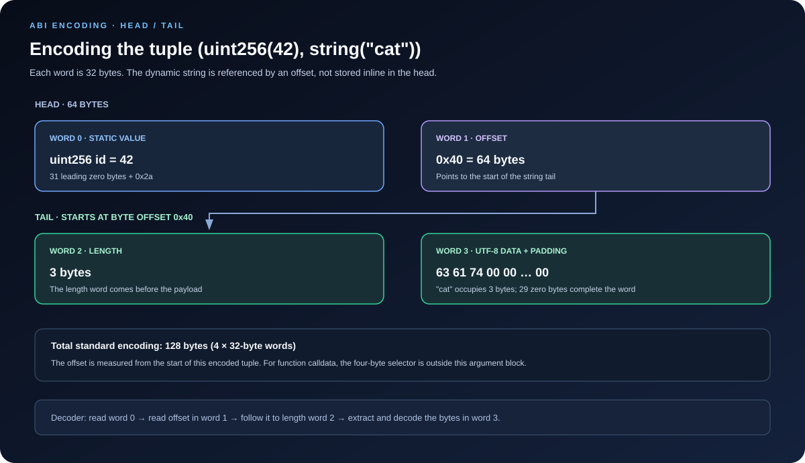

# ABI Encoding and Decoding: Turning Values into Bytes

> **Stage:** 02 — ABI and Contract Interaction  
> **Priority:** 1  
> **Status:** Reviewed  
> **Last reviewed:** 2026-10-17

## 1. Overview

**ABI encoding** converts typed values into a byte sequence according to the Ethereum Contract ABI specification. **ABI decoding** interprets that byte sequence using an expected list of types and reconstructs the corresponding values.

Contracts and applications do not exchange JavaScript objects, Solidity structs, or human-readable strings directly. At the contract boundary, they exchange bytes. Both sides must agree on the types and on the rules used to represent those types.

This article focuses on the encoding mechanics themselves. The companion [Application Binary Interface (ABI)](01-application-binary-interface-abi.md) article explains the ABI artifact, function selectors, and the wider contract-interaction model.

The central rule to remember is:

> Standard ABI encoding places static values directly in the **head**. For dynamic values, the head contains an **offset** to the value's encoding in the **tail**.

The ABI is not self-describing. A byte sequence does not generally include the field names and type information needed to decode itself; the decoder must be given the right schema. [Solidity's ABI specification](https://docs.solidity.org/en/latest/abi-spec.html) defines the exact rules.

## 2. Where Encoding and Decoding Are Used

ABI encoding appears in several different places:

- **Function calldata:** a normal external function call starts with a four-byte function selector, followed by ABI-encoded arguments.
- **Return data:** function outputs are ABI-encoded, but the returned payload does not begin with a function selector.
- **Events:** event data and some indexed values use ABI-related encoding rules, with special handling for indexed dynamic or complex values.
- **Custom errors:** revert data commonly starts with a four-byte error selector, followed by ABI-encoded error arguments.
- **Contract-to-contract calls:** compiled Solidity code and low-level call mechanisms use byte data to cross external-call boundaries.
- **Application code:** libraries such as ethers encode parameters before an RPC call and decode return bytes or logs afterward.

Do not assume every byte payload follows the same exact shape. A complete function call includes a selector; the argument payload passed to the Solidity helper abi.encode does not. Return values also have no function selector. Events have their own log structure, including topics and data.

## 3. The 32-Byte Word

Standard ABI encoding is built around **32-byte (256-bit) words**. Most elementary values occupy one word, even when their Solidity type is smaller than 256 bits.

Examples:

| Type | Standard ABI representation |
|---|---|
| **uint256** | One 32-byte word; big-endian value |
| **uint8** | One 32-byte word, zero-padded on the left |
| **int256** | One 32-byte word using two's-complement representation |
| **address** | One 32-byte word, with the 20-byte address right-aligned |
| **bool** | One 32-byte word representing zero or one |
| **bytes32** | Exactly 32 bytes |
| **bytes4** | Four data bytes padded on the right to 32 bytes |

These padding directions matter. Integer-like values and addresses are left-padded; fixed-size byte arrays such as bytes4 are right-padded. Do not interchange these representations when manually inspecting calldata.

As a small example, the integer 42 is encoded as a 32-byte word ending in 2a in hexadecimal. It is not encoded as the one-byte sequence 0x2a in standard ABI mode.

## 4. Static and Dynamic Types

The standard ABI specification divides types into two broad groups.

### 4.1 Static types

A static value's encoding size is determined by its type, not by the value supplied at runtime. Static values are encoded directly in the head of the enclosing tuple.

Examples include:

- **uint256**, **int128**, **address**, and **bool**
- Fixed-size byte arrays such as **bytes32**
- Fixed-size arrays whose element types are all static, such as **uint256[3]**
- Tuples whose component types are all static

A static value may still require more than one 32-byte word. For example, a fixed-size array of three uint256 values takes three words.

### 4.2 Dynamic types

A dynamic value's encoded size can depend on the value itself. The outer head contains an offset to the value's encoding, which appears in the tail.

Common dynamic types include:

- **string**
- Dynamic **bytes**
- Dynamic arrays such as **uint256[]** and **string[]**
- Fixed-size arrays or tuples that contain a dynamic component

For a dynamic bytes or string value, the tail contains a 32-byte length word, followed by the data bytes and enough right-side zero padding to make the data area a multiple of 32 bytes. The length for a string is the number of **UTF-8 bytes**, not necessarily the number of visible characters.

A dynamic array starts with its element count and then encodes its elements according to the rules for that array's element type. Arrays of dynamic elements need offsets for their elements too. Nested tuples and arrays apply the same rules recursively.

## 5. Head and Tail: The Main Encoding Model

When encoding a tuple of values, ABI data is assembled in two logical areas:

- **Head:** one slot for each top-level tuple component. A static component is encoded in its slot; a dynamic component's slot contains an offset.
- **Tail:** the actual encoded data for dynamic components, laid out after the head.

A head slot is normally one 32-byte word for a dynamic component. A static component's head representation may span multiple words if its static type encodes to more than one word.

An **offset is a byte count relative to the beginning of the encoding of the enclosing tuple**, not an absolute memory address. At the top-level function-argument encoding, that base starts immediately after the four-byte selector if you are looking at full function calldata. For nested tuples and arrays, the relevant base is the start of that encoded tuple or array element region, as defined by the specification.

An offset for a dynamic string points to the start of the string's tail encoding—the length word—not directly to the first UTF-8 character.

## 6. Worked Example: abi.encode(uint256, string)

Consider these values:

    uint256 id = 42;
    string memory name = "cat";

    bytes memory payload = abi.encode(id, name);

The ABI encoding of the pair (42, "cat") has four 32-byte words:

| Word | Meaning | Value |
|---|---|---|
| 0 | Static uint256 id | 0x...002a (32 bytes total) |
| 1 | Offset to dynamic name | 0x...0040 (64 bytes) |
| 2 | String byte length | 0x...0003 (3 bytes) |
| 3 | UTF-8 bytes for cat, right-padded | 0x636174 followed by 29 zero bytes |

There are two arguments, so the head is two words, or 64 bytes. That is why the second word contains offset 0x40: the string tail starts immediately after the 64-byte head.

The tail starts with the length 3, then the three UTF-8 bytes for cat, followed by 29 zero bytes to complete one 32-byte data word. The complete tuple encoding is 128 bytes: four words.

Conceptually:

    Start of encoded tuple (byte 0)
    ┌──────────────────────────────┐
    │ Word 0: uint256(42)           │  32 bytes
    ├──────────────────────────────┤
    │ Word 1: offset = 0x40         │  32 bytes
    ├──────────────────────────────┤  ← byte offset 0x40 = 64
    │ Word 2: string length = 3     │  32 bytes
    ├──────────────────────────────┤
    │ Word 3: "cat" + zero padding  │  32 bytes
    └──────────────────────────────┘

The decoder reads word 0 as the integer. It then reads word 1 as an offset, follows it to word 2, reads the length, and extracts the string bytes from word 3.

This example is deliberately simple. With multiple dynamic values, the head contains separate offsets and the tail contains each value's encoding. With nested tuples and arrays, offsets are resolved relative to the appropriate enclosing encoding region—not by blindly counting from the beginning of the transaction.

## 7. Encoding and Decoding in Solidity

Solidity provides built-in ABI helpers for common cases.

### Standard encoding and decoding

    // SPDX-License-Identifier: MIT
    pragma solidity ^0.8.24;

    contract AbiCodecExample {
        function encodeProfile(
            uint256 id,
            string calldata name
        ) external pure returns (bytes memory) {
            return abi.encode(id, name);
        }

        function decodeProfile(
            bytes calldata payload
        ) external pure returns (uint256 id, string memory name) {
            (id, name) = abi.decode(payload, (uint256, string));
        }
    }

abi.encode(id, name) encodes the supplied values as a standard ABI tuple. abi.decode(payload, (uint256, string)) decodes bytes using the types supplied in the second argument.

Notice that the type list is not discovered from the payload. If the caller supplies the wrong types or the wrong byte layout, decoding can fail or produce unintended interpretations, depending on the data and validation performed. A successful decode does not prove that the bytes came from a trusted source.

### Encoding arguments for a function call

If you need calldata for a function, the function selector must also be included. For example:

    interface IProfile {
        function setProfile(uint256 id, string calldata name) external;
    }

    contract Caller {
        function buildCall(uint256 id, string calldata name)
            external
            pure
            returns (bytes memory)
        {
            return abi.encodeCall(IProfile.setProfile, (id, name));
        }
    }

abi.encodeCall accepts a function pointer and a tuple of arguments, allowing the compiler to check that the arguments match the function signature. The resulting bytes include the four-byte selector followed by the standard ABI encoding of the arguments.

Other helpers have distinct uses:

- **abi.encode(...)** — standard ABI encoding of the provided values, without a function selector.
- **abi.decode(data, (T1, T2, ...))** — decode standard ABI-encoded data into the supplied types.
- **abi.encodeWithSelector(selector, ...)** — prepend a specified four-byte selector to standard ABI-encoded arguments.
- **abi.encodeWithSignature("f(uint256)", ...)** — derive the selector from the signature string and append standard ABI-encoded arguments.
- **abi.encodeCall(functionPointer, (...))** — encode a specific function call with compile-time type checking.

Use abi.encodeCall when a compile-time function reference is available and it fits the use case. For low-level calls, remember that building calldata is not the same as executing it; the call can still revert or fail.

## 8. Encoding and Decoding in JavaScript with ethers v6

An application often needs to encode a tuple for a contract call or decode raw output bytes. The ethers AbiCoder can do this directly:

    import { AbiCoder } from "ethers";

    const coder = AbiCoder.defaultAbiCoder();

    const encoded = coder.encode(
      ["uint256", "string"],
      [42n, "cat"]
    );

    console.log(encoded);

    const decoded = coder.decode(
      ["uint256", "string"],
      encoded
    );

    console.log(decoded[0]); // 42n
    console.log(decoded[1]); // "cat"

This example encodes and decodes the argument tuple alone. The output does not include a function selector and does not contact a blockchain node. A contract call needs the selector too; a call through ethers' Contract API typically handles that when the contract address, ABI, and method are specified.

For interoperability, keep the types used for decoding consistent with the types used to encode the data. A decoder cannot infer the intended schema from the bytes alone.

## 9. Standard ABI Encoding vs. abi.encodePacked

Solidity also provides abi.encodePacked(...), a **non-standard packed encoding**. It is not a shorter alternative that can safely replace standard ABI encoding in every use case.

Important differences:

| Standard abi.encode | Packed abi.encodePacked |
|---|---|
| Uses standard ABI layout and offsets for dynamic values | Encodes values in-place without the standard head/tail layout |
| Includes lengths for dynamic byte/string values | Omits lengths for top-level dynamic byte/string values |
| Usually provides unambiguous tuple structure when types are known | Can be ambiguous when multiple dynamic values are concatenated |
| Used for standard ABI argument encoding | Not used as the regular function-call argument format |

For example, packed encoding can produce the same concatenated bytes for two different pairs:

    abi.encodePacked("a", "bc") == abi.encodePacked("ab", "c")

Both sides produce the bytes for abc. If such bytes are hashed and treated as a unique commitment to the original pair, the inputs are ambiguous.

**Security rule:** avoid keccak256(abi.encodePacked(a, b)) when multiple dynamic values can be supplied unless the encoding is made unambiguous by a sound design. Standard abi.encode is generally the safer default for hashing a tuple of values because its encoding preserves the distinction between the components. The exact suitability depends on the application and the types involved.

## 10. Common Mistakes and Security Considerations

1. **Reading an offset as the value.** For a dynamic field, the head word points to its tail; it is not the data length or the value itself.
2. **Using the wrong offset base.** Offsets are relative to the start of the relevant encoded tuple or array region, not always to the full transaction byte string.
3. **Forgetting the selector.** abi.encode encodes arguments but does not add the selector. Full external function calldata contains both.
4. **Treating string length as character count.** ABI string length is measured in UTF-8 bytes; a non-ASCII character may take multiple bytes.
5. **Mixing up padding directions.** Integer-like values are left-padded; fixed-size byte arrays and dynamic byte contents are padded on the right where required.
6. **Decoding with an incompatible schema.** The type list must match the data layout. A decoder cannot recover field names or types by inspecting the bytes alone.
7. **Substituting packed encoding for standard encoding.** Packed encoding can be ambiguous for multiple dynamic values and should not be treated as standard calldata encoding.
8. **Assuming encoding implies execution.** Encoding only creates bytes. A later RPC call or transaction can still fail, and decoding success does not authenticate the source of those bytes.

When manually inspecting payloads, split standard ABI data into 32-byte words first, mark static values and offsets, then follow each offset to its tail. For more complex tuples and arrays, use a maintained ABI library and confirm your reasoning against the formal specification.

## 11. Key Takeaways

- ABI encoding converts typed values into a defined byte representation; decoding interprets bytes using an explicitly supplied schema.
- Standard ABI data is organized around 32-byte words.
- Static values are encoded in-place; dynamic values are reached through offsets from the head.
- A dynamic string or byte sequence stores its byte length followed by data and padding.
- Offsets are relative to the beginning of the relevant enclosing encoding, not universally to the start of full calldata.
- abi.encode does not prepend a selector; function calldata requires the selector plus encoded arguments.
- abi.decode needs matching types and cannot authenticate the source of the data.
- abi.encodePacked follows different rules and can be ambiguous when multiple dynamic values are combined.

## Review Checklist

- [ ] Distinguish static and dynamic ABI types.
- [ ] Explain head, tail, offset, length, and padding.
- [ ] Manually trace the encoding of (uint256(42), string("cat")).
- [ ] Distinguish abi.encode from full function calldata.
- [ ] Use abi.decode and ethers AbiCoder with the correct types.
- [ ] Explain why packed encoding can create ambiguous concatenations.

## References

1. **[Solidity Contract ABI Specification](https://docs.solidity.org/en/latest/abi-spec.html)** — primary source for static and dynamic types, tuple encoding, relative offsets, padding, strict encoding mode, and packed encoding.
2. **[Solidity — ABI Encoding and Decoding Functions](https://docs.solidity.org/en/latest/cheatsheet.html#abi-encoding-and-decoding-functions)** — reference for abi.encode, abi.decode, abi.encodeWithSelector, abi.encodeWithSignature, and abi.encodeCall.
3. **[ethers v6 ABI API](https://docs.ethers.org/v6/api/abi/)** — reference for AbiCoder, encode, and decode.
4. **[Application Binary Interface (ABI) article in this roadmap](01-application-binary-interface-abi.md)** — companion explanation of ABI artifacts, selectors, and contract interaction.
