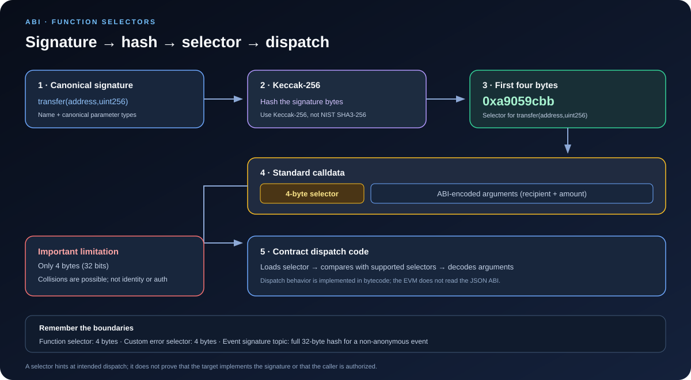

# Function Selectors: How EVM Calldata Identifies a Function

> **Stage:** 02 — ABI and Contract Interaction  
> **Priority:** 1  
> **Status:** Reviewed  
> **Last reviewed:** 2026-10-17

## 1. Overview

A **function selector** is a four-byte value used by the standard Ethereum Contract ABI to identify which external function a call is intended to invoke. It is derived from the function's canonical signature by hashing that signature with **Keccak-256** and taking the first four bytes of the hash.

For example, the commonly used ERC-20 function signature **transfer(address,uint256)** has selector **0xa9059cbb**. In a normal ABI-encoded call, those four bytes appear at the beginning of calldata, followed by the ABI-encoded arguments.

The selector is not the function's implementation, is not a permission, and is not a globally unique identifier. It is a compact dispatch value interpreted by the code at the target address.

## 2. Why Function Selectors Matter

Function selectors are useful to smart contract developers in several common tasks:

- **Inspecting transactions:** the first four bytes of contract calldata often indicate the intended function. Block explorers and debugging tools use selectors to help decode transactions.
- **Building contract calls:** ABI libraries derive the selector and encode arguments to produce calldata.
- **Debugging dispatch failures:** a selector may not match the function you expected, particularly when a frontend uses the wrong ABI or address.
- **Understanding low-level calls:** Solidity's low-level call functions accept bytes, so the caller must build the selector and argument encoding correctly.
- **Reviewing proxies and routers:** a proxy or router may forward or inspect calldata and use the selector to choose logic.
- **Auditing security assumptions:** selectors are only four bytes. Collisions are possible, and the selector itself proves nothing about the caller's identity or authorization.

Understanding selectors helps you translate a transaction's raw hex data into the function call that the sender intended to make—while remembering that intent is not a guarantee of how the target contract will interpret it.

## 3. How a Selector Is Calculated

For a standard external function, the selector is:

    selector = first 4 bytes of Keccak-256(canonical function signature)

The canonical signature contains the function name followed by a parenthesized, comma-separated list of canonical parameter types. It has no spaces.

For example:

    transfer(address,uint256)

The process is:

1. Write the canonical signature.
2. Convert that signature to its byte representation (for these ASCII characters, the bytes correspond to the visible text).
3. Calculate the Keccak-256 hash.
4. Take the first four bytes—the leftmost, highest-order four bytes of the hash.
5. Use those bytes as the selector at the start of standard function calldata.

For the ERC-20 transfer signature, the first four bytes are:

    0xa9059cbb

**Important:** Ethereum uses Keccak-256 here, not the later standardized NIST SHA3-256 hash function. They are related but use different padding conventions, so substituting SHA3-256 produces a different result.

## 4. What Is Included in the Canonical Signature?

The signature is based on the **function name and canonical parameter types**. It excludes other source-level details.

| Included in selector signature | Not included |
|---|---|
| Function name | Return type |
| Parameter types in order | Parameter names |
| Canonical forms of type aliases | Parameter data locations such as memory or calldata |
| Array dimensions and tuple component types | Visibility such as public or external |
| Parentheses and comma-separated type list, without spaces | Mutability such as view, pure, payable, or nonpayable |

For example, these declarations have the same selector signature because parameter names and data-location keywords do not form part of the signature:

    function setValue(uint256 newValue) external;
    function setValue(uint256 value) public;

The ABI canonicalizes type aliases. In selector signatures, uint is represented as uint256 and int as int256. Fixed-point aliases are canonicalized too. Tuple parameters are represented using canonical component types, with array suffixes preserved. The exact canonicalization rules are specified in the Solidity ABI specification.

Return types are excluded by design. A function cannot be distinguished from another using a different return type alone.

## 5. Selectors and Function Overloading

Solidity allows functions to share a name when their parameter lists differ. This is called **function overloading**.

For example:

    function quote(uint256 amount) external pure returns (uint256);
    function quote(address token) external view returns (uint256);

These have different parameter types and therefore different canonical signatures—and normally different selectors.

However, you cannot overload functions by changing only their return types:

    // These two signatures cannot form valid overloads by return type alone:
    function read() external pure returns (uint256);
    function read() external pure returns (address);

Both would have the same signature string, read(), because return types are not included. A call's selector therefore could not tell the dispatcher which return type was intended.

Parameter order matters too. The signatures **f(uint256,address)** and **f(address,uint256)** are different signatures. When calculating a selector, developers must use the types in the exact order defined by the interface.

## 6. Selector vs. Full Calldata

A selector is only the first four bytes, not the entire function call.

For a standard external function call:

    calldata = 4-byte selector || ABI-encoded arguments

For example, the selector for transfer(address,uint256) is followed by one 32-byte word containing the recipient address and one 32-byte word containing the amount. The address and amount are encoded according to the ABI rules.

The selector alone does not contain:

- The argument values
- The function's return values
- The function's implementation
- The sender's identity or permission to call
- A cryptographic guarantee that the target exposes a function with that signature

A transaction with an empty data field does not contain a four-byte function selector. The contract's receive or fallback behavior may apply, depending on the value transferred and the contract's code. Constructor arguments are also a separate case: deployment input contains creation bytecode followed by ABI-encoded constructor arguments, rather than a regular four-byte function selector.

## 7. How Contracts Use Selectors

The EVM itself does not read a JSON ABI file, hash human-readable function names, or automatically call a Solidity function. The deployed bytecode implements the dispatch behavior.

At a simplified level, generated Solidity dispatch code typically does this:

1. Check that calldata is long enough for a selector.
2. Load the first four bytes of calldata.
3. Compare that value with selectors for supported external functions.
4. If a match is found, decode the arguments for that function and execute its code.
5. If no selector matches, apply the contract's fallback/revert behavior or other custom dispatch logic.

This is a conceptual model of common compiler-generated dispatch. The exact bytecode sequence depends on compiler version, optimization settings, and the contract. Handwritten assembly, fallback routers, proxies, and other custom dispatch designs may behave differently.

A selector match is only part of routing. The contract can still reject the call because of access control, argument validation, state conditions, insufficient gas, or other execution failures.

### Proxies and routers

A proxy often receives calldata and forwards it using a low-level call mechanism such as DELEGATECALL. In a common proxy pattern, the original calldata—including the selector and encoded arguments—is forwarded unchanged to the implementation contract. The implementation's dispatch logic then selects the function.

A router may instead inspect the selector itself and route the call to different destinations. Therefore, when debugging a selector, check the behavior of both the address first called and any proxy or router it may use.

## 8. Obtaining Selectors in Solidity

Solidity exposes a function's selector through the **.selector** member. This avoids manually copying selector bytes into code.

    // SPDX-License-Identifier: MIT
    pragma solidity ^0.8.24;

    contract SelectorExample {
        function setValue(uint256 value) external {}

        function selectorFromFunction() external pure returns (bytes4) {
            return this.setValue.selector;
        }

        function selectorFromSignature() external pure returns (bytes4) {
            return bytes4(keccak256("setValue(uint256)"));
        }
    }

The two returned values represent the same four-byte selector. For a function that belongs to a known interface, you can also reference the interface function's selector. Be careful to hash the canonical signature string exactly—whitespace, non-canonical aliases, or the wrong parameter types lead to an incorrect selector.

The example is intended to demonstrate derivation, not to suggest that manually written signature strings are always the best approach. Prefer compiler-checked interface references when practical.

## 9. Using Selectors with ethers v6

ethers can compute a selector from an ABI interface and encode complete function calldata:

    import { Interface } from "ethers";

    const iface = new Interface([
      "function transfer(address to, uint256 amount)"
    ]);

    const selector = iface.getFunction("transfer").selector;
    const calldata = iface.encodeFunctionData(
      "transfer",
      ["0x1111111111111111111111111111111111111111", 100n]
    );

    console.log(selector); // 0xa9059cbb
    console.log(calldata.slice(0, 10)); // 0xa9059cbb

The first line derives the selector from the ABI. encodeFunctionData returns the selector plus the encoded arguments; slicing the first ten characters of the hex string gives 0x followed by the eight hex digits that represent four bytes.

This only prepares local bytes. It does not send a transaction, sign anything, or execute contract code. A subsequent call or transaction can still fail.

## 10. Selector Collisions and Security

A selector is four bytes long, giving it 2^32 possible values. Different canonical signatures can therefore share the same four-byte selector. A collision is not proof of malicious behavior, but it is a limitation that matters in low-level interfaces and custom dispatch systems.

Security principles:

1. **Do not use a selector as authentication.** It does not identify who called the contract and does not grant permission to perform an action.
2. **Do not assume a selector uniquely proves a function's identity.** Different signatures may collide, and tools may show only one plausible interpretation.
3. **Do not trust a selector database as proof of implementation.** Such databases can help identify likely signatures, but the same selector can be associated with multiple signatures.
4. **Review fallback routers carefully.** If custom routing logic uses selectors, ensure the routing table and authorization checks cannot be bypassed by unexpected inputs.
5. **Understand proxy context.** A selector may be handled by the proxy's own code or forwarded to an implementation, depending on the architecture.
6. **Do not confuse selector matching with input validation.** After dispatch, the contract still needs to validate authorization, amounts, addresses, and state constraints.

In particular, a contract should not treat a matching selector as proof that the rest of calldata is well-formed or that the caller has permission. The selector is routing metadata; security decisions must be made using the appropriate caller, state, and argument checks.

## 11. Function Selectors vs. Event Topics and Error Selectors

Related ABI concepts use hashes differently:

- **Function selector:** first four bytes of the Keccak-256 hash of a canonical function signature. It appears at the start of standard external function calldata.
- **Custom error selector:** first four bytes of the Keccak-256 hash of the canonical error signature. It commonly appears at the start of revert data, followed by encoded error arguments.
- **Event signature topic:** for a non-anonymous event, topic 0 is the full 32-byte Keccak-256 hash of the canonical event signature, not a four-byte function selector.

These are not interchangeable. Function calls, custom errors, and events use related signature-and-hash conventions but have different payload structures and contexts.

## 12. Key Takeaways

- A standard ABI function selector is the first four bytes of Keccak-256 over a canonical function signature.
- The canonical signature contains a function name and canonical parameter types, without spaces.
- Return types, parameter names, data locations, visibility, and mutability do not affect the selector.
- Standard calldata is the four-byte selector followed by ABI-encoded arguments.
- The EVM does not look up human-readable signatures; deployed bytecode implements dispatch.
- Selectors are only 32 bits, so collisions are possible and selectors are not secure identities.
- Solidity's .selector and ethers' Interface can calculate selectors and help avoid manual encoding mistakes.
- Event topics use the full event-signature hash, while custom errors use four-byte error selectors.

## Review Checklist

- [ ] Explain how Keccak-256 and canonical signatures produce a selector.
- [ ] List what is included in and excluded from a canonical signature.
- [ ] Explain why return types cannot distinguish overloaded functions.
- [ ] Separate a four-byte selector from full calldata.
- [ ] Describe how compiler-generated dispatch typically uses the selector.
- [ ] Explain collision risk and why a selector is not authentication.
- [ ] Distinguish function selectors, error selectors, and event signature topics.

## References

1. **[Solidity Contract ABI Specification — Function Selector](https://docs.solidity.org/en/latest/abi-spec.html#function-selector)** — primary source for selector length, Keccak-256 derivation, and canonical signatures.
2. **[Solidity Contracts — Function Signatures and Selectors](https://docs.solidity.org/en/latest/contracts.html#function-signatures-and-selectors-in-libraries)** — reference for Solidity selector access and library-specific calling conventions.
3. **[Ethereum.org — Transactions: The Data Field](https://ethereum.org/en/developers/docs/transactions/#the-data-field)** — explains how the first four calldata bytes identify a function and how the arguments follow.
4. **[Application Binary Interface (ABI)](01-application-binary-interface-abi.md)** — companion article explaining the ABI artifact and contract interaction.
5. **[ABI Encoding and Decoding](02-abi-encoding-and-decoding.md)** — companion article explaining the encoding of arguments after the selector.
