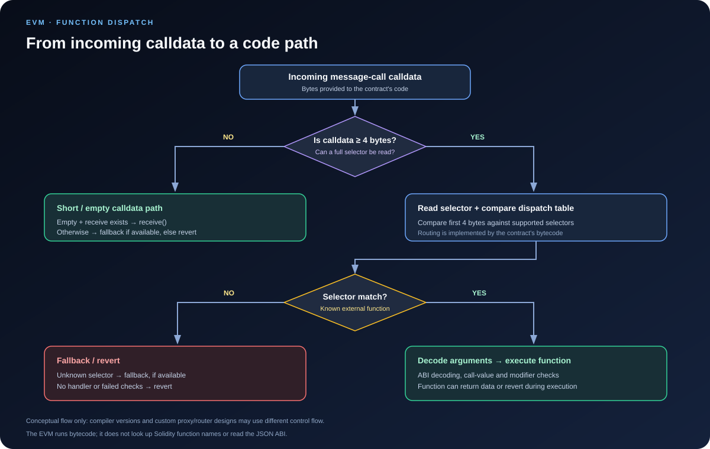

# Function Dispatch: How Contract Calldata Reaches the Right Logic

> **Stage:** 02 — ABI and Contract Interaction  
> **Priority:** 1  
> **Status:** Reviewed  
> **Last reviewed:** 2026-10-17

## 1. Overview

**Function dispatch** is the routing logic that decides which code should handle an external call to a smart contract. In a typical Solidity contract, compiler-generated bytecode examines the incoming calldata, reads the four-byte function selector when enough calldata is present, and routes a matching selector to the corresponding function entry point.

Dispatch is not a special EVM opcode and the EVM does not look up Solidity function names. The EVM executes bytecode. The contract's compiled code implements the dispatcher, while the ABI convention explains how a regular function call is represented as a selector followed by encoded arguments.

This distinction is important:

- **Function selector:** identifies the intended external function signature.
- **Function dispatch:** decides where execution goes based on calldata and the contract's routing logic.
- **ABI decoding:** interprets the argument bytes according to the selected function's parameter types.
- **Function body:** runs only after the call has passed the applicable dispatch, decoding, and execution checks.

A matching selector is not the same as a successful function call. The call can still fail while decoding arguments, checking call value, executing modifiers, enforcing access control, or running the function body.

## 2. Where Dispatch Happens

For a normal transaction to a deployed contract, the transaction's data field becomes the message call's calldata. For a contract-to-contract message call, the calling code supplies the input bytes. In both cases, the EVM provides these bytes to the code executing at the destination address.

A standard ABI function call has this general form:

    calldata = 4-byte function selector || ABI-encoded arguments

For example, calldata for a function with the canonical signature **transfer(address,uint256)** begins with the selector **0xa9059cbb**. The remaining bytes encode the recipient address and transfer amount according to the ABI specification.

The dispatcher reads the selector value and compares it against the supported external function selectors. The selector is simply bytes in calldata; it is not a function pointer stored by the EVM and does not itself contain the function's code.

The precise instruction sequence used for dispatch depends on the compiler version, optimizer settings, contract shape, and target EVM version. Treat the flow in this article as the common Solidity model rather than a promise that every contract has identical bytecode.

## 3. The Normal Dispatch Flow

A typical compiler-generated Solidity dispatcher follows a flow similar to this:

1. **Receive the calldata.** The contract begins executing with the input bytes available as calldata.
2. **Check selector availability.** If calldata is long enough, the code can load the leading four bytes. Short calldata needs a separate path rather than being treated as a complete selector.
3. **Read the selector.** The dispatcher extracts the first four bytes.
4. **Compare supported selectors.** It selects the code path associated with a matching external function signature.
5. **Decode the arguments.** The selected entry path interprets argument bytes according to the expected parameter types.
6. **Apply relevant checks and execute.** Call-value restrictions, modifiers, authorization checks, parameter validation, and function logic can still cause the call to revert.
7. **Return or revert.** The function may return ABI-encoded values, complete successfully without return data, or fail with revert data.

At a simplified level:

    incoming calldata
          |
          v
    Is there a complete 4-byte selector?
          |
      yes | no
          v
    Read selector             Short-calldata path
          |
          v
    Does a selector match?
          |
       yes|no
          v
    Decode arguments       Fallback / revert path
          |
          v
    Run checks and body
          |
          v
    Return data / revert

This is an explanatory flow, not literal EVM pseudocode. The compiler may rearrange checks or combine branches for efficiency. The important idea is that selector matching, argument decoding, and function execution are separate responsibilities.

## 4. What Happens When a Selector Matches?

When the incoming selector matches a function supported by the contract, dispatch transfers control to the entry path for that function. The input parameters then need to be decoded from calldata.

For example:

    // SPDX-License-Identifier: MIT
    pragma solidity ^0.8.24;

    contract DispatchExample {
        uint256 public storedValue;

        function setValue(uint256 newValue) external {
            storedValue = newValue;
        }

        function readValue() external view returns (uint256) {
            return storedValue;
        }
    }

A call intended for **setValue(uint256)** starts with that function's four-byte selector, followed by one ABI-encoded uint256 argument. The dispatcher selects setValue, and the generated entry code decodes the argument before the body stores it.

A selector match does **not** guarantee that the body executes successfully. Examples of later failures include:

- Calldata is too short or malformed for the declared arguments.
- The function is non-payable but the call transfers Ether.
- A modifier or access-control check rejects the caller.
- A require condition or custom error reverts.
- Execution runs out of gas or hits another exceptional condition.

The decoder generally needs enough well-formed input to obtain the declared arguments. Do not assume that a dispatcher validates every byte in the payload in exactly the same way across all implementations; compiler-generated decoding, fallback code, and custom assembly can have different behavior.

## 5. What Happens When No Selector Matches?

If the selector is not handled by a regular external function, a Solidity contract may route the input to its **fallback function**, if one exists. If no appropriate fallback path exists, the call normally reverts.

Example:

    // SPDX-License-Identifier: MIT
    pragma solidity ^0.8.24;

    contract FallbackExample {
        event UnmatchedCall(bytes4 selector, bytes input);

        fallback() external {
            emit UnmatchedCall(msg.sig, msg.data);
        }
    }

This fallback records the selector-like first four bytes exposed by **msg.sig** and the full input exposed by **msg.data**. The fallback can also be written with a bytes input parameter and a bytes return value, which is useful for certain routing designs.

Important details:

- The fallback function has **external** visibility.
- It can be marked **payable** if it needs to accept Ether with non-empty calldata, or if it is used as the fallback path for empty calldata when no receive function exists.
- A non-payable fallback rejects calls that transfer Ether.
- A fallback may intentionally inspect or forward raw calldata, but custom dispatch logic must validate inputs and authorization carefully.

A fallback is not automatically a universal proxy. It only becomes a router or forwarding mechanism when its implementation deliberately forwards or interprets the input bytes.

## 6. Empty Calldata: receive vs. fallback

An empty calldata payload does not contain a four-byte function selector. Solidity therefore has a distinct entry point for plain Ether transfers: **receive()**, when declared and applicable.

    // SPDX-License-Identifier: MIT
    pragma solidity ^0.8.24;

    contract ReceiveAndFallback {
        event ReceivedEther(address indexed sender, uint256 amount);
        event FallbackCalled(bytes input, uint256 amount);

        receive() external payable {
            emit ReceivedEther(msg.sender, msg.value);
        }

        fallback() external payable {
            emit FallbackCalled(msg.data, msg.value);
        }
    }

In this example:

- A call with **empty calldata** enters receive().
- A call with **non-empty calldata that matches no function selector** enters fallback().
- A call with unknown non-empty calldata and a value transfer can enter fallback only because this fallback is payable.
- A call with empty calldata and no receive function may use a payable fallback, if present.
- If neither appropriate receive nor fallback handling exists, the call reverts.

The existence of receive() does not make fallback irrelevant. In a contract that declares both functions, receive handles empty calldata, while fallback handles unmatched non-empty calldata.

Also distinguish an empty calldata call from a selector that is merely unknown. Empty input has no selector to compare; unknown non-empty input has bytes, often including a selector, that failed to match the dispatcher table.

See the official [Solidity fallback and receive documentation](https://docs.solidity.org/en/latest/contracts.html#fallback-function) for the exact language-level behavior.

## 7. Function Overloading and Dispatch

Solidity allows functions with the same name when their parameter type lists differ. This is **overloading**, and each externally callable signature is normally dispatched using its own selector.

    function quote(uint256 amount) external pure returns (uint256);
    function quote(address token) external view returns (uint256);

A caller's selector encodes the function name and canonical parameter types—not the return type, parameter names, or visibility. Therefore, the selector distinguishes these overloads through their different parameter types.

The dispatcher does not inspect a high-level name like **quote**. It sees the four selector bytes, compares them with its supported entries, and routes to a matching entry path.

Because a selector is only four bytes, collisions between different signatures are possible in principle. A normal contract interface cannot safely distinguish two signatures that produce the same selector solely from those four bytes. Compiler diagnostics and restrictions should be checked for the exact compiler version, and any custom router must account for selector collisions explicitly.

## 8. Dispatch, msg.sig, and Internal Calls

Solidity exposes two useful values:

- **msg.data** — the full calldata for the current message call.
- **msg.sig** — the first four bytes of that calldata.

In a normal external call, msg.sig commonly identifies the function whose dispatch entry was selected. However, inside a fallback function it can represent an unmatched selector rather than a declared function. With empty calldata, there are no four bytes of selector data, so code should not treat msg.sig as evidence of a recognized function.

An **internal function call** is different from an external message call. Solidity normally compiles internal calls as control-flow within the current execution, not as a new ABI call that re-enters the external selector dispatcher. The current message's msg.data and msg.sig are not replaced merely because an internal helper function is called.

An external self-call, such as a call through address(this), is different: it creates a new message-call boundary and enters the destination contract's external dispatch path. It also changes call semantics, including msg.sender and gas behavior, so it should not be used as a harmless substitute for an internal call.

## 9. Proxies, Routers, and Custom Dispatch

Not every contract uses only a compiler-generated selector table.

### Proxies

A common proxy receives calldata and forwards it to an implementation using DELEGATECALL. In a minimal forwarding proxy, the calldata—including the original selector and encoded arguments—is commonly passed through unchanged. The implementation's bytecode then runs in the delegatecall context and handles its own dispatch logic.

Some proxies also expose their own functions, so the proxy may process certain selectors before forwarding other calls. When debugging an upgradeable contract, identify whether a selector was handled by the proxy itself or by the implementation.

### Routers and diamond architectures

A router can inspect the selector and choose a target address, module, or function. The Diamond Standard (EIP-2535) is one example of a system where selectors are mapped to facets. Such custom dispatch can be flexible, but it introduces routing state and edge cases that need to be reviewed.

For custom dispatch implementations, audit at least:

- How a selector is extracted from short and long calldata.
- What happens for an unknown selector or empty calldata.
- Whether selector-to-target mappings can be modified safely.
- Whether authorization checks cover every route.
- How return data and revert data are forwarded.
- Whether selector collisions or unexpected calldata can select unintended logic.

The exact design depends on the architecture; a proxy, a diamond, a fallback router, and a regular Solidity contract should not be assumed to share one identical dispatcher.

## 10. Common Mistakes and Security Considerations

1. **Thinking the EVM knows Solidity function names.** The EVM executes bytecode; dispatch logic is part of the deployed program.
2. **Equating selector matching with success.** Argument decoding, payability, modifiers, authorization, and the body can still revert.
3. **Treating fallback as a guaranteed default success path.** Fallback can be absent, non-payable, or intentionally revert.
4. **Confusing empty calldata with an unknown selector.** receive() is for empty calldata; fallback normally handles unmatched non-empty calldata.
5. **Assuming internal calls use external dispatch.** Internal calls generally stay inside the current execution flow and do not create a new message-call boundary.
6. **Ignoring custom proxy/router behavior.** The initial address can process or forward a selector; inspect the implementation rather than assuming the first contract handles it directly.
7. **Using selectors as access control.** A selector routes input; it does not authenticate the caller.
8. **Assuming every payload must have exactly the arguments you expect.** Decoding behavior depends on the generated entry code or custom parser. Validate important inputs explicitly and test malformed calldata.

## 11. Key Takeaways

- Function dispatch is routing logic implemented by contract bytecode, not a dedicated EVM feature that reads ABI metadata.
- A standard Solidity dispatcher typically reads the first four bytes of sufficiently long calldata and compares the selector with supported external functions.
- After a match, argument decoding and execution checks can still fail.
- Unknown selectors generally go to fallback when available; otherwise the call reverts.
- Empty calldata has a special receive() path when that function is present; it is not the same as an unmatched selector.
- Internal Solidity function calls normally do not re-enter the external selector dispatcher.
- Proxies and routers may add custom routing layers, so inspect both the target and its call architecture.
- Selector routing is not authorization. Security checks must be explicit.

## Review Checklist

- [ ] Explain which part of dispatch is implemented by bytecode rather than by the EVM.
- [ ] Trace calldata from selector extraction to argument decoding.
- [ ] Distinguish selector match from successful execution.
- [ ] Explain unknown-selector, empty-calldata, fallback, and receive behavior.
- [ ] Describe why internal calls differ from external message calls.
- [ ] Explain how proxies and routers affect the dispatch path.
- [ ] Identify at least three dispatch-related security mistakes.

## References

1. **[Solidity Contract ABI Specification](https://docs.solidity.org/en/latest/abi-spec.html)** — defines the function-selector and argument-encoding convention used by ordinary ABI calls.
2. **[Solidity Documentation — Contracts: Fallback Function](https://docs.solidity.org/en/latest/contracts.html#fallback-function)** — specifies fallback behavior, including handling unknown selectors and calldata.
3. **[Ethereum.org — Transactions: The Data Field](https://ethereum.org/en/developers/docs/transactions/#the-data-field)** — explains selector-prefixed calldata and encoded arguments.
4. **[Solidity Compiler: ContractCompiler.cpp](https://github.com/argotorg/solidity/blob/develop/libsolidity/codegen/ContractCompiler.cpp)** — implementation reference illustrating generated selector dispatch, short-calldata checks, and receive/fallback routing. Compiler source can change; do not treat a specific implementation as a protocol-level guarantee.
5. **[EIP-2535: Diamonds, Multi-Facet Proxy](https://eips.ethereum.org/EIPS/eip-2535)** — primary proposal describing a selector-based facet routing architecture.
6. **[Function Selectors article in this roadmap](03-function-selectors.md)** — companion explanation of canonical signatures and selector derivation.
