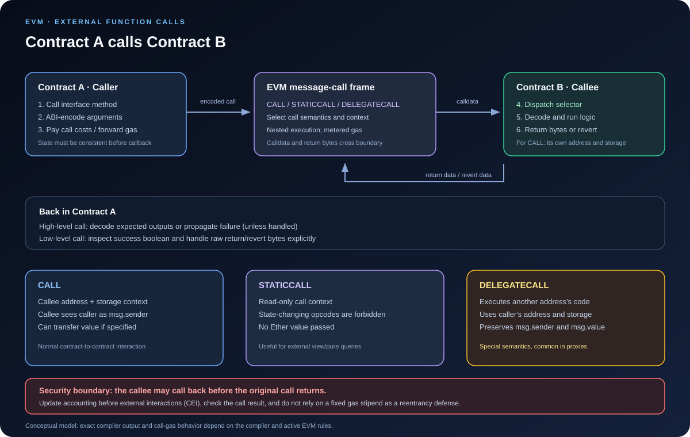

# External Function Calls: How Contracts Communicate

> **Stage:** 02 — ABI and Contract Interaction  
> **Priority:** 1  
> **Status:** Reviewed  
> **Last reviewed:** 2026-10-17

## 1. Overview

An **external function call** is a call that crosses a contract boundary and creates an EVM message-call frame. The calling code invokes a function exposed by another contract's interface, passes input bytes (usually ABI-encoded calldata), and receives success/failure information plus any returned bytes.

External calls are how smart contracts compose larger systems. A DeFi protocol can call a token, query a price feed, route a swap through an exchange, or invoke another protocol. Each call crosses an execution boundary, so the callee has its own code and storage context and may return data, revert, consume gas, or call back into the caller.

Solidity distinguishes **external** calls from **internal** calls. An internal call normally transfers control within the current contract's execution without creating a new EVM message call. A call such as token.transfer(to, amount) is an external call through a contract interface; a direct call to an internal helper function is not.

## 2. Why Developers Need to Understand Them

External calls are central to smart-contract architecture and debugging:

- **Composability:** contracts use interfaces to interact with tokens, lending protocols, exchanges, oracles, and other modules.
- **Data exchange:** ABI rules encode function arguments and decode return values across the boundary.
- **Execution context:** msg.sender, msg.value, address(this), and storage access depend on which contract's code is running and how it was called.
- **Failure handling:** the callee may revert, return false, return unexpected bytes, or fail to provide the expected result.
- **Gas and reliability:** the caller pays gas for its own execution and the nested call according to EVM rules; external code may consume much of the gas made available to it.
- **Security:** the target may be malicious or simply behave differently than expected, and can re-enter the calling contract through a callback.

A contract interface is only a compile-time description of expected behavior. Writing an address as a particular interface type does not, by itself, prove that the deployed code at that address implements that interface correctly.

## 3. A High-Level External Call

The usual Solidity approach is to declare an interface and call a function through a contract-typed address.

    // SPDX-License-Identifier: MIT
    pragma solidity ^0.8.24;

    interface IPriceFeed {
        function latestPrice() external view returns (uint256);
    }

    contract PriceConsumer {
        IPriceFeed public immutable priceFeed;

        constructor(IPriceFeed priceFeed_) {
            priceFeed = priceFeed_;
        }

        function readPrice() external view returns (uint256) {
            return priceFeed.latestPrice();
        }
    }

When readPrice calls priceFeed.latestPrice(), Solidity uses the interface declaration to determine the function selector and the expected argument and return types. The caller's code prepares the call data; the EVM creates a message-call frame for the target; then the returned bytes are decoded as uint256 if the call succeeds.

This does not mean the compiler can guarantee the implementation is trustworthy. A wrong address, incompatible contract, malicious implementation, or a return value that violates the expected schema can still produce failure or unexpected application behavior.

### Typical flow

1. The caller evaluates the target address and function arguments.
2. The arguments are encoded according to the expected ABI, with a selector for a regular external function call.
3. The EVM performs the appropriate message call using the relevant opcode and call context.
4. The callee executes in its own context, unless a special mechanism such as DELEGATECALL is used.
5. The callee returns output bytes or fails.
6. The caller decodes successful return data or handles the failure according to Solidity's call semantics.

The exact bytecode produced depends on compiler version, optimization settings, the selected EVM target, and function mutability. The model above explains the boundary rather than prescribing one exact opcode sequence for every source expression.

## 4. External Calls vs. Internal Calls

These forms may look similar at the source level but have different execution semantics.

| Call form | Creates a new message-call frame? | Context |
|---|---|---|
| Internal call, such as helper(x) | No, normally stays within current execution | Same contract address, storage, and current message context |
| External interface call, such as token.balanceOf(user) | Yes | Callee's address and storage; callee sees caller contract as msg.sender |
| External self-call, such as this.withdraw(x) | Yes | Re-enters the same contract address as a new call; msg.sender becomes address(this) |
| Low-level address.call(data) | Yes, if the EVM call is made | Normal CALL semantics; caller must inspect returned status and bytes |
| address.staticcall(data) | Yes | Static context; state-changing operations in this call tree are prohibited |
| address.delegatecall(data) | Yes, using another account's code | Runs code with the caller's address/storage context and preserves the current msg.sender and msg.value |

An external self-call is not just a more explicit spelling of a direct internal call. It pays for an external call boundary, passes through external dispatch, and changes context-sensitive values such as msg.sender. It may also encounter visibility, ABI-decoding, and reentrancy behavior that a direct internal call would not.

## 5. CALL, STATICCALL, and DELEGATECALL

Solidity source expresses the desired interaction; the compiler generates bytecode using appropriate EVM operations for the call semantics.

| Opcode / mechanism | Main purpose | State context and message values |
|---|---|---|
| CALL | Ordinary message call to another address; can transfer Ether | Callee code runs in the callee's address/storage context; callee's msg.sender is the calling contract; msg.value is the value sent with this call |
| STATICCALL | Read-only message call | Executes under a static flag; state-changing operations are rejected throughout the static call tree; value is not transferred |
| DELEGATECALL | Execute another account's code in the current contract's context, commonly for proxies | Uses the caller's address/storage context and preserves the current msg.sender and msg.value |

### CALL

A normal typed external call to another contract typically uses CALL for state-changing interactions. The caller may specify an amount of Ether, if the invoked function and call are payable. If the callee reverts and the failure is propagated, the current call fails as well.

### STATICCALL

External calls to functions declared view or pure are generally compiled with read-only call semantics when supported by the target EVM. STATICCALL sets a restriction that prevents state modification by the callee and its subcalls. The restriction is enforced by the EVM, not merely by Solidity's view keyword.

A static call may read state, perform calculations, and return bytes, but it cannot successfully perform prohibited state-changing operations such as writing storage or emitting logs. A function's pure/view declaration still matters at the Solidity level; STATICCALL is the runtime mechanism that enforces the static context for applicable external calls.

### DELEGATECALL

DELEGATECALL is different from an ordinary call. It executes code located at another address but uses the caller's storage and address context, while preserving the current msg.sender and msg.value. This is why it is used in proxy patterns—and why using it against untrusted or incompatible code can be dangerous.

Do not substitute DELEGATECALL for a normal external interface call just because both invoke code at another address. Their storage, address, and caller semantics are different.

## 6. What Happens to msg.sender, msg.value, and Storage?

Consider contract A calling contract B through a normal CALL:

- Inside B, msg.sender is generally A's address.
- Inside B, msg.value is the amount of Ether explicitly sent with that call.
- address(this) inside B is B's address.
- B's normal state-variable reads and writes access B's storage.

If B later calls C, then in a normal CALL C sees B as msg.sender. Each new message-call frame has its own execution context.

For an external self-call such as this.someFunction(), the target address is the same contract, but a new message call is created. In the nested call, msg.sender is the contract's own address, not necessarily the original user that called the outer function.

DELEGATECALL changes this model: the called code executes in the caller's context. For a proxy calling an implementation, the implementation's code reads and writes the proxy's storage; address(this) corresponds to the proxy address and the original caller/value context is preserved. That behavior enables upgradeable contracts but makes storage layout and code trust critical.

Do not rely on tx.origin as a replacement for msg.sender to establish authorization. External call chains make the distinction important, and tx.origin-based authorization can introduce phishing and composability risks.

## 7. Low-Level Calls and Return Data

Solidity exposes low-level functions on address values. They are useful when the caller needs to work directly with arbitrary calldata or handle the result manually.

    // SPDX-License-Identifier: MIT
    pragma solidity ^0.8.24;

    interface IReceiver {
        function onMessage(uint256 amount) external returns (uint256);
    }

    contract LowLevelCaller {
        error ExternalCallFailed(bytes returnData);

        function invoke(address target, uint256 amount)
            external
            returns (uint256 result)
        {
            bytes memory input =
                abi.encodeCall(IReceiver.onMessage, (amount));

            (bool success, bytes memory returnData) = target.call(input);

            if (!success) {
                // This wraps the original bytes in a new custom error.
                // It does not bubble the original revert payload unchanged.
                revert ExternalCallFailed(returnData);
            }

            result = abi.decode(returnData, (uint256));
        }
    }

The low-level call returns two values:

- **success:** whether the EVM call completed successfully at the call level.
- **returnData:** the raw bytes returned by the callee, or revert data if the call failed.

The caller must decide how to handle false, and must decode successful bytes if a typed return value is expected. In this example, a failed call is wrapped in ExternalCallFailed; that is a deliberate choice and changes the shape of the outward-facing error. Code that needs to preserve the original revert data may instead explicitly bubble it.

A true success flag does not automatically prove that the expected application function was implemented or that its return data is meaningful. When using low-level calls, check target assumptions, inspect the status, decode return bytes carefully, and validate the result before relying on it.

### High-level call vs. low-level call

A typed high-level call uses the interface to encode inputs and interpret the declared outputs. A low-level call works with bytes and a boolean result, giving the caller more control but also more responsibility.

Use high-level calls by default when a reliable interface is available. Use low-level calls when the design genuinely needs raw calldata, fallback routing, optional methods, or custom return/revert handling—and document the assumptions explicitly.

## 8. Failure and Revert Behavior

External calls can fail for many reasons: the target reverts, a requirement fails, execution runs out of gas, an invalid opcode is reached, or return data cannot be decoded as the declared output types.

With a typical high-level call, a callee revert causes the caller's statement to fail unless a try/catch construct is used to handle the external-call failure. Solidity's try/catch can handle failures from external function calls and contract creation expressions, but it does not act as a general catch-all for arbitrary internal code in the try block.

A low-level call normally returns success = false along with failure bytes rather than automatically reverting the caller. If the caller ignores that status and continues, its own execution may still succeed. That is sometimes intentional for optional interactions, but can also produce inconsistent accounting when failure should have been fatal.

If a caller reverts after a nested call fails, state changes made within the reverted call tree are rolled back. If it deliberately handles the failure and continues, state changes in its own frame that occurred before the failed call can remain. Failure handling therefore needs to match the application's invariant and accounting model.

When return data is expected, decoding can itself fail if the target returns bytes that do not match the expected ABI layout. A call that does not revert at the EVM level can still be unsuitable for the higher-level interface expected by the caller.

## 9. Gas and Call Boundaries

External calls consume gas for call-related work and the target's execution. The caller must have enough gas to perform the call and continue afterward. Memory expansion for input or output buffers, account access costs, transferred value, and the callee's computation all affect the total cost under the active EVM rules.

Do not assume an external call forwards all remaining gas or that the callee has unlimited execution capacity. EVM call-gas rules constrain how much gas can be forwarded, and the caller often needs remaining gas to process return data or handle failure.

The old habit of relying on the 2,300-gas stipend as a complete reentrancy defense is unsafe. Opcode costs can change, and security should rely on correct state transitions, checks-effects-interactions, reentrancy guards where appropriate, and explicit call-result handling—not a fixed gas assumption alone.

For exact cost analysis, refer to the applicable fork's execution specification and inspect the compiled code. High-level Solidity syntax may hide extra ABI encoding, decoding, and safety-check work.

## 10. External Calls and Reentrancy

An external call transfers control to code that may be outside your control. That code can call back into the caller before the first invocation has finished. This is **reentrancy**.

Consider a withdrawal function. If it sends Ether to an arbitrary address before reducing the user's recorded balance, the receiver may call withdraw again while the original balance is still present. A vulnerable implementation can therefore allow the same logical balance to be withdrawn multiple times.

A safer pattern is **Checks–Effects–Interactions (CEI)**:

1. **Checks:** validate the amount, authorization, and current balance.
2. **Effects:** update the contract's accounting before making the external call.
3. **Interactions:** call the external address only after internal state is consistent.

Example:

    // SPDX-License-Identifier: MIT
    pragma solidity ^0.8.24;

    contract SimpleVault {
        mapping(address => uint256) public balances;

        function deposit() external payable {
            balances[msg.sender] += msg.value;
        }

        function withdraw(uint256 amount) external {
            uint256 available = balances[msg.sender];
            require(amount <= available, "Insufficient balance");

            // Effects first: the balance is reduced before control leaves.
            balances[msg.sender] = available - amount;

            // Interaction second: the recipient's code may execute here.
            (bool success, ) = payable(msg.sender).call{value: amount}("");
            require(success, "Ether transfer failed");
        }
    }

This example illustrates the ordering principle, not a complete audited vault. Real systems may require reentrancy guards, pause controls, careful interaction design, accounting for tokens with non-standard behavior, and comprehensive tests. CEI also does not automatically solve every cross-function, cross-contract, or read-only reentrancy issue.

External calls should be treated as boundaries to potentially untrusted code. Validate assumptions before the call, leave state consistent, and do not make security decisions solely on the basis of a callee's returned boolean or claimed result.

## 11. Common Mistakes

1. **Assuming interfaces guarantee the target's behavior.** An interface describes the expected function signature, not what the deployed address actually does.
2. **Confusing internal and external calls.** A direct internal call does not create a new message-call frame; this.function() does.
3. **Ignoring call context.** msg.sender, msg.value, address(this), and storage behavior differ between CALL, STATICCALL, and DELEGATECALL.
4. **Discarding the low-level success flag.** A failed low-level call may return false without automatically reverting the caller.
5. **Decoding without checking success.** Revert bytes are not the expected successful return tuple.
6. **Assuming true means correct behavior.** The target might return an unexpected value, return no data, or not implement the intended interface.
7. **Relying on a fixed gas stipend for security.** Use sound state invariants and reentrancy defenses rather than gas assumptions alone.
8. **Updating state after untrusted interactions.** External code may re-enter before the caller completes its accounting.
9. **Assuming DELEGATECALL is an ordinary call.** It executes other code in the caller's context and can corrupt the caller's state if misused.

## 12. Key Takeaways

- An external function call creates an EVM message-call boundary; a normal internal call generally does not.
- The ABI is used to encode function arguments and decode returned bytes, but a contract interface does not prove the target's implementation.
- CALL, STATICCALL, and DELEGATECALL have materially different message and storage contexts.
- The callee normally sees the calling contract as msg.sender; msg.value is the value sent with that call.
- High-level calls handle typed interfaces, while low-level calls return a status flag and raw bytes that the caller must handle.
- Reverts, malformed return data, insufficient gas, and application checks can all cause a call to fail.
- Treat external code as untrusted and follow appropriate reentrancy defenses, such as Checks–Effects–Interactions.

## Review Checklist

- [ ] Distinguish an external message call from an internal function call.
- [ ] Explain the high-level interface-call flow from ABI encoding to return decoding.
- [ ] Compare CALL, STATICCALL, and DELEGATECALL.
- [ ] Explain how msg.sender, msg.value, address(this), and storage context change.
- [ ] Handle low-level success and return data correctly.
- [ ] Distinguish low-level call failure from a high-level revert.
- [ ] Explain why an external call can cause reentrancy and how CEI helps.
- [ ] Explain why the 2,300-gas stipend is not a complete security guarantee.

## References

1. **[Solidity Documentation — Visibility and Function Calls](https://docs.solidity.org/en/latest/contracts.html#function-visibility)** — explains external versus internal calls and Solidity visibility.
2. **[Solidity Documentation — Low-Level Call Functions](https://docs.solidity.org/en/latest/types.html#members-of-address-types)** — reference for address.call, staticcall, delegatecall, and the returned status/data.
3. **[EIP-214: New Opcode STATICCALL](https://eips.ethereum.org/EIPS/eip-214)** — defines the EVM static-call mechanism and static execution restrictions.
4. **[Ethereum.org — Understanding the Yellow Paper's EVM Specifications](https://ethereum.org/en/developers/tutorials/yellow-paper-evm/)** — background on message-call execution context and EVM call semantics.
5. **[Solidity SMTChecker — External Calls and Reentrancy](https://docs.solidity.org/en/latest/smtchecker.html#external-calls-and-reentrancy)** — explains why external calls should be treated as calls to potentially unknown code.
6. **[EIP-150: Gas Cost Changes for IO-heavy Operations](https://eips.ethereum.org/EIPS/eip-150)** — primary reference for historical gas-forwarding rule changes relevant to message calls.
7. **[Function Dispatch article in this roadmap](04-function-dispatch.md)** — companion explanation of selector routing and fallback behavior.
