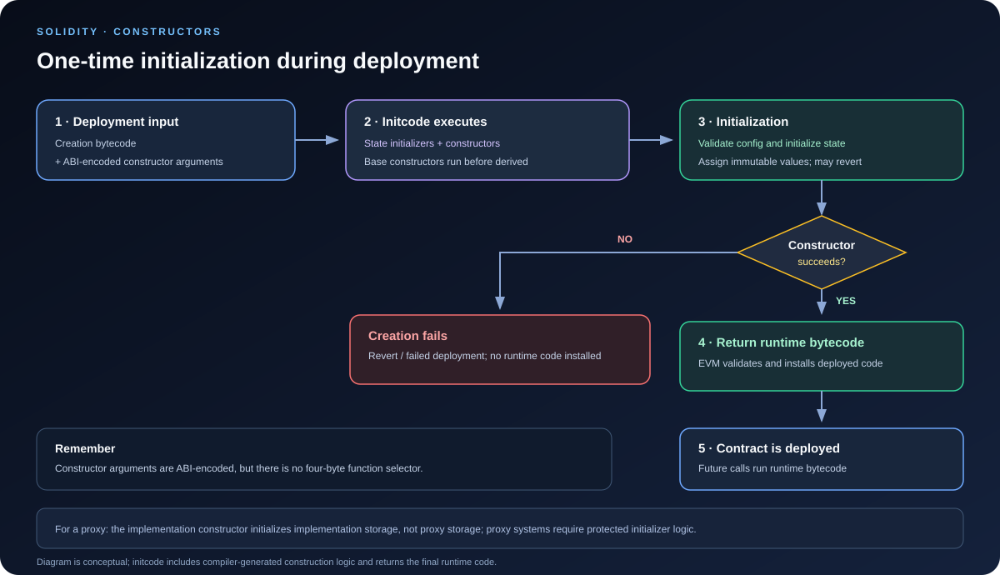

# Constructors: Initializing a Smart Contract at Deployment

> **Stage:** 02 — ABI and Contract Interaction  
> **Priority:** 1  
> **Status:** Reviewed  
> **Last reviewed:** 2026-10-17

## 1. Overview

A **constructor** is an optional Solidity function declared with the `constructor` keyword. It runs as part of creating a contract and is used to establish the contract's initial configuration: assigning an owner, setting immutable parameters, validating deployment inputs, and initializing state.

A constructor differs from a regular external function in a critical way: it runs during contract creation, not through the deployed contract's normal function dispatcher. Once construction completes successfully, the constructor code is not installed as a callable external function. The contract's returned runtime bytecode is what remains at the deployed address.

A contract can define at most one constructor, and constructors cannot be overloaded. If no constructor is declared, Solidity provides a default constructor with no parameters.

This article focuses on constructor-specific behavior. The Stage 01 article [Contract Creation and Initialization](../01-evm-execution/11-contract-creation-and-initialization.md) explains the wider EVM creation lifecycle, including initcode and runtime bytecode.

## 2. Why Constructors Matter

Constructors define the initial trust and configuration boundary for many contracts. Developers use them to:

- Set an administrator or owner at deployment.
- Configure token addresses, oracle addresses, fee parameters, and protocol limits.
- Validate deployment parameters before the contract becomes available.
- Initialize inherited contracts by supplying base-constructor arguments.
- Assign values to `immutable` variables.
- Prevent accidental deployment with invalid or unsafe configuration.

A constructor that assigns the wrong owner, accepts a malicious dependency address, or skips a required initialization step can create a permanent vulnerability. Unlike an ordinary setter, a constructor normally cannot be called again after deployment to correct the initial setup.

## 3. Basic Constructor Syntax

A minimal example:

    // SPDX-License-Identifier: MIT
    pragma solidity ^0.8.24;

    contract SimpleVault {
        address public owner;
        uint256 public minimumDeposit;

        constructor(uint256 minimumDeposit_) {
            owner = msg.sender;
            minimumDeposit = minimumDeposit_;
        }
    }

When the contract is deployed:

1. The deployment supplies the constructor argument `minimumDeposit_`.
2. Solidity initializes declared state variables to their inline initializers or default values as part of construction.
3. The constructor body runs, assigning `owner` and `minimumDeposit`.
4. If construction succeeds, the EVM installs the runtime bytecode returned by the initcode.

The example assigns `owner = msg.sender`. If an externally owned account deploys the contract directly, `msg.sender` is that account. If a factory contract deploys it, `msg.sender` inside the new contract's constructor is normally the factory contract—not the user who called the factory. That distinction matters when constructors assign ownership or permissions.

### Constructor visibility and overloading

Modern Solidity syntax does not use `public` or `external` after the `constructor` keyword. Older Solidity versions required a visibility keyword, but that syntax is obsolete in modern versions.

Only one constructor is allowed in a contract. It may have zero or more parameters, but you cannot define several constructors differentiated by parameter types as you could with ordinary overloaded functions.

## 4. Constructor Arguments and ABI Encoding

Constructor arguments are ABI-encoded, but they do **not** use a regular four-byte function selector.

For a typical Solidity deployment, the transaction input consists conceptually of:

    compiler-generated creation bytecode
    ++
    ABI-encoded constructor arguments

The constructor parameter values are encoded according to the standard ABI rules. The exact data layout therefore follows the same static/dynamic encoding rules explained in [ABI Encoding and Decoding](02-abi-encoding-and-decoding.md).

For example:

    constructor(address token_, uint256 cap_) {
        token = IERC20(token_);
        cap = cap_;
    }

The deployment tool must supply the expected two arguments in the correct order and types. The constructor does not begin with something like a `constructor(address,uint256)` selector, because contract creation uses initcode rather than a normal external function call.

This distinction is useful when inspecting a deployment transaction: the creation input contains initcode plus encoded constructor arguments; it does not follow the same selector-prefixed layout as an ordinary function call.

## 5. Constructor Execution vs. Runtime Code

Constructor logic is part of the contract-creation phase. It is not a callable entry point in the final deployed runtime code.

The creation process is broadly:

1. A top-level creation transaction or a contract's `CREATE`/`CREATE2` operation supplies initcode.
2. Initcode executes in the new contract's creation context.
3. The constructor body performs initialization and can call other contracts.
4. If execution succeeds, initcode returns runtime bytecode.
5. The EVM validates and installs that runtime bytecode at the new address.
6. Later external calls run the deployed runtime code, not the constructor again.

If the constructor reverts or otherwise fails, the creation attempt does not install the intended runtime code. The outer creation transaction or factory call reports failure according to its creation mechanism.

A constructor can call other contracts, but those calls occur during deployment and consume gas. Construction should not be treated as a free setup phase.

### Why this matters for CREATE2

The address derived by `CREATE2` depends on the creator address, salt, and hash of the exact initcode. Since ABI-encoded constructor arguments are appended to creation bytecode, changing those arguments changes the initcode hash and can therefore change the deterministic deployment address.

The compiler version, optimizer settings, metadata, linked libraries, and constructor arguments can all affect the bytecode used for deployment. When deriving or predicting a `CREATE2` address, use the exact initcode bytes that will actually be deployed.

## 6. State Variables, Immutable Values, and Defaults

State variables can be initialized inline or inside a constructor.

    // SPDX-License-Identifier: MIT
    pragma solidity ^0.8.24;

    contract Configuration {
        uint256 public constant BPS_DENOMINATOR = 10_000;
        uint256 public feeBps = 30;
        address public immutable feeRecipient;

        constructor(address feeRecipient_) {
            require(feeRecipient_ != address(0), "Zero recipient");
            feeRecipient = feeRecipient_;
        }
    }

These declarations have different roles:

- **Default values:** a state variable without another initial value receives its type's default value.
- **Inline initialization:** `feeBps = 30` establishes the variable's initial value during construction.
- **Constructor assignment:** the constructor validates the supplied recipient and assigns it.
- **`constant`:** the value is fixed at compile time and does not occupy a normal mutable storage slot.
- **`immutable`:** the value is assigned during construction and embedded into the deployed runtime code by Solidity, rather than being a normal mutable storage variable.

An immutable value cannot be assigned later through an ordinary external function. Because Solidity patches immutable values into runtime code at deployment, the deployed runtime bytecode can differ from the compiler's unpatched runtime template.

Inline initializers and constructor code execute as part of construction, but developers should be careful with state-variable initializer expressions that rely on other variables in an inheritance hierarchy. Follow Solidity's documented initialization and inheritance order rather than assuming source declaration order across all contracts is the entire story.

## 7. Constructors and Inheritance

When a contract inherits from one or more base contracts, those base constructors may also need to run. Every required base-constructor parameter must be supplied by the derived contract or its inheritance chain.

There are two common ways to provide base arguments.

### Arguments in the inheritance list

    // SPDX-License-Identifier: MIT
    pragma solidity ^0.8.24;

    contract BaseFee {
        uint256 public feeBps;

        constructor(uint256 feeBps_) {
            feeBps = feeBps_;
        }
    }

    contract Exchange is BaseFee(25) {
        address public immutable admin;

        constructor(address admin_) {
            admin = admin_;
        }
    }

Here the base constructor receives the constant value `25`, and the derived constructor receives the admin address.

### Arguments forwarded from the derived constructor

    contract ExchangeWithConfig is BaseFee {
        address public immutable admin;

        constructor(address admin_, uint256 feeBps_)
            BaseFee(feeBps_)
        {
            admin = admin_;
        }
    }

This approach is useful when the base arguments depend on the derived constructor's parameters.

### Constructor execution order

Base constructors execute before the most-derived contract's constructor, following Solidity's inheritance linearization order. With multiple inheritance, do not assume the order in which base arguments are written in the derived constructor determines execution order.

The exact initialization sequence matters when inherited constructors write state, validate configuration, or depend on state variables. Test the hierarchy and consult Solidity's inheritance documentation when multiple bases are involved.

If a base constructor requires arguments and the derived contract does not provide them, the derived contract must remain abstract until the required arguments can be supplied by a later concrete child contract.

## 8. Payable Constructors and Deployment Value

A constructor can be marked `payable` when the contract is intended to receive Ether during deployment.

    // SPDX-License-Identifier: MIT
    pragma solidity ^0.8.24;

    contract FundedAtDeployment {
        address public immutable deployer;

        constructor() payable {
            deployer = msg.sender;
        }

        function balance() external view returns (uint256) {
            return address(this).balance;
        }
    }

A payable constructor permits the creation transaction to send Ether to the new contract. A non-payable constructor does not accept a nonzero deployment value under Solidity's normal generated checks.

Use payable construction only when the intended initial Ether balance is part of the design, and account for it explicitly. Constructor value is not the same as a later call to a payable external function: during creation, the initcode is running and the runtime dispatcher has not yet been installed.

## 9. Security Considerations

### Validate deployment parameters

Reject unsafe configuration at construction time. Common examples include zero administrator addresses, unsupported token addresses, invalid fee ranges, and inconsistent protocol limits.

Constructor validation does not prove that a dependency is trustworthy. A nonzero address may still point to a contract with malicious, incompatible, or unexpected behavior. When dependencies matter for security, consider how the deployment process establishes and verifies those dependencies.

### Be careful with owner assignment

This pattern assigns ownership to the direct deployer:

    owner = msg.sender;

That is correct when the direct deployer should own the contract. It may be wrong for factory-based deployment, where the factory becomes the constructor's `msg.sender`. If a factory deploys on behalf of a user, pass the intended owner as an explicit constructor argument and validate it.

### A constructor is not a proxy initializer

For upgradeable proxy systems, the proxy and implementation are different contract accounts with separate storage. A constructor on the implementation initializes the implementation's own storage when the implementation is deployed; it does **not** initialize the proxy's storage.

Upgradeable designs typically use an initializer function executed through the proxy's context, with protections against repeated initialization. The initializer must be called correctly, and the implementation contract itself is often locked against direct initialization. Do not assume an implementation's constructor automatically sets the proxy's owner or configuration.

### External calls during construction

Constructor code can call external contracts. Such dependencies may revert, consume gas, or return unexpected data, so handle them carefully. The contract under construction has not yet had its final runtime code installed; calls to its address during this phase cannot be assumed to behave like calls to a fully deployed instance.

Avoid unnecessary external interactions in constructors. If a constructor must query or configure another contract, validate the assumptions and test failed deployment behavior.

### Deployment limits and gas

Initcode has protocol-level size and gas rules. EIP-3860 specifies a maximum initcode size of 49,152 bytes and adds a metered cost for initcode; active limits can change with future network upgrades, so check the applicable chain and fork rather than relying on a hard-coded assumption. Runtime code also has a separate size limit.

A constructor can make a contract undeployable if the complete initcode becomes too large, if deployment gas is insufficient, or if runtime-code deposit fails. This can matter for large constructors, factories that embed child creation bytecode, and deployments with substantial constructor arguments.

## 10. Common Mistakes

1. **Expecting to call the constructor later.** Constructor code is executed during creation and is not a normal deployed external function.
2. **Expecting a constructor selector.** Constructor arguments are appended as ABI-encoded data after creation bytecode; no regular four-byte function selector is used.
3. **Assigning ownership to the wrong account.** With a factory, constructor `msg.sender` is typically the factory.
4. **Ignoring base-constructor requirements.** Inherited constructor parameters must be supplied, and execution follows inheritance linearization.
5. **Confusing immutable and storage variables.** An immutable is embedded into deployed runtime code rather than remaining an ordinary mutable storage slot.
6. **Assuming implementation constructors initialize a proxy.** They initialize the implementation account, not the proxy's separate storage.
7. **Skipping argument validation.** A successfully encoded argument can still be an unsafe or invalid configuration.
8. **Ignoring the exact initcode.** Constructor arguments and build settings affect the deployed creation bytes and can change a `CREATE2` address.
9. **Treating deployment setup as free.** Constructor execution, external calls, initcode metering, and runtime-code deposit all consume gas.

## 11. Key Takeaways

- A constructor is an optional, one-time initialization function executed during contract creation.
- A deployed contract does not expose its constructor as a normal external function.
- Constructor parameters are ABI-encoded after creation bytecode, without a function selector.
- Inline state initializers, constructor assignments, constants, and immutables have different roles.
- Base constructors execute according to Solidity's inheritance linearization, and required parameters must be provided.
- Constructor `msg.sender` is the direct creator, which may be a factory rather than the original user.
- A payable constructor can accept Ether during deployment.
- Proxy implementations' constructors do not initialize the proxy's storage; upgradeable designs use protected initializer logic.
- Exact initcode matters for `CREATE2`, deployment gas, and protocol size constraints.

## Review Checklist

- [ ] Explain when a constructor runs and why it is not a regular external function.
- [ ] Explain how constructor arguments are encoded and why there is no function selector.
- [ ] Distinguish default values, inline initialization, constants, and immutables.
- [ ] Explain base-constructor arguments and inheritance order.
- [ ] Explain why a factory changes the meaning of constructor `msg.sender`.
- [ ] Distinguish constructor initialization from proxy initialization.
- [ ] Identify deployment-size, gas, and external-dependency risks.

## References

1. **[Solidity Documentation — Constructors](https://docs.solidity.org/en/latest/contracts.html#constructors)** — primary language reference for constructor syntax, initialization, argument encoding, and inheritance.
2. **[Solidity Documentation — Multiple Inheritance and Linearization](https://docs.solidity.org/en/latest/contracts.html#multiple-inheritance-and-linearization)** — explains constructor execution order in inheritance hierarchies.
3. **[EIP-3860: Limit and Meter Initcode](https://eips.ethereum.org/EIPS/eip-3860)** — specifies initcode size and metering rules for Ethereum execution.
4. **[EIP-1014: Skinny CREATE2](https://eips.ethereum.org/EIPS/eip-1014)** — defines deterministic address derivation based on the initcode hash.
5. **[OpenZeppelin Contracts — Writing Upgradeable Contracts](https://docs.openzeppelin.com/upgrades-plugins/writing-upgradeable)** — explains why proxy-based upgradeable contracts use initializer functions instead of relying on implementation constructors.
6. **[Contract Creation and Initialization in the EVM](../01-evm-execution/11-contract-creation-and-initialization.md)** — companion article covering the wider EVM contract-creation lifecycle.
