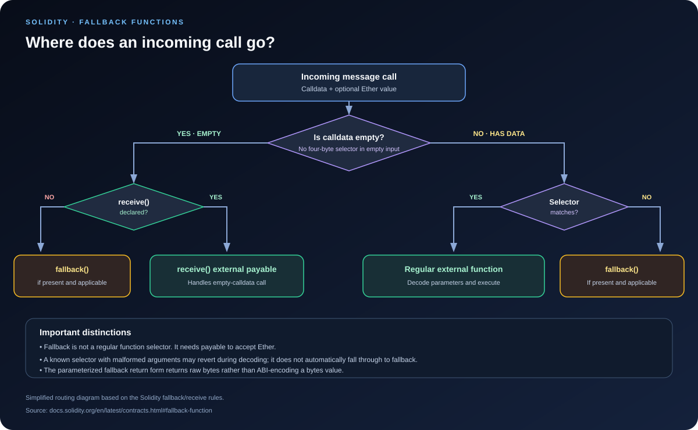

# Fallback Functions: Handling Unmatched Calls in Solidity

> **Stage:** 02 — ABI and Contract Interaction  
> **Priority:** 1  
> **Status:** Reviewed  
> **Last reviewed:** 2026-10-17

## 1. Overview

A **fallback function** is a special Solidity entry point that runs when a call to a contract does not match any of its regular external function signatures, or when calldata is empty and the contract does not have an applicable `receive()` function.

Unlike a normal external function, the fallback function has no ordinary function name or selector of its own. It is a catch-all entry point in the contract's dispatch logic. Depending on how it is written, it can reject unexpected calls, inspect raw calldata, accept Ether, return raw bytes, or forward the call to another contract.

Fallbacks are important in proxy contracts and routers, but they can also be a source of unexpected behavior if a contract silently accepts calls its authors did not intend to support.

## 2. When Is the Fallback Function Called?

For a Solidity contract that has a fallback function, the fallback generally runs in these cases:

- **Unknown selector:** calldata starts with a selector that does not match any regular external function.
- **Unmatched non-empty calldata:** the caller sends data that is not handled by the regular external dispatch logic.
- **Empty calldata with no applicable receive function:** if the contract has no `receive()`, empty calldata may be handled by a fallback function.
- **Custom routing:** a proxy or router deliberately uses fallback to forward or interpret raw call data.

There is an important distinction between an **unknown selector** and **malformed arguments for a known selector**. If the selector matches a declared function but its argument data cannot be decoded, the call may revert during decoding; it does not automatically fall through to fallback just because the arguments are invalid.

The EVM does not have a dedicated “fallback opcode.” The compiler's generated dispatch code routes the call to the fallback entry when its conditions are met. Custom bytecode, proxy code, and router implementations may have their own routing behavior.

## 3. Syntax and Rules

Modern Solidity supports these two fallback forms:

### No explicit calldata parameter

    fallback() external {
        // Handle an unmatched call.
    }

### Explicit calldata and raw return data

    fallback(bytes calldata input) external returns (bytes memory output) {
        // Inspect input and optionally return bytes.
    }

The fallback function:

- Must have **external** visibility.
- Can be declared at most once per contract.
- Uses the `fallback` keyword directly; the `function` keyword is not used.
- May be marked `payable` if it needs to accept Ether.
- Can have modifiers, be virtual, and be overridden where Solidity permits.
- Does not have a regular function selector of its own.

The `bytes calldata input` form receives the full input data, equivalent to `msg.data`. If the function returns `bytes memory output`, those bytes are returned directly without standard ABI encoding or additional padding. This is a special behavior: do not assume the return value is encoded like the return value of a regular Solidity function.

A contract should not define multiple fallback functions. If it needs to handle both ordinary Ether transfers and unknown function calls, the usual clear design is to define a separate `receive()` function and a fallback function with the intended behavior for non-empty calldata.

## 4. A Minimal Fallback Example

    // SPDX-License-Identifier: MIT
    pragma solidity ^0.8.24;

    contract FallbackLogger {
        event UnmatchedCall(
            address indexed sender,
            bytes4 selector,
            bytes data
        );

        fallback() external {
            emit UnmatchedCall(msg.sender, msg.sig, msg.data);
        }
    }

When a call to FallbackLogger does not match a regular external function, this fallback emits a log containing:

- `msg.sender`: the immediate caller.
- `msg.sig`: the first four bytes of calldata (or zero-like selector data when there is not a full selector; do not use it to prove a function was recognized).
- `msg.data`: all calldata passed into this message call.

Because this fallback is **not payable**, a call that attempts to send Ether to it will revert. It can handle unmatched calls with no Ether, but it does not accept Ether through that fallback.

This example is for demonstration. In a production contract, logging every arbitrary call may add unwanted gas costs and may expose information that the application does not need to record.

## 5. Fallback vs. Receive

Solidity split the old unnamed fallback behavior into separate `fallback()` and `receive()` functions starting with Solidity 0.6.0. Their purpose and dispatch behavior differ.

| Situation | Which entry point is used? |
|---|---|
| Empty calldata and a `receive()` function exists | `receive()` |
| Empty calldata and no `receive()`, but fallback exists | `fallback()` |
| Non-empty calldata matches a declared external function | That regular function |
| Non-empty calldata does not match a regular function | `fallback()`, if available |
| Unknown selector plus Ether, with non-payable fallback | Reverts |
| Unknown selector plus Ether, with payable fallback | Fallback can execute and access `msg.value` |

A receive function must be written as `receive() external payable`. It takes no parameters and returns no values. It is specifically for calls with empty calldata. By contrast, fallback is for unmatched calls and can receive non-empty calldata.

If a contract declares both receive and a payable fallback, an ordinary empty-calldata Ether transfer uses `receive()`; it does not use the fallback instead. If no receive function exists, a payable fallback can handle an empty-calldata transfer.

Having no receive or fallback means the contract normally rejects plain Ether transfers through a message call. Ether can still reach a contract through protocol-level mechanisms that do not execute its fallback, so contract code must not rely on a perfect guarantee that `address(this).balance` can only increase through its own receive/fallback paths.

See the official [Solidity fallback function documentation](https://docs.solidity.org/en/latest/contracts.html#fallback-function) for the formal rules.

## 6. Payability and Receiving Ether

Fallback functions are **non-payable by default**. To allow a fallback call to accept Ether, mark it `payable`:

    // SPDX-License-Identifier: MIT
    pragma solidity ^0.8.24;

    contract FallbackAndReceive {
        uint256 public fallbackCalls;
        uint256 public receivedEther;

        receive() external payable {
            receivedEther += msg.value;
        }

        fallback() external payable {
            fallbackCalls += 1;
            receivedEther += msg.value;
        }
    }

In this example:

- Empty calldata enters `receive()`.
- Unknown non-empty calldata enters `fallback()`.
- An unknown-selector call may also send Ether because the fallback is payable.
- The `receive()` function is not a general replacement for handling unknown selectors.

This contract writes state in both paths, so ordinary calls need enough gas to pay for storage updates. If Ether arrives through legacy `send()` or `transfer()`, the receiver has only a 2,300-gas stipend; a storage write typically exceeds that amount and makes the transfer fail. That stipend is not a general security boundary, and developers should not rely on it as a complete reentrancy defense. Prefer a carefully designed withdrawal/call pattern with explicit failure handling and appropriate state-update ordering.

A payable fallback should exist because the contract deliberately needs this behavior—not merely to make a contract appear capable of receiving Ether.

## 7. Fallbacks That Return Bytes

The fallback form with a calldata parameter can return raw bytes:

    // SPDX-License-Identifier: MIT
    pragma solidity ^0.8.24;

    contract RawReturnFallback {
        fallback(bytes calldata input)
            external
            returns (bytes memory output)
        {
            return input;
        }
    }

This fallback returns the input bytes unchanged. Because the fallback's returned bytes are **not ABI-encoded**, the result is raw return data rather than an ABI-encoded `bytes` value containing an offset and length.

This distinction matters when the caller expects a normal function ABI. If the caller expects a regular function to return `bytes memory`, its ABI-encoded return value normally includes an offset, length, and payload. The special fallback return form instead returns the output bytes without modification.

When consuming these bytes, the caller should know exactly which interface and return format it expects. Raw return data can be useful for generic proxies and routers, but a mismatch between raw and ABI-encoded data can break integrations.

## 8. Fallback as a Proxy or Router Entry Point

A proxy contract often defines a fallback so that calls to unrecognized implementation functions can be forwarded to an implementation contract. A simplified transparent explanation is:

1. The user sends calldata to the proxy address.
2. The proxy's own dispatch may handle certain proxy-specific functions first.
3. For other selectors, its fallback executes.
4. The fallback forwards the original calldata to the implementation, commonly through `DELEGATECALL`.
5. The implementation processes the selector and arguments in the proxy's storage context.
6. The proxy returns the implementation's return data or bubbles up the revert data.

In a delegatecall-based proxy, implementation code executes using the proxy's address and storage. This is fundamentally different from a normal `CALL` to the implementation address. A correct proxy must preserve the call result and revert behavior carefully; merely forwarding a selector is not enough.

A router may instead decode a selector and route the call to one of several targets. The exact behavior depends on the design. Never assume every fallback is a proxy or that every proxy forwards all calldata unchanged.

### Proxy security checks

When reviewing fallback-based proxy code, inspect:

- The implementation/facet address and how it can be changed.
- Whether the proxy has functions whose selectors overlap or collide with implementation selectors.
- Whether the calldata is forwarded exactly as intended.
- Whether returned bytes and revert data are propagated correctly.
- Whether authorization and upgrade controls are protected.
- Whether delegatecalled code is trusted and compatible with the proxy's storage layout.

An unprotected upgrade mechanism or unsafe delegatecall target can give an attacker control over proxy storage or behavior. Fallback routing itself is not the vulnerability; its access control and forwarding assumptions determine the risk.

## 9. Common Mistakes and Security Considerations

1. **Using fallback as a substitute for a regular function.** Prefer explicit functions for expected operations; fallback is a catch-all and can make interface mistakes harder to detect.
2. **Forgetting `payable`.** A non-payable fallback reverts if the call sends Ether.
3. **Confusing fallback with receive.** Empty calldata goes to receive when an applicable receive function exists; fallback handles unmatched non-empty calldata.
4. **Assuming malformed arguments always trigger fallback.** A known selector may match first, then fail while decoding its arguments.
5. **Misreading the special return form.** `fallback(bytes calldata) returns (bytes memory)` returns raw bytes, not a standard ABI-encoded `bytes` result.
6. **Blindly forwarding calldata.** A proxy or router must correctly propagate returndata and reverts, and must control its delegatecall destination.
7. **Treating a payable fallback as safe Ether handling by default.** It can be called with arbitrary calldata and may expose unintended behavior.
8. **Relying on the 2,300-gas stipend as a security guarantee.** Gas schedules can change, and robust reentrancy defenses require correct state transitions.
9. **Assuming all contract Ether arrivals execute fallback.** Some protocol-level mechanisms can transfer Ether without executing the receive/fallback code.
10. **Using `msg.sig` as proof of recognized intent.** It is a view of calldata's first four bytes, not authentication, and may represent an unknown selector.

## 10. Key Takeaways

- Fallback is a special external entry point for unmatched calls, with an empty-calldata case when receive is absent.
- It can be non-payable or payable; receiving Ether through fallback requires `payable`.
- A fallback function does not have a normal function selector and cannot be overloaded.
- The `fallback(bytes calldata input) returns (bytes memory output)` form can inspect input and return raw, unencoded bytes.
- Empty calldata is handled by receive if present; otherwise a fallback may handle it.
- Invalid arguments for a selector that already matches a regular function generally fail decoding rather than being redirected to fallback.
- Proxies and routers commonly use fallback for forwarding, but require careful return-data, revert, access-control, and delegatecall handling.
- Do not rely on fallback being executed for every Ether transfer or on a fixed gas stipend as a complete security defense.

## Review Checklist

- [ ] Explain when fallback runs and how it relates to selector dispatch.
- [ ] Distinguish fallback from receive.
- [ ] Show why a non-payable fallback rejects value transfers.
- [ ] Explain the special raw-byte return behavior of the parameterized fallback form.
- [ ] Explain how a proxy can forward calldata in fallback.
- [ ] Identify risks from unchecked delegatecall targets and mishandled return/revert data.
- [ ] Explain why a malformed call to a known selector does not automatically enter fallback.

## References

1. **[Solidity Documentation — Fallback Function](https://docs.solidity.org/en/latest/contracts.html#fallback-function)** — primary reference for declaration forms, when fallback runs, payability, calldata input, and raw return bytes.
2. **[Solidity Documentation — Receive Ether Function](https://docs.solidity.org/en/latest/contracts.html#receive-ether-function)** — defines receive behavior and the empty-calldata distinction.
3. **[Solidity v0.6.0 Breaking Changes](https://docs.solidity.org/en/latest/060-breaking-changes.html)** — explains why the former unnamed fallback behavior was split into fallback and receive.
4. **[Solidity Security Considerations](https://docs.solidity.org/en/latest/security-considerations.html)** — discusses Ether reception, gas stipends, and external-call risks.
5. **[EIP-1967: Proxy Storage Slots](https://eips.ethereum.org/EIPS/eip-1967)** — reference for common proxy implementation/admin storage conventions.
6. **[Function Dispatch article in this roadmap](04-function-dispatch.md)** — companion explanation of selector routing and short/unmatched calldata.
7. **[External Function Calls article in this roadmap](05-external-function-calls.md)** — companion explanation of call context, low-level calls, returndata, and reentrancy.
