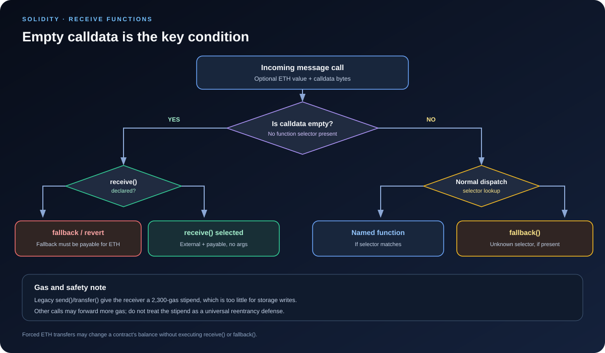

# Receive Functions: Handling Calls with Empty Calldata

> **Stage:** 02 — ABI and Contract Interaction  
> **Priority:** 1  
> **Status:** Reviewed  
> **Last reviewed:** 2026-10-17

## 1. Overview

A Solidity **receive function** is a special entry point that executes when a contract is called with **empty calldata**. It is most commonly used when Ether is sent directly to a contract without specifying a function, such as through a plain Ether transfer.

Its modern Solidity declaration is:

    receive() external payable {
        // Handle a call with empty calldata.
    }

The syntax is deliberately restrictive: a contract can have at most one receive function; it must be `external payable`; it cannot accept parameters or return values; and it is declared without the `function` keyword. Unlike a regular external function, it has no function selector.

Receive and fallback are related but different. If calldata is empty and a receive function exists, receive is selected. If receive is absent, a payable fallback can handle an empty-calldata call. Fallback handles calls that do not match a regular external function, including unknown non-empty calldata.

## 2. Why Receive Functions Matter

Contracts commonly need to receive Ether as part of their intended design. A receive function makes that behavior explicit and separates plain Ether reception from unknown function calls.

Developers use receive functions for:

- **Receiving plain Ether:** allowing an account or another contract to send ETH without invoking a named function.
- **Accepting deposits through a simple transfer:** useful when the application intentionally treats incoming value as an uncomplicated deposit.
- **Separating payment handling from fallback routing:** a contract can process empty calldata through receive and reserve fallback for unmatched calls or proxy behavior.
- **Composing with other contracts:** when another contract sends value with empty calldata, the recipient's receive path may execute.
- **Controlling deployment and wallet behavior:** the presence, payability, and gas use of receive/fallback entry points affect whether ordinary value transfers succeed.

A receive function is not a complete deposit accounting system by itself. The contract balance increases when it receives ETH, but an application that tracks user balances, shares, claims, or liabilities must update and validate that accounting through a deliberate design. A plain transfer does not identify a user or provide deposit metadata beyond the available message context.

## 3. Exact Declaration Rules

A receive function must follow this form:

    receive() external payable {
        // ...
    }

Important rules:

- **At most one:** a contract cannot define multiple receive functions.
- **External visibility:** it must be declared `external`.
- **Payable:** it must be able to accept the value sent with the call.
- **No parameters:** there is no way to pass explicit ABI arguments to receive.
- **No return values:** callers should not expect decoded return data from a receive function.
- **No selector:** it does not use a normal four-byte function selector.
- **Optional:** contracts do not need a receive function if they are not meant to accept plain ETH transfers.

The receive function can have modifiers, can be virtual, and can be overridden where Solidity allows. However, its special role and gas constraints mean that a receive implementation should generally stay simple.

## 4. When Does Receive Execute?

Receive is selected when the contract is called with **empty calldata**, provided a receive function is declared. The call may carry ETH, but the key routing condition is empty calldata.

Common situations include:

1. A user sends ETH to the contract address without calling a named function.
2. Another contract sends ETH using an empty-calldata call, such as `recipient.call{value: amount}("")`.
3. Legacy `send()` or `transfer()` is used to send ETH to a payable contract recipient. These APIs are deprecated in modern Solidity documentation, so new designs should not depend on them as their primary transfer strategy.
4. A caller makes a message call with no calldata and zero value; if receive exists, the receive entry point is still the empty-calldata path.

Receive is **not** selected simply because a call sends ETH. For example, a call with the selector and arguments for a payable function goes to that regular function. A call with non-empty calldata that does not match any regular external function normally goes to fallback, if available.

### Routing summary

| Incoming call | Typical entry point |
|---|---|
| Empty calldata, receive declared | `receive()` |
| Empty calldata, no receive, payable fallback declared | `fallback()` |
| Empty calldata, neither receive nor payable fallback exists | Call reverts |
| Calldata matches a regular external function | The matching function, subject to decoding and checks |
| Non-empty calldata has an unknown selector | `fallback()`, if declared; otherwise reverts |
| Unknown selector plus ETH, but fallback is non-payable | Call reverts |
| A payable named function is called with its selector and arguments | That named function—not receive |

This is normal message-call behavior. It should not be confused with forced ETH transfers that do not execute the recipient's receive or fallback code.

## 5. A Minimal Receive Example

    // SPDX-License-Identifier: MIT
    pragma solidity ^0.8.24;

    contract EtherReceiver {
        receive() external payable {
            // Intentionally minimal.
        }

        function balance() external view returns (uint256) {
            return address(this).balance;
        }
    }

When ETH is sent to EtherReceiver with empty calldata, receive runs. Its body performs no extra work; the contract's ETH balance still reflects the received value after successful execution.

A minimal body is a useful starting point because some ways of transferring ETH forward only a limited gas stipend. The receive function should not assume it can perform arbitrary storage updates or expensive external calls in every calling scenario.

The `balance()` function is an ordinary external view function. It is not involved in receiving ETH; it simply lets a caller inspect the current balance.

## 6. Receive vs. Fallback

Receive and fallback were separated in Solidity 0.6.0 to make the two use cases explicit.

### Receive: empty calldata

    receive() external payable {
        // Plain empty-calldata path.
    }

This entry point is intended for a call with no calldata. It must be payable.

### Fallback: unmatched calldata

    fallback() external payable {
        // Unknown/non-matching call path.
    }

Fallback handles a call that does not match a regular function. It is also used for empty-calldata calls when receive is absent, but only if the fallback can accept the call's value.

For a contract that declares both functions:

- Empty calldata enters receive.
- Non-empty calldata matching a declared external function enters that function.
- Non-empty calldata with an unmatched selector enters fallback.
- If a known selector matches but its arguments are malformed, decoding may fail and revert; the call does not automatically become a fallback call.

For more details about the unmatched-call path, see the companion [Fallback Functions article](07-fallback-functions.md).

## 7. Gas Constraints: Keep Receive Simple

The receive function's available gas depends on how it is called. When ETH is transferred through legacy `send()` or `transfer()`, the recipient receives a 2,300-gas stipend. This is a very restrictive budget: storage writes, contract creation, expensive external calls, or sending ETH onward generally require more gas than that stipend provides.

Do not conclude that every receive function always has only 2,300 gas. A normal low-level call such as `recipient.call{value: amount}("")` generally forwards the remaining gas subject to the EVM's call-gas rules and other limits. In that case, receive may have enough gas to do more work—but it also gives the recipient more opportunity to execute code or call back into the sender.

Modern Solidity documentation warns that `send()` and `transfer()` are deprecated. A common modern approach is a low-level value call with explicit success handling, combined with correct state-update ordering and reentrancy defenses where needed. This does **not** mean that `call` is automatically safe; the caller must handle failure and treat the recipient as potentially adversarial.

### Why a storage write is a poor default

This receive body may fail under a 2,300-gas stipend:

    receive() external payable {
        received += msg.value;
    }

It writes a state variable, and storage writes are not reliably affordable under that stipend. The contract's ETH balance already changes with a successful receipt, so do not add storage bookkeeping to receive unless the required gas and behavior are intentionally supported and tested.

If the application needs credited user deposits, consider an explicit payable deposit function with a user identity and validated accounting. Plain ETH transfers carry no application-level deposit parameters.

## 8. Example: Receive and a Named Deposit Function

The following contract separates plain ETH reception from an explicit deposit path:

    // SPDX-License-Identifier: MIT
    pragma solidity ^0.8.24;

    contract DepositExample {
        mapping(address => uint256) public credited;

        // Accepts plain ETH, but does not credit an individual user.
        receive() external payable {}

        // Explicitly records which caller made a deposit.
        function deposit() external payable {
            credited[msg.sender] += msg.value;
        }

The paths have different application meaning:

- Sending ETH with empty calldata executes receive. The contract's ETH balance can increase, but this function does not update `credited`.
- Calling `deposit()` sends selector-prefixed calldata and executes the named function. It records the value under `msg.sender`.

This illustrates an important accounting risk: if a protocol treats every received wei as belonging to a specific user, a plain receive path cannot safely infer which mapping entry should receive the credit. Define the expected deposit behavior clearly and ensure withdrawal/accounting invariants include every path by which the contract can hold value.

This is an educational example, not a complete vault. Production systems may need explicit withdrawal logic, reentrancy protections, and tests for forced or unsolicited ETH.

## 9. Receive Functions and Security

### Do not rely on receive to observe every Ether transfer

A contract can receive ETH without executing its receive function. Protocol-level mechanisms—including historical `SELFDESTRUCT`-based balance transfers under Ethereum's execution rules—can force ETH to an address without running the recipient's receive or fallback code. The exact effect of `SELFDESTRUCT` on code and storage has changed through protocol upgrades, but the important accounting point remains: a contract must not assume every balance increase was observed by receive.

Therefore:

- Do not assume `address(this).balance` is always equal to a sum of user-deposit accounting variables.
- Do not use the receive function as the only mechanism to enforce an invariant about all ETH that can reach an address.
- Design accounting around the protocol's intended flows and handle unsolicited balances explicitly.

### Reentrancy and external calls

If receive performs an external call or invokes complex logic, it can hand control to another contract. A recipient or dependency may call back into the contract while a prior operation is in progress. As with other external interactions, update state before risky interactions and use appropriate reentrancy protections.

### Do not use tx.origin for authorization

A receive function can be reached through another contract. Its `msg.sender` is the immediate caller; `tx.origin` is the original transaction EOA. Using `tx.origin` as an authorization check can allow phishing-style call chains to misuse an authorized user's transaction.

### Do not blindly reject unknown situations

A receive function is a narrow entry point, but it can still affect composability. Other contracts may rely on your contract's ability to receive ETH as part of a larger operation. If receive intentionally reverts or does expensive work, a multi-contract transaction that attempts to send ETH to it may fail. Document the intended behavior and test integrations.

## 10. Common Mistakes

1. **Assuming receive handles every call with ETH.** A payable named function or payable fallback may handle other calldata paths.
2. **Forgetting that receive must be payable and external.** Other visibility or mutability declarations are invalid for this special function.
3. **Adding parameters or return values.** The receive function cannot have either.
4. **Expecting it to have a selector.** It is an empty-calldata entry point, not a normal ABI function.
5. **Doing a storage write under the assumption that 2,300 gas is enough.** It generally is not; behavior also depends on the calling mechanism.
6. **Treating receive as deposit accounting.** A plain ETH transfer does not identify the intended account or provide amount metadata beyond `msg.value` and the call context.
7. **Assuming every balance increase triggers receive.** Forced ETH can bypass the recipient's receive/fallback logic.
8. **Relying on `send()`/ `transfer()` as a complete security boundary.** Gas schedules can change, and reentrancy defenses should be based on correct state transitions rather than a fixed stipend.
9. **Using `tx.origin` for access control.** Use the appropriate immediate caller and explicit authorization model instead.

## 11. Key Takeaways

- The receive function is a special Solidity entry point for calls with empty calldata.
- It must be declared as `receive() external payable`, with no parameters and no return values.
- If receive exists, empty calldata is routed there; otherwise a payable fallback may handle it.
- Receive is not a function-selector path and is not used for calls to ordinary named payable functions.
- The 2,300-gas stipend applies to legacy send/transfer-style calls, not all receive invocations; keep the function simple regardless.
- Prefer carefully handled low-level calls over relying on deprecated send/transfer patterns, and use explicit state accounting where user credits matter.
- Forced ETH can reach the contract without running receive; balance-based invariants must account for that.
- Receive and fallback behavior should be designed and tested as part of the contract's external interface.

## Review Checklist

- [ ] Explain the syntax and restrictions of receive.
- [ ] Distinguish receive from fallback and payable named functions.
- [ ] Explain why empty calldata, not merely ETH value, selects receive.
- [ ] Describe the gas-stipend limitation and why storage writes are unsafe under that assumption.
- [ ] Explain why receive does not automatically credit a user deposit.
- [ ] Explain how ETH can arrive without running receive.
- [ ] Identify reentrancy and tx.origin-related pitfalls.

## References

1. **[Solidity Documentation — Receive Ether Function](https://docs.solidity.org/en/latest/contracts.html#receive-ether-function)** — primary language reference for declaration restrictions, dispatch behavior, and gas limitations.
2. **[Solidity Documentation — Fallback Function](https://docs.solidity.org/en/latest/contracts.html#fallback-function)** — explains fallback behavior and how it relates to receive.
3. **[Solidity Security Considerations — Sending and Receiving Ether](https://docs.solidity.org/en/latest/security-considerations.html#sending-and-receiving-ether)** — discusses gas stipends, ETH transfers that bypass receive, and external-call risks.
4. **[Solidity v0.6.0: Fallback and Receive Split](https://www.soliditylang.org/blog/2020/03/23/fallback-receive-split/)** — background on why the two entry points were separated.
5. **[Fallback Functions article in this roadmap](07-fallback-functions.md)** — companion explanation of unknown selectors, raw return bytes, and fallback routing.
