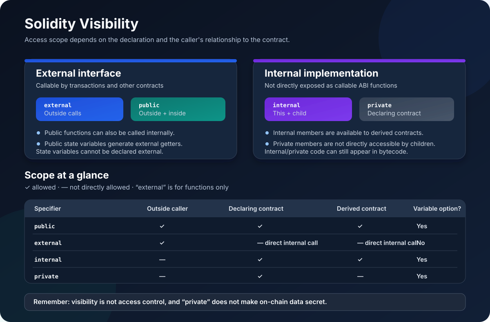

# Visibility in Solidity: Who Can Call or Access What?

> **Stage:** 02 — ABI and Contract Interaction  
> **Priority:** 1  
> **Status:** Reviewed  
> **Last reviewed:** 2026-10-17

## 1. Overview

In Solidity, **visibility** defines where a function or state variable can be accessed from. It answers questions such as: Can another contract call this function? Can a child contract use this helper? Can a function be invoked from elsewhere in the same contract?

Solidity has four visibility specifiers for functions:

- \`public\` — callable from outside the contract and from within the contract.
- \`external\` — callable through the contract's external interface; it cannot be called using a normal internal call such as \`f()\`.
- \`internal\` — accessible from the defining contract and contracts that inherit from it.
- \`private\` — accessible only from the contract where it is declared, not from derived contracts.

State variables support \`public\`, \`internal\`, and \`private\`. They do **not** support \`external\`.

Visibility is a source-language access rule. It is not the same thing as authorization, and it does not make blockchain data secret.

## 2. Why Visibility Matters

Visibility shapes a contract's interface and internal design:

- **Interface design:** Decide which functions callers and other contracts are meant to invoke.
- **Code organization:** Keep implementation helpers out of the external ABI.
- **Inheritance:** Allow child contracts to reuse selected functions or state without exposing them externally.
- **Security review:** Reduce accidental entry points, while remembering that visibility alone does not enforce who is authorized to act.
- **ABI and tooling:** Understand which functions appear in the contract's external interface and which are internal implementation details.

A good default design is to expose only the operations that users or integrations need, and keep reusable implementation logic internal. This is a design guideline, not a substitute for access-control checks.

## 3. Function Visibility

### \`public\`

A public function can be called from outside the contract through its ABI and can also be called from within the contract using a normal internal call.

\`\`\`solidity
// SPDX-License-Identifier: MIT
pragma solidity ^0.8.24;

contract PublicExample {
    uint256 public value;

    function setValue(uint256 newValue) public {
        value = newValue;
    }

    function setToDefault() external {
        setValue(1); // Internal call to the public function.
    }
}
\`\`\`

The call to \`setValue(1)\` from \`setToDefault\` is an internal call; it does not need to make an external message call to the same contract. An external caller can also invoke \`setValue\` through the contract's interface.

Use \`public\` when a function genuinely needs both internal and external entry paths. Do not make every function public by habit.

### \`external\`

An external function is part of the contract's external interface. It can be called by another contract or a transaction, but the function cannot be invoked by a regular internal call such as \`update(x)\` from within the same contract.

\`\`\`solidity
// SPDX-License-Identifier: MIT
pragma solidity ^0.8.24;

contract ExternalExample {
    uint256 public value;

    function setValue(uint256 newValue) external {
        value = newValue;
    }

    function doubleValue() external {
        // This is not valid:
        // setValue(value * 2);

        // This invokes the external interface instead:
        this.setValue(value * 2);
    }
}
\`\`\`

The \`this.setValue(...)\` expression makes an external message call to the same contract. That is **not** equivalent to an internal call: it has external-call semantics, consumes gas for the call, and the callee sees the current contract as \`msg.sender\`. It can also introduce a reentrancy boundary or other behavior that a simple internal call would not have.

Do not change an internal call to \`this.f()\` merely to work around visibility without checking the consequences. If both internal reuse and outside calls are intended, a common design is to expose a public entry point that calls an internal helper.

For functions that are only meant to be called externally, \`external\` communicates that intent clearly and can avoid copying certain calldata arguments into memory in cases where the function can work directly with \`calldata\`. Actual gas behavior depends on the function and its parameters, so benchmark when optimization matters.

### \`internal\`

An internal function can be called from the contract where it is declared and from contracts that inherit from it. It is not exposed as an ordinary externally callable ABI function.

Internal functions are useful for reusable implementation logic shared by several public or external entry points.

\`\`\`solidity
// SPDX-License-Identifier: MIT
pragma solidity ^0.8.24;

contract InternalBase {
    uint256 internal total;

    function add(uint256 amount) public {
        _add(amount);
    }

    function _add(uint256 amount) internal {
        total += amount;
    }
}

contract InternalChild is InternalBase {
    function addBonus(uint256 amount) external {
        _add(amount); // The child can access the inherited internal helper.
        total += 1;   // The child can access the inherited internal state variable.
    }
}
\`\`\`

An internal function call executes within the current EVM execution context rather than creating a separate external message-call frame. It is often the right place for validation or state-transition logic that multiple externally exposed functions need to share.

Internal does not mean that the logic is invisible. It means callers cannot invoke it directly as a separate function through the normal external interface. The compiler may compile the logic into the contract's bytecode.

### \`private\`

A private function or state variable can be accessed only within the contract where it is declared. A derived contract cannot directly access a private member declared by its base contract.

\`\`\`solidity
// SPDX-License-Identifier: MIT
pragma solidity ^0.8.24;

contract PrivateBase {
    uint256 private _internalAccountingDetail;

    function _updateAccounting(uint256 amount) private {
        _internalAccountingDetail += amount;
    }

    function record(uint256 amount) external {
        _updateAccounting(amount);
    }
}

contract PrivateChild is PrivateBase {
    function recordViaBase(uint256 amount) external {
        record(amount); // Calls an inherited external function through its interface.
        // _updateAccounting(amount); // Not allowed: it is private in PrivateBase.
        // _internalAccountingDetail = amount; // Not allowed for the same reason.
    }
}
\`\`\`

In this example, the child contract can call the inherited \`record\` entry point externally, but it cannot directly call the base contract's private helper or access its private variable. The base contract can still use both internally.

Use \`private\` when an implementation detail should not be directly reusable by derived contracts. If child contracts need the functionality, consider \`internal\` instead.

## 4. State Variable Visibility

The visibility options for state variables are \`public\`, \`internal\`, and \`private\`.

### Public state variables and automatic getters

When a state variable is declared \`public\`, Solidity automatically generates an external getter function for it:

\`\`\`solidity
// SPDX-License-Identifier: MIT
pragma solidity ^0.8.24;

contract VaultConfiguration {
    address public asset;
    uint256 public withdrawalLimit;
}
\`\`\`

Callers can read these values through getter functions such as \`asset()\` and \`withdrawalLimit()\`. Solidity does **not** generate a setter. A public variable can still be changed only by code that has an allowed write path, such as a function in the contract.

A public getter can expose a useful, stable read interface without requiring a hand-written getter function. For mappings and arrays, the generated getter follows Solidity's rules for which values can be returned; it does not make every item or an entire complex structure automatically enumerable.

### Internal state variables

An internal state variable is accessible inside the declaring contract and derived contracts. It is not exposed through an automatically generated external getter.

Internal is the default visibility for state variables when no visibility specifier is written.

### Private state variables

A private state variable is directly accessible only in its declaring contract. Unlike an internal variable, it is not directly accessible by derived contracts. A public function can still choose to return information derived from a private variable, so private visibility is not a promise that the value is secret.

### One example, three visibility levels

\`\`\`solidity
// SPDX-License-Identifier: MIT
pragma solidity ^0.8.24;

contract VisibilityStorage {
    uint256 public publicCount;
    uint256 internal sharedCount;
    uint256 private localCount;

    function incrementAll() external {
        publicCount += 1;
        sharedCount += 1;
        localCount += 1;
    }

    function readLocalCount() external view returns (uint256) {
        return localCount;
    }
}

contract VisibilityStorageChild is VisibilityStorage {
    function incrementSharedValues() external {
        publicCount += 1;
        sharedCount += 1;
        // localCount += 1; // Not allowed: private in the base contract.
    }
}
\`\`\`

- \`publicCount\` can be read through its generated getter and is accessible to derived Solidity code.
- \`sharedCount\` is accessible to the base and derived contracts, but it has no generated public getter.
- \`localCount\` can be accessed directly only within \`VisibilityStorage\`; the base contract may expose a separate function that reads it.

Visibility does not decide whether a write is authorized. For example, if an external function allows anyone to modify \`publicCount\`, anyone can call that function regardless of the variable's own visibility.

## 5. Visibility and the Contract ABI

The ABI describes how outside callers interact with a contract. Public and external functions normally form part of the external callable interface. Internal and private functions are not exposed as directly callable function entries in the ABI.

A public state variable also contributes a getter to that external interface, which is why the getter can be called even though the variable itself is a storage slot and not a regular function in source code.

Consider three separate questions:

1. **Can Solidity source code make this call here?** Visibility and the call form determine this.
2. **Is there an externally callable ABI entry for this function or getter?** Public/external functions and public-variable getters expose such entries.
3. **Is the caller permitted to perform the operation?** Access-control logic, checks, and contract state determine this—not visibility by itself.

Do not confuse the ABI with the full compiled program. Internal and private code can still be present in bytecode, even though outside callers cannot invoke it as a named ABI function.

## 6. Visibility Is Not Privacy or Authorization

### Private does not mean secret

Blockchain state and contract bytecode can be inspected by network participants and through blockchain tooling. Marking a variable \`private\` does not encrypt its storage or stop observers from examining contract storage, transactions, or execution.

If a value must remain confidential, do not assume Solidity visibility will protect it. Confidentiality requires a different design, such as keeping the sensitive data off-chain or using a suitable cryptographic privacy system.

### Public does not mean everyone is authorized

A public or external function is callable through the contract's external interface, but it can still enforce permissions:

\`\`\`solidity
// SPDX-License-Identifier: MIT
pragma solidity ^0.8.24;

contract AdminSettings {
    address public immutable admin;
    uint256 public feeBps;

    constructor(address admin_) {
        require(admin_ != address(0), "zero admin");
        admin = admin_;
    }

    function setFee(uint256 newFeeBps) external {
        require(msg.sender == admin, "not admin");
        require(newFeeBps <= 1_000, "fee too high");
        feeBps = newFeeBps;
    }
}
\`\`\`

Anyone can submit a transaction targeting \`setFee\`, but only the configured \`admin\` can pass the authorization check. Visibility makes the entry point externally callable; the \`require\` statements enforce the permission.

In production contracts, use well-reviewed authorization patterns and consider role management, ownership transfer, multisig control, and upgrade risks as appropriate. Choosing \`private\` for a sensitive function is not a replacement for validating the caller of an externally reachable path.

## 7. Common Mistakes

1. **Making every function public.** Expose only what the contract needs; use internal helpers for shared implementation logic.
2. **Assuming external and public are identical.** Both can be called from outside, but \`external\` functions cannot be invoked through a normal internal function call.
3. **Using \`this.f()\` as if it were an internal call.** It creates an external message call with different call context and gas behavior.
4. **Assuming private storage is secret.** Visibility restricts Solidity-level access; it does not hide blockchain data.
5. **Assuming public variables are writable from outside.** Public variables receive getters, not automatic setters.
6. **Expecting children to access private base members.** Use \`internal\` when derived contracts should share a member.
7. **Treating visibility as access control.** A public function that changes state may still need an explicit authorization check.
8. **Forgetting that external ABI and bytecode are different views.** Internal/private functions may exist in compiled code without being callable ABI entries.

## 8. Practical Rules of Thumb

- Choose \`external\` for an entry point that is intended to be called from outside and does not need normal internal calls.
- Choose \`public\` when the same function should be callable both externally and through internal calls.
- Choose \`internal\` for helpers or state shared across a contract inheritance hierarchy.
- Choose \`private\` for implementation details that the declaring contract alone should access directly.
- Use public state variables when an automatically generated read-only getter is the intended API.
- Add authorization checks to privileged state-changing entry points independently of visibility.
- Treat on-chain values as observable unless a separate privacy mechanism changes that assumption.

These are starting points rather than automatic rules. The appropriate visibility depends on inheritance, interfaces, compiler constraints, and the contract's intended public API.

## 9. Key Takeaways

- Solidity functions support \`external\`, \`public\`, \`internal\`, and \`private\`.
- State variables support \`public\`, \`internal\`, and \`private\`; they cannot be \`external\`.
- Public state variables receive compiler-generated getter functions, not setters.
- Internal members are available to derived contracts; private members are not directly available to them.
- An internal function call and \`this.f()\` are different execution paths.
- Visibility controls source-level access, not confidentiality or caller authorization.

## References

- [Solidity Documentation — Contracts: Visibility and Getters](https://docs.soliditylang.org/en/latest/contracts.html#visibility-and-getters)
- [Solidity Documentation — Security Considerations](https://docs.soliditylang.org/en/latest/security-considerations.html)
- [ABI Encoding and Decoding](02-abi-encoding-and-decoding.md)
- [Function Dispatch](04-function-dispatch.md)
- [External Function Calls](05-external-function-calls.md)

## Review Checklist

- [x] Distinguishes the four function visibility specifiers.
- [x] Explains the three state-variable visibility options and automatic public getters.
- [x] Covers internal calls versus \`this.f()\` external message calls.
- [x] Explains the inheritance difference between internal and private members.
- [x] Separates visibility, ABI exposure, authorization, and privacy.
- [x] Links official Solidity documentation and related roadmap concepts.
