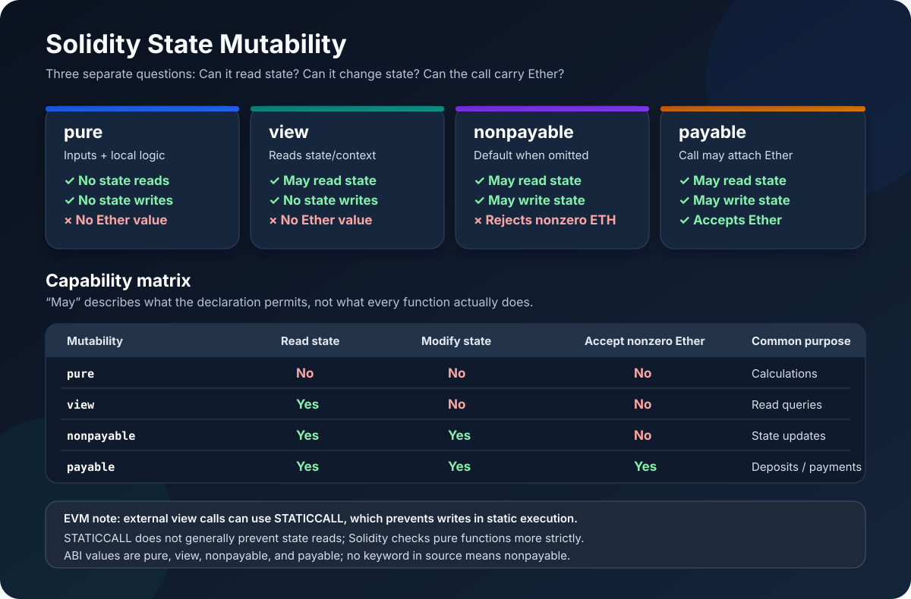

# State Mutability in Solidity: pure, view, nonpayable, and payable

> **Stage:** 02 — ABI and Contract Interaction  
> **Priority:** 1  
> **Status:** Reviewed  
> **Last reviewed:** 2026-10-17

## 1. Overview

In Solidity, **state mutability** describes what a function is allowed to do in relation to contract state and whether the call may transfer Ether to the contract. The four mutability categories represented in a contract's ABI are:

- **\`pure\`** — promises not to read or modify blockchain state.
- **\`view\`** — promises not to modify blockchain state, but may read it.
- **\`nonpayable\`** — may read or modify state, but rejects calls that send a nonzero amount of Ether. In Solidity source code, this is the default when no mutability keyword is written.
- **\`payable\`** — allows the call to carry Ether; the function may also read or modify state.

Mutability is not the same as visibility. Visibility answers **who can call a function**; mutability describes **which effects the function may have and whether it may receive Ether**. A function still needs appropriate authorization checks if only selected callers should be allowed to execute it.

## 2. The Four Mutability Categories

### \`pure\`: neither read nor modify state

A \`pure\` function uses its inputs and local computation without relying on blockchain state.

\`\`\`solidity
// SPDX-License-Identifier: MIT
pragma solidity ^0.8.24;

contract Calculator {
    function add(uint256 a, uint256 b)
        external
        pure
        returns (uint256)
    {
        return a + b;
    }

    function quoteWithFee(uint256 amount, uint256 feeBps)
        external
        pure
        returns (uint256)
    {
        return amount + (amount * feeBps / 10_000);
    }
}
\`\`\`

These functions calculate results from their arguments. They do not read a storage variable, inspect the current block timestamp, or depend on an account balance. If the inputs are the same, their result is determined by their computation rather than changing blockchain state.

A \`pure\` function cannot read state variables—including \`immutable\` variables—or use state-dependent context such as \`block.timestamp\`, \`msg.sender\`, or \`address(this).balance\`. Solidity's rules have narrow exceptions for call-data-related values such as \`msg.data\` and \`msg.sig\`; this does not make a pure function a general reader of transaction or chain context.

Pure functions may still revert, for example through \`require\` or \`revert\`. A revert does not itself constitute a successful state modification. Pure also does not mean that a function is always evaluated at compile time or has zero runtime gas cost.

Use \`pure\` for deterministic computations that genuinely do not need to inspect the current contract or chain context.

### \`view\`: may read state, but may not modify it

A \`view\` function can inspect contract state or relevant blockchain context, but it promises not to modify state.

\`\`\`solidity
// SPDX-License-Identifier: MIT
pragma solidity ^0.8.24;

contract Vault {
    uint256 public totalDeposited;

    function total() external view returns (uint256) {
        return totalDeposited;
    }

    function currentBlockTime() external view returns (uint256) {
        return block.timestamp;
    }

    function contractBalance() external view returns (uint256) {
        return address(this).balance;
    }
}
\`\`\`

These examples read stored data or chain context. They do not update storage, emit events, create another contract, or send Ether.

Operations that would modify state are not allowed in a view function. For example, incrementing \`totalDeposited\`, emitting an event, or making a call that may change state cannot be used as ordinary view-function behavior.

A public state variable's generated getter is also a read-only function and is represented as \`view\` in the ABI.

**EVM nuance:** for EVM targets that support it, Solidity uses \`STATICCALL\` for external calls made as view calls. The EVM's static execution context prevents state-changing effects during that call and its nested calls. The \`view\` guarantee is therefore enforced by Solidity's checks and, for relevant external calls, by EVM execution rules.

Use \`view\` for read paths such as balance queries, configuration getters, quote calculations that depend on stored parameters, and status checks.

### No mutability keyword: \`nonpayable\`

When a Solidity function has no mutability keyword, its ABI mutability is \`nonpayable\`. It is **not** read-only: it can read state, write state, emit events, and perform other permitted state-changing operations. It simply does not accept a call that transfers a nonzero amount of Ether to it.

\`\`\`solidity
// SPDX-License-Identifier: MIT
pragma solidity ^0.8.24;

contract Counter {
    uint256 public count;

    // No mutability keyword: nonpayable by default.
    function increment() external {
        count += 1;
    }

    function setCount(uint256 newCount) external {
        count = newCount;
    }
}
\`\`\`

Both functions can modify storage. If the caller sends a nonzero Ether value with a normal call to either function, the call reverts because the functions are nonpayable.

This is the normal choice for a state-changing function that does not need to accept Ether. You do not write \`nonpayable\` in a modern Solidity function declaration; omitting the mutability keyword expresses it.

### \`payable\`: the function may receive Ether

A \`payable\` function allows the caller to attach Ether to the call. It can read or modify state like an ordinary nonpayable function.

\`\`\`solidity
// SPDX-License-Identifier: MIT
pragma solidity ^0.8.24;

contract DepositBox {
    mapping(address => uint256) public deposited;

    event Deposited(address indexed account, uint256 amount);

    function deposit() external payable {
        deposited[msg.sender] += msg.value;
        emit Deposited(msg.sender, msg.value);
    }

    function myDeposit() external view returns (uint256) {
        return deposited[msg.sender];
    }
}
\`\`\`

The caller may send Ether with \`deposit\`, and the amount is available in \`msg.value\`. The function updates the caller's accounting balance and emits an event. It can also be called with zero Ether; \`payable\` permits value transfer but does not require that the value be greater than zero.

Mark a function payable only when receiving Ether is part of its intended behavior. A payable declaration does not automatically provide correct accounting, refunds, withdrawal logic, or reentrancy protection. Those requirements must be handled by the contract's design.

## 3. Side-by-Side Comparison

| Mutability | Read blockchain state? | Modify state? | Accept nonzero Ether? | Typical use |
|---|---|---|---|---|
| \`pure\` | No, except narrow language-defined calldata-related cases | No | No | Calculations using only inputs |
| \`view\` | Yes | No | No | Read balances, configuration, or chain context |
| \`nonpayable\` (default) | Yes | Yes | No | Ordinary state-changing functions without Ether deposits |
| \`payable\` | Yes | Yes | Yes | Deposits, purchases, payable callbacks, Ether reception |

Think of \`pure\` and \`view\` as restrictions on what a function can do to state. Think of \`payable\` as permission for the call to carry Ether. \`nonpayable\` is the default for functions that may have effects but must not accept nonzero call value.

## 4. State Mutability and EVM Execution

Solidity's mutability rules are checked at compile time, and the EVM adds an important runtime rule for static calls.

### What \`STATICCALL\` does

When a contract makes an external call to a function treated as \`view\` (or \`pure\`) on a supported EVM target, the compiler can use \`STATICCALL\`. A static execution context prevents state-changing operations not only in the immediate callee but also in its nested calls. This is why a view call cannot successfully write to storage or emit an event through a nested call under that static context.

However, the EVM does not provide a general runtime rule that forbids reading state. \`STATICCALL\` prevents writes; Solidity's compiler checks enforce the additional source-language promise made by \`pure\`, which is not supposed to read state. Do not treat a \`pure\` annotation as an EVM-level privacy boundary.

Library calls have implementation-specific details: Solidity cannot use a combined static-and-delegate call opcode because no such opcode exists. Follow the compiler's checks and official Solidity documentation rather than assuming every source-level view call uses the exact same opcode pattern.

### Internal calls are not external calls

Calling a view or pure function internally does not necessarily create a separate EVM message-call frame. The compiler checks the mutability of internal calls according to the source code and the called function's restrictions. An external view call, on the other hand, can use \`STATICCALL\` and therefore establish an EVM static context.

### Mutability does not make a function free

A view or pure function is not inherently free to execute. When called locally or through an RPC \`eth_call\`, the node still executes the code and may apply provider resource limits. If execution is included in a mined transaction—for example, as part of a state-changing contract workflow—its execution consumes gas. Calling a function from a wallet using a read-only RPC request is different from submitting a transaction that pays for on-chain execution.

## 5. How Mutability Appears in the ABI

Solidity's ABI JSON uses a \`stateMutability\` field to communicate a function's mutability. Typical values are:

\`\`\`json
{
  "type": "function",
  "name": "total",
  "inputs": [],
  "outputs": [{ "type": "uint256" }],
  "stateMutability": "view"
}
\`\`\`

The four ABI values are \`pure\`, \`view\`, \`nonpayable\`, and \`payable\`. Remember that \`nonpayable\` is represented explicitly in the ABI even though the Solidity source code expresses it by leaving out a mutability keyword.

This metadata helps client libraries and tooling understand the intended interface. It does not turn mutability into access control, and it does not automatically make an unsafe function safe.

## 6. Mutability in Constructors, Fallback, and Receive

Most ordinary functions can be declared \`pure\`, \`view\`, omitted-mutability (nonpayable), or \`payable\`, subject to their implementation.

Special entry points have more specific rules:

- **Constructor:** may be nonpayable (the default) or payable. A payable constructor allows Ether to be sent during deployment.
- **Receive function:** must be declared \`external payable\`, because its purpose is to handle calls with empty calldata that can carry Ether.
- **Fallback function:** can be payable or nonpayable. Use payable only if the fallback path is intentionally allowed to receive Ether.
- **Automatically generated getter:** is read-only and represented as \`view\` in ABI metadata.

For the routing difference between \`receive\` and \`fallback\`, see [Receive Functions](08-receive-functions.md) and [Fallback Functions](07-fallback-functions.md).

## 7. Common Mistakes and Security Considerations

1. **Calling \`view\` “read-only and free.”** It cannot modify state, but its code still executes and can consume gas when included in a transaction.
2. **Calling \`pure\` a more secure \`view\`.** Pure is a stronger source-level restriction because it should not read state; it is not a privacy guarantee or an EVM rule that prohibits all reads.
3. **Treating nonpayable as read-only.** A function with no mutability keyword can freely modify state within the contract's normal rules.
4. **Assuming payable requires a positive deposit.** A payable function can be called with zero Ether unless its own logic checks otherwise.
5. **Using payable without accounting for \`msg.value\`.** If a protocol tracks deposits, the accounting and withdrawal rules must be implemented carefully.
6. **Assuming a payable function is automatically safe.** Ether-receiving functions can still have reentrancy, authorization, accounting, and denial-of-service risks.
7. **Emitting an event from a view function.** Emitting logs is a state-changing side effect for Solidity mutability checking, so it is not allowed in a view or pure function.
8. **Confusing visibility with mutability.** An \`external view\` function can be externally called but cannot modify state; a \`public\` function with no mutability keyword can be externally called and can modify state.

Mutability is one part of a function's contract. Review it together with visibility, authorization, external-call behavior, and the function's economic purpose.

## 8. Practical Rules of Thumb

- Choose \`pure\` when the result depends only on inputs and local computation.
- Choose \`view\` when the function needs to read contract state or blockchain context without changing it.
- Omit a mutability keyword for a normal state-changing function that must not accept Ether.
- Choose \`payable\` when the call is intentionally allowed to carry Ether, and implement the expected accounting.
- Read ABI metadata when debugging an integration: a source function with no mutability keyword normally appears as \`nonpayable\`.
- Treat modifiers as compiler-checked declarations of intent, not as a replacement for secure contract design.

## 9. Key Takeaways

- \`pure\` promises no state reads or writes.
- \`view\` can read state but cannot modify it.
- No mutability keyword means \`nonpayable\` in modern Solidity; it may still change state.
- \`payable\` allows Ether to accompany a call and does not prevent state changes.
- The ABI records the mutability as \`pure\`, \`view\`, \`nonpayable\`, or \`payable\`.
- \`STATICCALL\` provides EVM-level protection against writes in static execution contexts; it is not a general rule against reading state.
- Mutability is different from visibility, access control, and confidentiality.

## References

- [Solidity Documentation — Contracts: State Mutability](https://docs.solidity.org/en/latest/contracts.html#state-mutability)
- [Solidity Documentation — ABI Specification](https://docs.solidity.org/en/latest/abi-spec.html)
- [Solidity Documentation — Cheatsheet](https://docs.solidity.org/en/latest/cheatsheet.html)
- [Visibility](09-visibility.md)
- [External Function Calls](05-external-function-calls.md)
- [Fallback Functions](07-fallback-functions.md)
- [Receive Functions](08-receive-functions.md)

## Review Checklist

- [ ] Explain the differences among `pure`, `view`, nonpayable, and `payable`.
- [ ] Distinguish state reads, state modifications, and Ether acceptance.
- [ ] Explain ABI `stateMutability` metadata and the implicit nonpayable default.
- [ ] Explain what `STATICCALL` enforces and how that differs from Solidity's `pure` checks.
- [ ] Describe how mutability rules apply to constructors, receive functions, and fallback functions.
- [ ] Review the common security mistakes and official Solidity references.
