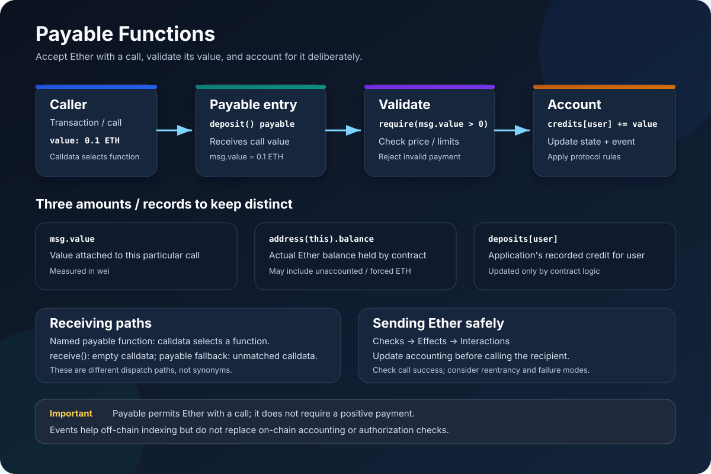

# Payable Functions in Solidity: Receiving and Handling Ether

> **Stage:** 02 — ABI and Contract Interaction  
> **Priority:** 1  
> **Status:** Reviewed  
> **Last reviewed:** 2026-10-17

## 1. Overview

A Solidity function marked <code>payable</code> is allowed to receive Ether along with the function call. The Ether value is exposed inside the function through <code>msg.value</code>, measured in wei.

    // SPDX-License-Identifier: MIT
    pragma solidity ^0.8.24;

    contract SimplePayment {
        uint256 public totalReceived;

        event PaymentReceived(address indexed payer, uint256 amount);

        function pay() external payable {
            totalReceived += msg.value;
            emit PaymentReceived(msg.sender, msg.value);
        }
    }

A caller may invoke <code>pay()</code> with Ether attached. The function can inspect <code>msg.value</code>, update accounting, emit events, and execute other permitted state-changing logic.

Three points are essential:

- **Payable permits a value-bearing call; it does not require a positive payment.** The function can still be called with zero Ether unless its own code rejects that case.
- **<code>msg.value</code> is the amount attached to this call, not the contract's total balance.** The contract balance may include funds received earlier or Ether that arrived through other mechanisms.
- **Accepting Ether is not the same as accounting for it correctly.** The contract must define who owns deposited funds, what the payment entitles the caller to, and how funds can later be withdrawn or spent.

Payable functions build on Solidity's [state mutability](10-mutability.md). This article focuses on how value-bearing calls work and how to handle their funds safely.

## 2. Basic Syntax and What Payable Means

The keyword appears after visibility:

    function deposit() external payable {
        // This function may receive Ether with the call.
    }

Common combinations include:

- <code>external payable</code> — an externally callable function that can receive Ether.
- <code>public payable</code> — a function callable both externally and through normal internal calls, and which can receive Ether on its external call path.
- <code>receive() external payable</code> — the special entry point for calls with empty calldata.
- <code>fallback() external payable</code> — the special entry point for unmatched calls; it can accept Ether when marked payable.

The normal mutability options <code>pure</code> and <code>view</code> do not permit a function to accept Ether as a payable call. A function with no mutability keyword is nonpayable by default, even though it may modify state. If a caller attaches nonzero Ether to a normal call to a nonpayable function, the call reverts.

### The function selector still matters

A payable function is an ordinary declared function with payable mutability. When a caller wants to invoke it by name, the calldata still identifies that function using its ABI selector and encoded arguments. The payable keyword is not itself a selector and does not replace the ABI.

For example, a call to <code>buy(3)</code> has calldata describing the <code>buy(uint256)</code> function and its argument. The call's value is provided separately as transaction/message-call value; Solidity exposes that amount as <code>msg.value</code>.

This differs from sending plain Ether with empty calldata, where dispatch follows the <code>receive</code>/<code>fallback</code> rules described later.

## 3. Understanding msg.value

<code>msg.value</code> is the Ether value attached to the current message call. In a payable function, it is commonly used to validate the payment and update the application's accounting.

    // SPDX-License-Identifier: MIT
    pragma solidity ^0.8.24;

    contract ExactPriceSale {
        uint256 public constant PRICE = 0.01 ether;
        mapping(address => uint256) public itemsBought;

        event Purchased(
            address indexed buyer,
            uint256 quantity,
            uint256 amountPaid
        );

        function buy(uint256 quantity) external payable {
            require(quantity > 0, "Quantity is zero");

            uint256 requiredPayment = quantity * PRICE;
            require(msg.value == requiredPayment, "Incorrect payment");

            itemsBought[msg.sender] += quantity;
            emit Purchased(msg.sender, quantity, msg.value);
        }
    }

In this example:

1. The caller selects the <code>buy(uint256)</code> function and supplies a quantity.
2. The call attaches Ether.
3. The contract computes the required payment.
4. The contract requires the attached value to match the expected amount.
5. Only then does it update the buyer's item count and emit an event.

The literal <code>0.01 ether</code> is expressed in Ether units, while <code>msg.value</code> is expressed in wei. Solidity's denomination suffix converts the amount into the smallest Ether unit at compile time, so the comparison uses the same underlying unit.

### Exact payment, minimum payment, or overpayment

The contract's payment policy should be explicit:

- **Exact payment:** <code>require(msg.value == requiredPayment)</code> rejects both underpayment and overpayment.
- **Minimum payment:** <code>require(msg.value >= requiredPayment)</code> accepts overpayment, but the contract should define what happens to any excess.
- **No price requirement:** a payable function may intentionally accept arbitrary deposits, but should still track and document what the deposit means.

Do not leave overpayment behavior accidental. Refunds can create an external call and additional reentrancy or failure-handling considerations. Many designs are simpler if they require exact payment or use a deliberate credit/withdrawal model for refunds.

Arithmetic and limits are part of payment safety, too. Validate zero or unreasonable quantities where relevant, and make sure multiplication, discounts, fees, and rounding match the protocol's intended economics.

## 4. Receiving Ether Is Not the Same as Tracking Deposits

The EVM maintains the contract's actual Ether balance, accessible through <code>address(this).balance</code>. Application accounting is whatever the contract records in its own state, such as a mapping of each user's deposit.

These values are related, but they are not interchangeable.

    // SPDX-License-Identifier: MIT
    pragma solidity ^0.8.24;

    contract DepositLedger {
        mapping(address => uint256) public deposits;
        uint256 public totalRecordedDeposits;

        event Deposited(address indexed depositor, uint256 amount);

        function deposit() external payable {
            require(msg.value > 0, "Zero deposit");

            deposits[msg.sender] += msg.value;
            totalRecordedDeposits += msg.value;

            emit Deposited(msg.sender, msg.value);
        }

        function actualEtherBalance() external view returns (uint256) {
            return address(this).balance;
        }
    }

In this contract, the payable function records each successful call's value. The mapping records the contract's liability or credit to each depositor according to the example's intended accounting model.

However, a contract's actual balance can increase without executing this deposit function. Ether can arrive through mechanisms that do not execute the recipient's ordinary payable function, receive function, or fallback. Consequently:

- <code>address(this).balance</code> shows the actual Ether held by the contract.
- <code>deposits[user]</code> shows the amount recorded for that user by this contract's logic.
- <code>totalRecordedDeposits</code> shows the aggregate amount recorded by the deposit logic.
- These values should not be assumed to be equal in every possible state.

Never use the current balance as the only source of truth for user entitlements when the application needs per-user accounting. Conversely, do not assume that all Ether held by a contract is already assigned to a user.

## 5. Payable Functions vs. receive and fallback

These constructs are related, but they serve different purposes.

### A named payable function

    function deposit() external payable {
        // Runs when calldata selects deposit().
        // msg.value contains the attached Ether amount.
    }

A caller invokes this function through its ABI. It can use explicit parameters, such as a token identifier or a purchase quantity, alongside <code>msg.value</code>.

### receive() external payable

<code>receive</code> is a special function with no arguments or return value. It executes when the contract is called with empty calldata and an applicable receive function is present.

    receive() external payable {
        // Handles a plain empty-calldata Ether transfer.
    }

A receive function must be external and payable. It is not a replacement for a named payable function when the application needs an operation-specific argument or selector.

### fallback() external payable

The fallback function executes when calldata does not match a declared function, or in the empty-calldata case when there is no applicable receive function. It must be marked payable if that path should accept Ether.

    fallback() external payable {
        // Handles unmatched calls; may receive Ether.
    }

A payable fallback can therefore receive value attached to an unmatched call with nonempty calldata. That is useful for deliberate proxy or routing designs, but using a catch-all function merely to receive plain Ether can hide interface mistakes. If the contract intends to support plain empty-calldata transfers, a dedicated receive function is usually clearer.

### Quick comparison

| Entry point | How it is selected | Can accept Ether? |
|---|---|---|
| Named payable function | Calldata matches its function selector | Yes |
| Named nonpayable function | Calldata matches its function selector | No; a nonzero value causes the call to revert |
| <code>receive</code> | Empty calldata, when receive exists | Yes; receive must be payable |
| Payable <code>fallback</code> | Unmatched calldata, or empty calldata if receive is absent | Yes |
| Nonpayable <code>fallback</code> | Unmatched calldata, or empty calldata if receive is absent | No |

For more detail, see [Receive Functions](08-receive-functions.md), [Fallback Functions](07-fallback-functions.md), and [Function Dispatch](04-function-dispatch.md).

## 6. Sending Ether From a Contract

Payable functions are about **receiving** value. A contract that later sends Ether needs a separate outgoing-payment mechanism and must account for recipient behavior and failure.

A common modern pattern uses <code>call</code> and checks its success result:

    // SPDX-License-Identifier: MIT
    pragma solidity ^0.8.24;

    contract WithdrawalVault {
        mapping(address => uint256) public credits;

        event Deposited(address indexed account, uint256 amount);
        event Withdrawn(address indexed account, uint256 amount);

        function deposit() external payable {
            require(msg.value > 0, "Zero deposit");
            credits[msg.sender] += msg.value;
            emit Deposited(msg.sender, msg.value);
        }

        function withdraw() external {
            uint256 amount = credits[msg.sender];
            require(amount > 0, "Nothing to withdraw");

            // Effects before interaction.
            credits[msg.sender] = 0;

            // Interaction: the recipient may execute code here.
            (bool success, ) = payable(msg.sender).call{value: amount}("");
            require(success, "ETH transfer failed");

            emit Withdrawn(msg.sender, amount);
        }
    }

This example uses the Checks-Effects-Interactions pattern:

1. **Checks:** verify the caller has a recorded credit.
2. **Effects:** clear that credit before making the external call.
3. **Interactions:** attempt to send the Ether to the recipient.

The recipient may be a contract that runs code when receiving Ether. It can call back into the vault before the original call finishes. Updating the credit before the external call helps prevent the same recorded balance from being withdrawn repeatedly during a reentrant call.

The example demonstrates an important pattern, not a universal security guarantee. Real contracts may need reentrancy guards, pause controls, role checks, invariant checks across multiple contracts, careful handling of failed transfers, and thorough testing. If <code>call</code> fails, <code>require</code> reverts the whole transaction, including the earlier credit update in this call.

### Why not simply use transfer or send?

Older Solidity patterns commonly used <code>transfer</code> or <code>send</code>, which rely on a limited gas stipend. Current Solidity documentation deprecates these operations and recommends carefully using <code>call</code> with an appropriate security pattern instead. A small gas stipend should not be treated as a general reentrancy defense, because gas costs and recipient behavior can change.

With <code>call</code>, the sender must inspect and handle the returned success flag. Forwarding more gas also means the recipient has more opportunity to execute code and potentially call back. That is why the checks-effects-interactions pattern and correct state invariants are essential, rather than assuming a particular gas limit makes the transfer safe.

## 7. address payable Is a Different Concept

The <code>payable</code> keyword on a function and the <code>address payable</code> type are related but not identical:

- A **payable function** can receive Ether when that function is called.
- An <code>address payable</code> is a distinct address type that provides the legacy <code>transfer</code> and <code>send</code> members. Solidity's documentation marks both as deprecated and scheduled for removal.
- The low-level <code>call</code> member is available on an ordinary <code>address</code> too. Therefore, an <code>address payable</code> variable is **not required solely to use** <code>call{value: amount}("")</code>.

For example:

    address recipient = msg.sender;
    (bool success, ) = recipient.call{value: 0.01 ether}("");
    require(success, "Payment failed");

This example is an outgoing payment from the current contract. It is not proof that the recipient will keep the funds or perform a particular action; if the recipient is a contract, its receive or fallback behavior may execute, or the transfer may fail.

Converting an address to <code>address payable</code> does not grant permission to spend funds that belong to another account, and it does not provide access control. The type is not a substitute for validation, authorization, or checking the result of an Ether transfer.

## 8. Common Mistakes and Security Considerations

1. **Assuming payable requires a positive value.** A payable function can be called with <code>msg.value == 0</code>; add an explicit check if a deposit must be positive.
2. **Forgetting to validate <code>msg.value</code>.** A purchase or minting function should define underpayment and overpayment behavior.
3. **Confusing <code>msg.value</code> with the total balance.** It is the value of the current call; use <code>address(this).balance</code> to read the contract's current Ether balance.
4. **Assuming every Ether inflow executes a payable function.** Ether may arrive without the recipient's normal function logic executing, so reconcile on-chain balance and application accounting carefully.
5. **Using a payable fallback for every payment path.** A fallback is a catch-all; a named payable function or dedicated receive function usually communicates intent more clearly.
6. **Sending Ether before updating accounting.** External calls can run recipient code and enable reentrancy. Update relevant state first and maintain protocol invariants.
7. **Ignoring a failed <code>call</code>.** The returned boolean must be checked or handled intentionally; a failed send must not be recorded as a successful payment.
8. **Treating transfer's gas stipend as security.** It is not a substitute for safe state transitions and reentrancy protections.
9. **Assuming a deposit event is the accounting itself.** Events help off-chain systems index activity; contracts should maintain the on-chain state needed to enforce their rules.
10. **Letting one recipient block unrelated withdrawals.** When appropriate, credit funds individually and let recipients withdraw, rather than making a batch operation depend on every receiver accepting Ether.

A payable function is an externally reachable value-handling boundary. Review it for correct amount validation, authorization, accounting, event semantics, failure handling, and reentrancy—not just whether it compiles.

## 9. Practical Checklist for Writing a Payable Function

Before publishing a payable function, ask:

- Is it clear which action the caller is buying or triggering?
- Should zero Ether be accepted?
- Should payment be exact, minimum, or allow overpayment?
- Is <code>msg.value</code> denominated and validated correctly?
- Does the contract update its accounting state consistently?
- Can an external call cause reentrancy before the operation completes?
- What happens if an outgoing payment fails?
- Could Ether reach the contract without this function running?
- Are events describing successful state transitions rather than replacing on-chain accounting?
- Does the ABI clearly expose the intended named payable function?

## 10. Key Takeaways

- <code>payable</code> permits a function call to carry Ether; it does not require the caller to send a positive amount.
- <code>msg.value</code> represents the Ether attached to the current call, while <code>address(this).balance</code> represents the contract's current Ether balance.
- Payable functions should validate the amount and update application accounting according to a clear policy.
- Named payable functions, receive functions, and payable fallback functions are selected through different dispatch conditions.
- A contract's actual Ether balance can change without its deposit logic running, so balance and user-accounting records are not interchangeable.
- For outgoing Ether transfers, check the result of <code>call</code>, account for recipient code execution, and use sound state-transition patterns.
- <code>address payable</code> provides the legacy <code>send</code> and <code>transfer</code> members; low-level <code>call{value: ...}("")</code> is also available on <code>address</code>, and neither type grants authorization.

## References

- [Solidity Documentation — Contracts: Receive Ether and Fallback Function](https://docs.solidity.org/en/latest/contracts.html)
- [Solidity Documentation — Security Considerations: Sending and Receiving Ether, Reentrancy](https://docs.solidity.org/en/latest/security-considerations.html)
- [Solidity Documentation — Types: Address Types](https://docs.solidity.org/en/latest/types.html#members-of-addresses)
- [State Mutability](10-mutability.md)
- [Receive Functions](08-receive-functions.md)
- [Fallback Functions](07-fallback-functions.md)
- [External Function Calls](05-external-function-calls.md)

## Review Checklist

- [x] Explains the purpose of payable functions and the role of <code>msg.value</code>.
- [x] Includes an example with explicit payment validation and accounting.
- [x] Distinguishes named payable functions from receive and fallback dispatch.
- [x] Explains contract balance versus recorded deposits.
- [x] Covers outgoing ETH, checked call results, and reentrancy-aware state ordering.
- [x] Links official Solidity documentation and related Stage 02 concepts.
