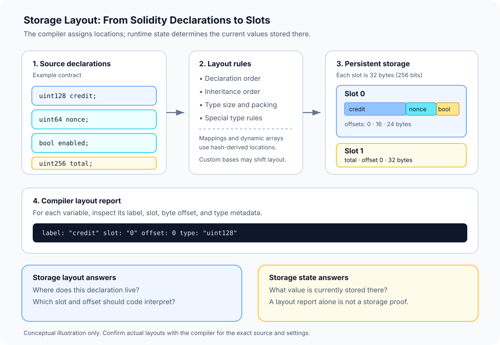

# Storage Layout: How Solidity Maps State Variables to Storage

> **Stage:** 03 — Storage and Data Layout  
> **Priority:** 1  
> **Status:** Reviewed  
> **Last reviewed:** 2026-10-17

## 1. Overview

**Storage layout** describes how a Solidity compiler assigns persistent contract state variables to locations in the EVM's storage space. For ordinary statically laid-out state variables, that means a **storage slot** and, when values share a slot, a **byte offset** within it.

Storage layout is a map from declarations to storage locations. It is not the same thing as the values currently stored there, and it is not the same thing as the full storage trie or a storage proof.

The distinction matters because the EVM does not store Solidity variable names. Persistent storage is addressed using 256-bit slot keys, and the compiled code must read and write the right locations. A developer inspecting a contract, debugging state, or changing an upgradeable contract needs to know how the source-level declarations correspond to those locations.

This article focuses on the overall layout model and the compiler's layout report. Packing details, slot calculations for mappings and dynamic arrays, and storage proofs are related topics covered separately in this stage.



## 2. Storage Layout, Storage Slots, and Stored Values

These terms are related, but they refer to different things:

- **Storage layout** is the assignment rule and resulting map between declarations and storage locations.
- A **storage slot** is one addressable 256-bit (32-byte) position in a contract's persistent storage.
- A **stored value** is the data currently held at a particular slot, or represented across slots by a more complex type.
- A **storage proof** is cryptographic evidence about a storage value under an account's storage root. Knowing a variable's layout helps identify its slot, but does not itself provide a proof.

A useful mental model is a filing system: layout tells you where a field belongs; the slot is the numbered location; the value is what is currently inside it. The contract's current state can change while the layout remains the same.

## 3. How Solidity Assigns Storage Locations

Under Solidity's default storage layout, ordinary persistent state variables are assigned beginning at slot `0`, following declaration order as affected by inheritance rules. Each storage slot is 32 bytes wide.

Not every variable necessarily gets an entire slot of its own. The compiler applies type-specific rules:

1. **Value types use the bytes needed for their representation.** For example, `uint256` uses 32 bytes, `uint128` uses 16 bytes, `address` uses 20 bytes, and `bool` uses one byte.
2. **Small adjacent values may share one slot.** They can be packed together when they fit within the available 32 bytes, subject to Solidity's layout rules.
3. **A value that cannot fit in the remaining space moves to a new slot.**
4. **Structs and array data begin at a new slot boundary.** Their members or elements are laid out according to the rules for the contained types; variables declared after a struct or array begin in a new slot.
5. **Mappings and dynamically sized arrays have special layouts.** Their declaration reserves a base slot, while their entries or elements are located using hash-based calculations rather than by placing all data directly in that base slot.

The detailed packing algorithm and hash calculations are easy to misapply when done from memory. For nontrivial contracts, inspect the compiler's output and verify the relevant rule in the official documentation.

### Inheritance affects the order

For contracts using inheritance, storage variable order follows Solidity's C3-linearized inheritance order, starting with the most base-ward contract. If the layout rules allow it, variables declared in different contracts in the inheritance hierarchy may share a slot.

That means reading a derived contract's own declarations from top to bottom is not always enough to reconstruct its complete layout. Base contracts and the exact inheritance graph matter too.

### Constants, immutables, and transient storage

Do not assume every declaration in a contract consumes a persistent storage slot:

- **`constant` variables** are compile-time constants and do not occupy ordinary persistent storage slots.
- **`immutable` variables** are assigned during construction and embedded into the deployed runtime code by the compiler rather than stored as ordinary persistent state variables.
- **`transient` variables** use the separate transient-storage space introduced by EIP-1153. They are transaction-scoped and do not share the persistent storage layout discussed in most of this article.

Local variables and function parameters are also not automatically persistent state variables. Depending on their data location and how the compiler generates code, they may be handled in calldata, memory, or the EVM stack.

## 4. Worked Example: Reading Slots and Byte Offsets

Consider this contract:

```solidity
// SPDX-License-Identifier: MIT
pragma solidity ^0.8.24;

contract LayoutExample {
    uint128 credit;
    uint64  nonce;
    bool    enabled;
    uint256 total;
}
```

A simplified layout report for these variables is:

| Variable | Type | Slot | Byte offset | Bytes used |
|---|---|---:|---:|---:|
| `credit` | `uint128` | `0` | `0` | 16 |
| `nonce` | `uint64` | `0` | `16` | 8 |
| `enabled` | `bool` | `0` | `24` | 1 |
| `total` | `uint256` | `1` | `0` | 32 |

The first three values use 25 bytes in total, so they fit in slot `0`. The `uint256 total` needs a complete 32-byte slot and therefore begins at slot `1`.

The **offset is measured in bytes from the lower-order end of the slot**. It is not a bit offset, and it is not a byte position from the start of all contract storage. This can be confusing when looking at a full 32-byte hexadecimal value: lower-order bytes appear at the right side of the hex representation.

The table is an illustrative result for this exact declaration order and default layout. Always confirm the report for the specific compiler version, source code, inheritance hierarchy, and layout settings you are using.

## 5. Inspecting the Compiler's Storage Layout

Solidity can expose storage-layout information through its Standard JSON compiler interface. The output includes a `storage` list and a `types` map. Each storage entry includes details such as:

- `label`: the source-level variable name;
- `slot`: the slot where the variable resides or starts;
- `offset`: the byte offset within the slot;
- `type`: a key that points to metadata about the type.

Type metadata can describe the encoding, label, byte size, and—where relevant—the members of a struct, the base type of an array, or the key and value types of a mapping.

For example, a Standard JSON compiler request can ask for this output using the following selection:

```json
{
  "settings": {
    "outputSelection": {
      "*": {
        "*": ["storageLayout"]
      }
    }
  }
}
```

This is only the relevant part of the compiler input; a complete request also needs the source code and the required compiler settings. The compiler's output is the authoritative way to inspect the layout produced for that compilation.

**Important:** Solidity documentation currently describes the JSON storage-layout output format as experimental and subject to change in non-breaking compiler releases. If a script parses it, pin and record the compiler version, handle the expected schema explicitly, and revalidate the script when upgrading the toolchain.

## 6. Custom Storage Layout Bases

Solidity versions that support the custom storage-layout specifier allow a contract to declare a base slot using the `layout at <base-slot-expression>` syntax. Instead of placing its ordinary statically laid-out variables starting at slot `0`, the compiler starts that layout at the specified base.

Conceptually, if a contract's first ordinary state variable would normally occupy slot `0`, a supported custom base can shift that location to the chosen base slot. The relative layout rules still matter: inheritance order, packing, and how mappings or dynamic arrays derive their data locations must still be considered.

Custom bases are an advanced feature, not a way to make storage layout irrelevant. They can be useful for namespacing or for avoiding collisions between independently designed storage regions, but they must be applied consistently and with a compiler version that supports the syntax. Check the official documentation for the exact constraints and interactions with inheritance.

For upgradeable systems, also distinguish a custom base for the contract's storage from standards that define particular slots for proxy metadata. They are related to storage-location design, but they are not interchangeable concepts.

## 7. Why Storage Layout Matters to Smart-Contract Developers

### Debugging state

When a debugger, RPC tool, or forensic script exposes a slot value, the compiler layout helps connect that raw data to a source-level variable. Without the map, a 32-byte word is just a word; it is easy to misinterpret a value or inspect the wrong location.

### Proxy contracts and upgrades

In proxy-based systems, implementation code can execute against the proxy's persistent storage. If a new implementation interprets an existing slot differently, the stored bytes do not move or automatically convert to the new source declaration.

Changing variable order, changing types, or inserting a new field in the middle of an existing layout can therefore corrupt the meaning of stored state. Upgrade-safe changes depend on the specific proxy and storage design; do not assume a source-level change is safe merely because compilation succeeds.

Before an upgrade, compare the old and new layouts using the appropriate tool for the framework, review inheritance and namespaced storage conventions, and run upgrade tests against representative existing state. Follow the upgrade framework's rules rather than relying on a general packing intuition.

### Gas and data organization

Storage layout can affect how many slots a contract uses and which operations it must perform. Packing compatible small values can reduce the number of distinct slots used, but it is not automatically a gas optimization in every code path: the compiler may need extra masking or read-modify-write logic when updating a packed field.

The useful habit is to measure realistic operations and inspect the generated layout and code, rather than optimizing based on variable types alone.

### Storage-aware tooling

Indexers, debuggers, migration scripts, monitoring tools, and security reviewers may need to relate low-level storage to source variables. A trustworthy tool must account for the exact compiled layout and relevant configuration, not just variable names from a source file.

## 8. Common Mistakes and Security Considerations

1. **Treating one variable as one slot.** Smaller values may share a slot, while some types use hash-derived locations.
2. **Confusing slot and offset.** `slot` identifies a 32-byte position; `offset` identifies a byte position within that slot.
3. **Ignoring inheritance.** A derived contract's layout depends on its linearized base-contract order as well as its own declarations.
4. **Assuming mappings store values directly in their declaration slot.** The base slot participates in location derivation; mapping entries are stored elsewhere.
5. **Assuming constants, immutables, locals, and transient variables follow persistent storage rules.** They have different storage or execution behavior.
6. **Changing an upgradeable contract's declarations casually.** A new implementation can read old values using different meanings or locations if its layout is incompatible.
7. **Relying on memory or intuition instead of compiler output.** Compiler version, inheritance, custom layout settings, and type composition can change what must be inspected.
8. **Treating layout metadata as a proof of a value.** The compiler report explains locations; proving what value a chain committed requires the appropriate state and proof data.

When reviewing a storage-sensitive change, preserve the exact compiler configuration, inspect the emitted layout, compare it against the previous version, and add tests that exercise existing state before and after the change.

## 9. Key Takeaways

- Storage layout maps source-level persistent state variables to storage slots and byte offsets.
- A storage slot is 32 bytes, but multiple small values can share one slot.
- Inheritance affects the final order of state variables; mappings, dynamic arrays, structs, and arrays require special layout rules.
- Constants, immutables, transient storage, and local variables should not be casually treated as ordinary persistent storage fields.
- Compiler output is the practical source of truth for a particular build, but its JSON schema must be handled with version awareness.
- Layout compatibility is a major concern for proxy-based upgrades because the same stored bytes must retain the same intended meaning.

## Review Checklist

- [ ] Explain the difference between storage layout, a storage slot, a stored value, and a storage proof.
- [ ] Read the slot and byte-offset columns of a compiler layout report.
- [ ] Explain at a high level how packing, inheritance, mappings, and arrays affect layout.
- [ ] Distinguish persistent storage from constants, immutables, local data, and transient storage.
- [ ] Explain why storage-layout compatibility matters when upgrading a proxy-based contract.
- [ ] Know how to request storage-layout output from the Solidity compiler and why to pin the compiler version.

## References

1. **[Solidity — Layout of State Variables in Storage and Transient Storage](https://docs.solidity.org/en/latest/internals/layout_in_storage.html)** — primary reference for persistent and transient layout rules, inheritance ordering, special types, custom storage bases, and the compiler's layout JSON output.
2. **[Solidity — Structure of a Contract](https://docs.solidity.org/en/latest/structure-of-a-contract.html)** — explains state variables and the distinction between persistent and transient state.
3. **[Solidity — Using the Compiler](https://docs.solidity.org/en/latest/using-the-compiler.html)** — documents the Standard JSON compiler interface and output-selection options.
4. **[EIP-1153: Transient Storage](https://eips.ethereum.org/EIPS/eip-1153)** — specifies transaction-scoped transient storage and its EVM semantics.
5. **[Stage 03 — Storage and Data Layout](README.md)** — index of the related storage, memory, calldata, and proof concepts in this roadmap.
