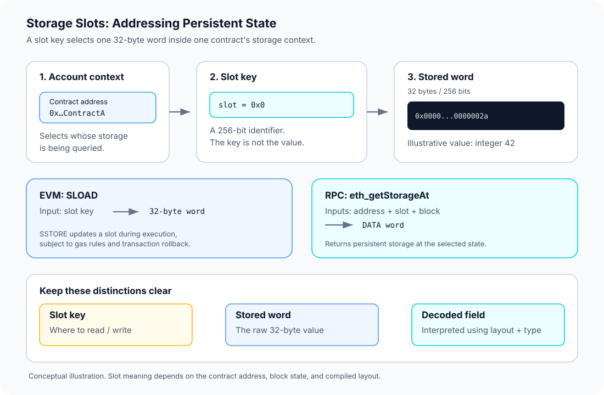

# Storage Slots: Addressing Persistent Contract State

> **Stage:** 03 — Storage and Data Layout  
> **Priority:** 1  
> **Status:** Reviewed  
> **Last reviewed:** 2026-10-17

## 1. Overview

A **storage slot** is a numbered, 32-byte location in a contract account's persistent EVM storage. The EVM addresses storage using a 256-bit slot key, and the value associated with that key is also a 256-bit word.

A useful mental model is a mapping:

```text
storage[slotKey] -> 32-byte word
```

This is a logical model, not a statement that every contract gets a giant, physically allocated array of \(2^{256}\) words. The keyspace is enormous and storage is sparse: a slot that has never been written is read as zero.

The slot key tells the EVM **where** to read or write. The word held there is **what** is stored. These are different things. A source-level Solidity variable may occupy one full slot, share a slot with other variables, or use hash-derived slot locations as with mappings and dynamic arrays.

This article focuses on the slot as a storage address and how developers inspect it. The companion [Storage Layout](01-storage-layout.md) article explains how Solidity maps declarations to slots and offsets; separate articles cover packing, mappings, dynamic arrays, and proofs in more detail.



## 2. The Slot Key and the Stored Word

A storage slot has two important properties:

- **Slot key:** a 256-bit identifier (32 bytes) used to select a position in this contract's persistent storage.
- **Stored word:** the 256-bit value associated with that key.

For example, a simple contract might have a `uint256 count` variable in slot `0`. If `count` is `42`, the slot's 32-byte word represents the integer `42`, written in hexadecimal as `0x2a` and left-padded with zero bytes to the full word width.

The returned raw word is not self-describing. It does not carry the Solidity type, variable name, struct member name, or source declaration. You need the contract's layout and type information to interpret the bytes correctly.

A slot number may be shown as a decimal integer or hexadecimal quantity. In JSON-RPC, a slot argument such as slot zero is commonly written as `0x0`. The value returned for a slot is encoded as hexadecimal data and is represented as a full 32-byte word.

## 3. Every Contract Has Its Own Storage Context

The slot key is interpreted in the context of the account whose storage is being accessed. Slot `0` in contract A is not the same storage location as slot `0` in contract B: the account address is part of the context.

This distinction is essential when working with proxies and `DELEGATECALL`:

- When ordinary code executes against its own account, its storage operations refer to that account's storage.
- When implementation code is executed through `DELEGATECALL`, storage reads and writes use the caller's storage context. In a common proxy design, that means the implementation code reads and writes the proxy account's slots.

Therefore, the same implementation code can see different state depending on the account context in which it executes. A slot key alone is not enough to identify a value globally; you also need the relevant contract address and block state.

## 4. Basic Example: Reading Slot Zero

Consider this contract:

```solidity
// SPDX-License-Identifier: MIT
pragma solidity ^0.8.24;

contract SlotExample {
    uint256 public count;

    function increment() external {
        count += 1;
    }
}
```

Under the default layout, `count` starts at slot `0`.

- Before `increment()` has changed the state, the slot contains the initial value `0`.
- After one successful call, slot `0` contains `1`.
- After the value becomes `42`, the slot word ends with the hexadecimal byte `2a`, padded on the left to 32 bytes.

Conceptually, when the stored integer is `42`, its raw slot value is:

```text
0x000000000000000000000000000000000000000000000000000000000000002a
```

This is the storage word, not the slot key. The key is `0`; the word returned from that key encodes the value `42`.

### Read a slot with JSON-RPC

The Ethereum JSON-RPC method `eth_getStorageAt` returns the value at a storage position for a specific contract and block state. Its parameters are:

1. the contract address;
2. the storage slot position;
3. the block number or a supported block tag, such as `latest` or `finalized`.

Example request (replace the address placeholder with a real 20-byte contract address):

```json
{
  "jsonrpc": "2.0",
  "method": "eth_getStorageAt",
  "params": [
    "<CONTRACT_ADDRESS>",
    "0x0",
    "latest"
  ],
  "id": 1
}
```

For this example, the result is a hexadecimal `DATA` value representing the slot word. The returned value depends on the actual address and state at the requested block; the placeholder request above is a template, not a runnable request as written.

**Choose the right block tag.** `latest` can refer to a block that may still be reorganized. For reproducible inspection, record the block number or use an appropriate stable tag supported by the RPC endpoint.

## 5. Reading and Writing Slots Inside the EVM

The EVM provides two main opcodes for persistent storage access:

- **`SLOAD`** reads the 256-bit word associated with a slot key.
- **`SSTORE`** writes a word to a slot key, subject to execution rules and gas requirements.

At a high level:

```text
slot key  ── SLOAD ──>  32-byte word

slot key + new word  ── SSTORE ──> updated storage state
```

High-level Solidity normally generates these operations for state-variable reads and writes. Developers rarely need to write them directly, but understanding them helps when inspecting bytecode, debugging low-level code, or reviewing inline assembly.

An `SSTORE` during execution does not guarantee that the final chain state will contain the new value. If the relevant execution reverts, state changes in that reverted scope are rolled back. Gas costs for storage operations depend on the operation and state—for example, the slot's warm/cold access status and the original, current, and new values—so do not assume one universal price per read or write.

### Inline assembly example

For a minimal illustration, Solidity's inline assembly can read slot zero directly:

```solidity
function readSlotZero() external view returns (uint256 value) {
    assembly {
        value := sload(0)
    }
}
```

This example is intentionally low-level. It bypasses the source-level variable name and reads the word at slot `0`; it does not automatically decode a packed field or discover a variable's type. Use explicit knowledge of the storage layout before relying on direct slot access in production code.

## 6. A Slot Does Not Always Equal One Solidity Variable

A slot is always a 32-byte storage word, but a source-level variable does not always get an entire slot exclusively.

For example, adjacent smaller value types can be packed together. If `uint128 credit`, `uint64 nonce`, and `bool enabled` share a slot, that slot contains bits for several variables. The compiler must extract or update the relevant part of the 32-byte word.

This leads to three practical distinctions:

- **Slot key:** selects a 32-byte storage position.
- **Byte offset:** identifies where a packed field is located within that word, according to Solidity's storage-layout rules.
- **Field value:** the logical value represented by the relevant bits or bytes, after applying the correct type and offset.

Reading a packed slot with `eth_getStorageAt` returns the full word, not a separately decoded `bool`, `uint64`, or `uint128`. Use the compiler's storage-layout output or a trusted tool to interpret individual fields. See [Storage Layout](01-storage-layout.md) and the separate Storage Packing topic.

## 7. Mappings, Dynamic Arrays, and Non-Sequential Locations

Simple state variables may use low-numbered slots in declaration order. Mappings and dynamically sized arrays are different: their declaration has a base slot, but their entries or data elements are generally found through hash-based location calculations.

That means a mapping entry such as `balances[user]` is not necessarily stored directly at the mapping's declared base slot, nor can its location be found by merely adding the user index. The key, the base slot, the key's type, and the relevant encoding rules all matter.

The same is true for dynamic arrays: the declaration slot participates in locating the array's data, but the elements are not simply placed immediately after that base slot. Packed elements and nested structures add more rules.

Do not hand-calculate these positions from memory. Use the official Solidity layout rules and verify the calculation with a small reproducible example. The separate Mappings and Dynamic Arrays in Storage topic will cover those derivations step by step.

## 8. Persistent Storage Is Not Transient Storage

Persistent storage is part of the contract account's durable state and can be observed at a chosen block. The EVM also supports **transient storage**, introduced by EIP-1153, which is temporary storage scoped to a transaction and accessed with `TLOAD` and `TSTORE`.

Transient storage uses a separate space; its slot `0` does not refer to the same location as persistent storage slot `0`. Transient values do not become persistent contract state at the end of a transaction.

Do not confuse persistent slot inspection with transient storage. The standard `eth_getStorageAt` method reads persistent storage at an account and block state; it does not expose the per-transaction transient-storage space.

## 9. Common Mistakes and Security Considerations

1. **Mixing up key and value.** Slot `0` is the location identifier; a 32-byte word returned from slot `0` is its current value.
2. **Assuming a slot is globally unique.** Slot keys are interpreted within an account's storage context. Contract address and block state matter.
3. **Assuming every variable has its own slot.** Packed fields can share a slot; one raw read may contain several values.
4. **Assuming mapping entries are sequential.** Their locations are derived using hash-based rules and depend on the mapping key and base slot.
5. **Assuming a read value reveals its Solidity type.** Raw storage contains bytes, not source-level labels or type metadata.
6. **Ignoring `DELEGATECALL` storage context.** Proxy implementation code may operate on the proxy's slots, so incompatible slot assumptions can corrupt state.
7. **Treating every `SSTORE` as final.** Reverted execution rolls back the corresponding state changes.
8. **Comparing slot values without recording the block.** A value may differ between block states, and `latest` may not be reproducible later.

For debugging or incident response, record the chain, contract address, slot key, block number or block hash where available, and the layout/version used to decode the word.

## 10. Key Takeaways

- A storage slot is a 32-byte addressable position in a contract account's persistent storage.
- The slot key identifies where to read or write; the stored word is the data at that location.
- `SLOAD` reads a word and `SSTORE` attempts to update one during EVM execution, subject to gas and rollback rules.
- `eth_getStorageAt` reads persistent storage for a particular account and block state.
- Packed variables can share a word, so raw slot data may require decoding using the compiler's layout.
- Mappings and dynamic arrays use hash-derived locations, not simple sequential offsets from their declaration slots.
- Account storage context matters, especially when implementation code runs through `DELEGATECALL`.

## Review Checklist

- [ ] Explain why a storage slot is a key to a 32-byte word, not the word itself.
- [ ] Explain why slot `0` in two different contracts represents two different storage locations.
- [ ] Read a raw storage word using `eth_getStorageAt` and specify the block being inspected.
- [ ] Explain the roles of `SLOAD` and `SSTORE`, including revert behavior.
- [ ] Distinguish a slot key, byte offset, packed field, and logical variable value.
- [ ] Explain why mapping and dynamic-array elements do not generally occupy sequential slots.
- [ ] Distinguish persistent storage slots from transient storage slots.

## References

1. **[Solidity — Layout of State Variables in Storage and Transient Storage](https://docs.solidity.org/en/latest/internals/layout_in_storage.html)** — primary reference for slot width, packing, state-variable layout, mapping and array location rules, and the separate transient-storage space.
2. **[Ethereum JSON-RPC API — `eth_getStorageAt`](https://ethereum.org/en/developers/docs/apis/json-rpc/#eth_getstorageat)** — explains how to query the value associated with a storage position at a specified block state.
3. **[Ethereum Execution APIs — `eth_getStorageAt`](https://ethereum.github.io/execution-apis/api/methods/eth_getStorageAt/)** — method parameters and response shape for the execution RPC interface.
4. **[EVM Opcodes — `SLOAD`](https://www.evm.codes/#54)** and **[`SSTORE`](https://www.evm.codes/#55)** — interactive reference for opcode semantics; gas behavior must be interpreted under the active fork rules.
5. **[EIP-1153: Transient Storage](https://eips.ethereum.org/EIPS/eip-1153)** — specifies the separate transaction-scoped transient-storage opcodes and behavior.
6. **[Storage Layout](01-storage-layout.md)** — companion article explaining how Solidity declarations are assigned slots and offsets.
