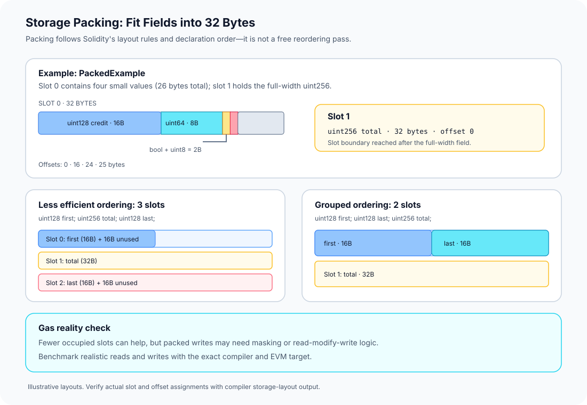

# Storage Packing: Fitting Multiple Variables into One Slot

> **Stage:** 03 — Storage and Data Layout  
> **Priority:** 1  
> **Status:** Reviewed  
> **Last reviewed:** 2026-10-17

## 1. Overview

**Storage packing** is Solidity's ability to place multiple small state variables into the same 32-byte EVM storage slot when the variables are eligible and fit together under the storage-layout rules.

The EVM reads and writes persistent storage in 256-bit (32-byte) words. A Solidity field such as `uint8` needs only one byte to represent its value, and a `uint128` needs 16 bytes. Solidity can place adjacent eligible fields into one slot rather than assigning every declaration a full 32-byte word.

Packing can reduce the number of storage slots used by a contract, but it is not automatically a gas optimization for every operation. The result depends on which fields are read or written together, the code generated by the compiler, the current storage values, and the active EVM gas rules.

This article focuses on the packing rules and practical trade-offs. For the larger map from declarations to slots, see [Storage Layout](01-storage-layout.md). For the slot key and the raw 32-byte word, see [Storage Slots](02-storage-slots.md).



## 2. The Core Packing Rules

Solidity's documented storage-layout rules can be summarized as follows:

1. **A slot is 32 bytes.** Packing is about fitting data into this fixed-width word.
2. **Eligible values use only the bytes needed for their type.** For example, `uint8` and `bool` need one byte, `uint64` needs eight, `uint128` needs 16, and an `address` needs 20 bytes.
3. **Adjacent small values can share a slot if they fit.** Values are packed contiguously according to Solidity's layout rules; they are not arbitrarily rearranged by the compiler to find the globally best packing.
4. **The first item in a slot is lower-order aligned.** Offsets in the compiler's layout output are measured in bytes within the slot, with offset `0` at the lower-order end.
5. **If the next value does not fit in the remaining bytes, it starts in the next slot.**
6. **Structs and array data start at a new slot boundary.** Members or elements inside them can themselves be packed tightly according to the rules. Variables declared after struct or array data begin in a new slot.
7. **Inheritance order matters.** State variables follow Solidity's C3-linearized inheritance order. Eligible adjacent variables originating in different contracts may share a slot.

These rules describe layout, not a source-code formatting preference. Adding whitespace, renaming a variable, or changing a function does not in itself change how its state variables are packed. Changing declaration order, types, inheritance, or relevant layout settings can.

## 3. Worked Example: One Slot, Several Values

Consider this contract:

```solidity
// SPDX-License-Identifier: MIT
pragma solidity ^0.8.24;

contract PackedExample {
    uint128 credit;
    uint64  nonce;
    bool    enabled;
    uint8   flags;
    uint256 total;
}
```

The first four fields need a combined 26 bytes, so they fit inside slot `0`. The full-width `total` variable uses slot `1`.

| Variable | Type | Size | Slot | Byte offset |
|---|---|---:|---:|---:|
| `credit` | `uint128` | 16 bytes | `0` | `0` |
| `nonce` | `uint64` | 8 bytes | `0` | `16` |
| `enabled` | `bool` | 1 byte | `0` | `24` |
| `flags` | `uint8` | 1 byte | `0` | `25` |
| `total` | `uint256` | 32 bytes | `1` | `0` |

Slot `0` contains 26 bytes of declared fields and has six bytes left unused. The unused bytes are not extra variables; they are simply available space within the same 32-byte word.

The offset numbers in this example use Solidity's convention: offset `0` begins at the lower-order end of the slot. When viewing the slot as a 64-hex-character word, the lower-order bytes appear on the right.

**Important:** the table shows the expected layout for these declarations under Solidity's default rules. Confirm the actual compiler layout for your source and toolchain instead of relying on a handwritten table in production work.

## 4. Declaration Order Can Change the Number of Slots

Packing follows declaration order and the layout rules; Solidity does not move a later field ahead of an earlier one just to fill a gap.

### An order that uses three slots

```solidity
contract LessPacked {
    uint128 first;
    uint256 total;
    uint128 last;
}
```

With the default layout, `first` occupies half of slot `0`. `total` needs a whole slot and cannot fit in the remaining half, so it starts at slot `1`. The following `last` begins in slot `2`, because it follows a full-width variable.

This layout uses three storage slots.

### An order that uses two slots

```solidity
contract MorePacked {
    uint128 first;
    uint128 last;
    uint256 total;
}
```

The two `uint128` values fit exactly into slot `0`, and `total` uses slot `1`. This layout uses two storage slots.

In a new contract design, grouping compatible small state variables together may reduce the number of occupied slots. However, **do not reorder variables in an already deployed upgradeable contract just to improve packing**. Existing storage values are already associated with specific locations; changing the declaration order can make new code interpret old bytes incorrectly. Storage compatibility rules take precedence over an apparent optimization.

## 5. Packing Is Also Relevant Inside Structs and Arrays

The same general packing principles apply to eligible members within a struct and eligible elements within array data, while the struct or array's overall layout follows its own boundary rules.

For example:

```solidity
struct UserConfig {
    address account; // 20 bytes
    uint64 nonce;    // 8 bytes
    bool active;     // 1 byte
}
```

These members use 29 bytes in total, so they can fit in one 32-byte slot when laid out as shown. The struct itself starts at a slot boundary, and a state variable following the struct starts at a new slot boundary under Solidity's documented layout rules.

A fixed-size array may pack small elements within its array data. Dynamic arrays and mappings have additional rules for locating their data, so do not assume that their entries follow the same pattern as a simple run of state variables. The precise layout depends on the type and should be checked against the official storage-layout documentation.

## 6. Does Packing Always Save Gas?

No. Packing is a trade-off and should be measured for the real access patterns of the contract.

### When packing can help

- **Fewer occupied storage slots:** compatible fields may share a single slot instead of using one slot each.
- **Potentially fewer storage operations:** when code uses several fields from the same packed word, the compiler may be able to combine relevant work around one slot access.
- **Smaller persistent state footprint:** packing can reduce the number of distinct storage words needed for a set of state variables.

### When the benefit may be smaller—or reversed

The EVM operates on 32-byte storage words. To read a packed field, generated code may need masking or shifting to extract the relevant bits. Updating one field can also require preserving the other fields in the same word, which may involve reading the existing word and combining it with the new field value before writing it back.

These extra operations can offset savings in some access patterns. If values are not read or written together, a packed layout is not automatically cheaper. Gas for storage reads and writes also depends on the active fork rules, whether a slot is warm or cold, and the original, current, and new values.

The right approach is to compile and benchmark representative operations using the exact compiler version, optimization settings, and EVM target used by the project. Compare not just the number of slots, but also the gas of common reads, writes, and full workflows.

### Smaller types are not always better everywhere

Storage packing can benefit from smaller state-variable types because compatible values can share a slot. That does not mean that changing every `uint256` to a smaller unsigned integer is automatically a general optimization. Function arguments and memory values are not packed in the same manner as persistent state variables, and smaller types may require extra conversions, checks, masking, or arithmetic operations.

Choose a type that represents the valid domain of the value first, then evaluate packing and gas with measurements.

## 7. How to Verify the Packed Layout

Use the Solidity compiler's storage-layout output rather than assuming the source alone tells the complete story.

In the Standard JSON compiler interface, the relevant output selection is:

```json
{
  "settings": {
    "outputSelection": {
      "*": {
        "*": ["storageLayout"]
      }
    }
  }
}
```

This is only the relevant settings fragment; a complete compiler request also needs the contract sources and other necessary settings. In the returned layout, inspect each variable's:

- `label`: the variable name;
- `slot`: the slot it occupies or starts in;
- `offset`: the byte offset inside the slot;
- `type`: the identifier for its type metadata.

For the worked example, confirm that `credit`, `nonce`, `enabled`, and `flags` appear in slot `0` with offsets `0`, `16`, `24`, and `25`, and that `total` starts at slot `1`.

Compiler layout JSON has been documented as an experimental output format and may change between compiler versions. Pin the compiler version in scripts or CI that parse it, and rerun layout checks when changing the compiler or source.

## 8. Common Mistakes and Security Considerations

1. **Assuming every state variable occupies a whole slot.** Several eligible small values can share a word.
2. **Thinking Solidity reorders fields automatically.** Packing follows declaration and inheritance order under the defined rules; it is not a global rearrangement optimizer.
3. **Treating offsets as bits or as positions from the start of the whole contract state.** Solidity reports byte offsets within the slot, with offset `0` at the lower-order end.
4. **Optimizing only by counting slots.** Extra masking, shifting, and read-modify-write work can affect gas; benchmark actual access patterns.
5. **Using inline assembly without preserving neighboring values.** A raw assembly write such as `sstore(slot, value)` writes an entire 32-byte word. If other fields are packed in that slot, blindly replacing the word can erase them.
6. **Reordering existing state variables in an upgrade.** A new implementation can interpret old bytes differently, causing corrupted application state.
7. **Assuming memory and calldata are packed like persistent storage.** Their layout rules differ from storage.
8. **Failing to check inherited or nested layouts.** Base-contract order, structs, and arrays can influence where fields are placed.

For upgradeable systems, compare the old and new layouts with the tooling recommended by the project's upgrade framework. For assembly or manual slot writes, review the relevant packed-field masks and prove that unrelated bits remain unchanged.

## 9. Key Takeaways

- Storage packing lets eligible adjacent small state variables share a 32-byte storage slot.
- Solidity's layout is order-sensitive; compatible fields are not freely reordered to fill every gap.
- Declaration order can change how many slots are used, as shown by the three-slot and two-slot examples.
- Struct and array data have boundary rules, while members or elements may themselves be packed.
- Fewer slots do not guarantee lower gas in every function. Measure realistic reads and writes.
- Raw assembly writes operate on an entire storage word and can overwrite neighboring packed fields if carelessly implemented.
- Storage-layout compatibility is essential when changing deployed or upgradeable contracts.

## Review Checklist

- [ ] Explain the Solidity storage-packing rules at a high level.
- [ ] Calculate the combined byte sizes and offsets of several small value types in one slot.
- [ ] Explain why declaration order changes slot usage in the two example contracts.
- [ ] Distinguish fewer occupied storage slots from guaranteed gas savings.
- [ ] Explain why a raw assembly write can overwrite other packed fields.
- [ ] Describe why variable reordering is unsafe for a storage-compatible upgrade.
- [ ] Find and verify the compiler-reported slot and offset fields.

## References

1. **[Solidity — Layout of State Variables in Storage and Transient Storage](https://docs.solidity.org/en/latest/internals/layout_in_storage.html)** — primary source for slot packing rules, lower-order alignment, declaration order, struct/array boundaries, inheritance, and the compiler storage-layout output.
2. **[Solidity — Gas Optimization](https://docs.solidity.org/en/latest/internals/optimizer.html)** — background on compiler optimization; validate gas claims with measurements for the exact generated code and target EVM.
3. **[OpenZeppelin — Writing Upgradeable Contracts](https://docs.openzeppelin.com/upgrades-plugins/writing-upgradeable)** — explains why changing state-variable order or types in an upgrade can corrupt stored data, and discusses storage gaps and namespaced storage.
4. **[Storage Layout](01-storage-layout.md)** — companion article explaining how Solidity declarations map to slots and byte offsets.
5. **[Storage Slots](02-storage-slots.md)** — companion article explaining the slot key, the raw storage word, and slot inspection.
