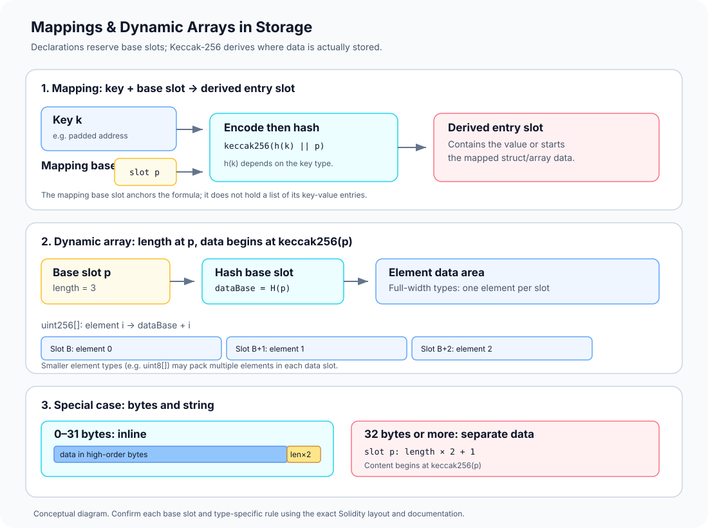

# Mappings and Dynamic Arrays in Storage: Hash-Derived Locations

> **Stage:** 03 — Storage and Data Layout  
> **Priority:** 1  
> **Status:** Reviewed  
> **Last reviewed:** 2026-10-17

## 1. Overview

Solidity mappings and dynamically sized arrays have a different storage layout from ordinary state variables. Instead of placing every entry directly after the declaration, Solidity reserves a **base slot** and uses Keccak-256-based calculations to derive where entries or elements live.

The main rules are:

- A **mapping** reserves a base slot for layout purposes, but the slot itself does not hold its key-value entries.
- A **dynamic array** normally stores its current length in its base slot, while its element data begins at a slot derived from that base.
- **Nested mappings and arrays** apply location rules recursively.
- **bytes and string** are special: short values are stored inline in their own slot, while longer values use a separate data area.

This matters because a developer may know the declaration and key yet still need to calculate a slot to inspect or decode the raw storage. It is also critical for proxies and upgrades: if a mapping or array's base slot changes, its derived locations can change too.

This article focuses on deriving locations. [Storage Layout](01-storage-layout.md) explains how declarations receive base slots; [Storage Slots](02-storage-slots.md) covers raw slot reads; [Storage Packing](03-storage-packing.md) explains how small values share words.



## 2. Why a Base Slot Is Needed

Assume a contract contains:

```solidity
mapping(address => uint256) balances; // base slot p
uint256[] values;                     // base slot q
```

The compiler assigns each declaration a storage position according to the contract's full layout, including inheritance. Call these base positions p and q.

A mapping cannot be laid out as a simple consecutive list because its set of keys is not known at compile time and may be sparse. A dynamic array can grow, so its elements cannot be assigned a fixed consecutive region immediately after the declaration slot either.

Instead, Solidity uses Keccak-256 to derive locations:

- For a mapping entry, the encoded key and the mapping's base slot are combined and hashed.
- For a dynamic array, the hash of its base slot marks the start of its element data area.

These calculations make the derived locations depend on the declaration's base slot. They also separate mappings or arrays even when their keys or indexes happen to be the same.

**Do not guess p or q from a short snippet.** Preceding state variables, inheritance, custom storage bases, and layout changes can affect the base slot. Verify it using the compiler's storage-layout output.

## 3. Mapping Storage: Key Plus Base Slot

For a mapping located at base slot p, the value associated with key k is stored at a slot derived from:

```text
keccak256(h(k) || encode32(p))
```

Here || means concatenation, and h(k) is the key representation required by Solidity's mapping storage rules:

- For value-type keys such as integers, addresses, and booleans, the key is padded to 32 bytes in the same manner used for ordinary storage-word representation.
- For string and bytes mapping keys, h(k) is the raw, unpadded key data. These keys do not follow the same 32-byte padded rule, so a generic ABI encoding example must not be blindly applied to them.

For common value-type keys, a convenient equivalent calculation is often expressed in Solidity as:

```solidity
keccak256(abi.encode(key, p))
```

That shorthand is appropriate only when the ABI encoding matches the mapping storage rule for the key type. Confirm the exact type-specific rule before using it in tooling.

### Example: mapping(address => uint256)

```solidity
contract Balances {
    mapping(address => uint256) public balances;
}
```

Suppose the compiler reports that balances is located at base slot p = 0. For an address user, the slot for balances[user] is derived by hashing the 32-byte padded address followed by the 32-byte representation of p.

Conceptually:

```text
entrySlot = keccak256(paddedUserAddress || encode32(0))
```

The mapping base slot 0 does not itself contain balances[user]. It anchors the derivation. A direct eth_getStorageAt query must use the **derived entry slot**, the contract address, and the block state being inspected.

### Mapping values that are structs or other reference types

The derived mapping slot marks the start of the mapping value's storage representation. If the value is a struct, a member may live at an offset from that starting slot. If the value is another mapping, the derived slot becomes the base for the next mapping calculation. If it is a dynamic array, it becomes that array's base slot and the array rules then apply.

This is why nested mappings and mappings of structs require more than one step of location derivation.

## 4. Nested Mappings: Apply the Rule Recursively

Consider:

```solidity
mapping(address => mapping(uint256 => bool)) approved;
```

Let p be the base slot of approved. To locate approved[user][id]:

1. Derive the inner mapping position for user by hashing the padded address key with p.
2. Treat that derived position as the base slot for the inner mapping.
3. Hash the padded integer key id with that inner base position.
4. The final derived slot contains the encoded boolean value.

Conceptually:

```text
outerBase = keccak256(paddedUserAddress || encode32(p))
entrySlot = keccak256(encode32(id) || outerBase)
```

This is a conceptual rendering of the Solidity storage rule. Exact byte encoding and concatenation order matter. Do not replace Keccak-256 with standardized SHA3-256, and do not concatenate human-readable strings such as the text form of an address or integer.

Mappings are not enumerable from storage alone. A mapping does not store a list of all keys, so knowing the base slot does not let you discover every key-value pair. Applications generally need an indexing strategy, known candidate keys, or emitted events to track entries.

## 5. Dynamic Arrays: Length Slot and Data Area

For a dynamic array with base slot p, the array's length is normally stored at slot p. Its element data begins at:

```text
dataBase = keccak256(encode32(p))
```

The element location depends on its type.

### Full-width elements such as uint256[]

Each uint256 occupies one complete 32-byte slot. Therefore, for a uint256[] array, element values[i] is located at:

```text
slot(values[i]) = dataBase + i
```

For example, if the array declaration has base slot p:

- slot p stores the current element count;
- slot keccak256(encode32(p)) stores element 0;
- the next slot stores element 1, and so on.

The elements do not begin immediately after slot p; the starting slot is hash-derived.

### Smaller value types can share array-data slots

For array elements smaller than 32 bytes, Solidity packs multiple elements into a single word when the element type's storage representation allows it. Elements are not split across two storage slots.

Let s be the element's storage size in bytes. For eligible fixed-size value types:

```text
elementsPerSlot = floor(32 / s)
dataSlot(i) = dataBase + floor(i / elementsPerSlot)
byteOffset(i) = (i % elementsPerSlot) * s
```

This compact formula is suitable for fixed-size value types such as uint8 and uint24 arrays. Complex element types—such as structs or nested dynamic arrays—need their own recursive rules.

For uint8[], 32 one-byte elements fit in each slot:

- elements 0 through 31 share the first data slot;
- element 32 starts in the next data slot.

For uint24[], each element uses three bytes, so floor(32 / 3) = 10 elements fit in one slot, with two bytes left unused. The next element begins in the following slot rather than crossing a slot boundary.

### Example contract

```solidity
contract ArrayExample {
    uint256[] public values; // assume base slot p = 0
}
```

For this example, the length is stored at slot 0, and element data begins at keccak256(encode32(0)). For uint256[], element index i is at the data base plus i.

The actual base slot must be confirmed for a real contract. An empty array has length zero; no contiguous block of element slots is reserved just because the array was declared.

## 6. Dynamic Arrays of Dynamic Arrays

A dynamic array can itself contain dynamic arrays, for example:

```solidity
uint24[][] matrix;
```

The outer array uses its base slot to store its length, and its outer element area begins at the hash-derived data base. Each outer element represents an inner dynamic array with its own base position. The inner array then stores its own length and derives its element data area from that position.

The rule is recursive:

1. Determine the storage position of the outer element.
2. Treat that position as the base slot of the inner dynamic array.
3. Hash the inner base slot to get the inner array's data start.
4. Apply the element packing rules to locate the indexed inner element.

This is why matrix[i][j] is not generally located with one hash or by adding i + j to the declaration slot. Use the exact Solidity specification or compiler-aware tooling when calculating nested locations.

## 7. Special Storage Rules for bytes and string

Dynamic bytes and string use a special compact representation. They do not follow the same length-slot-plus-hashed-data pattern for every value.

### Values of 0–31 bytes: stored inline

If the byte sequence is at most 31 bytes long:

- the data is stored left-aligned in the high-order bytes of the declaration slot;
- the lowest-order byte stores length * 2;
- the least significant bit is therefore 0.

For example, the short string "cat" occupies three bytes of the slot's high-order data area, and the low-order byte stores 3 * 2 = 6, represented as 0x06.

The length is measured in **bytes**, not Unicode characters. A string containing non-ASCII characters can use multiple UTF-8 bytes per character.

### Values of 32 bytes or more: data stored separately

If the content is 32 bytes or longer:

- the declaration slot stores length * 2 + 1;
- the actual bytes begin at keccak256(encode32(p));
- the least significant bit is 1, marking the long form.

For example, a 32-byte value stores 32 * 2 + 1 = 65 (0x41) in its main slot, while the 32 data bytes begin at the derived data base.

Do not decode bytes or string as an ordinary dynamic array. The low bit distinguishes the short and long forms. Solidity also defines behavior for malformed encodings; do not assume arbitrary raw slot contents are necessarily a valid string or bytes representation.

## 8. Inspecting These Values in Practice

A reliable workflow is:

1. **Identify the deployed contract address and block.** Slot values are specific to an account and state at a particular block.
2. **Find the declaration's base slot.** Use compiler storage-layout output for the exact source, compiler version, inheritance, and settings.
3. **Apply the type's location rule.** Use the mapping-key formula, dynamic-array data base, packing formula, or bytes/string encoding as appropriate.
4. **Read the raw storage word.** Use an RPC method such as eth_getStorageAt with the derived slot position.
5. **Decode carefully.** Interpret byte order, element offset, value type, and any packed fields using the documented representation.

For ordinary value-type mapping keys, a compatible ABI library can help build the 32-byte padded key and base-slot encoding. For string and bytes mapping keys, nested structures, or complex array values, do not assume the same helper call automatically produces the correct storage preimage. Test calculations against a small contract with known values and a pinned compiler version.

The compiler's storageLayout report describes declarations and type metadata. It does not enumerate every mapping key or calculate every possible runtime element location for you.

## 9. Common Mistakes and Security Considerations

1. **Reading a mapping's base slot as though it contained an entry.** It is a location anchor; entries are hash-derived.
2. **Treating array elements as sequential from the declaration slot.** A dynamic array's data begins at the hash of its base slot.
3. **Forgetting the array's length.** For ordinary dynamic arrays, the base slot stores the current element count.
4. **Ignoring packing inside an array.** Arrays of small value types may place multiple elements in each 32-byte data slot.
5. **Using ABI encoding indiscriminately for all mapping keys.** string and bytes keys follow different key-preimage rules from value types.
6. **Confusing Keccak-256 with SHA3-256.** They are related but produce different results because their padding conventions differ.
7. **Decoding bytes and string as ordinary dynamic arrays.** Short values of up to 31 bytes use inline storage; longer values use a hash-derived data area.
8. **Changing a mapping or array's base slot during an upgrade.** The derived locations can change, making the new implementation look at a different storage area.
9. **Assuming storage exposes every mapping key.** Mapping storage is not enumerable without knowing the keys or maintaining an external index.

For upgradeable contracts, preserve storage compatibility and verify the complete old and new layouts. For storage-inspection tools, record the chain, contract address, block, compiler/layout version, key encoding, and calculation method.

## 10. Key Takeaways

- Mappings and dynamic arrays reserve a base slot and use Keccak-256-based calculations for their entries or data.
- A mapping entry uses the correctly encoded key and mapping base slot; nested mappings apply the formula recursively.
- A dynamic array normally stores its length at its base slot, while element data starts at keccak256(encode32(p)).
- Arrays of small value types may pack multiple elements into each 32-byte data slot.
- bytes and string store values of up to 31 bytes inline; 32-byte-and-longer values use a separate hash-derived data area.
- Correct decoding requires the contract address, block state, correct base slot, type-specific encoding, and exact storage rules.
- A base-slot change can alter derived locations, which is why storage compatibility is critical for upgrades.

## Review Checklist

- [ ] Explain why a mapping reserves a base slot even though its entries live elsewhere.
- [ ] Calculate a mapping entry slot for a value-type key using the correctly padded key and base slot.
- [ ] Explain how nested mappings derive locations recursively.
- [ ] Find the length slot and data base of a dynamic array.
- [ ] Calculate element slots for uint256[] and packed elements for uint8[] or uint24[].
- [ ] Distinguish short and long storage encodings for bytes and string.
- [ ] Explain why changing a mapping or array's base slot can break upgrade compatibility.
- [ ] Confirm derived-slot calculations using a small deployed test contract and raw storage reads.

## References

1. **[Solidity — Layout of State Variables in Storage and Transient Storage](https://docs.solidity.org/en/latest/internals/layout_in_storage.html)** — primary source for mapping key preimages, dynamic-array data locations, packed array elements, nested types, and special bytes/string storage encoding.
2. **[Solidity — Using the Compiler](https://docs.solidity.org/en/latest/using-the-compiler.html)** — documents compiler output selection, including storage-layout metadata.
3. **[Ethereum JSON-RPC API — eth_getStorageAt](https://ethereum.org/en/developers/docs/apis/json-rpc/#eth_getstorageat)** — describes querying a raw storage word for a contract at a selected block state.
4. **[EVM Opcodes — KECCAK256](https://www.evm.codes/#20)** — interactive reference for the EVM's Keccak-256 operation; do not substitute standardized SHA3-256.
5. **[Storage Layout](01-storage-layout.md)** — explains how Solidity assigns declarations to base slots and offsets.
6. **[Storage Slots](02-storage-slots.md)** — explains storage slot keys, raw words, and storage inspection.
7. **[Storage Packing](03-storage-packing.md)** — explains packing of smaller values into storage words.
