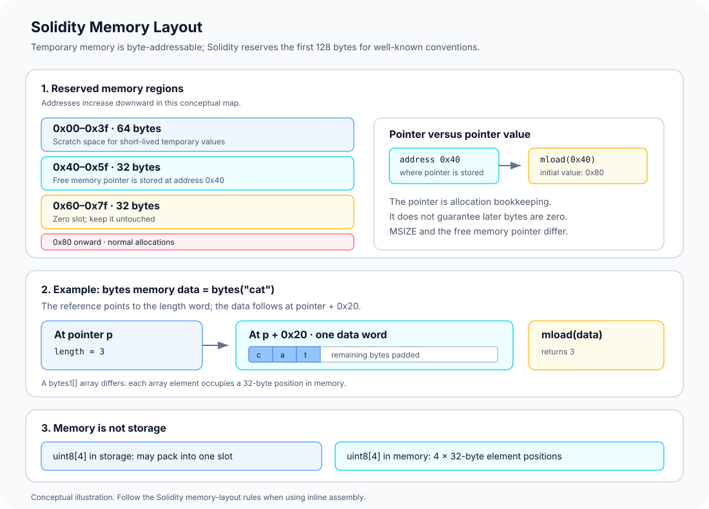

# Memory Layout: How Solidity Uses EVM Memory

> **Stage:** 03 — Storage and Data Layout  
> **Priority:** 1  
> **Status:** Reviewed  
> **Last reviewed:** 2026-10-17

## 1. Overview

**Memory layout** describes how Solidity represents temporary data inside the EVM's byte-addressable memory during execution. Unlike persistent storage, memory is temporary: each message-call execution frame gets a fresh memory area, and its contents do not become persistent contract state when execution finishes.

The EVM memory model is simpler than Solidity's storage model, but it still has important conventions. Solidity uses a few well-known memory locations, maintains a **free memory pointer**, and lays out reference types such as dynamic arrays, strings, bytes, and structs in memory according to rules that are not identical to storage layout.

Memory is useful for computations, ABI encoding and decoding, temporary buffers, return data, and intermediate values. Understanding its layout helps developers inspect assembly, debug memory corruption, reason about gas costs, and avoid unsafe assumptions when writing low-level code.

This article focuses on memory itself and Solidity's conventions for using it. [Storage Layout](01-storage-layout.md) and [Storage Slots](02-storage-slots.md) explain persistent state; [Calldata Layout](06-calldata-layout.md) will cover the read-only input area in detail.



## 2. What Memory Is—and What It Is Not

EVM memory is a **linear, byte-addressable area** used by the current execution frame. Each memory address identifies one byte, although common opcodes read or write a whole 32-byte word.

The key properties are:

- **Temporary:** memory is initialized for each new message-call frame and is not committed as contract state.
- **Byte-addressable:** an operation can refer to a byte offset, while instructions such as `MLOAD` and `MSTORE` work with 32-byte words.
- **Expanded as needed:** using a previously untouched higher memory range expands active memory and may charge additional gas.
- **Not automatically freed by Solidity:** ordinary allocations advance the free memory pointer; Solidity does not generally reclaim each temporary object when it goes out of scope.
- **Separate from storage and calldata:** memory is neither persistent storage nor the original read-only transaction input.

Internal Solidity function calls generally operate within the same EVM execution frame and can share the frame's memory. A message call to another contract creates another execution frame with its own memory, even when the call uses `DELEGATECALL`. In that case the storage context may be inherited from the caller, but the memory is still that of the new frame.

## 3. The Standard Solidity Memory Map

Solidity reserves the first 128 bytes for specific purposes. These are conventions used by Solidity-generated code and should also be respected when writing inline assembly.

| Byte range | Size | Purpose |
|---|---:|---|
| `0x00–0x3f` | 64 bytes | Scratch space for short-lived temporary values, including hashing operations |
| `0x40–0x5f` | 32 bytes | Free memory pointer: stores the next available allocation address |
| `0x60–0x7f` | 32 bytes | Zero slot: used as the initial value for empty dynamic memory arrays; should never be written to |
| `0x80` onward | Variable | General memory allocations |

At the beginning of the standard Solidity memory layout, the free memory pointer initially contains `0x80`, which is the first location available for normal allocations.

The pointer is stored **at address `0x40`**. Its value is normally read with `mload(0x40)`. These are different things:

- `0x40` is the location where the pointer is stored.
- `mload(0x40)` returns the pointer value, initially `0x80`.

The zero slot is also a memory location at `0x60`; it is not a promise that all later memory addresses always contain zero. Never overwrite `0x60` when following Solidity's standard memory conventions.

## 4. Scratch Space: `0x00–0x3f`

The first 64 bytes can be used as scratch space for temporary work. Solidity-generated code may use this area for hashing and other short-lived intermediate values.

Scratch space is not a place to store values that must survive arbitrary later operations. Another operation may reuse the same memory range. Treat it as disposable workspace and preserve any value needed after the operation somewhere appropriate.

Some compiler operations need temporary memory larger than 64 bytes. They may use memory starting at the free memory pointer without updating that pointer if the temporary data is short-lived. Consequently, **memory at or beyond the free memory pointer is not guaranteed to be zeroed out**. The pointer indicates the beginning of the next ordinary allocation according to the allocator's bookkeeping; it does not guarantee every byte after it is pristine.

This matters when writing assembly: do not assume memory is zero just because the free memory pointer has not advanced past it.

## 5. The Free Memory Pointer

The free memory pointer is a 32-byte word stored at address `0x40`. Its value marks the starting point for the next ordinary memory allocation under Solidity's conventions.

A simplified allocation pattern is:

```solidity
assembly ("memory-safe") {
    let ptr := mload(0x40)       // current free memory pointer
    // Use memory beginning at ptr.
    // Compute the actual allocation size before continuing.
    mstore(0x40, add(ptr, 0x20)) // example: reserve one word
}
```

This snippet illustrates the idea of advancing the pointer; it is not a complete allocator for arbitrary data. Real allocation code must reserve enough bytes for the object, its length word where applicable, and any padding or alignment required by the representation.

For example, a simple buffer allocator may round a size up to the next multiple of 32 bytes. Solidity-generated code also accounts for the exact layout of the object being allocated.

The `memory-safe` assembly annotation is a promise by the author that the assembly respects Solidity's memory assumptions; it does not automatically make incorrect pointer arithmetic safe. Only use it when the assembly follows the documented rules.

### Why the free memory pointer is not the same as `MSIZE`

- **Free memory pointer:** Solidity's allocation bookkeeping, stored at memory address `0x40`.
- **`MSIZE`:** an EVM opcode that reports the size of currently active memory in bytes, rounded to memory words.

Some temporary operations can touch memory beyond the free memory pointer without updating the pointer. Therefore, using `MSIZE` as a way to locate clean, never-used memory is unsafe. Use the free memory pointer and a correct allocation strategy instead.

## 6. The Zero Slot: `0x60–0x7f`

The word beginning at memory address `0x60` is known as the **zero slot**. Solidity uses it as the initial value for empty dynamic memory arrays.

The standard memory convention is that this slot should never be written to. Overwriting it can break assumptions made by compiler-generated code that relies on it remaining zero.

This does not mean every memory location in the execution frame is always zero. It is a specific reserved word with a specific purpose. Keep it distinct from uninitialized temporary bytes beyond the ordinary allocation pointer.

## 7. How Objects Are Represented in Memory

A Solidity reference variable in memory normally acts as a pointer to the beginning of the object representation. The exact layout depends on its type.

### Dynamic arrays in memory

A dynamically sized memory array stores its length in the first 32-byte word, followed by its elements. Each element in an ordinary memory array occupies a multiple of 32 bytes—even types such as `uint8` or `bytes1` use a 32-byte stride in memory arrays.

Conceptually, a three-element `uint256[] memory` looks like:

```text
pointer
   |
   v
+--------------------------+  p
| length = 3               |  32 bytes
+--------------------------+  p + 0x20
| element 0                |  32 bytes
+--------------------------+  p + 0x40
| element 1                |  32 bytes
+--------------------------+  p + 0x60
| element 2                |  32 bytes
+--------------------------+
```

The reference points to the length word at `p`; element data begins at `p + 0x20`.

Multi-dimensional memory arrays are built from references to other arrays. Do not assume a multidimensional array is one uninterrupted rectangular block: the outer array holds references to inner arrays, each with its own representation.

### `bytes` and `string` in memory

A dynamic `bytes` or `string` object also starts with a 32-byte length word. The actual byte sequence begins immediately after it, and the data area is padded to a 32-byte boundary as needed for allocation.

Unlike `bytes1[]`, which uses a 32-byte memory slot for each element, `bytes` stores its raw bytes contiguously. A three-byte value such as `cat` uses one length word and one data word, not one 32-byte word per character.

### Structs and fixed-size arrays

Memory layout differs from storage packing. In memory, struct members and ordinary array elements occupy 32-byte-sized positions rather than packing adjacent small value types as tightly as persistent storage does.

For example, a `uint8[4]` array can use only four bytes of persistent storage when its storage elements are packed together, but its memory representation uses four 32-byte element positions, or 128 bytes.

Similarly, a struct with two `uint256` members followed by two `uint8` members occupies three storage slots under the relevant storage rules, but its memory representation lays the four members out in four 32-byte positions. Confirm the exact layout for the type and data location you are using.

## 8. Worked Example: Inspecting a `bytes memory` Object

Consider this function:

```solidity
// SPDX-License-Identifier: MIT
pragma solidity ^0.8.24;

contract MemoryExample {
    function inspectBytes()
        external
        pure
        returns (uint256 length, bytes32 firstWord)
    {
        bytes memory data = bytes("cat");

        assembly {
            length := mload(data)
            firstWord := mload(add(data, 0x20))
        }
    }
}
```

The value `data` is a memory reference. It points to the word that stores the length, not directly to the first character.

The two assembly reads mean:

1. `mload(data)` reads the word at the pointer, so `length` becomes `3`.
2. `mload(add(data, 0x20))` reads the first 32-byte data word. The bytes for `cat` occupy the high-order three bytes, followed by zero padding in this allocated object, so the word begins with `0x636174`.

The result illustrates the difference between a pointer, an object's length, and its actual data. It also shows why interpreting memory manually requires knowing the data type's layout.

For arrays of small value types, do not copy storage-packing assumptions into this example: the memory stride for each element is different.

## 9. Memory Expansion and Gas

The EVM does not charge the full memory cost anew for every operation. Instead, expanding memory to reach a previously untouched range incurs an expansion cost based on the old and new active memory sizes.

At a high level:

- Accessing memory that is already active does not trigger another expansion for that same range.
- Touching a higher offset may expand memory to cover the highest accessed word.
- The total memory-cost function includes a linear term and a quadratic term in the number of 32-byte words.
- An operation that copies, hashes, returns, or reads a large memory region may pay for expansion as well as the operation's own cost.

The expansion charge is the difference between the cost for the new memory size and the cost already accounted for the old size. As a result, memory can be cheap for small buffers but increasingly expensive when a contract expands to large ranges. Exact gas also depends on the opcode and the amount of data it processes.

A pointer update alone does not mean every byte up to the new pointer has been read or written. The actual opcodes that access memory determine when memory expansion is charged.

## 10. Memory, Storage, and Calldata Compared

| Property | Memory | Storage | Calldata |
|---|---|---|---|
| Lifetime | Current EVM execution frame | Persistent contract state | Input data for the current call |
| Writable by Solidity code? | Yes | Yes, subject to mutability and execution rules | No; read-only |
| Main purpose | Temporary computation and objects | Long-lived application state | Read-only function input |
| Typical low-level operations | `MLOAD`, `MSTORE`, `MSTORE8` | `SLOAD`, `SSTORE` | `CALLDATALOAD`, `CALLDATACOPY` |
| Layout behavior | Arrays and struct fields use memory-specific spacing | Supports storage packing and hash-derived locations | Follows ABI/input representation for external calls |

These areas solve different problems. A value copied from storage into memory can be modified temporarily without changing the persistent slot. An input read from calldata is not automatically a memory object; some operations or type conversions may copy it into memory.

## 11. Common Mistakes and Security Considerations

1. **Treating the free memory pointer location as its value.** The pointer is stored at `0x40`; its initial value is `0x80`.
2. **Assuming memory after the free memory pointer is zero.** Compiler-generated temporary operations may use this region without advancing the pointer, so its contents are not guaranteed to be clean.
3. **Overwriting the zero slot.** The word at `0x60` should remain untouched under Solidity's memory convention.
4. **Assuming the first 64 bytes are permanent variables.** The scratch area is reusable and only suitable for temporary data.
5. **Using `MSIZE` to find unused, clean memory.** Active memory size and Solidity's allocation pointer track different things.
6. **Applying storage packing rules to memory arrays or structs.** Small elements in memory arrays commonly occupy 32-byte positions even when storage would pack them together.
7. **Allocating too few bytes in assembly.** Later objects may overlap a buffer if the free memory pointer is not advanced correctly.
8. **Marking assembly `memory-safe` without satisfying the rules.** The annotation is a programmer's guarantee, not a runtime bounds check.
9. **Ignoring memory expansion costs.** Large buffers and copies can increase gas beyond the base cost of the opcode.

When writing low-level code, document the memory range each block reads and writes, preserve Solidity's reserved slots, align allocations as required, and verify that the free memory pointer is updated correctly whenever allocated memory must survive subsequent operations.

## 12. Key Takeaways

- EVM memory is temporary, byte-addressable, and local to the current execution frame.
- Solidity reserves `0x00–0x3f` for scratch space, stores the free memory pointer at `0x40`, and reserves `0x60–0x7f` as the zero slot.
- The free memory pointer initially contains `0x80`, but memory beyond it is not guaranteed to be zero.
- A dynamic array in memory starts with its length word; the elements follow in memory-specific positions.
- `bytes` and `string` store a length word followed by contiguous byte data, while memory arrays of `bytes1` or other small values use 32-byte element positions.
- Memory expansion has a size-dependent gas cost with linear and quadratic components.
- Memory layout differs from storage packing and calldata encoding; never assume these data areas use interchangeable rules.

## Review Checklist

- [ ] Identify the scratch space, free memory pointer, zero slot, and initial allocation region.
- [ ] Explain the difference between address `0x40` and the pointer value loaded from it.
- [ ] Explain why memory beyond the free memory pointer is not guaranteed to be zero.
- [ ] Read the length and first data word of a `bytes memory` value using assembly.
- [ ] Explain why `uint8[4]` occupies more memory than packed persistent storage.
- [ ] Distinguish the free memory pointer from `MSIZE`.
- [ ] Explain how memory expansion affects gas and why unchecked assembly allocation is dangerous.
- [ ] Distinguish memory, storage, and calldata by lifetime, mutability, and layout.

## References

1. **[Solidity — Layout in Memory](https://docs.solidity.org/en/latest/internals/layout_in_memory.html)** — primary source for the reserved memory ranges, free memory pointer, zero slot, memory allocation conventions, and memory-specific array layout.
2. **[Solidity — Inline Assembly](https://docs.solidity.org/en/latest/assembly.html)** — describes how to access the free memory pointer, allocate memory, and follow memory-safe assembly conventions.
3. **[Solidity — Introduction to Smart Contracts](https://docs.solidity.org/en/latest/introduction-to-smart-contracts.html)** — overview of EVM memory lifetime and expansion behavior.
4. **[Ethereum Yellow Paper](https://ethereum.github.io/yellowpaper/paper.pdf)** — formal EVM reference for memory expansion and its gas-cost model; check whether a newer execution specification supersedes the relevant section.
5. **[Storage Layout](01-storage-layout.md)** — companion article on Solidity's persistent state layout.
6. **[Storage Packing](03-storage-packing.md)** — companion article explaining why storage packing does not carry over to memory objects.
7. **[Stack, Memory, and Calldata](../01-evm-execution/02-stack-memory-and-calldata.md)** — Stage 01 overview of the EVM execution data areas.
