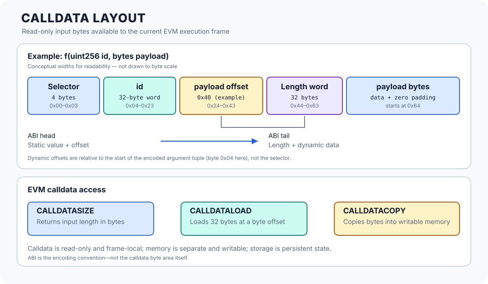

# Calldata Layout: How Input Bytes Reach the EVM

> **Stage:** 03 — Storage and Data Layout  
> **Priority:** 1  
> **Status:** Reviewed  
> **Last reviewed:** 2026-10-17

## 1. Overview

**Calldata** is the read-only, byte-addressable input area exposed to an EVM execution frame. For a normal call to a Solidity contract, it contains the input bytes supplied by the caller. In a typical ABI-encoded external function call, those bytes begin with a four-byte function selector, followed by the encoded arguments.

Calldata is not the same thing as Solidity's `memory`, persistent `storage`, or the ABI itself:

- **Calldata** is the input byte sequence available to the current execution frame.
- **The ABI** defines how typed values are encoded into and decoded from a byte sequence.
- **Memory** is a separate, writable temporary area. Data may be copied from calldata into memory.
- **Storage** holds persistent contract state, subject to the execution rules.

Calldata is read-only from EVM code. Its layout matters when debugging external calls, writing fallback functions or proxies, inspecting raw input, optimizing copies, and reasoning about ABI-decoding boundaries.



## 2. Where Calldata Comes From

Calldata is scoped to an execution frame; it is not one global buffer shared by every contract call.

### A transaction that calls a contract

For a transaction directed to an existing contract, the transaction's input data becomes the initial call's calldata. A wallet or application commonly constructs these bytes using the contract's ABI, but the EVM receives bytes—not typed Solidity values.

### A contract calling another contract

For a nested message call, the calling contract specifies an input range from its own memory as part of the call operation. The called contract receives that input as the calldata of its new execution frame. The child frame has its own calldata view, even when the call uses `DELEGATECALL`.

This distinction is useful when tracing a proxy: the proxy receives input bytes, then commonly forwards those bytes in a new call frame. Calldata is not simply one unchanging transaction buffer automatically shared by every nested call.

### Contract creation and constructor arguments

A contract-creation transaction does not call an already deployed contract's external function, so its input is not arranged as a function selector followed by a normal function-argument tuple. In the standard Solidity deployment format, the creation bytecode (**initcode**) is followed by constructor arguments encoded as an ABI tuple. The EVM executes the initcode, and the constructor code uses those appended bytes as its parameters. When creation succeeds, the initcode returns the deployed runtime bytecode.

This is the usual Solidity toolchain convention; custom creation code can define a different format. For the constructor-argument convention, see [Solidity — Contracts](https://docs.solidity.org/en/latest/contracts.html#constructors).

## 3. The Typical External Function Calldata Format

For an ordinary external function call using Solidity's standard ABI encoding, calldata is structured like this:

```text
Byte offsets (hex)       Contents
0x00–0x03                4-byte function selector
0x04–...                 ABI-encoded argument tuple
                           ├─ head: static values and offsets
                           └─ tail: dynamic values
```

The function selector is the first four bytes of the Keccak-256 hash of the function's canonical signature, for example `transfer(address,uint256)`. The return type is not part of that signature.

Starting at byte offset `0x04`, the arguments are encoded as an ABI tuple. The selector identifies the intended function in a typical Solidity dispatcher; it is not a security credential, and calldata can also reach fallback code without a recognized selector.

This format is a common convention, not a rule for every possible call. A fallback function can receive arbitrary bytes, a receive function is entered with empty calldata, and custom dispatchers may define different interpretations.

## 4. ABI Head and Tail: Static and Dynamic Arguments

The ABI uses 32-byte words for its standard argument encoding. Static values are encoded in-place. Dynamic values such as `bytes`, `string`, and dynamic arrays are normally represented in the head by a 32-byte **offset** to their data, with the data itself placed in the tail.

That offset is measured in **bytes from the start of the argument encoding**, immediately after the four-byte selector for a normal function call. It is not measured from the beginning of the entire calldata buffer. For nested tuples and arrays, offsets are interpreted relative to the relevant encoding context.

Consider this function:

```solidity
// SPDX-License-Identifier: MIT
pragma solidity ^0.8.24;

contract CalldataExample {
    function inspect(uint256 id, bytes calldata payload)
        external
        pure
        returns (uint256, uint256, bytes32)
    {
        uint256 firstWord;
        bytes32 payloadWord;

        assembly {
            firstWord := calldataload(4)
            payloadWord := calldataload(payload.offset)
        }

        return (id, firstWord, payloadWord);
    }
}
```

The function has one static argument (`id`) and one dynamic argument (`payload`). The typical standard-ABI layout is:

| Absolute calldata byte range | Meaning |
|---|---|
| `0x00–0x03` | Four-byte selector for `inspect(uint256,bytes)` |
| `0x04–0x23` | 32-byte ABI word for `id` |
| `0x24–0x43` | 32-byte offset word for `payload`; commonly `0x40` |
| `0x44–0x63` | 32-byte length word for `payload` |
| `0x64–...` | Payload bytes, followed by padding to a 32-byte boundary |

Why is the dynamic offset commonly `0x40`? The argument tuple's head contains two 32-byte words: one for `id` and one for the `payload` offset. That head is 64 bytes long, so the tail starts at offset `0x40` relative to the argument tuple. Since the tuple starts at absolute calldata byte `0x04`, the tail length word begins at absolute byte `0x44`.

The example illustrates the layout; the compiler decodes `id` and provides `payload` as a calldata reference. Assembly reads are low-level raw reads and do not replace validation or the normal ABI decoder.

## 5. The Main Calldata Opcodes

Calldata is read through dedicated EVM opcodes. These operations are distinct from memory reads and writes.

### `CALLDATASIZE`

Pushes the number of input bytes available in the current frame. It is useful for checking whether enough bytes are present for a custom format or selector.

### `CALLDATALOAD`

Loads 32 bytes beginning at a byte offset and pushes them onto the EVM stack as a 256-bit word. If the requested word extends past the end of calldata, missing trailing bytes are treated as zero for the load.

The offset is a byte offset, not a word index. For example, `CALLDATALOAD(4)` reads a word beginning immediately after the four-byte selector.

### `CALLDATACOPY`

Copies a requested range from calldata into EVM memory. The instruction takes a destination memory offset, a source calldata offset, and a byte length. It may expand memory and therefore incur memory-expansion gas; when the source range extends past calldata, out-of-range bytes are zero-filled.

These opcodes do not make calldata writable. To modify or build data, code must use a writable area such as memory.

## 6. Solidity's `calldata` Data Location

In Solidity, `calldata` is a data location for function parameters and other supported reference-type variables. It describes data that is read from the current call's input area instead of being represented as an ordinary mutable memory object.

```solidity
function sum(uint256[] calldata values) external pure returns (uint256 total) {
    for (uint256 i = 0; i < values.length; ++i) {
        total += values[i];
    }
}
```

Here, `values` refers to the input array in calldata. The function can read its length and elements but cannot assign to its elements as though it were a mutable memory array. Solidity can often avoid copying the whole array into memory when it remains in calldata and is accessed directly.

Compare the common data locations:

- `calldata`: read-only input for the current call.
- `memory`: writable temporary objects in the current execution frame.
- `storage`: persistent contract state.
- `transient`: transaction-scoped temporary state introduced by EIP-1153, a different mechanism from calldata.

Using `calldata` can reduce unnecessary copying for external inputs, but it is not automatically the best location for every operation. Code that needs to modify an array or construct new data generally needs another representation, and actual gas depends on compiler output and usage.

## 7. Reading Calldata in Inline Assembly

For a dynamic `bytes calldata payload` parameter, Solidity exposes assembly properties such as `payload.offset` and `payload.length`. The offset points to the payload's data bytes—not to its ABI length word.

```solidity
function inspectPayload(bytes calldata payload)
    external
    pure
    returns (uint256 length, bytes32 firstWord)
{
    assembly {
        length := payload.length
        firstWord := calldataload(payload.offset)
    }
}
```

For empty payloads, the length is zero; code should not treat a loaded word as meaningful payload data unless the necessary bytes are present. Even when Solidity's ABI decoder has already validated the function arguments, assembly should still respect the intended length and the bounds of any custom data it parses.

A raw selector read is commonly written as:

```solidity
uint32 selector;
assembly {
    selector := shr(224, calldataload(0))
}
```

`CALLDATALOAD(0)` places the first calldata byte in the high-order byte of the loaded word. Shifting right by 224 bits moves the first four bytes into the low 32 bits of the numeric `uint32` selector. This snippet assumes the intended input is a standard selector-bearing call; check the calldata length before relying on it in a custom decoder. When inspecting selector values and packed data, be mindful of the EVM's big-endian interpretation of loaded words and Solidity's fixed-bytes type conversions.

## 8. Calldata, Memory, and Return Data

These areas are related but not interchangeable:

| Area | Role | Typical low-level operation | Writable by running EVM code? |
|---|---|---|---|
| Calldata | Input for the current execution frame | `CALLDATASIZE`, `CALLDATALOAD`, `CALLDATACOPY` | No |
| Memory | Temporary, byte-addressable working area | `MLOAD`, `MSTORE`, `MSTORE8` | Yes |
| Storage | Persistent contract state | `SLOAD`, `SSTORE` | Yes, subject to execution context and rules |
| Return data | Bytes returned by the most recent call-like operation in the caller's frame | `RETURNDATASIZE`, `RETURNDATACOPY` | Not directly; it is read/copied |

For example, `CALLDATACOPY` transfers bytes from the current frame's calldata into memory. A subsequent `CALL` may pass a range of that memory as the next frame's input. Returned bytes use a separate return-data mechanism and are not appended to the original calldata.

See [Memory Layout](05-memory-layout.md) for Solidity's memory conventions and [Stack, Memory, and Calldata](../01-evm-execution/02-stack-memory-and-calldata.md) for the broader EVM execution-data overview.

## 9. Gas and Data-Size Considerations

Calldata size can affect transaction cost and execution work, but there is no single “calldata cost” that covers every operation:

- The transaction input bytes contribute to transaction data cost under the active protocol rules. Pricing has changed through protocol upgrades, so avoid hard-coding historical per-byte rates as timeless constants.
- Contract code that reads calldata pays for the relevant opcode work.
- Copying calldata into memory can also incur memory-expansion and copy costs.
- Large ABI-encoded arrays and byte strings increase the amount of input data and may increase decoding or copying work.

For Ethereum, see [EIP-2028](https://eips.ethereum.org/EIPS/eip-2028) for a historical change to transaction-data pricing and [EIP-7623](https://eips.ethereum.org/EIPS/eip-7623) for a later calldata-cost floor intended to constrain very data-heavy transactions. Exact costs should always be checked against the target chain and active fork.

For Layer 2 systems, calldata may also be relevant to how transaction data is published to Ethereum, although systems increasingly use other data-availability mechanisms. Do not assume every chain prices input data identically.

## 10. Common Mistakes and Security Considerations

1. **Treating calldata as the ABI.** Calldata is bytes; the ABI is a convention for encoding and decoding typed values.
2. **Assuming every call starts with a selector.** Standard external function calls usually do, but empty calldata, fallback handling, contract creation, and custom routers are different cases.
3. **Measuring offsets from byte zero of calldata.** Standard ABI dynamic offsets for a function's arguments are relative to the start of the encoded argument tuple, after the selector.
4. **Confusing byte offsets with word indices.** `CALLDATALOAD` takes a byte offset.
5. **Assuming decoded values are automatically copied into memory.** Solidity may use calldata references and decode values as needed; inspect the declared data location and generated behavior.
6. **Using a loaded word without checking meaningful length.** A load can include zero-filled bytes beyond the end of calldata; that does not mean those bytes were actually supplied.
7. **Trusting malformed raw input.** Custom fallback handlers, assembly decoders, and proxies must validate input lengths, offsets, selectors, and any application-specific invariants.
8. **Treating a selector as authorization.** Selectors identify a dispatch target, not the caller's permission to use it. Enforce access control separately.
9. **Assuming calldata belongs to the parent transaction in every nested call.** Each message-call frame has its own input bytes; a caller can construct different input for a child call.
10. **Using historical gas figures as universal constants.** Transaction-data pricing and data-availability designs vary by fork and chain.

When parsing custom calldata, define the exact byte format, validate every range before using it, avoid arithmetic overflow in offset/length calculations, and test truncated, oversized, and unexpected inputs.

## 11. Key Takeaways

- Calldata is immutable, byte-addressable input local to an EVM execution frame.
- A typical ABI-encoded function call contains a four-byte selector followed by the encoded argument tuple.
- ABI static values are encoded in-place; dynamic values are referenced through offsets and stored in a tail.
- Standard function-argument offsets are measured from the start of the argument tuple, not from the selector at absolute calldata offset zero.
- `CALLDATALOAD` reads a 32-byte word at a byte offset; `CALLDATACOPY` copies bytes into memory; `CALLDATASIZE` reports the input length.
- Solidity's `calldata` location lets code read supported input data without treating it as a mutable memory object.
- ABI-decoded input and custom raw calldata still require careful boundary reasoning, especially in fallback functions, proxies, and assembly.
- Calldata cost depends on current protocol rules and the target chain.

## Review Checklist

- [ ] Distinguish calldata from the ABI, memory, storage, and return data.
- [ ] Explain the selector and argument tuple in a standard external function call.
- [ ] Describe how ABI head/tail encoding represents a dynamic `bytes` argument.
- [ ] Explain why a dynamic argument offset is relative to the argument tuple.
- [ ] Distinguish `CALLDATALOAD` from `CALLDATACOPY` and `CALLDATASIZE`.
- [ ] Explain what `payload.offset` and `payload.length` mean for `bytes calldata`.
- [ ] Identify common calldata validation mistakes in assembly or fallback code.
- [ ] Explain why transaction-data gas rules can change across forks and chains.

## References

1. **[Solidity — Contract ABI Specification](https://docs.solidity.org/en/latest/abi-spec.html)** — primary source for function selectors, 32-byte encoding, static/dynamic types, and relative offsets.
2. **[Solidity — Types and Data Locations](https://docs.solidity.org/en/latest/types.html)** — documents `calldata` as a non-modifiable, non-persistent data location and explains its use for reference types.
3. **[Solidity — Introduction to Smart Contracts](https://docs.solidity.org/en/latest/introduction-to-smart-contracts.html)** — describes calldata in message execution, parameter decoding, return data, and contract creation.
4. **[Ethereum.org — Understanding the Yellow Paper's EVM Specifications](https://ethereum.org/developers/tutorials/yellow-paper-evm/)** — overview of the calldata opcodes and EVM memory/data areas.
5. **[EIP-2028](https://eips.ethereum.org/EIPS/eip-2028)** — historical transaction calldata pricing change.
6. **[EIP-7623](https://eips.ethereum.org/EIPS/eip-7623)** — calldata-cost floor for data-heavy transactions.
7. **[Memory Layout](05-memory-layout.md)** — companion article on the separate writable memory area.
8. **[Stack, Memory, and Calldata](../01-evm-execution/02-stack-memory-and-calldata.md)** — Stage 01 overview of execution data areas.
