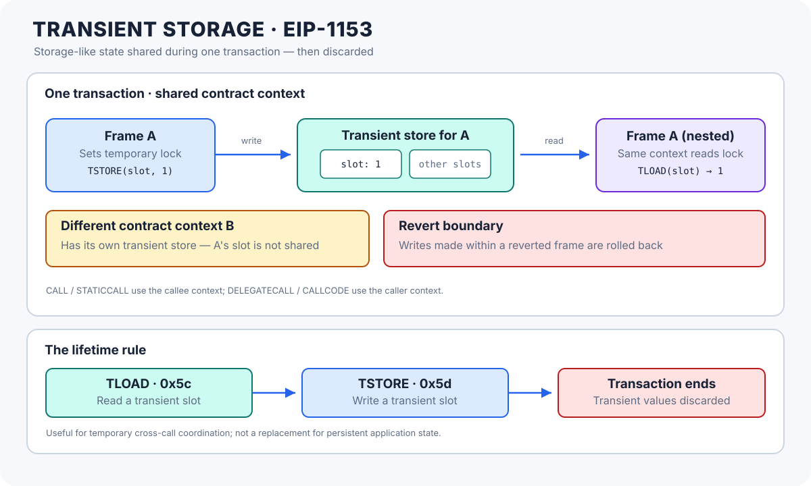

# Transient Storage (EIP-1153): Transaction-Scoped EVM State

> **Stage:** 03 — Storage and Data Layout  
> **Priority:** 1  
> **Status:** Reviewed  
> **Last reviewed:** 2026-10-17

## 1. Overview

**Transient storage** is an EVM key-value data area that behaves much like persistent contract storage while a transaction is executing, but its values are discarded when the transaction ends. It was introduced by [EIP-1153](https://eips.ethereum.org/EIPS/eip-1153), which adds two opcodes: `TLOAD` and `TSTORE`.

The idea is to let different execution frames belonging to the same contract context share temporary state during one transaction without paying the full cost of persistent state updates. This is useful for reentrancy locks, temporary approvals, callback coordination, and passing short-lived metadata between calls.

Transient storage is not the same as memory:

- **Memory** belongs to one EVM execution frame and is not shared automatically with a separate call frame.
- **Transient storage** is shared by frames that use the same contract storage context during a transaction.
- **Persistent storage** remains part of contract state across transactions unless it is changed by execution.

The data is transaction-scoped, but the usual state-transition and security rules still matter. In particular, transient writes participate in revert behavior and can affect later calls made within the same transaction.



## 2. Why EIP-1153 Was Introduced

Some contracts need a value to exist only while a transaction is in progress. A classic example is a reentrancy guard: after entering a protected function, the contract marks itself as locked so a nested call cannot enter the same protected path before the first call finishes.

Before transient storage, developers often used persistent storage slots for such temporary coordination. That can be unnecessarily expensive and may involve storage refund rules. Memory is not a direct replacement because a reentrant call creates another execution frame with its own memory; the nested frame cannot simply depend on the caller's memory contents.

EIP-1153 provides a storage-like area with transaction-only lifetime. Its main use is not to replace ordinary application state, but to store values that genuinely need to survive across calls during a single transaction and have no meaning after that transaction.

Potential use cases include:

- Reentrancy locks that only need to exist during the current transaction.
- Temporary permissions, such as an approval intended for use within one transaction.
- Callback or “till” patterns that record intermediate state and validate it before the transaction completes.
- Passing short-lived metadata between a proxy and an implementation using the same storage context.
- Coordination among multiple calls in a larger transaction flow.

These patterns still require careful design. Transient storage is a new state area, not an automatic security mechanism.

## 3. The Lifetime and Data Model

Transient storage is a 256-bit-word key-value store, similar in shape to persistent EVM storage. A slot key identifies a word, and code can load or overwrite that word during execution.

Its defining property is lifetime:

- **Within a transaction:** a value can remain available across multiple calls that share the same contract storage context.
- **At transaction end:** transient values are discarded and slots return to their default zero state for the next transaction.
- **Across separate transactions:** transient values are not a way to persist application data.
- **On a revert:** writes made within the reverted execution scope are rolled back, just like persistent-state writes.

Do not interpret “transaction-scoped” as “local to one function.” Several internal functions and nested call frames can observe the same transient slot when they execute against the same contract context.

## 4. The Two Opcodes: `TLOAD` and `TSTORE`

EIP-1153 adds these opcodes:

| Opcode | Hex | Purpose |
|---|---:|---|
| `TLOAD` | `0x5c` | Read the 32-byte word at a transient slot key |
| `TSTORE` | `0x5d` | Write a 32-byte word to a transient slot key |

The opcodes use a storage-like, word-addressed interface. They access transient state, not ordinary persistent storage. `TLOAD` reads a slot; `TSTORE` writes a value to a slot.

In the EIP's specified gas schedule, `TLOAD` and `TSTORE` each cost 100 gas. This is substantially cheaper than many persistent-storage operations, because the values do not need to be loaded from or committed to persistent state. Gas schedules can vary by chain or be changed by protocol upgrades, so verify the rules for the target EVM.

Conceptually, the operations look like this in Yul-style inline assembly:

```solidity
assembly {
    tstore(slot, value)
    let loaded := tload(slot)
}
```

Here, `slot` is a key identifying a transient word, `value` is the word written there, and `loaded` receives the word currently stored at that key. The example is illustrative; use a collision-resistant slot convention if transient slots are shared across modules, libraries, or proxy implementations.

## 5. Which Contract Owns the Transient State?

Transient storage ownership follows the EVM's contract storage context, much like persistent storage.

- **`CALL` and `STATICCALL`:** the called contract is the owner of the transient state being accessed.
- **`DELEGATECALL` and `CALLCODE`:** the caller's storage context is used, so transient reads and writes belong to the calling contract—commonly the proxy—not to the implementation's independent context.
- **Multiple frames in the same context:** they can observe and update the same transient slots during that transaction.
- **Separate contract contexts:** they do not share their transient key-value store merely because they are part of the same transaction.

This matters for proxies. An implementation invoked using `DELEGATECALL` uses the proxy's storage context, so transient variables or assembly slots used by the implementation can overlap with other transient slots used by the proxy or other delegated modules. A project should define its transient-slot conventions and avoid accidental collisions.

## 6. Reverts and Static Execution

Transient writes follow state rollback rules rather than behaving like ordinary in-memory variables.

If an execution frame reverts, transient writes made within that frame's reverted scope—including writes made by nested calls inside it—are rolled back. Earlier transient values established before entering that scope are not automatically erased just because the nested frame reverts.

This behavior is important when a contract makes a low-level call, catches a failure, and continues execution. The caller must reason about which transient writes survived the failed frame and which were rolled back.

There is also a rule related to static execution:

- `TLOAD` is allowed during a `STATICCALL`.
- `TSTORE` attempts to modify transient state, so executing it in a static context causes an exception.

A transient slot is therefore not a way to sneak state changes into a `view`-style or static call.

## 7. Using Transient State Variables in Solidity

The EVM opcodes require EVM support for Cancun or a later compatible revision. Solidity also provides a high-level transient state-variable declaration: support for transient state variables of **value types** became available in Solidity 0.8.28.

For example, a simple reentrancy guard can store its lock in transient state:

```solidity
// SPDX-License-Identifier: MIT
pragma solidity ^0.8.28;

contract TransientReentrancyGuard {
    bool transient locked;

    modifier nonReentrant() {
        require(!locked, "Reentrant call");
        locked = true;
        _;
        locked = false;
    }

    function guardedAction() external nonReentrant returns (uint256) {
        // The protected work would run here.
        return 1;
    }
}
```

The lock only needs to remain set while the protected call is in progress. After a successful return, the modifier sets it back to `false`. If execution reverts, the transaction's rollback rules also apply to the transient write.

This example demonstrates the storage mechanism, not a complete defense for every possible reentrancy pattern. A guard must cover all relevant entry points and shared state transitions, and the overall function should still follow sound checks-effects-interactions and authorization practices.

### High-level language limitations

The Solidity documentation currently describes the following constraints for transient state variables:

- High-level transient state variables support value types; reference types such as arrays, mappings, and structs, as well as local and parameter variables, are not supported by this feature.
- A transient variable cannot be initialized with an in-place declaration value, because the value would be cleared at the end of the contract-creation transaction.
- `constant` and `immutable` are not compatible with transient variables.
- Transient and persistent storage use independent layouts, but transient variables follow storage-style packing rules within their own layout.

For compiler-level details, check the [Solidity transient-storage documentation](https://docs.solidity.org/en/latest/contracts.html#transient-storage) for the compiler version and EVM target you use.

## 8. Transient Storage Compared with Other Data Areas

| Property | Persistent storage | Transient storage | Memory |
|---|---|---|---|
| Lifetime | Across transactions | Current transaction only | Current execution frame |
| Shared across separate call frames? | When they use the same storage context | When they use the same storage context | Not automatically |
| Survives transaction end? | Yes, unless modified | No | No |
| Low-level access | `SLOAD`, `SSTORE` | `TLOAD`, `TSTORE` | `MLOAD`, `MSTORE` |
| Typical purpose | Contract state | Temporary cross-call coordination | Local computation and temporary objects |
| Writes rolled back on a reverted frame? | Yes | Yes | Frame's computation does not continue after revert |

Transient storage combines two different ideas: a lifetime similar to memory (it does not survive the transaction) and a sharing model more like storage (frames in the same storage context can communicate through it).

See [Storage Layout](01-storage-layout.md), [Storage Slots](02-storage-slots.md), and [Memory Layout](05-memory-layout.md) for the related state and data areas.

## 9. Common Mistakes and Security Considerations

1. **Using transient storage for data that must persist.** A user's balance, ownership, or protocol configuration should not live only in transient state.
2. **Assuming it is per-call or per-function.** Other calls in the same transaction and contract context may see the same transient slot.
3. **Leaving a lock set when a later call in the same transaction should be allowed.** Although every transient slot resets at transaction end, later operations inside the same transaction can still be affected by the value.
4. **Assuming a revert clears all transient state in the whole transaction.** A revert rolls back writes in its reverted scope, not every earlier write in the transaction.
5. **Forgetting the `DELEGATECALL` context.** Delegated code reads and writes the proxy's transient storage context, so modules can accidentally collide on slots.
6. **Treating a transient lock as a complete reentrancy solution.** Guard the right entry points and analyze external-call ordering and state invariants.
7. **Trying to write transient storage inside static execution.** `TSTORE` in a static context fails; `TLOAD` remains allowed.
8. **Assuming transient and persistent variables share the same layout.** Their layouts are independent, even though each uses storage-style slot and packing rules.
9. **Ignoring chain or fork compatibility.** The target EVM must implement EIP-1153; a compiler accepting the code does not guarantee that every target chain supports the opcodes.
10. **Using ad hoc transient slot constants across modules.** Namespacing and documenting slots helps prevent collisions in proxies and shared execution contexts.

One particularly important design rule is to write nonzero transient values only when later calls in the same transaction are meant to observe them. EIP-1153 explicitly warns that failing to account for such values can break composability or introduce bugs.

## 10. Key Takeaways

- EIP-1153 introduces `TLOAD` (`0x5c`) and `TSTORE` (`0x5d`) for transaction-scoped EVM state.
- Transient storage persists across calls within the same transaction and contract storage context, then resets at transaction end.
- It is much cheaper than many persistent-storage operations, but it is not the same thing as memory.
- Transient writes are reverted when the execution scope that made them reverts.
- `CALL`/`STATICCALL` use the callee's context; `DELEGATECALL`/`CALLCODE` use the caller's context.
- `TSTORE` is not allowed in static execution; `TLOAD` is allowed.
- Solidity 0.8.28 added high-level transient state variables for value types; compiler and target-chain compatibility matter.
- Reentrancy guards and callback coordination are major use cases, but slot ownership, reset timing, revert boundaries, and composability must be handled deliberately.

## Review Checklist

- [ ] Explain the purpose of EIP-1153 and the difference between transient and persistent storage.
- [ ] Identify `TLOAD` and `TSTORE` and their opcode bytes.
- [ ] Explain why transient storage is shared across some call frames but memory is not.
- [ ] Describe storage ownership under `CALL`, `STATICCALL`, and `DELEGATECALL`.
- [ ] Explain transaction-end clearing and revert rollback boundaries.
- [ ] Explain why `TSTORE` fails in a static context while `TLOAD` is permitted.
- [ ] Recognize the compiler and high-level type limitations for transient state variables.
- [ ] Identify possible reentrancy, proxy-slot collision, and composability hazards.

## References

1. **[EIP-1153 — Transient storage opcodes](https://eips.ethereum.org/EIPS/eip-1153)** — the normative source for opcode behavior, gas schedule, transaction lifetime, context ownership, revert semantics, static-call restrictions, use cases, and security considerations.
2. **[Solidity — Transient Storage](https://docs.solidity.org/en/latest/contracts.html#transient-storage)** — high-level language support, initialization rules, type limitations, and reentrancy-guard examples.
3. **[Solidity 0.8.28 Release Announcement](https://www.soliditylang.org/blog/2024/10/09/solidity-0.8.28-release-announcement/)** — confirms full support for transient state variables of value types in Solidity 0.8.28.
4. **[Solidity — Layout of State Variables in Storage and Transient Storage](https://docs.solidity.org/en/latest/internals/layout_in_storage.html)** — explains that the two layouts are independent and describes storage-style packing rules.
5. **[Storage Layout](01-storage-layout.md)** — companion article on persistent state-variable layout.
6. **[Storage Slots](02-storage-slots.md)** — companion article on key/value slot semantics.
7. **[Memory Layout](05-memory-layout.md)** — companion article on the separate, frame-local memory area.
