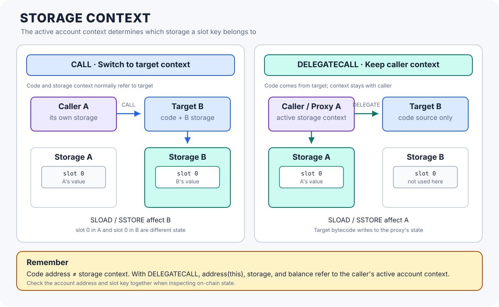

# Storage Context: Which Contract's State Is Being Accessed?

> **Stage:** 03 — Storage and Data Layout  
> **Priority:** 1  
> **Status:** Reviewed  
> **Last reviewed:** 2026-10-17

## 1. Overview

**Storage context** means the account whose persistent storage an EVM execution frame reads and writes. The EVM's `SLOAD` and `SSTORE` instructions do not access a storage slot in isolation: the slot key is interpreted within the active account context.

This distinction becomes critical with `DELEGATECALL`. The EVM can execute code stored at one address while using another contract's account context. In a proxy pattern, the implementation provides the code, but the proxy provides the storage context.

A useful mental model is to ask two separate questions:

1. **Whose code is running?** Which account supplied the bytecode for this frame?
2. **Whose context is active?** Which account address, storage, and balance are used by the executing code?

With an ordinary `CALL`, these normally point to the target contract. With `DELEGATECALL`, they can be different.



## 2. Storage Slots Are Account-Scoped

A persistent storage slot is a 256-bit key that identifies a word within one account's storage. The address of the account is also required to identify the state being read.

Conceptually:

```text
Storage location = (account address, slot key)

Storage[A][0] -> value held in slot 0 of account A
Storage[B][0] -> value held in slot 0 of account B
```

Even if both contracts have a variable called `count` assigned to slot `0`, the variables are stored separately when each contract uses its own context. Slot `0` in contract A is not slot `0` in contract B.

The same rule applies to mappings and other values whose slot keys are derived from hashes: first determine the active account context, then determine the slot key within that account.

This is why a raw slot number alone is not enough when inspecting state through JSON-RPC. A request such as `eth_getStorageAt` needs both the account address and the slot key, plus a block reference.

See [Storage Slots](02-storage-slots.md) for the slot-key model and [Storage Layout](01-storage-layout.md) for the compiler's mapping of Solidity declarations to locations.

## 3. How Call Opcodes Select the Context

The call opcode determines how the child execution frame relates to the caller's account context. The following table gives the typical behavior for calls involving contracts.

| Operation | Code executed | Storage context | `address(this)` | `msg.sender` in child frame |
|---|---|---|---|---|
| `CALL` | Target's code | Target account | Target address | Calling contract |
| `STATICCALL` | Target's code | Target account | Target address | Calling contract |
| `DELEGATECALL` | Target's code | Current caller's context | Current context's address | Preserved from the current call context |
| Internal Solidity call | Same contract's compiled code | Current context | Unchanged | Unchanged |

For `STATICCALL`, the child context is the target contract, but execution is marked static: state-changing operations are not permitted. No ETH value is transferred, so the static child frame's `msg.value` is zero.

For `DELEGATECALL`, both `msg.sender` and `msg.value` are preserved from the current call context. They are not automatically reset to the implementation contract's address or value. The opcode also uses the caller's account context for storage and the current account address.

The table describes account context and selected message-call values. It is not a complete description of every environmental value or gas rule; consult the EVM specification and Solidity documentation for exact opcode behavior.

## 4. A Concrete Example: CALL Versus DELEGATECALL

Suppose contract `Counter` has a `count` variable in slot `0`:

```solidity
// SPDX-License-Identifier: MIT
pragma solidity ^0.8.24;

contract Counter {
    uint256 public count; // slot 0

    function increment() external {
        count += 1;
    }
}
```

Now imagine contract `Caller` invokes `increment()` in two different ways.

### Ordinary CALL

When `Caller` calls `Counter.increment()` using a normal high-level external call or low-level `CALL`, the code executes in `Counter`'s context. The `SLOAD` and `SSTORE` operations generated for `count += 1` therefore read and update `Counter`'s slot `0`.

### DELEGATECALL

When `Caller` executes `Counter`'s code using `DELEGATECALL`, that code runs in `Caller`'s context. The same storage instructions now read and update slot `0` of `Caller` instead.

This does not copy `Counter`'s state into `Caller`; it executes `Counter`'s code against the active caller context. If the caller's slot `0` contains unrelated data, the delegated code may interpret or overwrite that data as though it were `count`.

This is the key difference: **the code address tells you where the instructions came from; the storage context tells you whose state those instructions can modify.**

## 5. Storage Context in a Proxy

An upgradeable proxy normally holds the persistent state used by the application. The implementation holds the code that operates on that state.

A typical call follows this sequence:

1. A user sends a transaction to the proxy address.
2. The proxy receives the calldata and selects the implementation address.
3. The proxy uses `DELEGATECALL` to execute implementation code in the proxy's context.
4. A state read or write made by the implementation accesses the proxy's storage.
5. The implementation's return or revert data is forwarded back through the proxy to the user.

During delegated execution, common observations include:

| Expression or operation in implementation code | What it refers to |
|---|---|
| `address(this)` | Proxy address |
| `address(this).balance` | Proxy account's ETH balance |
| `SLOAD` / `SSTORE` | Proxy account's persistent storage |
| `TLOAD` / `TSTORE` | Proxy account's transient storage context during the transaction |
| An emitted event log | Normally attributed to the proxy address |
| `msg.sender` | Sender in the proxy's current message-call context |
| `msg.value` | Value associated with that call context |

The last two values depend on the call chain. If a user calls the proxy directly, the delegated implementation normally sees the user as `msg.sender`. If another contract calls the proxy, the implementation generally sees that other contract as `msg.sender`, not automatically the original user.

This is one reason to reason about each message-call frame rather than assuming every frame sees the transaction origin.

## 6. Storage Layout Must Match

A proxy and its implementation do not have two separate sets of application state that automatically merge. Implementation code is reading and writing the proxy's storage slots. The code's expectations about those slots therefore need to match the proxy's actual layout.

Imagine the implementation expects:

```solidity
uint256 count; // expected at slot 0
address owner; // expected at slot 1
```

If the proxy or an earlier implementation uses a different ordering or incompatible types, a delegated function may read the wrong value or overwrite an unrelated variable. A variable declaration's name does not protect its slot from being reused by different code.

For upgradeable contracts, changing the order or type of existing state variables can therefore corrupt application state. Developers should verify the compiler-generated storage layout and follow the upgrade rules of the proxy framework in use.

Common techniques include preserving existing variable positions, appending compatible state variables when the pattern requires it, or using a documented namespaced-storage design. Standards such as [EIP-1967](https://eips.ethereum.org/EIPS/eip-1967) reserve specific slots for proxy metadata such as the implementation address to reduce collisions with ordinary state variables. They do not make an otherwise incompatible storage layout safe.

## 7. Constructors and Initializers

A Solidity constructor runs when the implementation contract itself is deployed. It initializes the implementation account's storage; it does **not** initialize a separate proxy's storage merely because the proxy will later delegate to that implementation.

If a proxy's application state needs initialization, a common pattern is to call an initializer function in the implementation using `DELEGATECALL` during proxy deployment or through a controlled initialization transaction. Since this function runs in the proxy's context, its state writes go to the proxy.

Initializer design has security implications:

- Ensure initialization can only occur through the intended path and at the intended time.
- Prevent an untrusted account from claiming ownership or setting critical state by calling an unprotected initializer.
- Track and enforce one-time initialization where appropriate.
- Consider the implementation account separately; locking its initializers is a common defensive practice in upgradeable-contract frameworks.

An initializer is not a constructor. It is ordinary callable code whose safety depends on access control, deployment order, and the account context in which it executes.

## 8. Transient Storage Follows the Context Too

EIP-1153 adds transaction-scoped storage accessed through `TLOAD` and `TSTORE`. Its lifetime differs from persistent storage, but its ownership follows the EVM's storage-context rules.

If implementation code runs through `DELEGATECALL`, its transient-storage accesses use the proxy's transient storage context. This is useful for proxy-aware reentrancy guards or short-lived coordination, but it also means different delegated modules can collide if they use the same transient slot key for different purposes.

Transient storage resets at the end of the transaction, but that lifetime rule does not remove the need to namespace slots or understand which contract context a delegated operation is using.

Read [Transient Storage (EIP-1153)](07-transient-storage-eip-1153.md) for the details of `TLOAD`, `TSTORE`, transaction-end clearing, and revert behavior.

## 9. Security Considerations

1. **Do not treat `DELEGATECALL` as a simple read-only library call.** Delegated code can write the caller's storage and perform external calls in that context.
2. **Do not delegate to untrusted code.** Malicious implementation code can modify critical state, change authorization variables, emit misleading logs, or affect assets held by the calling account.
3. **Verify storage-layout compatibility during upgrades.** Existing slots must continue to mean the same thing to the new implementation unless a carefully designed migration or storage scheme says otherwise.
4. **Keep proxy metadata away from application variables.** Use a documented layout strategy such as EIP-1967 or namespaced storage; do not rely on variable names preventing collisions.
5. **Initialize proxy state safely.** Constructor-written implementation state does not automatically transfer to the proxy.
6. **Reason about the actual caller.** Under delegated execution, `msg.sender` is preserved from the current call context; it is not necessarily the original end user or `tx.origin`.
7. **Check the execution context before interpreting a slot.** The same slot key can refer to completely different values under different account addresses.
8. **Remember the static flag.** A `STATICCALL` runs in the target's context but cannot successfully perform state-changing operations; delegated storage context does not bypass that restriction.

Storage-context bugs often become critical because a developer understands what the code is meant to do but overlooks whose state the code is actually modifying.

## 10. Key Takeaways

- A storage location is identified by both an account context and a slot key.
- `CALL` and `STATICCALL` execute target code in the target's account context; `STATICCALL` additionally prohibits state changes.
- `DELEGATECALL` executes target code in the caller's account context, preserving the current `msg.sender` and `msg.value`.
- In a proxy, implementation code normally reads and writes the proxy's persistent and transient storage.
- `address(this)`, the account balance, and event-emitter address follow the active account context, not simply the address from which bytecode was loaded.
- Proxy initialization and storage layout require explicit care; implementation constructor state does not initialize proxy state.
- Slot collisions, layout mismatches, and untrusted delegated code are major security risks.

## Review Checklist

- [ ] Explain why a storage slot key alone does not uniquely identify account state.
- [ ] Distinguish the address that supplies bytecode from the active storage context.
- [ ] Compare `CALL`, `STATICCALL`, `DELEGATECALL`, and internal function calls.
- [ ] Predict the values of `address(this)`, `msg.sender`, and `msg.value` in a proxy call.
- [ ] Explain why a delegated `SSTORE` updates the proxy's storage.
- [ ] Explain how storage-layout incompatibility can corrupt proxy state.
- [ ] Distinguish implementation constructors from proxy initializers.
- [ ] Describe how transient storage follows storage context under `DELEGATECALL`.
- [ ] Identify the risks of untrusted delegated code and unsafe initialization.

## References

1. **[Solidity — Introduction to Smart Contracts: Delegatecall and Libraries](https://docs.solidity.org/en/latest/introduction-to-smart-contracts.html#delegatecall-and-libraries)** — explains that delegated code runs in the calling contract's context and that storage, current address, and balance refer to the caller.
2. **[Solidity — Types: Call, Delegatecall, and Staticcall](https://docs.solidity.org/en/latest/types.html#members-of-addresses)** — describes the low-level call variants, their returned values, and the storage/context implications of `delegatecall`.
3. **[EIP-7 — DELEGATECALL](https://eips.ethereum.org/EIPS/eip-7)** — specifies the opcode's preservation of caller and call value and its role in using code in the caller's environment.
4. **[EIP-1967 — Proxy Storage Slots](https://eips.ethereum.org/EIPS/eip-1967)** — specifies reserved storage locations used by proxy implementations.
5. **[Ethereum.org — Upgrading Smart Contracts](https://ethereum.org/developers/docs/smart-contracts/upgrading/)** — explains the proxy/implementation split and the consequence that delegated implementation code reads and writes proxy storage.
6. **[Storage Slots](02-storage-slots.md)** — companion article on account-scoped slot keys.
7. **[Transient Storage (EIP-1153)](07-transient-storage-eip-1153.md)** — companion article on transaction-scoped storage using the same active context rules.
8. **[DELEGATECALL](../01-evm-execution/05-delegatecall.md)** — Stage 01 article on the opcode's execution-frame semantics.
9. **[EVM Execution Context](../01-evm-execution/03-execution-context.md)** — Stage 01 overview of the broader execution context.
