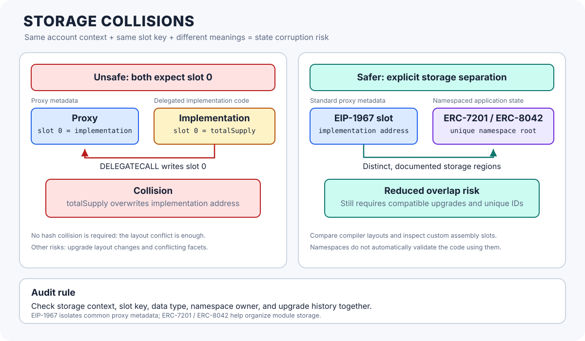

# Storage Collisions: When Different Code Uses the Same State Slots

> **Stage:** 03 — Storage and Data Layout  
> **Priority:** 1  
> **Status:** Reviewed  
> **Last reviewed:** 2026-10-17

## 1. Overview

A **storage collision** happens when two pieces of code interpret or use the same storage location for different purposes. It most often becomes dangerous when multiple implementations, modules, or facets execute in the same account storage context, especially through `DELEGATECALL`.

The EVM does not store Solidity variable names beside their values. Persistent storage is addressed by 256-bit slot keys within an account. If one part of a system expects slot `0` to contain an implementation address while another part expects slot `0` to contain a counter, a write can corrupt critical state—even though each piece of code may look reasonable on its own.

Storage collisions are not all the same. Important cases include:

- **Proxy metadata versus implementation state:** delegated code overwrites a slot that the proxy uses for its own control data.
- **Incompatible implementation layouts across upgrades:** a new version reads an old slot as a different variable or type.
- **Conflicting modules or Diamond facets:** independently written modules use the same slots for unrelated state in one shared storage context.
- **Namespace or custom-slot collisions:** two modules choose the same manually derived storage location for different structures.

This article focuses on persistent storage collisions and their prevention. The same context discipline also matters for [Transient Storage (EIP-1153)](07-transient-storage-eip-1153.md), but transient and persistent storage use separate layouts.



## 2. Why a Slot Collision Is Possible

Solidity's default storage layout assigns ordinary state variables to slots starting at slot `0`, following the language's layout rules. Each contract deployed at a separate address has its own persistent storage. However, when code uses `DELEGATECALL`, that code executes in the caller's account context.

That combination is the key risk:

1. A proxy or modular host owns one storage area.
2. Implementation code contains storage reads and writes compiled for its declared layout.
3. Delegated code accesses the host's slots, not an isolated copy of the implementation's state.
4. If the host and module disagree about what a slot means, a write may corrupt another piece of state.

A storage slot is therefore not globally identified by its number alone. For ordinary state, the relevant location is the pair **(account context, slot key)**. Within one shared account context, however, modules must coordinate their slot assignments.

See [Storage Context](08-storage-context.md) for the EVM account-context rules and [Storage Layout](01-storage-layout.md) for how Solidity assigns slots and byte offsets.

## 3. Collision Type A: Proxy Metadata and Implementation Variables

Consider a deliberately unsafe custom proxy:

```solidity
// Simplified anti-pattern — do not use as a production proxy.
contract UnsafeProxy {
    address public implementation; // slot 0
    uint256 public adminValue;     // slot 1

    fallback() external payable {
        address target = implementation;
        assembly {
            calldatacopy(0, 0, calldatasize())
            let ok := delegatecall(gas(), target, 0, calldatasize(), 0, 0)
            returndatacopy(0, 0, returndatasize())
            switch ok
            case 0 { revert(0, returndatasize()) }
            default { return(0, returndatasize()) }
        }
    }
}

contract Implementation {
    uint256 public totalSupply; // slot 0 in its own default layout

    function setTotalSupply(uint256 value) external {
        totalSupply = value;
    }
}
```

This example is intentionally simplified to demonstrate the collision; the fallback implementation and access-control design are not production-ready.

The proxy stores its `implementation` address in slot `0`. The implementation compiler lays out `totalSupply` at slot `0` in the implementation's own layout. When `setTotalSupply` runs by `DELEGATECALL`, its `SSTORE` writes to slot `0` of the proxy. The proxy's implementation address is overwritten by the value intended for `totalSupply`.

A call that appears to update business state can therefore break the proxy's routing metadata. In the worst case, control of execution can be lost or redirected.

### Why this is not a hash collision

No cryptographic hash collision is needed. Both modules deliberately use the same simple slot number in the same account context. The collision is a layout and context design error.

## 4. Collision Type B: Storage Layout Changes During an Upgrade

Suppose version 1 declares:

```solidity
contract V1 {
    uint256 totalSupply; // slot 0
    address owner;       // slot 1
}
```

And an upgrade changes the layout to:

```solidity
contract V2 {
    address owner;       // slot 0 — now incompatible
    uint256 totalSupply; // slot 1
}
```

If a proxy already holds state using V1's layout, simply upgrading its implementation to V2 does not move the stored values. Slot `0` still contains the old `totalSupply`, and slot `1` still contains the old `owner`. V2 instead interprets those words in the opposite order and different types.

This can cause incorrect values, broken authorization, or destructive writes. Solidity does not automatically migrate proxy storage when the implementation address changes.

Upgrade compatibility rules include:

- Do not reorder, remove, or change the types of existing state variables when the framework requires layout compatibility.
- Be particularly careful with inheritance, structs, packed variables, mappings, and dynamic arrays, because their locations depend on layout rules.
- Review compiler-generated storage layout for both old and new versions before shipping an upgrade.
- Use an explicit migration when a real layout change is required; a changed source declaration alone does not relocate existing state.

An appended variable may be safe in many established upgrade patterns, but it is not a universal guarantee: inheritance changes, base contracts, custom storage bases, namespaced storage, and framework-specific rules still need review.

## 5. Collision Type C: Diamond Facets and Modular Code

The Diamond pattern (ERC-2535) routes function selectors to separately deployed facets while keeping application state in the Diamond account. Facets can intentionally share state, but they must agree on where that state lives and what its layout means.

Imagine two facets each declare `uint256 value` as their first ordinary state variable. If both facets run by `DELEGATECALL` against the Diamond's context, both refer to slot `0`. If one facet thinks slot `0` means a user's balance and the other thinks it means a fee rate, the two concepts collide.

Sometimes shared storage is deliberate: multiple facets may use the same storage struct at the same location to access one common data model. The danger is **uncoordinated reuse**, not sharing by itself.

For modular contracts:

- Define clear ownership for every storage region.
- Share a struct definition and exact storage-location convention when modules intentionally access the same state.
- Give unrelated modules distinct namespaces rather than relying on declarations in separate source files to isolate them.
- Audit facet additions and replacements for both storage changes and function-routing changes.

The Diamond standard leaves the concrete storage organization pattern to the implementation, so this is an architectural responsibility rather than something automatically solved by using a Diamond.

## 6. Collision Type D: Manually Chosen or Namespaced Slots

Low-level Solidity sometimes chooses custom locations for a struct or storage pointer instead of relying only on the compiler's default sequential layout. This can be useful for proxies and modular systems, but a custom location is safe only if it is derived and managed consistently.

For example, two modules that both use the same constant:

```solidity
bytes32 constant MODULE_SLOT = keccak256("example.module");
```

will use the same starting location if they use that constant as their storage root. If they intend different meanings for the same struct slots, their data can collide. The fact that the slot is hash-derived does not protect against two modules deliberately using the same identifier.

There is a difference between:
- **Logical slot reuse:** two modules choose the same root or slot key. This is a realistic engineering risk.
- **Accidental cryptographic collision:** two independent identifiers unexpectedly produce the same hash output. With Keccak-256, this is considered computationally infeasible for normal development scenarios.
- **Overlap between a custom region and the default layout:** a poorly chosen custom slot could overlap ordinary Solidity storage or another custom region.

Use established, documented storage namespace patterns rather than inventing an unreviewed slot formula.

## 7. Established Mitigations and Standards

No single technique removes every class of storage collision. Choose a layout strategy appropriate to the architecture and preserve it consistently.

### EIP-1967: reserved proxy metadata slots

[EIP-1967](https://eips.ethereum.org/EIPS/eip-1967) standardizes slots for important proxy metadata such as the implementation address, admin, or beacon. These special locations are derived in a way intended to avoid the ordinary compiler-assigned slots used by typical Solidity state variables.

This helps prevent basic proxy variables from colliding with implementation variables at slots such as `0` and `1`. It does **not** automatically make incompatible implementation upgrades safe, nor does it prevent arbitrary modules from using the same custom slot.

### ERC-7201: Namespaced Storage Layout

[ERC-7201](https://eips.ethereum.org/EIPS/eip-7201) defines a convention for assigning a namespace to a storage struct and computing a distinct root location for that namespace. The struct's contents then follow Solidity's normal storage-layout rules rooted at that location.

The standard's formula is designed to keep a namespace separate from the default Solidity storage tree and other namespace roots, assuming Keccak-256 collision resistance and reasonable namespace sizes. A NatSpec annotation such as `@custom:storage-location erc7201:example.main` documents the intended namespace, but the annotation alone does not enforce correct usage at runtime.

### ERC-8042: Diamond Storage

[ERC-8042](https://eips.ethereum.org/EIPS/eip-8042) formalizes the widely used Diamond Storage convention, where a struct's storage root is derived from a human-readable identifier using `keccak256`. It recommends meaningful, unique identifiers and printable ASCII strings.

ERC-7201 and ERC-8042 use different formulas and conventions. Do not calculate a root using one standard and annotate or document it as the other. Follow one chosen convention consistently and check the standard's current requirements.

### Other useful mitigations

- Preserve storage layout across implementation upgrades and compare compiler outputs in code review.
- Use the proxy framework's established layout and upgrade validation tools rather than hand-editing critical slot constants.
- Document the owner, purpose, and version of each custom storage namespace.
- Use namespaced storage to separate independently maintained modules where it fits the design.
- Test the upgrade or facet change against realistic state populated by the previous version, not just against a freshly deployed contract.

## 8. A Practical Review Workflow

When reviewing a proxy or modular contract, check storage as deliberately as you check access control:

1. **Identify the active context.** Determine whether each path uses `CALL`, `DELEGATECALL`, or another call mechanism.
2. **Map ordinary variables.** Export the compiler's storage layout and review slots, offsets, inheritance, structs, and mapping/array roots.
3. **Inventory custom slots.** Search for `.slot :=`, `sstore`, `sload`, hashed constants, namespace annotations, and assembly storage pointers.
4. **Compare versions.** For an upgrade, compare the old and new layout and confirm that all existing state keeps its intended meaning.
5. **Check module ownership.** For Diamonds and plugin-style designs, confirm that each facet has a unique namespace unless shared access is intentional and identically defined.
6. **Exercise the collision scenario.** Write tests that populate state through the old implementation, perform the upgrade or module change, and then verify every affected variable and authorization condition.
7. **Check control metadata.** Verify implementation, admin, and beacon slots against the framework or standard in use.

Compiler layout output covers Solidity's declared variables but may not describe every manually assigned slot or every external namespace convention. A correct review needs both compiler data and source-level inspection of custom storage code.

## 9. Common Mistakes and Security Considerations

1. **Assuming each source file gets separate storage.** Delegated modules share the caller's account context.
2. **Assuming the implementation has its own state during `DELEGATECALL`.** The code comes from the implementation, but storage access occurs in the caller's context.
3. **Changing variable order during an upgrade.** Existing bytes are not automatically moved to match the new declarations.
4. **Assuming EIP-1967 solves all layout problems.** It separates standard proxy metadata slots; it is not a general storage migration mechanism.
5. **Assuming a hashed slot cannot collide.** Modules that intentionally or accidentally use the same namespace identifier get the same root by design.
6. **Mixing ERC-7201 and ERC-8042 formulas.** Their namespace conventions are different and must not be interchanged casually.
7. **Thinking compiler output shows every custom storage pointer.** Handwritten assembly and some namespace patterns require additional source review.
8. **Testing only fresh deployments.** Layout corruption often appears only when an upgrade is applied to populated state.
9. **Using storage gaps as a license to reorder state.** A gap can support certain planned additions in particular upgrade patterns; it does not make arbitrary layout changes safe.
10. **Ignoring access-control consequences.** If a collision overwrites an owner, admin, role mapping, or implementation address, it can become a direct takeover or denial-of-service vulnerability.

The most important practical point is that a storage collision is often about **two components believing the same bytes have different meanings**. Audit the storage context, slot assignment, data type, and upgrade history together.

## 10. Key Takeaways

- A storage collision occurs when different code uses the same storage location for incompatible purposes in the same account context.
- `DELEGATECALL` makes implementation code operate on the caller's storage, which is why proxy and Diamond layouts require coordination.
- Upgrade collisions can happen when new code changes the interpretation of previously populated slots; deployment does not automatically migrate storage.
- Slot collisions from reused identifiers or layout mistakes are realistic; an accidental Keccak-256 hash collision is a different and far less plausible case.
- EIP-1967 separates common proxy metadata from ordinary Solidity slots but does not solve every upgrade-layout incompatibility.
- ERC-7201 and ERC-8042 provide established namespace approaches for modular storage; use each formula and annotation correctly.
- Review both compiler-generated layout and manually assigned slots, and test upgrades against state created by the previous version.

## Review Checklist

- [ ] Explain why delegated modules can access the same storage slots.
- [ ] Identify the risk when proxy metadata and implementation variables use the same slot.
- [ ] Explain how changing variable order or types can corrupt state across an upgrade.
- [ ] Distinguish intentional shared state from an uncoordinated Diamond facet collision.
- [ ] Distinguish logical slot reuse from an accidental cryptographic hash collision.
- [ ] Explain the role and limitations of EIP-1967.
- [ ] Compare the purpose of ERC-7201 and ERC-8042 namespaced storage.
- [ ] Describe how to review default layouts and custom assembly storage slots.
- [ ] Plan upgrade tests using state populated under the previous implementation.

## References

1. **[Solidity — Layout of State Variables in Storage and Transient Storage](https://docs.solidity.org/en/latest/internals/layout_in_storage.html)** — the rules for storage layout, inheritance, packing, and compiler-generated layout reports.
2. **[EIP-1967 — Proxy Storage Slots](https://eips.ethereum.org/EIPS/eip-1967)** — standard proxy metadata slots and the rationale for avoiding collisions with implementation functions or storage.
3. **[ERC-7201 — Namespaced Storage Layout](https://eips.ethereum.org/EIPS/eip-7201)** — the namespace annotation and formula for separating storage regions.
4. **[ERC-8042 — Diamond Storage](https://eips.ethereum.org/EIPS/eip-8042)** — the standardized hash-derived storage-location convention for Diamond Storage.
5. **[ERC-2535 — Diamonds, Multi-Facet Proxy](https://eips.ethereum.org/EIPS/eip-2535)** — explains how facets execute against shared Diamond storage and why the layout pattern is an architectural responsibility.
6. **[Storage Context](08-storage-context.md)** — companion article on the active account whose state is accessed.
7. **[Storage Layout](01-storage-layout.md)** — companion article on Solidity's default slot and offset assignment rules.
8. **[Storage Slots](02-storage-slots.md)** — companion article on account-scoped slot keys and stored words.
