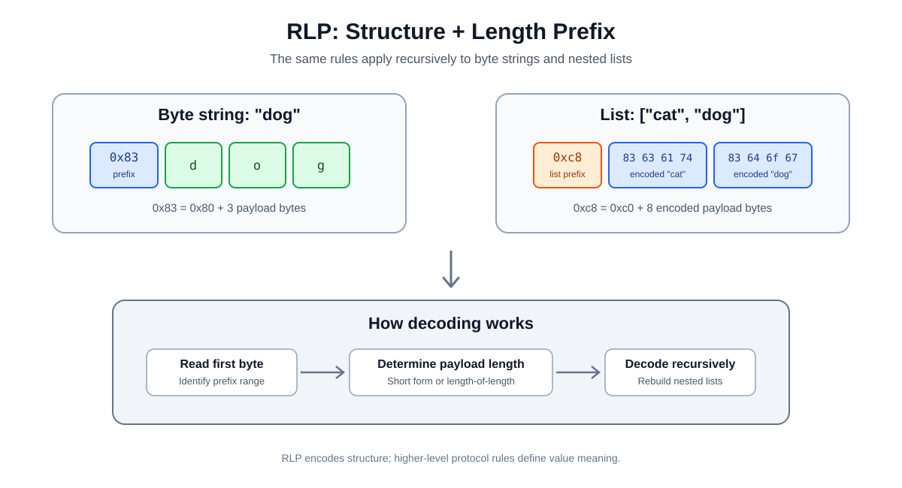

# Recursive Length Prefix (RLP) Encoding

> **Stage:** 03 — Storage and Data Layout  
> **Priority:** 1  
> **Status:** Reviewed  
> **Last reviewed:** 2026-10-17

## 1. Overview

**Recursive Length Prefix (RLP)** is a serialization format used extensively by Ethereum's execution layer. It converts byte strings and nested lists into a deterministic sequence of bytes so that clients can store, transmit, hash, and decode structured protocol data.

RLP is primarily concerned with **structure and length**, not with the meaning of a value. It knows how to encode a byte string or a list of recursively encoded items; higher-level protocol rules determine whether those bytes represent an address, a transaction field, an integer, or something else.

RLP is important when studying Ethereum internals because execution-layer structures—including legacy transaction data and block-related structures—use RLP serialization. It is not the same as Solidity's ABI encoding, and it is not the main serialization format for Ethereum's consensus layer, where SSZ is widely used.



## 2. What RLP Encodes

RLP accepts two structural kinds of item:

- **Byte strings:** arbitrary sequences of bytes, including an empty byte string.
- **Lists:** ordered collections of RLP items, which may themselves contain lists.

A positive integer is not a separate structural type in RLP. A protocol using RLP first represents the integer as its shortest big-endian byte sequence, then encodes that byte sequence as a string. Under Ethereum's integer rules, zero is represented by the empty byte string, which RLP encodes as `0x80`; a literal one-byte value `0x00`, by contrast, encodes as `0x00`.

RLP does not automatically encode maps/dictionaries as a dedicated type. A protocol must define how such data is represented, for example as an ordered list of key-value pairs.

## 3. The Five Prefix Cases

The first byte identifies how the decoder should interpret the item and determine its length.

### Case 1: A single byte from 0x00 to 0x7f

If a byte string contains exactly one byte whose value is between `0x00` and `0x7f`, that byte is its own encoding. No extra prefix is added.

Example:

```text
Input byte:  0x7f
RLP output:  0x7f
```

### Case 2: A short byte string (0–55 bytes)

For a byte string of up to 55 bytes, the encoding is:

```text
prefix = 0x80 + payload length
output = prefix || payload
```

The empty byte string has length zero, so its encoding is `0x80`. A one-byte string whose byte is below `0x80` uses Case 1 instead.

Example — the string `"dog"` is three UTF-8 bytes:

```text
Payload:  64 6f 67
Prefix:   0x80 + 3 = 0x83
RLP:      83 64 6f 67
```

### Case 3: A long byte string (more than 55 bytes)

For a payload longer than 55 bytes, RLP first encodes the payload length itself as a minimal big-endian byte sequence.

```text
prefix = 0xb7 + length-of-length
output = prefix || encoded-length || payload
```

For example, a payload of 56 bytes has a one-byte length representation `0x38`, so its prefix is `0xb8`, followed by `0x38`, followed by the 56 payload bytes.

### Case 4: A short list (payload length 0–55 bytes)

First RLP-encode every item in the list and concatenate those encodings. If the combined payload is no more than 55 bytes:

```text
prefix = 0xc0 + encoded-payload length
output = prefix || concatenated encoded items
```

An empty list has no payload, so it encodes as `0xc0`.

Example — the list `["cat", "dog"]`:

```text
"cat" -> 83 63 61 74
"dog" -> 83 64 6f 67
List payload length = 8 bytes
List prefix = 0xc0 + 8 = 0xc8

RLP = c8 83 63 61 74 83 64 6f 67
```

### Case 5: A long list (payload longer than 55 bytes)

For a list whose concatenated encoded payload exceeds 55 bytes, the payload length is encoded as a minimal big-endian byte sequence:

```text
prefix = 0xf7 + length-of-length
output = prefix || encoded-payload length || concatenated encoded items
```

In short, the prefix range separates single-byte strings, short and long strings, and short and long lists.

## 4. Prefix Reference

| First byte | Meaning |
| --- | --- |
| `0x00–0x7f` | A single byte encoded as itself |
| `0x80–0xb7` | Byte string with payload length 0–55 |
| `0xb8–0xbf` | Long byte string; prefix indicates the number of length bytes |
| `0xc0–0xf7` | List with encoded payload length 0–55 |
| `0xf8–0xff` | Long list; prefix indicates the number of length bytes |

The length described by a list prefix is the size of its **encoded payload**, not the number of list elements. Each element already has its own RLP encoding.

## 5. Why the Encoding Is Recursive

A list can contain strings and other lists. Each nested item is encoded according to the same rules, then the encoded items are concatenated to form the list payload. The outer list receives a prefix describing the length of that complete payload.

For example, a conceptual value like:

```text
["cat", ["puppy", "cow"], "horse"]
```

is encoded from the inside out:

1. Encode each byte string.
2. Encode the nested list from its already encoded children.
3. Concatenate the encoded top-level items.
4. Prefix the top-level list with the length of that concatenated payload.

RLP preserves list boundaries through these length prefixes, so a decoder can reconstruct the original nested structure without separators between items.

## 6. RLP Is Not ABI Encoding

RLP and the Solidity ABI solve different problems.

- **RLP** is a general-purpose serialization format for byte strings and nested lists, widely used by Ethereum's execution-layer protocol.
- **ABI encoding** defines how Solidity-level function arguments, return values, and other contract interface data are represented.
- **Function selectors** and ABI calldata layout are part of contract interaction; RLP prefixes are not used to encode ordinary Solidity function arguments.

Knowing the difference helps when debugging raw transactions, client data, and contract calldata. Do not assume that every byte sequence visible in Ethereum is RLP-encoded.

## 7. Integer Canonicalization and Decoder Safety

RLP itself frames byte strings and lists. When a protocol interprets an RLP byte string as an integer, Ethereum requires the integer to use the shortest big-endian representation without leading zero bytes.

For example, the integer one is represented by the byte `0x01`, not by `0x00 0x01`. A higher-level protocol must reject non-canonical integer encodings where its rules require minimal representation.

When implementing or reviewing an RLP decoder:

- Check that prefixes and declared lengths fit within the available input.
- Reject truncated payloads and malformed nested lists.
- Enforce the protocol's canonical integer rules.
- Avoid accepting alternative encodings when the surrounding protocol expects a unique representation.
- Keep RLP framing rules separate from validation of transaction fields or other higher-level structures.

RLP lengths are limited by the specification; inputs with byte-string or list payloads of length (2^{64}) or greater cannot be encoded.

## 8. Where RLP Appears in Ethereum

RLP is used across the Ethereum execution layer to serialize structured data. Common contexts include legacy transaction serialization and structures involved in execution-layer data handling. Exact transaction formats depend on transaction type: typed transactions introduced under EIP-2718 use a type prefix and a transaction-type-specific payload, which is commonly RLP-encoded for current Ethereum transaction types. Do not assume the entire typed transaction is simply one ordinary RLP list.

Ethereum's consensus layer uses **Simple Serialize (SSZ)** as its dominant serialization format. This distinction matters when moving between execution-layer internals and consensus-layer data structures.

## 9. Key Takeaways

- RLP serializes byte strings and recursively nested lists into bytes.
- The first byte tells a decoder which prefix rule applies.
- Payloads of up to 55 bytes use short forms; longer payloads include a length-of-length field.
- A list prefix describes the total length of its encoded children, not the number of children.
- Integer representation and canonicalization are governed by Ethereum's higher-level protocol rules.
- RLP is different from ABI encoding and from consensus-layer SSZ.

## References

- [Ethereum.org — Recursive Length Prefix (RLP) Serialization](https://ethereum.org/developers/docs/data-structures-and-encoding/rlp/)
- [Ethereum Yellow Paper — Appendix B: Recursive Length Prefix](https://ethereum.github.io/yellowpaper/paper.pdf)
- [Ethereum.org — Data Structures and Encoding](https://ethereum.org/developers/docs/data-structures-and-encoding/)

---

[Stage 03 index](README.md) · [Full learning roadmap](../../roadmap/roadmap.md)
