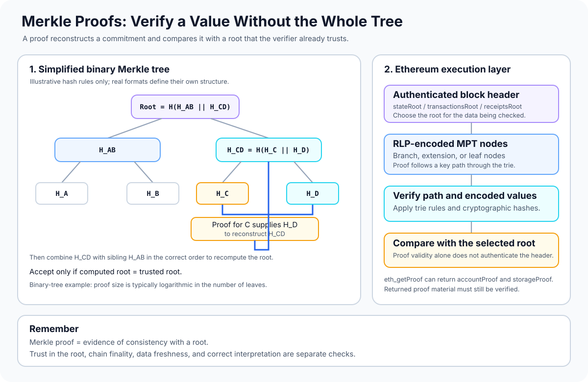

# Merkle Proofs: Verifying Data Against a Trusted Root

> **Stage:** 03 — Storage and Data Layout  
> **Priority:** 1  
> **Status:** Reviewed  
> **Last reviewed:** 2026-10-17

## 1. Overview

A **Merkle proof** is a compact set of data that lets a verifier check whether a particular value or record is committed to by a known cryptographic root, without downloading or trusting the entire data structure.

The root is a short commitment to a much larger collection. A proof supplies the target item and the sibling hashes or structural nodes needed to reconstruct the root. If the reconstructed root matches the trusted root, and the verifier applies the correct tree rules, the item is proven to be part of the committed structure.

Merkle proofs are useful only relative to a root that the verifier trusts. A proof does not independently tell you whether a root belongs to the canonical Ethereum chain, whether a block is finalized, or whether an application interpreted a value correctly. Those are separate validation steps.

Ethereum's execution layer uses a **Modified Merkle-Patricia Trie (MPT)** rather than a simple binary Merkle tree for its state, transactions, and receipts. This article first explains the general Merkle-proof idea, then shows how the concept applies to Ethereum. Account proofs and storage proofs are covered as closely related, separate concepts in this stage.



## 2. Why Merkle Proofs Matter to a Developer

Merkle proofs are a foundational idea behind:

- **Light clients and independently verified RPC data:** a client can verify a response against a root from a block header instead of blindly trusting the node that supplied it.
- **On-chain claims and distributions:** contracts can verify that a claimant belongs to an allowlist, allocation set, or snapshot represented by a Merkle root.
- **Cross-chain and Layer 2 systems:** protocols often use cryptographic commitments and proofs to establish that particular data belongs to an agreed state or batch. The exact proof system varies by protocol.
- **Efficient integrity checks:** a verifier can check one record using a proof rather than downloading the whole collection.

For smart-contract developers, the central distinction is between **receiving a value** and **verifying why that value should be trusted**. A JSON-RPC response from a remote provider is just a response until it is checked against an authenticated commitment or otherwise trusted.

## 3. The Basic Idea

Imagine a collection containing four items: A, B, C, and D. In a simple binary Merkle tree, each leaf is hashed, then child hashes are combined and hashed to create parent nodes. This continues until a single root remains.

Illustrative construction:

```text
H_A = H(A)                 H_B = H(B)
H_C = H(C)                 H_D = H(D)

H_AB = H(H_A || H_B)       H_CD = H(H_C || H_D)

                Root = H(H_AB || H_CD)
```

Here, `H` means the hash function selected by this tree's specification, and `||` means concatenation. This is a teaching model; real protocols define the precise leaf encoding, parent encoding, ordering rules, and treatment of odd numbers of leaves.

To prove that **C** belongs to the tree, the prover does not need to send A, B, and D. It can supply:

- the target item C (or its leaf commitment);
- the sibling hash `H_D` needed to calculate `H_CD`;
- the sibling hash `H_AB` needed to calculate the root;
- any direction/order information required by the tree's rules.

The verifier hashes C, combines it with the supplied sibling hashes in the correct order, and compares the result to the trusted root. It is not enough for the prover merely to provide a list of hashes; the verifier must recompute the path.

For a balanced binary tree with N leaves, a proof generally needs O(log N) sibling hashes. Proof length and verification details depend on the tree construction.

## 4. Inclusion Proof Verification

A generic inclusion-verification flow is:

1. **Obtain a trusted root.** For example, an authenticated block header can commit to an Ethereum state root. In an application-specific Merkle tree, the root might have been stored in a contract or published through another trusted process.
2. **Obtain the proof and the claimed value.** These must be encoded exactly as the relevant protocol specifies.
3. **Reconstruct the commitment.** Hash the leaf using the correct rule, then process every sibling or proof node in the required order.
4. **Compare roots.** Accept inclusion only if the reconstructed commitment equals the trusted root and all structural checks pass.

If one byte of a committed item changes, the resulting hashes normally change all the way to the root. The hash function's cryptographic properties make it infeasible to find a different input that produces the same commitment under the assumed security model.

### Ordering is part of the proof

For a non-commutative parent rule such as `H(left || right)`, the verifier must know whether the current hash is the left or right child at each level. Reversing the order generally produces another root. Some application-specific schemes sort each pair before hashing; others preserve position. Never assume one scheme's rule applies to another tree.

## 5. Inclusion Is Not the Same as Non-Inclusion

An **inclusion proof** demonstrates that a particular value is committed at the expected location.

A **non-inclusion proof** demonstrates that a queried key is absent, according to the data structure's rules. It must establish why the search path cannot lead to that key—for example, by showing a missing branch or a conflicting leaf path in a trie.

Absence proofs are structure-specific. An arbitrary collection of sibling hashes is not automatically a proof that a value does not exist. The verifier needs the rules for interpreting the proof and the root must commit to the relevant complete structure.

## 6. Merkle Proofs in Ethereum

Ethereum's execution layer uses a Modified Merkle-Patricia Trie. This is not the same structure as the binary tree shown in the simplified example above.

MPT nodes are structured objects, including branch, extension, and leaf nodes. They are serialized using RLP, and nodes are connected through references determined by the trie rules—commonly Keccak-256 hashes of RLP-encoded nodes, with compact-node rules for shorter encodings. A proof therefore commonly consists of RLP-encoded trie nodes along the searched path, rather than just a sequence of sibling hashes.

**Protocol-evolution note (reviewed 2026-10-17):** This article describes Ethereum's current execution-layer MPT proof model. Verkle Trees are being developed as a potential replacement that could substantially reduce state-witness sizes. The [Ethereum.org Verkle Trees roadmap](https://ethereum.org/roadmap/verkle-trees/) page, last updated 2026-06-24, reported that Verkle testnets were running while substantial client updates remained outstanding. Do not treat Verkle proofs as interchangeable with today's MPT proofs; check the current protocol status and specification before implementing a production verifier.

Three roots in an execution block header are especially relevant:

- **`stateRoot`:** commits to the global account state for that block.
- **`transactionsRoot`:** commits to the block's transaction trie.
- **`receiptsRoot`:** commits to the block's receipt trie.

These roots are not interchangeable. A transaction proof must be checked against the correct transaction root, while an account proof uses the state root. Receipt inclusion similarly uses the receipt root.

### 6.1 A state proof at a high level

A verifier wishing to check an account starts with the state root from a particular block header. The proof provides the serialized nodes needed to follow the account's key through the state trie. The trie rules determine how the nodes are decoded and traversed; the final account value is then checked against the claimed account fields.

Account-key derivation and account-value decoding are part of the Ethereum trie specification. Developers should not substitute the visible address bytes as the trie path without applying the specified key transformation.

### 6.2 Why RLP is relevant

RLP is the execution layer's serialization format for MPT nodes. RLP only provides the encoding of nested byte strings and lists; the trie specification defines how each encoded node should be interpreted and how nodes connect to each other. See [Recursive Length Prefix (RLP) Encoding](10-recursive-length-prefix-rlp-encoding.md).

This is an example of how concepts in this stage fit together:

- **Storage layout** tells you how Solidity variables map to storage slots.
- **RLP** serializes execution-layer structures such as trie nodes.
- **Merkle proofs** let a verifier check that a particular value is committed under a trusted root.
- **Account proofs** and **storage proofs** apply the proof idea to specific parts of Ethereum state.

## 7. Requesting an Ethereum Proof with `eth_getProof`

Ethereum execution clients expose the `eth_getProof` JSON-RPC method, described by the Execution APIs and originally proposed in [EIP-1186](https://eips.ethereum.org/EIPS/eip-1186). It can return an account proof and proofs for requested storage keys.

A representative request shape is:

```json
{
  "jsonrpc": "2.0",
  "id": 1,
  "method": "eth_getProof",
  "params": [
    "0xYour20ByteAccountAddress",
    ["0x0000000000000000000000000000000000000000000000000000000000000000"],
    "finalized"
  ]
}
```

This is a template, not a ready-to-run request: replace the account address with a valid address, and check that the target execution client supports the requested block tag and method. The response contains fields such as `accountProof`, `storageHash`, and `storageProof`, alongside claimed values.

**Receiving this response is not the same as verifying it.** A verifier must validate the proof against the right root and confirm the authenticity of the block header containing that root. Provider support, supported block tags, and available historical data can differ.

See [Ethereum Execution APIs — `eth_getProof`](https://ethereum.github.io/execution-apis/api/methods/eth_getProof/) for the method's current API shape.

## 8. What a Merkle Proof Does—and Does Not—Prove

A valid proof can establish that data is consistent with a given cryptographic commitment, assuming the cryptographic primitives and encoding rules are secure. It does **not** by itself establish all of the following:

- **That the root is canonical or finalized.** The verifier must authenticate the block header and apply its chain and finality assumptions.
- **That the data is recent.** A proof for an old, valid root remains a proof for that old state.
- **That the application-level meaning is correct.** A proof might establish a stored word or a leaf value; the caller must still decode and interpret it correctly.
- **That the data is secret.** A Merkle proof is an integrity and membership mechanism, not an encryption or privacy technique.
- **That every tree uses the same algorithm.** A proof for a custom Solidity Merkle tree is not automatically a valid Ethereum MPT proof, and vice versa.

## 9. Security and Implementation Pitfalls

- **Using an untrusted root.** An attacker can create a tree and valid proofs for their own root. Root authenticity is essential.
- **Mixing proof types or roots.** Use the root for the specific data structure and block being verified; state, transaction, and receipt roots serve different purposes.
- **Encoding mismatch.** Hashing raw bytes where the protocol expects an RLP encoding, applying the wrong key derivation, or decoding a node differently can invalidate verification—or create a serious verification flaw.
- **Incorrect ordering or hash rules.** Parent ordering, pair-sorting rules, leaf hashing, and domain separation must match the construction exactly.
- **Incomplete boundary checks.** Reject malformed nodes, truncated encodings, invalid paths, unexpected proof length, and inconsistent values. In contracts, also consider gas costs and denial-of-service risks.
- **Confusing a claimed value with verified data.** RPC fields next to a proof are convenient hints, but a trust-minimized consumer should recompute or validate the relevant commitment.
- **Assuming non-inclusion.** A proof that fails to show the requested leaf is not necessarily a valid proof of absence; the verifier must validate the data structure's non-inclusion rules.

For custom Solidity Merkle trees, prefer established libraries and verify that the tree generation procedure exactly matches the contract's verifier. Test valid proofs, tampered leaves, wrong roots, reordered siblings, malformed proof lengths, and duplicate-leaf edge cases.

## 10. Key Takeaways

- A Merkle proof lets a verifier validate a value against a trusted root without downloading the entire data structure.
- Verification recomputes the commitment using protocol-specific hashing, encoding, and ordering rules.
- Ethereum's execution layer uses a Modified Merkle-Patricia Trie, so its proofs are trie-node proofs—not simply binary sibling-hash arrays.
- The block header's `stateRoot`, `transactionsRoot`, and `receiptsRoot` commit to different datasets.
- `eth_getProof` can return account and storage proof material, but the consumer still needs to validate the proof and trust the corresponding header.
- A proof establishes consistency with a root; root authenticity, chain finality, freshness, and correct interpretation are separate concerns.

## References

- [Ethereum.org — Merkle Patricia Trie](https://ethereum.org/developers/docs/data-structures-and-encoding/patricia-merkle-trie/) — how execution-layer trie nodes, roots, RLP, and key paths fit together.
- [Ethereum Execution APIs — `eth_getProof`](https://ethereum.github.io/execution-apis/api/methods/eth_getProof/) — current RPC method shape for account and storage proofs.
- [EIP-1186 — RPC Method to Get Merkle Proofs](https://eips.ethereum.org/EIPS/eip-1186) — original proposal and response fields for `eth_getProof`.
- [Recursive Length Prefix (RLP) Encoding](10-recursive-length-prefix-rlp-encoding.md) — related concept in this repository on serialization used by execution-layer trie nodes.
