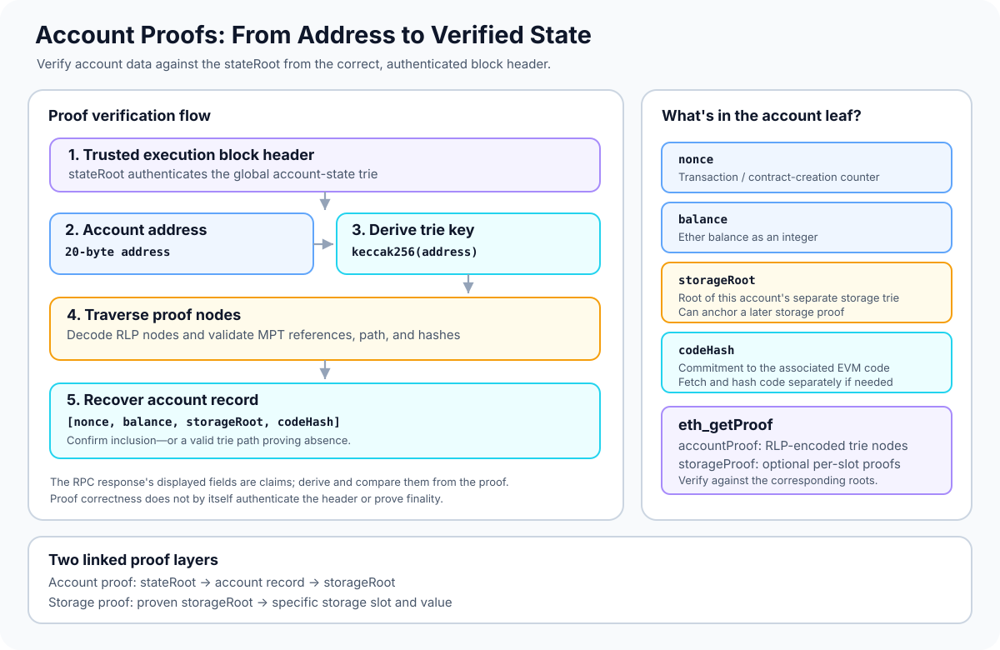

# Account Proofs: Verifying Ethereum Account State

> **Stage:** 03 — Storage and Data Layout  
> **Priority:** 1  
> **Status:** Reviewed  
> **Last reviewed:** 2026-10-17

## 1. Overview

An **account proof** is cryptographic evidence that lets a verifier check an Ethereum account record against the `stateRoot` committed to by a particular execution block header. The record includes the account's nonce, balance, storage-trie root, and code hash.

Ethereum's execution-layer global state is stored in a **Modified Merkle-Patricia Trie (MPT)**. The trie maps a derived key for an account to an encoded account record. An account proof supplies the serialized trie nodes needed to follow that key from the root to the account record (or to establish that the key is absent according to the trie rules).

An account proof is not the same as a storage proof. An account proof authenticates the account record under the global state root; a storage proof uses the account's `storageRoot` to verify a particular storage slot. Both can be returned by the JSON-RPC method `eth_getProof`.

A proof is only as trustworthy as the root and block header against which it is verified. Receiving `accountProof` from a node does not, by itself, establish that the data is canonical, finalized, recent, or correctly interpreted.



## 2. Why Account Proofs Matter to a Developer

Account proofs are useful when building or evaluating:

- **Light clients and trust-minimized RPC consumers:** check a provider's account data against an authenticated block header instead of accepting claimed values without verification.
- **Cross-chain systems and bridges:** some systems need to establish that an Ethereum account or contract state is committed to by a particular block. The bridge must still validate the source chain and its finality assumptions.
- **Proof-verification contracts and rollup infrastructure:** understand exactly what the proof commits to and what additional assumptions the application needs.
- **Debugging and client implementation:** inspect how account fields are encoded, how the trie key is derived, and how RLP-encoded trie nodes are verified.

For smart-contract developers, the key lesson is that **a value returned by an RPC endpoint is not automatically a verified value**. An application that needs independent verification must authenticate the block header and check the proof against the appropriate root.

## 3. What Is Stored in an Ethereum Account Record?

In the execution-layer state trie, an account value is RLP-encoded as a four-item structure:

```text
[nonce, balance, storageRoot, codeHash]
```

- **`nonce`** — the account's transaction nonce (for an externally owned account) or the contract creation nonce (for a contract account), according to Ethereum account rules.
- **`balance`** — the account's Ether balance, represented as an integer.
- **`storageRoot`** — the root of that account's separate storage trie. It commits to the account's persistent storage, not to Solidity's source-level variable names.
- **`codeHash`** — the hash of the account's associated EVM code. For an account with no code, the protocol's empty-code hash is used.

The values in the account record are not stored as human-readable labels. RLP encodes a list of byte strings, and the account-state rules define the meaning of each position. Ethereum integer values are serialized using the protocol's integer conventions; developers must not treat an arbitrary RLP byte string as a typed integer without applying those rules.

The code itself is not included in the account record. The record commits to it through `codeHash`; fetching code and verifying that its hash matches is a separate check.

## 4. How an Account's Trie Key Is Derived

The global state trie does not use an account address directly as its trie path. The account key is:

```text
accountTrieKey = keccak256(address)
```

The address is the 20-byte account address. Its Keccak-256 hash is the 32-byte key whose nibbles determine the path through the state trie.

This transformation is specific to Ethereum's state-trie rules. Do not substitute the displayed hexadecimal address, an ABI-encoded address, or a storage-slot key into the trie traversal. The account key and the path rules must match the execution-layer specification exactly.

A simplified view is:

```text
20-byte address
      |
      v
Keccak-256(address)
      |
      v
32-byte account trie key
      |
      v
MPT path from stateRoot
      |
      v
RLP-encoded account record
[nonce, balance, storageRoot, codeHash]
```

The path is traversed through Modified Merkle-Patricia Trie nodes. A node can be a branch, extension, or leaf, and nodes are linked using the trie reference rules. Node encodings are RLP-serialized; depending on the rules, a child node can be referenced directly when its encoding is short enough or by its hash.

For the general proof structure and the difference between simple binary Merkle trees and Ethereum's MPT, see [Merkle Proofs](11-merkle-proofs.md). For node serialization, see [Recursive Length Prefix (RLP) Encoding](10-recursive-length-prefix-rlp-encoding.md).

## 5. What an Account Proof Contains

The `eth_getProof` response includes an `accountProof` array: hex-encoded, RLP-serialized trie nodes that form the proof path for the requested account. The verifier starts from the trusted `stateRoot`, processes the proof nodes according to the MPT rules, and follows the hashed account key.

Conceptually, verification checks the following:

1. Start with an authenticated `stateRoot` from the execution block header.
2. Derive the account trie key from the requested address using Keccak-256.
3. Decode and validate the provided trie nodes, following branch, extension, and leaf rules for that key.
4. Validate node references and hashes according to the MPT rules, including the rule for embedded short nodes.
5. Determine whether the path proves an account record exists or proves that the address is absent.
6. If an account record exists, decode its RLP structure and compare the fields derived from it with any reported nonce, balance, storage hash, and code hash.

The response's convenient fields are claims supplied by the RPC server. A verifier should derive the proven account data from the proof and compare it to the claims, rather than merely trusting both parts of the same response.

### Inclusion and non-inclusion

An **inclusion proof** establishes that the derived key maps to the account record committed under the root.

A **non-inclusion proof** establishes that no account record exists at that key in the trie represented by the root, according to the MPT's path and node rules. This is not equivalent to simply receiving a zero balance or a missing-looking response: an address can have a zero balance and still have account state, and RPC representations of absent accounts must be interpreted according to the method and block queried.

## 6. Using `eth_getProof`

The JSON-RPC method `eth_getProof` returns proof material for an account and optionally for specified storage keys. The method is described by [EIP-1186](https://eips.ethereum.org/EIPS/eip-1186) and the current [Ethereum Execution APIs specification](https://ethereum.github.io/execution-apis/api/methods/eth_getProof/).

Example request shape:

```json
{
  "jsonrpc": "2.0",
  "id": 1,
  "method": "eth_getProof",
  "params": [
    "0xYour20ByteAccountAddress",
    [],
    "finalized"
  ]
}
```

This is a template, not a ready-to-run request: replace the address with a valid address and confirm that the target client supports the method and requested block tag. The second parameter is an array of 32-byte storage keys; the empty array asks for the account proof without requesting individual storage-slot proofs.

Fields in the result include:

- **`address`** — account address queried.
- **`accountProof`** — RLP-encoded trie nodes for verifying the account record.
- **`balance`, `nonce`, `codeHash`, `storageHash`** — values reported by the server and to be checked against the proven record.
- **`storageProof`** — proof objects for the requested storage keys, if any were requested.

The method does not return a substitute for an authenticated block header. The caller needs the matching block's `stateRoot` and must establish why that header is trusted. A proof from one block cannot be checked against another block's root, and mixing the account proof with a storage root or transaction root is incorrect.

## 7. Relationship Between Account Proofs and Storage Proofs

The account record contains a `storageRoot`, which is itself the root of the account's storage trie. This creates a two-step verification model:

1. Use the **account proof** to verify the account record against the block's global `stateRoot`.
2. Read the proven `storageRoot` from that record.
3. Use a **storage proof** to verify a particular storage value against that `storageRoot`, applying the storage-trie key and value encoding rules.

This hierarchy matters. A storage proof checked against an untrusted or unrelated storage root is not independently meaningful. The root should be tied to the correct account record, which in turn should be tied to the block's authenticated global state root.

The `storageRoot` and Solidity's storage layout are different concepts: storage layout identifies the slot where a Solidity variable is represented, while the storage root commits cryptographically to the account's overall storage trie. See [Storage Layout](01-storage-layout.md); the related Storage Proofs concept will cover validation of individual storage values.

## 8. What an Account Proof Does—and Does Not—Prove

A successfully verified account proof establishes that the account record (or its absence) is consistent with a particular state root, assuming the specified hash and trie rules are secure. By itself, it does not establish:

- **That the header is authentic.** The verifier needs a trusted header or another sound method to authenticate it.
- **That the block is canonical or finalized.** Chain selection and finality are separate from trie-proof verification.
- **That the proof is current.** A mathematically valid proof can describe an older block's state.
- **That fetched bytecode matches the claimed code hash.** If the application uses separately fetched code, it should hash the bytes and compare them with the proven `codeHash`.
- **That an arbitrary storage slot is a particular Solidity variable.** The account proof establishes the account record; interpreting a storage value also requires storage-trie rules and, when relevant, the contract's storage layout.
- **That an application is safe.** Proving an account's code hash or balance does not prove that the contract's business logic is correct.

## 9. Common Mistakes and Security Considerations

- **Trusting the RPC response instead of verifying it.** The response's fields and proof come from the same server. Verify the proof against a trusted root and independently derive the account data.
- **Using the wrong root.** Account proofs are checked against the block header's `stateRoot`, not `transactionsRoot`, `receiptsRoot`, or an arbitrary storage root.
- **Deriving the wrong path.** Apply Keccak-256 to the 20-byte address exactly as the trie specification requires.
- **Decoding account fields incorrectly.** The account value is a four-item RLP list. Interpret the fields according to Ethereum account rules, not according to assumptions about ABI encoding or raw memory layout.
- **Mixing blocks.** Ensure the account proof and state root refer to the same block.
- **Skipping malformed-node checks.** Verification must reject invalid RLP, broken references, truncated proofs, invalid compact paths, and inconsistent node encodings. On-chain verifiers must also account for gas and denial-of-service risks.
- **Confusing an absent account with a zero-valued field.** A proven absent account is a statement about the trie path; a zero balance alone is not proof of absence.
- **Forgetting code validation.** The proof commits to a code hash, not the full bytecode. Hash the separately obtained code if it must be tied to the proof.

When implementing verification in Solidity or another language, prefer a reviewed MPT proof library or execution-client implementation where possible. Test valid inclusion proofs, non-inclusion proofs, tampered nodes, wrong roots, wrong addresses, malformed RLP, and proofs from a different block.

## 10. Key Takeaways

- An account proof verifies an Ethereum account record against the block header's `stateRoot`.
- The state-trie key is `keccak256(address)`, and the account value is RLP encoding of `[nonce, balance, storageRoot, codeHash]`.
- `eth_getProof` returns proof nodes and reported account fields; those fields must be independently checked against the proof.
- Account proofs can establish inclusion or, with a valid trie non-inclusion path, absence of an account record.
- The proven `storageRoot` can then anchor a separate storage proof for an individual storage key.
- Proof validity, header authenticity, canonicality, finality, freshness, and application-level interpretation are separate questions.

## References

- [Ethereum.org — Merkle Patricia Trie](https://ethereum.org/developers/docs/data-structures-and-encoding/patricia-merkle-trie/) — global state trie, account keys and values, RLP-encoded trie nodes, and trie-root commitments.
- [Ethereum Execution APIs — `eth_getProof`](https://ethereum.github.io/execution-apis/api/methods/eth_getProof/) — current request parameters and response schema for account and storage proof retrieval.
- [EIP-1186 — RPC Method to Get Merkle Proofs](https://eips.ethereum.org/EIPS/eip-1186) — `accountProof`, account fields, and storage proof response design.
- [Merkle Proofs](11-merkle-proofs.md) — related article in this repository about proof verification and trusted roots.
- [Recursive Length Prefix (RLP) Encoding](10-recursive-length-prefix-rlp-encoding.md) — related article in this repository about encoding execution-layer trie nodes.
