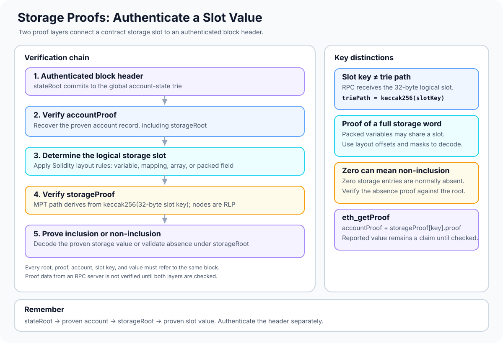

# Storage Proofs: Verifying Ethereum Contract Storage

> **Stage:** 03 — Storage and Data Layout  
> **Priority:** 2  
> **Status:** Reviewed  
> **Last reviewed:** 2026-10-17

## 1. Overview

A **storage proof** is cryptographic evidence that a particular storage slot and its value are consistent with an Ethereum account's storage trie at a specific block. Ethereum maintains a separate storage trie for each account. The root of that trie is included in the account record as `storageRoot` (returned by JSON-RPC as `storageHash`).

A storage proof is not verified directly against a block's global `stateRoot`. Verification is layered:

1. Authenticate the relevant block header and its `stateRoot`.
2. Verify the account proof against that `stateRoot` to recover the account record and its `storageRoot`.
3. Verify the storage proof against that `storageRoot` to establish the value at the requested storage-trie key.

This chain ties a specific contract storage value to the authenticated state of a particular block. If the account proof, storage proof, or root belongs to a different block or account, the chain of trust is broken.

**Protocol-evolution note (reviewed 2026-10-17):** This article explains storage proofs for Ethereum's current MPT-based state. Verkle Trees are being developed as a potential alternative with smaller state witnesses. The [Ethereum.org Verkle Trees roadmap](https://ethereum.org/roadmap/verkle-trees/) page, last updated 2026-06-24, reported that testnets were running while significant client updates remained. Do not assume MPT storage proofs transfer unchanged to a future tree format; use the specification and client rules active for the target network and block.

Ethereum's execution layer uses a **Modified Merkle-Patricia Trie (MPT)**. For storage, the trie path is derived from the 32-byte storage slot key using Keccak-256. Trie nodes are RLP-encoded, and a proof provides the nodes needed to validate the path. The exact path and value encodings must follow Ethereum's trie rules.



## 2. Why Storage Proofs Matter to a Developer

Storage proofs are useful when building or analyzing:

- **Trust-minimized state reads:** independently validate a remote RPC provider's claimed contract storage value.
- **Light clients and cross-chain systems:** demonstrate that a value belonged to a contract's state at a particular source-chain block, subject to separate header-authentication and finality rules.
- **Rollup infrastructure and proof verifiers:** understand the difference between a claimed state value and a value cryptographically committed by a known root.
- **Security reviews and debugging:** inspect how storage slots, trie paths, RLP encoding, and proof nodes fit together.

For smart-contract developers, storage proofs connect several concepts in this stage. Solidity's storage layout tells you which slot represents a variable; the storage trie commits to values at slot keys; RLP encodes trie nodes; and Merkle proofs establish that a value is consistent with a trusted root.

## 3. Storage Layout Is Not the Storage Trie

A Solidity contract does not store variable names in the EVM state. A variable is represented by one or more storage slots according to Solidity's storage-layout rules.

The **storage slot key** and the **trie path** are related but not identical:

- A slot key is a 32-byte position in the contract's storage address space, derived from Solidity's layout rules.
- The storage-trie path is derived as `keccak256(slotKey)`, with the slot key represented as exactly 32 bytes.
- A storage proof proves the trie entry at that path. It does not automatically tell you which source-level variable that slot represents.

For a simple state variable, the slot key may be the variable's assigned slot index padded to 32 bytes. For a mapping or dynamic array, the relevant slot is derived using Solidity's specific hashing and layout rules. Packed variables may share a slot; a proof of that slot establishes the whole stored word, and the variable's byte offset and mask must then be applied to interpret an individual field.

When calling `eth_getProof`, provide the **32-byte storage slot key** for the item you want to prove. Do not pre-hash it to the trie path yourself unless you are directly implementing the lower-level trie verification algorithm. The RPC client performs the trie-key derivation as part of constructing the proof.

See [Storage Layout](01-storage-layout.md), [Storage Slots](02-storage-slots.md), and [Mappings and Dynamic Arrays in Storage](04-mappings-and-dynamic-arrays-in-storage.md) for slot calculation rules.

## 4. The Storage Trie and Its Values

Each account's `storageRoot` commits to that account's persistent storage trie. The trie stores key-value entries using the Ethereum MPT rules:

- **Path:** derived from the Keccak-256 hash of the 32-byte storage slot key.
- **Stored value:** the nonzero storage integer represented using Ethereum's canonical RLP value encoding.
- **Proof nodes:** RLP-encoded branch, extension, or leaf nodes needed to follow the key path and validate the result against the trie root.

An RPC method such as `eth_getStorageAt` returns a storage word as a 32-byte value for convenient use by callers. The value representation inside the trie is not necessarily that same padded 32-byte display: trie values use the protocol's encoding rules, including minimal integer encoding.

### Zero values and absent paths

In Ethereum's canonical storage trie, zero-valued storage entries are not kept as ordinary stored entries. A zero value is therefore generally represented by the absence of the corresponding key from the storage trie.

This makes **non-inclusion proofs** important. A verifier can establish that a slot has no entry under the proven root, which corresponds to the canonical zero storage value. A client simply returning `0x00...00` is not equivalent to independently verifying that result; the proof must be checked against the correct root.

The empty trie root commonly seen for an account with no storage is:

```text
0x56e81f171bcc55a6ff8345e692c0f86e5b48e01b996cadc001622fb5e363b421
```

That is the root hash of an empty Ethereum MPT, not a storage value and not the numeric value zero. An empty storage trie means there are no nonzero storage entries represented in that trie.

## 5. How Storage Proof Verification Works

A robust verifier needs an authenticated execution block header and must validate both proof layers.

### Step 1: Authenticate the block header

Obtain the header for the exact block being queried and establish why it is trusted—for example, through a light-client verification process or another well-defined trust model. The header contains the global `stateRoot`.

A proof that verifies against an arbitrary root says only that the data is consistent with that root. It does not prove that the root belongs to Ethereum's canonical chain or that the block is finalized.

### Step 2: Verify the account proof

Use the account address and the account proof to verify the account record under the header's `stateRoot`. The account record contains:

```text
[nonce, balance, storageRoot, codeHash]
```

The account trie key is derived from the account address according to Ethereum's state-trie rules. After validating the account proof, use the proven `storageRoot` from that account record. The RPC response calls this field `storageHash`.

### Step 3: Derive the storage-trie path

Start with the storage slot key determined by Solidity's storage layout or the protocol being inspected. Represent the slot as 32 bytes, then derive the MPT path from its Keccak-256 hash.

For example, slot index zero has a 32-byte slot key consisting entirely of zero bytes. In a mapping or dynamic array, the logical slot key is first derived using the relevant Solidity rules; only then is the storage-trie path derived.

### Step 4: Verify the storage proof nodes

Walk the RLP-encoded MPT nodes in the returned proof according to the hashed slot path. Validate node encodings, references, hashes, compact paths, and the inclusion or non-inclusion result. For inclusion, decode the proven storage value according to Ethereum's storage-value encoding. For non-inclusion, validate the trie path that proves the requested key is absent.

### Step 5: Compare the proven value

Compare the value decoded from the proof with the claimed `storageProof.value` and with any value the application plans to use. Keep the account address, slot key, proof nodes, account `storageRoot`, and block header tied to the same queried block.

A conceptual chain looks like this:

```text
Authenticated block header
          |
          v
       stateRoot
          |
          | verify accountProof
          v
    Account record
          |
          v
      storageRoot
          |
          | verify storageProof for slot
          v
  Proven storage value
```

## 6. Requesting a Storage Proof with `eth_getProof`

The JSON-RPC method `eth_getProof` returns an account proof and proofs for requested storage keys. It is specified in the [Ethereum Execution APIs](https://ethereum.github.io/execution-apis/api/methods/eth_getProof/) and was originally proposed by [EIP-1186](https://eips.ethereum.org/EIPS/eip-1186).

Example request shape for slot zero:

```json
{
  "jsonrpc": "2.0",
  "id": 1,
  "method": "eth_getProof",
  "params": [
    "0xYour20ByteContractAddress",
    [
      "0x0000000000000000000000000000000000000000000000000000000000000000"
    ],
    "finalized"
  ]
}
```

This is a template. Replace the address with the contract being inspected, change the slot key as appropriate, and confirm that the RPC endpoint supports the method and requested block tag. If proving a mapping value, the requested slot key must already be derived according to Solidity's mapping layout rules.

The response includes:

- **`accountProof`** — RLP-encoded trie nodes to verify the account record against `stateRoot`.
- **`storageHash`** — the account's storage trie root, called `storageRoot` in the account record.
- **`storageProof`** — an array with the requested `key`, the reported `value`, and the RLP-encoded proof-node array.
- **Account fields** such as `balance`, `nonce`, and `codeHash`, which should be checked against the proven account record when they matter to the application.

The fields in the response are convenient claims from the RPC server, not an automatic verification result. An independent consumer must validate the account proof against an authenticated `stateRoot`, then validate each storage proof against the `storageRoot` derived from that account proof.

## 7. A Worked Slot Example

Suppose a simple Solidity contract declares:

```solidity
contract Counter {
    uint256 public count; // assigned storage slot 0
}
```

For this illustrative layout, `count` occupies slot index `0`. The 32-byte slot key to request through `eth_getProof` is:

```text
0x0000000000000000000000000000000000000000000000000000000000000000
```

If the stored counter is nonzero, the storage trie contains a value for the path derived from the hash of that slot key. The proof nodes let the verifier reconstruct the path from the account's `storageRoot` to the encoded value.

If the counter is zero and there is no storage entry for slot zero, the correct proof can instead establish non-inclusion. The verifier interprets that valid absence as zero under Ethereum's canonical storage rules.

This example does not mean every Solidity variable is at slot zero. Inheritance, declaration order, packing, mappings, dynamic arrays, structs, and custom storage-layout mechanisms all affect the logical slot calculation. Always derive the slot before requesting or checking its proof.

## 8. Packed Variables, Mappings, and Dynamic Arrays

A storage proof operates on a trie entry, not directly on a Solidity variable name.

- **Packed variables:** multiple smaller values can share one 32-byte storage slot. The proof authenticates the complete slot word; use the compiler's slot and byte-offset information to extract a particular variable.
- **Mappings:** derive the mapping entry's storage slot according to Solidity's mapping rules using the key and mapping declaration slot. The resulting slot key is then used for the storage proof request.
- **Dynamic arrays:** derive the relevant element slot from the array's base slot and element type rules. Packed array elements may share a slot, so interpretation may require an offset and mask.
- **Nested data structures:** calculate the final logical slot through every level of the layout before requesting a proof.

Do not confuse the Solidity-level slot calculation with the storage trie key derivation. They are separate steps: first determine the slot in the contract's storage space; then derive the trie path used to prove that slot.

## 9. What a Storage Proof Does—and Does Not—Prove

A valid storage proof establishes that a claimed value or absence is consistent with a particular storage root under Ethereum's trie and encoding rules. By itself, it does not establish:

- **That the storage root is authentic.** Tie it to a verified account record, and tie that record to an authenticated block header's `stateRoot`.
- **That the header is canonical or finalized.** Chain validation and finality are separate from trie proof verification.
- **That the proof is current.** A valid proof may correspond to an old block.
- **Which source variable a slot represents.** Apply Solidity layout and the relevant contract version to interpret the slot.
- **That a contract's logic is secure.** A correct proof of a value does not validate the code's intended behavior.
- **That a value read from another RPC call matches the proof.** The application must compare the independently obtained value with what the proof establishes.

## 10. Common Mistakes and Security Considerations

- **Checking against the wrong root.** Storage proofs use the account's proven `storageRoot`, not the global `stateRoot` directly, and not the transaction or receipt root.
- **Skipping the account proof.** Trusting the response's `storageHash` without proving the account record breaks the authentication chain unless the storage root is trusted through another sound mechanism.
- **Hashing the RPC key twice.** Provide the logical 32-byte storage slot key to `eth_getProof`; the trie path is derived by the client. Only hash the slot key yourself when implementing the lower-level trie traversal or when computing a Solidity-defined mapping/array slot.
- **Using a slot index as the answer for a mapping entry.** The declared mapping slot is a seed for deriving each mapping element slot; it is not usually the element's final slot.
- **Treating an absent node as an automatic zero.** The proof must establish valid non-inclusion under the root. An incomplete or malformed proof is not evidence of zero.
- **Ignoring packed fields.** The proof authenticates a full storage word. Extract a packed variable using the appropriate offset and width.
- **Mixing block identifiers.** The header, account proof, and storage proof must all refer to the same block state.
- **Trusting RPC-reported values.** Recompute the proof result and compare it with the response values instead of assuming the server returned a correct proof.
- **Failing to bound parsing work.** Proof verification must reject malformed RLP, invalid node references, bad compact paths, and truncated data. Smart-contract verifiers must also account for gas costs and denial-of-service risks.

For an implementation, use a reviewed Ethereum MPT proof library or client implementation where practical. Test inclusion, non-inclusion, zero values, nonzero values, incorrect roots, incorrect slots, tampered nodes, malformed RLP, and proofs fetched from another block.

## 11. Key Takeaways

- A storage proof authenticates a slot value against an account's `storageRoot`.
- The account proof ties that `storageRoot` to the block header's global `stateRoot`.
- First derive the Solidity storage slot; then derive the trie path using Keccak-256 of the 32-byte slot key.
- `eth_getProof` returns proof nodes and reported values, but the consumer must validate the account proof and storage proof against the proper roots.
- Storage proofs establish an entire slot word. Interpreting a source-level variable may require packing offsets or mapping/array slot calculations.
- A valid non-inclusion proof can establish the canonical zero value for an absent storage entry, but only when the proof and root are verified.

## References

- [Ethereum.org — Merkle Patricia Trie](https://ethereum.org/developers/docs/data-structures-and-encoding/patricia-merkle-trie/) — execution-layer state and storage tries, trie roots, and key derivation.
- [Ethereum Execution APIs — `eth_getProof`](https://ethereum.github.io/execution-apis/api/methods/eth_getProof/) — request parameters and response fields for account and storage proofs.
- [EIP-1186 — RPC Method to Get Merkle Proofs](https://eips.ethereum.org/EIPS/eip-1186) — account and storage proof response design.
- [Account Proofs](12-account-proofs.md) — how the account proof authenticates the account record and its `storageRoot`.
- [Merkle Proofs](11-merkle-proofs.md) — general verification model for inclusion, non-inclusion, trusted roots, and the MPT-to-Verkle roadmap.
- [Recursive Length Prefix (RLP) Encoding](10-recursive-length-prefix-rlp-encoding.md) — serialization rules used by execution-layer trie nodes.
