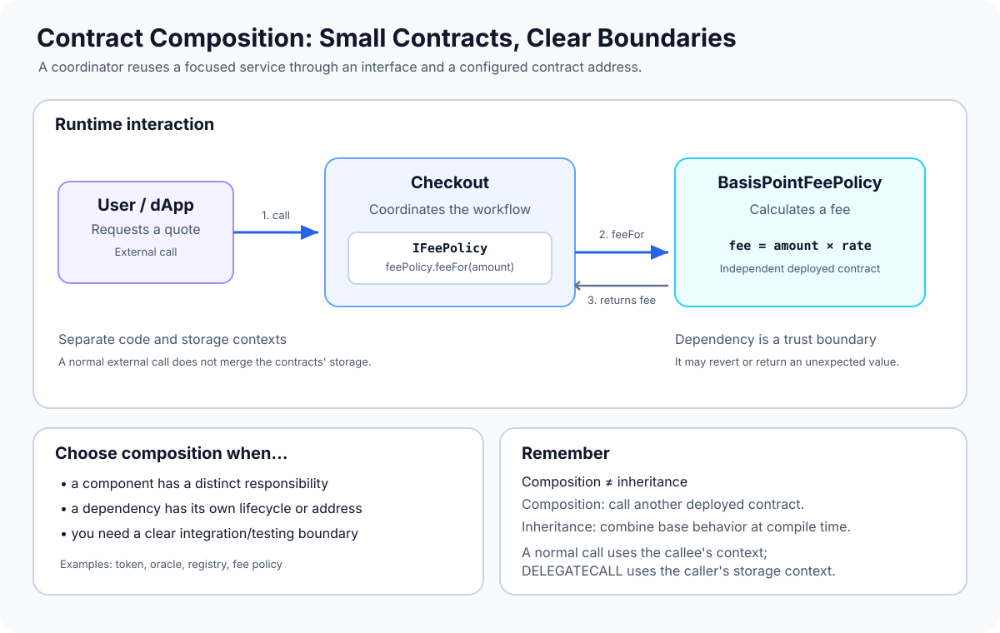

# Contract Composition: Building Systems from Independent Contracts

> **Stage:** 04 — Smart Contract Architecture  
> **Priority:** 1  
> **Status:** Reviewed  
> **Last reviewed:** 2026-10-17

## 1. Overview

**Contract composition** is an architectural approach in which a larger smart-contract system is built by connecting smaller contracts with clearly defined responsibilities. Instead of putting every feature into one large contract—or relying only on inheritance—the system delegates specific work to separate deployed contracts and interacts with them through known interfaces.

For example, a payment application might use one contract to manage the checkout flow and another to calculate fees. A vault might rely on a token contract for asset transfers and an oracle contract for price data. Each component owns its own code and, in ordinary contract-to-contract calls, its own storage context.

Composition is more than splitting code into separate files. Two contracts in different files do not automatically form a composed system. Composition means that one component deliberately depends on another component's behavior through a defined boundary such as an interface and an address.

The central design question is: **which responsibility belongs in which contract, and how should the components interact safely?**



## 2. Why It Matters to a Developer

Contract composition helps developers:

- **Separate responsibilities:** keep pricing, accounting, access policy, token custody, and orchestration from becoming one tangled implementation.
- **Reuse components:** use an existing trusted token, oracle, registry, or protocol instead of reimplementing its behavior.
- **Test boundaries:** replace a dependency with a controlled test double or mock and test how the calling contract handles valid results, reverts, and unexpected responses.
- **Limit code changes:** in a well-designed system, changing one component can require less modification to the rest of the system.
- **Make assumptions explicit:** interfaces and configuration show what a contract expects from each dependency.

Composition also creates costs and risks. External calls consume gas, may revert, and may transfer control to code outside the caller's control. Separate contracts need deployment and configuration, and their behavior may change if the dependency is upgradeable. Separation is useful only when the resulting boundaries are designed and tested carefully.

## 3. The Core Model

A composed system typically has four elements:

1. **A coordinator or application contract** — exposes the main user-facing operations and coordinates the workflow.
2. **A dependency contract** — provides a focused service, such as fee calculation, token transfers, a registry lookup, or price data.
3. **An interface** — declares the functions and data types the caller expects to use. It describes the callable boundary, not the dependency's implementation or trustworthiness.
4. **A dependency address** — identifies the deployed contract instance the caller will contact.

A typical interaction looks like this:

```text
User / another contract
          |
          v
Application contract
          |
          | typed interface + dependency address
          v
Independent dependency contract
```

With a normal external contract call, the EVM enters a new message-call frame. The callee uses its own account context, storage, and code. The caller does not get direct access to the callee's state variables; it interacts through callable functions and returned data.

This differs from `DELEGATECALL`, where code from another address executes in the caller's storage context. Ordinary composition generally uses normal external calls, not `DELEGATECALL`, unless a specialized architecture deliberately requires delegated execution.

## 4. Worked Example: A Checkout Composed with a Fee Policy

The example below separates the fee policy from the contract that produces a checkout quote. It does **not** move funds; it is intentionally focused on architecture and dependency interaction.

### 4.1 Define the interface

```solidity
// SPDX-License-Identifier: MIT
pragma solidity ^0.8.24;

interface IFeePolicy {
    function feeFor(uint256 amount) external view returns (uint256);
}
```

The interface declares a function that callers can use to ask for a fee. It does not say how that fee is calculated, whether the result is economically reasonable, or whether a deployed contract will behave honestly.

### 4.2 Implement one policy

```solidity
// SPDX-License-Identifier: MIT
pragma solidity ^0.8.24;

contract BasisPointFeePolicy is IFeePolicy {
    uint256 private constant BPS_DENOMINATOR = 10_000;

    uint256 public immutable feeBps;

    error InvalidFeeRate();

    constructor(uint256 feeBps_) {
        if (feeBps_ > BPS_DENOMINATOR) revert InvalidFeeRate();
        feeBps = feeBps_;
    }

    function feeFor(uint256 amount) external view returns (uint256) {
        // Split the calculation to avoid overflowing amount * feeBps.
        return
            (amount / BPS_DENOMINATOR) * feeBps
            + ((amount % BPS_DENOMINATOR) * feeBps) / BPS_DENOMINATOR;
    }
}
```

The constructor accepts a fee rate in basis points: 100 basis points equals 1%, and 10,000 basis points equals 100%. The rate is stored as an immutable value and cannot be changed after deployment. The calculation avoids the intermediate multiplication `amount * feeBps`, which could overflow for large uint256 inputs.

### 4.3 Compose the policy into an application contract

```solidity
// SPDX-License-Identifier: MIT
pragma solidity ^0.8.24;

import "./IFeePolicy.sol";

contract Checkout {
    IFeePolicy public immutable feePolicy;

    error ZeroFeePolicy();
    error FeeExceedsAmount(uint256 fee, uint256 amount);

    constructor(IFeePolicy policy) {
        if (address(policy) == address(0)) revert ZeroFeePolicy();
        feePolicy = policy;
    }

    function quote(uint256 amount)
        external
        view
        returns (uint256 fee, uint256 netAmount)
    {
        fee = feePolicy.feeFor(amount);

        if (fee > amount) revert FeeExceedsAmount(fee, amount);

        netAmount = amount - fee;
    }
}
```

For a real project, put the interface in a file named `IFeePolicy.sol`, compile the contracts with the same Solidity project, and deploy a policy before deploying `Checkout`. Pass the deployed policy address to the `Checkout` constructor.

The dependency check prevents a zero address from being configured. It does not prove the address has the intended implementation or will always return a correct fee. A caller must choose and verify its dependencies according to the application's trust model.

### 4.4 What happens during a quote?

1. A user calls `Checkout.quote(amount)`.
2. `Checkout` calls `feeFor(amount)` through the `IFeePolicy` interface.
3. The EVM executes the policy contract in its own call context.
4. The fee value is returned to `Checkout`.
5. `Checkout` checks that the fee does not exceed the quoted amount, then returns the fee and net amount.

Because `feeFor` is declared `view`, Solidity performs the external read-only call under static-call rules in this normal external-call context. The policy cannot successfully perform state-changing operations during that call, but it can still revert, consume gas, or return a value that is semantically wrong. The caller's range check catches only one class of invalid result; it does not prove the fee policy is fair or authorized.

## 5. Composition Versus Inheritance

Composition and inheritance both support reuse, but they create different structures.

| Question | Composition | Inheritance |
|---|---|---|
| Main relationship | One deployed contract calls another | A derived contract extends a base contract |
| Typical Solidity syntax | Interface-typed variable and external call | `contract Child is Parent` |
| Deployment | Components commonly have separate deployments | Base and derived code are compiled into the deployed derived contract |
| Storage context | A normal external call uses the callee's context | Inherited code operates on the same deployed contract's state |
| Runtime dependency | Caller depends on a specific address and behavior | Derived contract depends on base implementation at compile time |
| Typical use | Integrating tokens, oracles, registries, policy modules, or other protocols | Reusing behavior, implementing a standard, adding modifiers, or specializing a base |

These are not mutually exclusive choices. A contract can inherit from a reusable base contract and also call several independent contracts through interfaces.

A useful rule of thumb:

- Use **inheritance** when the new contract really is a specialized form of a base contract, or when the framework's extension model expects it.
- Use **composition** when a component has a distinct responsibility or lifecycle and the application should interact with it through a defined boundary.
- Use a **library** for reusable helper logic when a separate stateful service contract is not needed.
- Use an **interface** to describe the calls the application expects to make to another contract.

Neither composition nor inheritance is automatically safer. Choose the smallest architecture that keeps responsibilities, assumptions, and testing boundaries clear.

## 6. Composition, Interfaces, and Libraries

These concepts complement each other but are not synonyms:

- **Composition** is the overall design approach of combining components.
- **An interface** describes the functions a component exposes to a caller. It does not include implementation code and cannot guarantee the callee follows the intended behavior.
- **A library** packages reusable logic. Internal library functions are generally compiled into the calling contract; public or external library calls follow Solidity's library-call rules and may use delegated execution. That distinction matters for deployment, code execution, and storage context.
- **Inheritance** combines base-contract behavior and declarations into a derived contract during compilation.

A contract can therefore be composed using interface calls, reuse behavior through inheritance, and use libraries for calculations—all in the same application.

## 7. Composition and Protocol Composability

**Contract composition** usually describes how a developer structures a system from cooperating contracts. **Protocol composability** is the broader ability to build applications by combining already deployed protocols—for example, using a decentralized exchange, lending market, or token within a new application.

The two ideas are related: clear interfaces make integration easier. But protocol composability introduces extra concerns beyond code organization, such as token behavior, liquidity, oracle assumptions, permission models, upgradeability, and the risks inherited from external protocols.

A contract calling another contract is not automatically a secure or useful integration. The caller must understand what the dependency promises, what it can actually do, and what happens if it fails.

## 8. Design and Security Considerations

### Keep boundaries focused

Each component should have a clear responsibility and a small, documented interface. If every contract needs deep knowledge of the internals of every other contract, splitting them may only move complexity instead of reducing it.

### Validate dependency configuration

Check for zero addresses and validate configuration during deployment or controlled updates. Where appropriate, verify expected code, interface behavior, or known implementation addresses. A contract's code existing at an address does not prove that it is trustworthy.

### Treat external calls as trust boundaries

A dependency may revert, consume gas, return an unexpected value, or—if the call is state-changing—reenter the caller before the external call returns. Perform appropriate input and return-value checks. For functions that make state-changing external calls, follow sound checks-effects-interactions patterns or use a carefully reviewed reentrancy defense when needed.

### Be clear about mutability and trust

A Solidity `view` interface function is executed under static restrictions during a normal external call; that limits state changes but does not make the returned data correct. A malicious or faulty dependency can still provide misleading data or revert.

### Plan for dependency changes

An immutable dependency fixes the configured address for the lifetime of that deployed caller. If an application must support upgrades or switching providers, that capability needs an explicit, access-controlled design and tests for transitions. A freely changeable dependency can become a privileged attack surface.

### Consider failure and availability

If the caller cannot perform its main operation without a dependency, that dependency becomes a critical availability assumption. Decide whether failures should revert the whole operation, be handled explicitly, or be recoverable through governance or migration. Avoid silently substituting a potentially unsafe default value.

### Test the boundary

Test success, dependency reverts, incorrect return values, zero-address configuration, and any permitted dependency update. Use mocks to test the caller in isolation, then add integration tests with the actual dependency implementation. Mock tests alone cannot establish that the real integration behaves as expected.

## 9. Common Mistakes

1. **Splitting a contract without a clear reason.** More contracts add deployment, call, and coordination overhead.
2. **Confusing composition with inheritance.** An interface variable pointing to another address is not the same as extending a base contract.
3. **Assuming an interface validates the target.** It only describes how the caller encodes the call and expects the result.
4. **Assuming separate source files mean separate runtime components.** Separate files may compile into a single contract; independent deployed components need actual contract instances and calls.
5. **Ignoring external-call failure.** A dependency can revert and propagate a failure to its caller.
6. **Trusting returned values without checks.** ABI decoding gives a typed result, not proof that the value is economically or logically correct.
7. **Using `DELEGATECALL` when a normal contract call is intended.** Delegated execution changes the storage-context model and introduces different security risks.
8. **Making dependencies replaceable without access control.** An attacker who can change a policy, oracle, or token address can redirect the application's behavior.
9. **Testing only mocked dependencies.** Mocks may not reproduce actual tokens, protocols, or unexpected external behavior.
10. **Over-engineering the architecture.** Every boundary should justify its cost in complexity, reuse, isolation, or upgrade strategy.

## 10. Key Takeaways

- Contract composition builds a larger system from smaller components with explicit responsibilities and boundaries.
- Interfaces define how components communicate; they do not prove that a dependency is correct or trustworthy.
- A normal external call enters the callee's context, while `DELEGATECALL` executes code using the caller's storage context.
- Composition and inheritance can coexist; neither is always better.
- Separate contracts add deployment and call complexity, gas costs, dependency failures, and security boundaries.
- Good composition requires deliberate dependency configuration, error handling, access control, and integration tests.
- Protocol composability extends the idea to integrating existing deployed protocols, where additional economic and operational risks must be considered.

## Review Checklist

- [ ] Explain contract composition in your own words.
- [ ] Distinguish composition from inheritance, libraries, and interfaces.
- [ ] Trace an external interface call from the caller to a separately deployed dependency.
- [ ] Explain why the callee's storage is separate under a normal external call.
- [ ] Identify at least three failure modes introduced by an external dependency.
- [ ] Explain why an interface and a `view` function do not make a dependency trustworthy.
- [ ] Describe how to test a caller with both mocks and the actual dependency.
- [ ] Explain when composition adds unnecessary complexity.

## References

1. **[Solidity — Contracts](https://docs.solidity.org/en/latest/contracts.html)** — explains calling other contract instances and how the EVM call context differs from inheritance.
2. **[Solidity — Structure of a Contract](https://docs.solidity.org/en/latest/structure-of-a-contract.html)** — overview of contracts, functions, state variables, interfaces, libraries, and inheritance.
3. **[OpenZeppelin — Developing Smart Contracts](https://docs.openzeppelin.com/contracts/5.x/learn/developing-smart-contracts)** — practical example of separating responsibilities across contracts and comparing that approach with inheritance.
4. **[Ethereum.org — Smart Contract Composability](https://ethereum.org/developers/docs/smart-contracts/composability/)** — explains the broader practice of building applications by integrating existing deployed protocols.
5. **[Interfaces and Libraries](../04-smart-contract-architecture/03-interfaces-and-libraries.md)** — related concept in this stage, once that article is published.
6. **[Internal and External Calls](../04-smart-contract-architecture/04-internal-and-external-calls.md)** — related concept in this stage, once that article is published.
