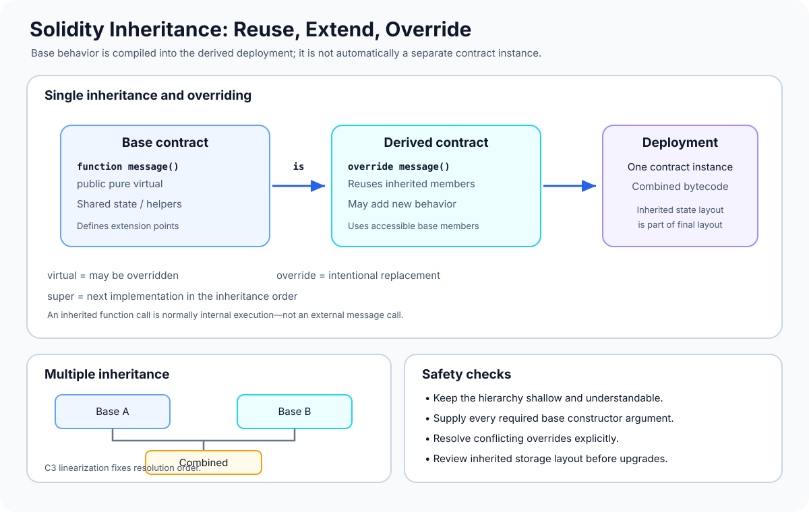

# Inheritance: Reusing and Extending Contract Behavior

> **Stage:** 04 — Smart Contract Architecture  
> **Priority:** 1  
> **Status:** Reviewed  
> **Last reviewed:** 2026-10-17

## 1. Overview

**Inheritance** lets one Solidity contract derive behavior and declarations from one or more base contracts. A derived contract can reuse accessible functions and state variables, add new functionality, and override functions that the base explicitly marks as `virtual`.

Inheritance is a compile-time relationship. When a derived contract is deployed, its bytecode includes the inherited implementation that is needed by that contract. Solidity does not automatically deploy one separate contract instance for every base contract in the inheritance list.

For example, an application may inherit a reusable fee policy, access-control helper, pause mechanism, or token implementation. The derived contract uses the rules defined by its bases and may specialize behavior where overriding is allowed.

Inheritance is useful, but it is not the same as composition. With ordinary inheritance, the code and state declarations become part of one deployed contract's layout. With composition, one deployed contract normally calls another contract through an interface, and each contract keeps its own storage context.



## 2. Why It Matters to a Developer

Inheritance appears in many Solidity codebases, including reusable token implementations, access-control systems, pausable contracts, upgradeable-contract frameworks, and protocol components.

Understanding it helps you:

- **Reuse tested behavior:** inherit common functions or modifiers rather than duplicating code.
- **Customize behavior safely:** override a designated hook without rewriting the entire base implementation.
- **Understand the deployed layout:** inherited state variables participate in the derived contract's storage layout.
- **Read framework code:** understand how a derived contract gets behavior from its base classes and why certain functions use `super`.
- **Avoid subtle bugs:** constructor order, multiple inheritance, function conflicts, and storage-layout changes can affect the final contract.

Inheritance does not automatically make code safer or smaller. A deep hierarchy can obscure execution paths, and a base-class change can affect every derived contract. Prefer a hierarchy whose responsibilities and override points are clear.

## 3. Basic Syntax: `is`

The `is` keyword declares that a contract inherits from a base contract.

```solidity
// SPDX-License-Identifier: MIT
pragma solidity ^0.8.24;

contract CounterBase {
    uint256 internal count;

    function currentCount() public view returns (uint256) {
        return count;
    }
}

contract Counter is CounterBase {
    function increment() external {
        count += 1;
    }
}
```

In this example:

- `CounterBase` declares the state variable `count` and the read function.
- `Counter` inherits those accessible members and adds `increment()`.
- Deploying `Counter` creates one contract instance with the inherited state and behavior included in its compiled implementation.

The variable uses `internal` visibility, so the derived contract can access it. If it were declared `private`, the derived contract would not be able to refer to it directly, although the variable would still be part of the base's storage layout. Inheritance does not make private members visible to derived source code.

## 4. Visibility and Inherited Members

Visibility determines how members can be accessed, including from derived contracts.

- **`private`:** accessible only within the contract where it is declared. A derived contract cannot directly use it by name.
- **`internal`:** accessible inside the declaring contract and derived contracts.
- **`public`:** accessible internally and through the contract's external getter or function interface as appropriate.
- **`external`:** intended to be called through the external interface. An external function cannot be called as an ordinary internal function by its bare name, though it may be made available to inheritors depending on how the function is declared and overridden.

A derived contract inherits the base's non-private members, subject to the language rules. Inheriting a function does not mean it can be called externally if its visibility does not expose it that way. Similarly, an inherited `internal` helper does not become a new public API just because another contract derives from the base.

Do not confuse visibility with inheritance permission. A base contract can expose some helpers to its descendants while keeping other implementation details private.

## 5. Function Overriding: `virtual` and `override`

A base function must be declared `virtual` if a derived contract is allowed to change its implementation. The derived implementation uses `override`.

```solidity
// SPDX-License-Identifier: MIT
pragma solidity ^0.8.24;

contract Greeting {
    function message() public pure virtual returns (string memory) {
        return "Hello";
    }
}

contract PersianGreeting is Greeting {
    function message() public pure override returns (string memory) {
        return "Salam";
    }
}
```

Calling `message()` on a deployed `PersianGreeting` returns `"Salam"`. The function signature matches the base function, and `override` tells the compiler that the derived implementation intentionally replaces the virtual behavior.

Important rules:

- A function that is not declared `virtual` cannot normally be overridden by a derived contract.
- The overriding function must use `override`; this lets the compiler validate the intended relationship.
- The overriding function must follow Solidity's compatibility rules for parameters, return types, visibility, and mutability.
- A derived implementation can generally make mutability more restrictive where Solidity allows it, such as overriding `view` with `pure`; it cannot arbitrarily weaken the base function's restrictions.
- `private` functions cannot be overridden because they are not inherited as callable members.
- State-variable shadowing is disallowed where a derived declaration conflicts with a visible inherited state variable.

The compiler is an important safety net here. If you intend a function to be customized, mark the base hook `virtual` deliberately and use `override` in the derived implementation.

## 6. Calling the Base Implementation with `super`

Sometimes an override should extend, rather than completely replace, the base behavior. The `super` keyword calls the next implementation in Solidity's inheritance linearization.

```solidity
// SPDX-License-Identifier: MIT
pragma solidity ^0.8.24;

contract BaseMessage {
    function message() public pure virtual returns (string memory) {
        return "Hello";
    }
}

contract SuffixMessage is BaseMessage {
    function message() public pure virtual override returns (string memory) {
        return string.concat(super.message(), " Web3");
    }
}

contract FinalMessage is SuffixMessage {
    function message() public pure override returns (string memory) {
        return string.concat(super.message(), " Developer");
    }
}
```

For `FinalMessage`, the result is `"Hello Web3 Developer"`. The call in `FinalMessage` reaches `SuffixMessage.message()`; that function's `super.message()` then reaches the next implementation, `BaseMessage.message()`.

`super` is not a low-level message call to a separately deployed contract. It resolves to the next implementation in the contract's inheritance order and executes as an internal call in the same deployed contract context. This difference matters for both behavior and storage.

Avoid assuming that `super` always means “call the direct parent named immediately before this contract.” With multiple inheritance, it follows the compiler's linearized order.

## 7. Constructors in an Inheritance Hierarchy

A base contract may have a constructor that initializes inherited state. When a derived contract is deployed, the constructors in its inheritance hierarchy are executed as part of the one creation process.

```solidity
// SPDX-License-Identifier: MIT
pragma solidity ^0.8.24;

contract FeeConfig {
    uint256 public immutable feeBps;

    error FeeTooHigh();

    constructor(uint256 feeBps_) {
        if (feeBps_ > 10_000) revert FeeTooHigh();
        feeBps = feeBps_;
    }
}

contract Marketplace is FeeConfig {
    constructor(uint256 feeBps_) FeeConfig(feeBps_) {}
}
```

When deploying `Marketplace(250)`, its base constructor receives `250` and initializes `feeBps` to 250 basis points (2.5%). The base's constructor is not a separate transaction and does not deploy a `FeeConfig` instance of its own.

If a base constructor requires arguments, the concrete derived contract must provide them, either in the inheritance list or in the derived constructor's initializer list. If required base-constructor arguments are not supplied, the derived contract must remain abstract until a later derived contract supplies them.

With multiple inheritance, constructor execution order follows Solidity's inheritance linearization rules, not simply the textual order of base-constructor arguments in the derived constructor. Be explicit about dependencies between initialization steps.

## 8. Abstract Contracts

An **abstract contract** is a contract that cannot be deployed directly because it is marked `abstract` or lacks implementation for one or more required functions. It can define shared logic and state while leaving selected behavior for derived contracts to implement.

```solidity
abstract contract PriceOracle {
    function latestPrice() public view virtual returns (uint256);
}

contract FixedPriceOracle is PriceOracle {
    uint256 private immutable price;

    constructor(uint256 price_) {
        price = price_;
    }

    function latestPrice() public view override returns (uint256) {
        return price;
    }
}
```

Here, `PriceOracle` describes a behavior that an implementation must provide. It cannot be deployed as a complete contract, whereas `FixedPriceOracle` supplies an implementation and can be deployed.

An abstract contract differs from an interface: an abstract contract can contain implemented functions and state variables in addition to unimplemented function declarations. Interfaces define an external contract-facing specification and have stricter member restrictions. See Solidity's official documentation for the exact rules that apply to the compiler version in use.

Use abstract contracts for shared implementation plus explicit extension points, not just as a way to group declarations that would be clearer in an interface.

## 9. Multiple Inheritance and C3 Linearization

Solidity supports multiple inheritance:

```solidity
contract A { /* behavior A */ }
contract B { /* behavior B */ }

contract C is A, B { /* combined behavior */ }
```

A contract can inherit from several bases, but the resulting hierarchy must have a consistent order. Solidity uses **C3 linearization** to determine the order in which base contracts are considered for method resolution and constructor execution.

This ordering matters when several bases define or inherit the same virtual function. If no unique final implementation can be selected under the language rules, the derived contract must explicitly override the conflicting functions, for example:

```solidity
// SPDX-License-Identifier: MIT
pragma solidity ^0.8.24;

contract A {
    function version() public pure virtual returns (string memory) {
        return "A";
    }
}

contract B {
    function version() public pure virtual returns (string memory) {
        return "B";
    }
}

contract Combined is A, B {
    function version()
        public
        pure
        override(A, B)
        returns (string memory)
    {
        return string.concat(A.version(), "+", B.version());
    }
}
```

The `override(A, B)` list makes the conflict explicit and satisfies the compiler's requirement to resolve both base implementations. In this example, the derived implementation deliberately calls the explicitly named base implementations. This differs from `super`, which follows the inheritance linearization chain.

### The diamond-shaped hierarchy

A common multiple-inheritance shape has a shared base at the top and two derived contracts below it:

```text
        Base
       /    \\
    Left    Right
       \\    /
       Final
```

C3 linearization ensures that the shared base is handled according to one consistent method-resolution order rather than being treated as two unrelated copies. It also means not every imaginable ordering of bases is valid: some hierarchies cannot be linearized and are rejected by the compiler.

Do not try to memorize an informal “left side always wins” rule. Check the declared `is` order, the full inheritance graph, the required `override` list, and the compiler's linearization behavior.

## 10. Inheritance and Storage Layout

Inherited state variables contribute to the storage layout of the final deployed contract. Inheritance order, base-contract declarations, packing rules, structs, and custom storage-layout settings can all influence where state is placed.

This has practical consequences:

- Reading only the derived contract's local declarations is not enough to determine all slot assignments.
- Changing the order of base contracts can change the effective inheritance order and may affect storage layout.
- Adding, removing, or reordering variables in a base contract can affect derived contracts.
- For upgradeable contracts, a base-contract change can make a new implementation interpret existing proxy storage differently.

Inheritance is therefore closely related to [Storage Layout](../03-storage-data-layout/01-storage-layout.md) and [Storage Collisions](../03-storage-data-layout/09-storage-collisions.md). When changing a deployed upgradeable system, compare the old and new compiler-generated storage layouts and use the framework's upgrade validation tools. Do not assume that a change is safe just because the source still compiles.

## 11. Inheritance Versus Composition

Inheritance and composition can both reduce duplicated logic, but they represent different kinds of relationships.

| Question | Inheritance | Composition |
|---|---|---|
| Relationship | One contract derives from base contract(s) | One contract calls another component |
| Main mechanism | `is`, inherited members, `virtual`/`override` | Interface call to a configured address |
| Deployment | Inherited code is included in the derived deployment | Dependencies are usually deployed as separate contracts |
| Storage context | Inherited functions operate on the derived contract's context | A normal external call operates on the callee's context |
| Runtime coupling | Base code is compiled into the derived contract | Behavior depends on the external dependency's address and runtime behavior |
| Typical use | Shared hooks, common state/behavior, standard extensions | Tokens, oracles, registries, fee providers, and other independent services |

These approaches can be used together. A contract might inherit from a reusable pausable base and also compose with a separately deployed token or oracle. The choice should follow the design: inherit when a type relationship and shared implementation are appropriate; compose when a separate runtime component has a distinct responsibility or lifecycle.

For the complementary architecture pattern, see [Contract Composition](01-contract-composition.md).

## 12. Common Mistakes and Security Considerations

1. **Forgetting `virtual` or `override`.** Functions are not freely overridable by default. Mark extension points deliberately and use the compiler's explicit override rules.
2. **Assuming base contracts are separately deployed.** Inherited implementations become part of the derived contract's compiled code; constructor execution is part of the derived deployment.
3. **Treating `super` as a call to a fixed direct parent.** With multiple inheritance it follows the C3-linearized method-resolution order.
4. **Ignoring constructor dependencies.** Base initialization order follows linearization, and each required constructor argument must be supplied.
5. **Overusing multiple inheritance.** A deep hierarchy can make behavior, initialization, and override order difficult to reason about.
6. **Changing base storage layout casually.** Inherited declarations contribute to the derived layout; changes can break state compatibility in upgradeable systems.
7. **Confusing visibility with inheritance.** `private` members are not directly accessible in derived code, while `internal` members are.
8. **Assuming a compiler-accepted override is business-correct.** The compiler checks language rules, not whether the new behavior preserves access-control or accounting invariants.
9. **Relying on unsafe base hooks.** A virtual hook that changes critical accounting or authorization can be modified by descendants; keep security invariants enforced and test all derived implementations.
10. **Shadowing inherited state.** Conflicting state-variable declarations are restricted by Solidity; do not design around duplicate names.
11. **Assuming every inheritance graph is valid.** C3 linearization can reject contradictory base orders.

For inherited security components, test the final derived contract—not just the base contract in isolation. Include constructor configuration, each override path, access control, reverts, and any state layout assumptions.

## 13. Key Takeaways

- Inheritance reuses and extends contract behavior through the `is` relationship.
- One deployed derived contract includes the inherited implementation; base contracts are not automatically separate deployed instances.
- `virtual` marks functions that may be overridden; `override` states that the derived implementation replaces inherited behavior.
- `super` calls the next applicable implementation in Solidity's inheritance linearization.
- Base constructors run during derived deployment, and their arguments must be supplied correctly.
- Abstract contracts can combine implemented behavior with functions that derived contracts must implement.
- Multiple inheritance uses C3 linearization and can require explicit override lists.
- Inherited state contributes to the final storage layout, making inheritance changes important in proxy upgrades.
- Inheritance and composition are complementary tools; neither is always the right answer.

## Review Checklist

- [ ] Explain inheritance and the role of the `is` keyword.
- [ ] Distinguish `private`, `internal`, `public`, and `external` when reasoning about inherited members.
- [ ] Explain why `virtual` and `override` are used.
- [ ] Trace the result of an override that calls `super`.
- [ ] Explain how base constructors run and how constructor parameters are supplied.
- [ ] Distinguish an abstract contract from an interface.
- [ ] Explain at a high level why Solidity uses C3 linearization.
- [ ] Explain how inherited state affects storage layout and proxy compatibility.
- [ ] Decide whether a simple architecture should use inheritance or composition.
- [ ] Write tests for the final derived contract and its overridden behavior.

## References

1. **[Solidity Documentation — Contracts: Inheritance](https://docs.solidity.org/en/latest/contracts.html#inheritance)** — primary reference for inheritance, function overriding, constructors, multiple inheritance, and C3 linearization.
2. **[Solidity — Structure of a Contract](https://docs.solidity.org/en/latest/structure-of-a-contract.html)** — overview of contracts, state variables, functions, interfaces, libraries, and abstract contracts.
3. **[Solidity 0.6.x Features: Inheritance](https://www.soliditylang.org/blog/2020/06/18/solidity-0.6-inheritance/)** — background on explicit `virtual` and `override` requirements and changes introduced in Solidity 0.6.
4. **[Solidity — Layout of State Variables in Storage and Transient Storage](https://docs.solidity.org/en/latest/internals/layout_in_storage.html)** — explains how state-variable declarations, packing, and inheritance order affect storage layout.
5. **[Contract Composition](01-contract-composition.md)** — companion article comparing inheritance with contract composition.
