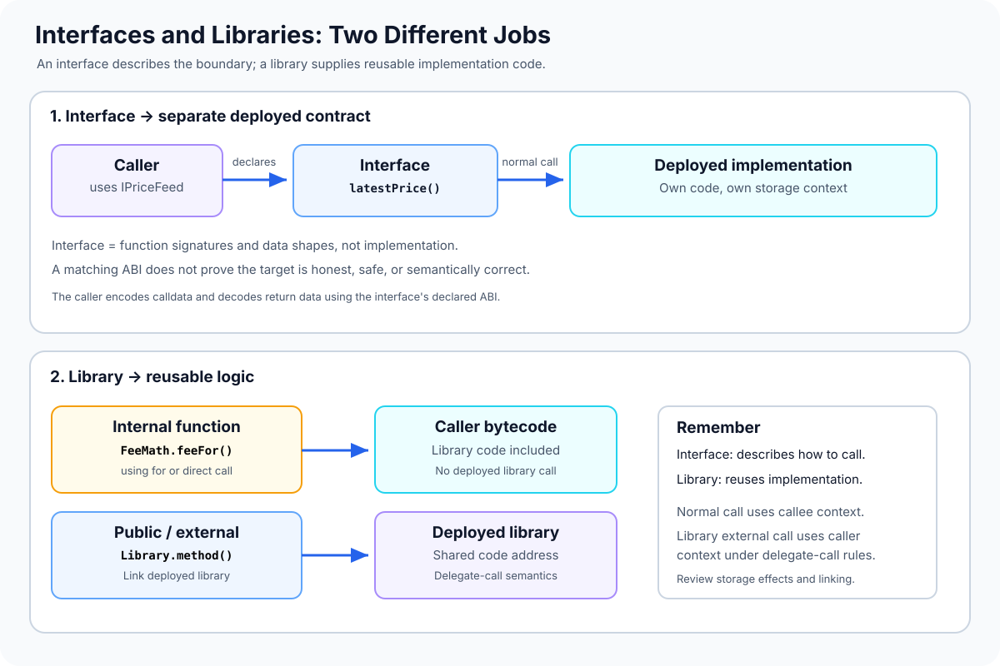

# Interfaces and Libraries: Contract Boundaries and Reusable Solidity Logic

> **Stage:** 04 — Smart Contract Architecture  
> **Priority:** 1  
> **Status:** Reviewed  
> **Last reviewed:** 2026-10-17

## 1. Overview

**Interfaces** and **libraries** both help Solidity developers avoid tightly coupled, repetitive code, but they solve different problems.

- An **interface** describes how code can call a contract: function signatures, input and return types, events, and errors. It does not provide the implementation of those functions.
- A **library** packages reusable logic that can be applied by other contracts. Depending on its visibility and call pattern, the library code can be compiled into the caller or deployed separately and invoked through Solidity's library-call mechanism.

Interfaces are commonly used to integrate tokens, oracles, registries, vaults, and other independently deployed contracts. Libraries are commonly used for calculations, reusable data-structure operations, validation helpers, and other logic that several contracts need.

These are complementary tools. An interface defines a boundary; a library provides code reuse. Neither automatically makes a dependency secure or its result trustworthy.



## 2. Why They Matter to a Developer

Understanding interfaces and libraries helps you:

- integrate existing protocol contracts without needing their complete source code at compile time;
- keep application code independent from a particular implementation behind a stable function boundary;
- reuse well-tested logic rather than copy-pasting formulas across contracts;
- distinguish normal external calls from library calls that use the caller's execution context;
- understand compiler output, library linking, deployment configuration, and storage-context risks;
- test components in isolation and test their integration using mocks and real implementations.

The key architectural question is whether you need to **describe an external contract's API** (an interface), **reuse code** (a library), or **call a separate component that provides a service** (composition). In a real project, all three may be used together.

## 3. Interfaces: Declaring a Contract Boundary

An interface declares the functions and events that another contract is expected to expose. Interface functions have no implementation body and are declared with `external` visibility. An interface cannot declare ordinary state variables or constructors, and it cannot implement its functions.

Interfaces may declare types such as structs and enums, events, and custom errors as part of the contract-facing specification. An interface can also inherit from other interfaces.

### Example: A price-feed interface

```solidity
// SPDX-License-Identifier: MIT
pragma solidity ^0.8.24;

interface IPriceFeed {
    function latestPrice()
        external
        view
        returns (uint256 price, uint256 updatedAt);
}
```

This definition tells the compiler what function selector and return-data shape to use when a caller invokes `latestPrice()`. It does not specify how the price is calculated, where it comes from, whether the result is fresh, or whether the implementation is honest.

A separate contract may implement the interface:

```solidity
// SPDX-License-Identifier: MIT
pragma solidity ^0.8.24;

contract FixedPriceFeed is IPriceFeed {
    uint256 private immutable configuredPrice;

    constructor(uint256 initialPrice) {
        configuredPrice = initialPrice;
    }

    function latestPrice()
        external
        view
        override
        returns (uint256 price, uint256 updatedAt)
    {
        return (configuredPrice, block.timestamp);
    }
}
```

This is a simple demonstration implementation, not a production oracle. The reported timestamp is the time of the call, not proof that the underlying price was recently observed or independently verified.

The implementation explicitly inherits from `IPriceFeed`, so the compiler checks that it provides a compatible function. However, a caller can also use an interface type to call a deployed address even if that implementation did not explicitly inherit from the interface. The EVM does not store a universal “this contract implements IPriceFeed” declaration automatically.

## 4. Calling a Contract Through an Interface

A caller can store an interface-typed reference to a deployed contract:

```solidity
// SPDX-License-Identifier: MIT
pragma solidity ^0.8.24;

import "./IPriceFeed.sol";

contract PriceReader {
    IPriceFeed public immutable feed;

    error ZeroFeedAddress();

    constructor(address feedAddress) {
        if (feedAddress == address(0)) revert ZeroFeedAddress();
        feed = IPriceFeed(feedAddress);
    }

    function readPrice()
        external
        view
        returns (uint256 price, uint256 updatedAt)
    {
        return feed.latestPrice();
    }
}
```

The cast `IPriceFeed(feedAddress)` tells Solidity how the caller intends to interact with that address; it does **not** prove the target contains a correct price-feed implementation. If the target reverts, returns malformed data, or returns semantically incorrect values, the call can fail or the application can make a bad decision.

For a production price consumer, define and enforce the application's trust and validation model. Depending on the feed, this can include checking that the address is an approved deployment, validating timestamps and staleness, checking the value's sign/range and decimal scale, and handling reverts. Those requirements are feed-specific; the interface itself does not provide them.

### ABI and runtime behavior

Solidity uses the interface's declared function signature to encode the external call and decode the returned data according to the ABI conventions. This is why caller and callee must agree on compatible parameter and return-data formats.

A matching function selector is not enough to guarantee matching semantics. Two contracts can expose the same function signature but interpret the value differently, use different units, or follow different authorization rules. Compatibility includes the meaning of the data, not just whether a call can be encoded.

### Optional interface discovery

Some contracts implement [ERC-165](https://eips.ethereum.org/EIPS/eip-165), which provides a standard mechanism for querying supported interface identifiers. This is useful when the target explicitly participates in ERC-165 interface discovery. It is not a universal capability check for every contract: many valid contracts do not implement ERC-165, and a reported interface identifier is not a guarantee that the implementation is safe or correct.

## 5. What a Solidity Library Is

A **library** is a reusable unit of Solidity code intended to be called from contracts. It is not an ordinary stateful service contract: Solidity restricts libraries from having ordinary mutable state variables, constructors, or payable functions, and libraries cannot define fallback or receive functions.

Libraries are useful for:

- pure or view calculations;
- common validation and conversion logic;
- operations on structs, arrays, mappings, and other data structures;
- reusable helpers that should have one well-defined implementation in the codebase.

A library can accept a storage reference explicitly, such as a storage struct or mapping, where Solidity's type and library-call rules allow it. The library cannot simply name arbitrary state variables from the caller; those values or references must be passed through the function arguments or accessed according to the library's allowed call model.

### Example: A reusable fee calculation library

```solidity
// SPDX-License-Identifier: MIT
pragma solidity ^0.8.24;

library FeeMath {
    uint256 internal constant BPS_DENOMINATOR = 10_000;

    error InvalidFeeRate();

    function feeFor(uint256 amount, uint256 feeBps)
        internal
        pure
        returns (uint256)
    {
        if (feeBps > BPS_DENOMINATOR) revert InvalidFeeRate();

        // Avoid the intermediate multiplication amount * feeBps.
        return
            (amount / BPS_DENOMINATOR) * feeBps
            + ((amount % BPS_DENOMINATOR) * feeBps)
                / BPS_DENOMINATOR;
    }
}
```

Here, basis points are parts per 10,000: 100 basis points equals 1%, and 10,000 basis points equals 100%. The implementation splits the calculation into quotient and remainder terms to avoid directly multiplying an arbitrary `uint256 amount` by `feeBps` before division. The function still needs to be used in a context where the business meaning of the rate is correct; mathematical bounds do not establish that a particular fee is appropriate.

## 6. Internal Library Functions and `using for`

### Internal library functions

An `internal` library function is compiled into the calling contract's bytecode when used. The compiler can use the internal calling convention rather than an external message call. This avoids deploying a separate library just for that function, though it can increase the size of each caller's bytecode that includes the logic.

A caller can use the library with a qualified function name:

```solidity
uint256 fee = FeeMath.feeFor(amount, feeBps);
```

This is code reuse at compile time. There is no runtime dependency on a separately deployed `FeeMath` contract for this internal function.

### Attach library functions with `using for`

The directive `using LibraryName for Type` makes eligible library functions available using a value of the specified type as the first argument.

```solidity
// SPDX-License-Identifier: MIT
pragma solidity ^0.8.24;

library PercentMath {
    uint256 internal constant DENOMINATOR = 10_000;

    error InvalidBasisPoints();

    function percentOf(uint256 amount, uint256 bps)
        internal
        pure
        returns (uint256)
    {
        if (bps > DENOMINATOR) revert InvalidBasisPoints();

        return
            (amount / DENOMINATOR) * bps
            + ((amount % DENOMINATOR) * bps) / DENOMINATOR;
    }
}

contract QuoteCalculator {
    using PercentMath for uint256;

    function feeFor(uint256 amount, uint256 bps)
        external
        pure
        returns (uint256)
    {
        return amount.percentOf(bps);
    }
}
```

In `amount.percentOf(bps)`, the value before the dot—`amount`—is passed as the first argument to `PercentMath.percentOf`. With an internal library function, the call is compiled into the caller; it is not a transaction to a deployed library address.

The `using for` syntax is a convenience for organization and readability, not a change to the underlying arithmetic rules. Avoid attaching overly broad sets of helper methods to common types if doing so makes code harder to read.

## 7. Public or External Library Functions

A library can also expose `public` or `external` functions. Calls to such library functions use Solidity's library-call convention and, in the normal deployed-library case, invoke the library's code using `DELEGATECALL`. The library address is linked into the calling contract's compiled deployment bytecode.

This has several consequences:

- **Deployment/linking:** deploy the library and provide its address when linking/compiling contracts that reference its public or external functions.
- **Separate code address:** the library's runtime code resides at its own address, rather than being copied wholesale into every caller.
- **Caller context:** execution uses the calling contract's context. Storage, `address(this)`, `msg.sender`, and `msg.value` follow delegate-call semantics rather than behaving like a normal call to a service contract.
- **Storage discipline:** if a library function accepts or operates on caller storage, the library code and storage layout assumptions must be carefully reviewed.
- **Gas and bytecode trade-offs:** deploying and calling a linked library has different cost and bytecode-size consequences from including an internal function. Measure the real project rather than assuming one strategy is always cheaper.

Solidity's library-call mechanism includes compiler-generated protections: a state-modifying public/external library function is not intended to be invoked through an ordinary `CALL` as if the library were a normal service contract. Do not manually substitute `CALL` or assume library calls have the same semantics as a normal interface call.

For most simple math and validation helpers, internal library functions are straightforward. A deployed public/external library is worth considering when shared code size or a particular data-structure design justifies the linking and call complexity.

## 8. Interfaces, Libraries, Inheritance, and Composition Compared

These concepts are related but distinct:

| Tool | Main purpose | Typical use | Key runtime implication |
|---|---|---|---|
| Interface | Describe a callable contract boundary | Calling a token, oracle, registry, or vault | Normal external call to a configured address |
| Library with internal functions | Reuse implementation code | Math and helper functions | Code is compiled into the caller |
| Library with public/external functions | Reuse code through a deployed library | Larger shared logic or storage-aware helpers | Library-call convention normally uses `DELEGATECALL` |
| Inheritance | Extend a base contract's behavior | Reusable modifiers, hooks, token/access-control extensions | Inherited code and state layout form part of the derived contract |
| Composition | Build a system from independent deployed components | Application calls a separate service contract through an interface | Each normal external call uses the callee's context |

A common architecture might inherit a reusable access-control contract, call an external token through an interface, and use an internal library for fee math. They are not competing features; they address different layers of the design.

For more context, see [Contract Composition](01-contract-composition.md) and [Inheritance](02-inheritance.md).

## 9. Common Mistakes and Security Considerations

1. **Assuming an interface proves behavior.** It describes the expected call shape, not the correctness, honesty, or availability of the implementation.
2. **Calling an untrusted address.** Validate dependency configuration and the application's trust assumptions; a zero-address check alone does not prove a target is appropriate.
3. **Ignoring return-value semantics.** Correct ABI decoding cannot tell you whether a price is fresh, a unit is correct, or a policy is economically sound.
4. **Mixing up interfaces and abstract contracts.** Interfaces declare a contract-facing API without function bodies; abstract contracts can also include implemented functions and state.
5. **Assuming all library functions require a deployed address.** Internal library functions are compiled into the caller; public/external library functions have different linking and call behavior.
6. **Treating a library call as an ordinary external call.** Public/external library functions normally execute with delegate-call context, so storage and `address(this)` refer to the caller's context.
7. **Misunderstanding `using for`.** It rearranges the calling syntax by passing the receiver as the first argument; it does not change function semantics.
8. **Ignoring library code size and deployment costs.** Internal code can be duplicated across callers; linked library functions add deployment, linking, and call overhead. Benchmark the actual build.
9. **Passing storage references carelessly.** A library that mutates a storage reference can modify the caller's persistent state. Review the data passed in and the effects of each operation.
10. **Trusting interface-discovery claims blindly.** ERC-165 is optional and a supported-interface response does not prove that the advertised functions are secure.
11. **Using an interface against an ABI-incompatible target.** Calls may revert or return data that decodes incorrectly if the target's actual behavior does not match the declared interface.
12. **Skipping integration tests.** Test expected results, reverts, malformed or extreme return values, and real dependency behavior in addition to isolated mocks.

## 10. Key Takeaways

- An interface defines how callers encode calls and interpret results; it does not implement or validate the target contract.
- Interfaces can declare external functions, events, errors, and types, but cannot define ordinary state variables, constructors, or implemented function bodies.
- Libraries package reusable code and can accept explicit storage references under Solidity's rules.
- Internal library functions are compiled into the caller; public/external library functions normally use a linked deployed library and delegate-call semantics.
- `using for` makes a compatible library function available as a method on its first argument's type.
- A normal interface call and a public/external library call have different execution-context semantics.
- Interfaces, libraries, inheritance, and composition can be used together, but each serves a different purpose.
- Design safe boundaries, validate data according to the business context, and test both dependencies and integration paths.

## Review Checklist

- [ ] Explain what an interface declares and what it does not guarantee.
- [ ] Use an interface type to call a separately deployed contract.
- [ ] Explain why a matching selector or ABI does not guarantee semantic correctness.
- [ ] Distinguish an interface from an abstract contract.
- [ ] Write an internal library function and call it by its qualified name.
- [ ] Explain `using LibraryName for Type` with a small example.
- [ ] Distinguish internal library calls from public/external library calls.
- [ ] Explain why deployed external library functions use delegate-call context.
- [ ] Compare interfaces, libraries, inheritance, and composition for a design decision.
- [ ] Identify the tests needed for a dependency boundary and for a library that mutates storage.

## References

1. **[Solidity Documentation — Interfaces](https://docs.solidity.org/en/latest/contracts.html#interfaces)** — interface restrictions, inheritance between interfaces, declarations, and the fact that interfaces do not provide function implementations.
2. **[Solidity Documentation — Libraries](https://docs.solidity.org/en/latest/contracts.html#libraries)** — library restrictions, internal versus public/external functions, linking, delegate-call behavior, and storage-reference use.
3. **[Solidity Documentation — Using For](https://docs.solidity.org/en/latest/contracts.html#using-for)** — attaching library or free functions to a type and passing the receiver as the first argument.
4. **[Solidity — Contract ABI Specification](https://docs.solidity.org/en/latest/abi-spec.html)** — ABI encoding of function calls, return data, events, errors, and selectors.
5. **[EIP-165 — Standard Interface Detection](https://eips.ethereum.org/EIPS/eip-165)** — optional runtime interface identification.
6. **[Contract Composition](01-contract-composition.md)** — related article about combining independently deployed components.
7. **[Inheritance](02-inheritance.md)** — related article about extending code and behavior through base contracts.
