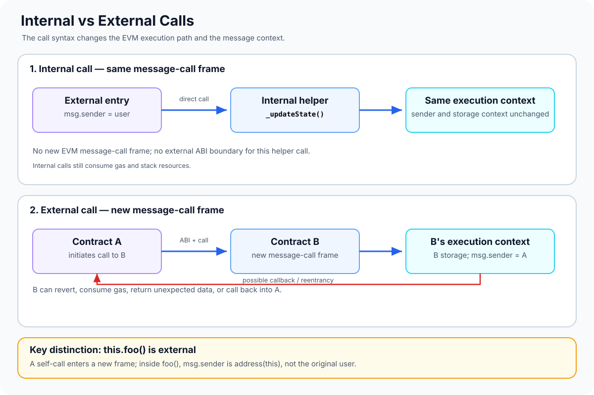

# Internal and External Calls: How Solidity Functions Execute

> **Stage:** 04 — Smart Contract Architecture  
> **Priority:** 1  
> **Status:** Reviewed  
> **Last reviewed:** 2026-10-17

## 1. Overview

In Solidity, a function can be called internally within the current contract execution or externally through an EVM message call. The difference is more important than the syntax: it affects execution context, data handling, gas, visibility, error propagation, and security.

- **Internal function call:** calls a function in the same contract instance using Solidity's internal calling convention. It does not create a new EVM message-call frame.
- **External function call:** invokes a function through a message call, either on another contract or on the current contract using `this.functionName(...)`. A new execution frame is created, with its own call data and context.
- **Cross-contract call:** a common form of external call, usually made through an interface or contract-typed reference.

A bare call such as `_updateState()` is not equivalent to `this.updateState()`. The first is an internal call; the second is an external message call to the current contract's address. In the latter case, the function observes a new call context—for example, `msg.sender` is the contract itself, not the original external user.



## 2. Why It Matters to a Developer

Understanding call types helps when you:

- reason about `msg.sender`, `msg.value`, storage context, and the flow of control;
- design contract interfaces and integrations with tokens, oracles, vaults, and other protocols;
- avoid accidental behavior changes when replacing a direct call with `this.function()`;
- understand why an external call can revert, consume gas, or call back into the caller;
- choose when `try/catch` is available and how to handle low-level call results;
- review execution cost, data encoding, and reentrancy risk.

Many security bugs arise because developers think of an external contract call as an ordinary function call in a single program. It is better to treat every external contract call as a boundary to code whose behavior may be unknown.

## 3. Internal Function Calls

A function can be called internally by using its name directly, or by calling an inherited function through Solidity's internal dispatch rules. These calls use the compiler's internal calling convention, commonly translated into jumps within the same EVM execution frame.

```solidity
// SPDX-License-Identifier: MIT
pragma solidity ^0.8.24;

contract InternalExample {
    uint256 public total;

    function add(uint256 amount) external {
        _add(amount);
    }

    function _add(uint256 amount) internal {
        total += amount;
    }
}
```

When a user calls `add(5)`, the external entry point invokes `_add(5)` internally. The helper does not create a new message-call frame and does not reset the current message context. The `msg.sender` observed anywhere in that internal path remains the sender of the current external message, and the current `msg.value` remains the value attached to that message.

Internal calls are often efficient because they avoid a new message call and do not require the same external ABI encoding/decoding boundary. Memory references can be passed internally according to Solidity's data-location rules without copying the entire object in the same way an external ABI boundary generally requires.

However, internal calls still consume gas and EVM stack resources. Excessive recursion can exhaust the available stack depth, so “internal” does not mean free or unlimited.

### Internal calls and visibility

- `internal` functions can be called from the declaring contract and derived contracts, but not directly by external accounts.
- `private` functions are visible only inside the contract where they are declared.
- `public` functions may be called internally by name and externally through the contract interface.
- `external` functions are intended for external entry. They cannot normally be invoked by a bare internal call using only their function name, though a public/external entry can be reached through an external call such as `this.someFunction()` where allowed.

Visibility describes where a function may be accessed; it does not by itself determine whether a call is secure.

## 4. External Function Calls

An external call invokes a function on a contract instance or through `this`, using an EVM message call. Solidity encodes the arguments according to the applicable ABI or call convention, hands control to the target frame, and decodes the return data if the call succeeds and the caller expects a return value.

Example using an interface:

```solidity
// SPDX-License-Identifier: MIT
pragma solidity ^0.8.24;

interface IPriceFeed {
    function latestPrice() external view returns (uint256);
}

contract PriceConsumer {
    IPriceFeed public immutable feed;

    constructor(IPriceFeed feed_) {
        feed = feed_;
    }

    function readPrice() external view returns (uint256) {
        return feed.latestPrice();
    }
}
```

Calling `feed.latestPrice()` makes an external call to the configured address. In a normal `CALL` context, the callee uses its own account's code and storage. The caller cannot directly access the callee's state variables; it gets only the returned data or the failure result.

The interface tells Solidity how to encode the call and decode the response. It does not prove that the target implements the intended logic, returns fresh data, or is safe to trust.

### What changes at the call boundary?

For an ordinary external `CALL` from contract A to contract B:

- A new message-call frame is entered for B.
- B executes its code and accesses B's storage context.
- B sees `msg.sender == address(A)`, not the user who originally called A.
- B sees the `msg.value` attached to that particular A-to-B call. It is zero unless value is sent with that call.
- The call has a gas budget and can return data or revert.
- B can call other contracts, including A, before returning; this is a potential reentrancy path.

These are the normal-call rules. `DELEGATECALL` deliberately has different context semantics and is covered separately in the EVM and proxy articles.

## 5. The Difference Between `foo()` and `this.foo()`

This is one of the most important Solidity distinctions.

```solidity
// SPDX-License-Identifier: MIT
pragma solidity ^0.8.24;

contract CallContextExample {
    address public lastSender;

    function recordInternal() external {
        _record();
    }

    function recordViaExternalSelfCall() external {
        this.recordExternally();
    }

    function recordExternally() external {
        lastSender = msg.sender;
    }

    function _record() internal {
        lastSender = msg.sender;
    }
}
```

Consider an externally owned account (EOA) calling these two entry points:

- Calling `recordInternal()` runs `_record()` internally. The recorded `msg.sender` is the EOA.
- Calling `recordViaExternalSelfCall()` triggers `this.recordExternally()`, which is a new external message call from the contract to itself. Inside `recordExternally()`, `msg.sender` is the contract's own address.

The second version is not merely more expensive syntax. It changes the caller observed by the callee and introduces an external-call boundary. It can also affect access control, event context, revert behavior, and reentrancy analysis.

A public function can be called internally by its bare name. Prefer that form when you truly intend an internal call and do not need an external boundary. Use `this.function()` only when external-call semantics are intentional.

## 6. View Calls, `STATICCALL`, and State Changes

An external call to a function declared `view` or `pure` is generally compiled using static-call restrictions when supported by the target EVM. A `STATICCALL` creates an external call frame but prohibits state-changing operations in that frame and its descendants. It is not the same as an internal call.

A few distinctions matter:

- A `view` call through an interface is still an external call if the target is another contract.
- A static call cannot successfully execute operations such as `SSTORE`, emit logs, create contracts, or transfer Ether.
- `view` and `pure` are Solidity-level mutability promises and influence how the compiler and tools treat a function; they do not prove the returned value is correct.
- A function called internally does not create a new `STATICCALL` frame simply because it is marked `view`; it runs within the current execution frame and follows the restrictions of that frame.

The caller must still check returned values and handle external-call failure. Static execution limits state changes; it does not make an oracle, token, or other dependency truthful.

## 7. Return Values, Reverts, and `try/catch`

When an external high-level call succeeds, the caller can decode its return data. If the callee reverts, Solidity normally propagates the failure unless the call is wrapped in a supported `try/catch` pattern or a low-level call is used to handle it explicitly.

`try/catch` can be used for external function calls and contract creation calls. It does not catch a failure from an ordinary internal function call in the same way.

```solidity
interface IRemote {
    function value() external view returns (uint256);
}

contract SafeReader {
    function readOrDefault(IRemote remote)
        external
        view
        returns (uint256 result, bool success)
    {
        try remote.value() returns (uint256 returnedValue) {
            return (returnedValue, true);
        } catch {
            return (0, false);
        }
    }
}
```

This example shows how the caller can handle a failure instead of necessarily reverting. Returning zero as a fallback is appropriate only when zero is a safe and unambiguous default for that application. Otherwise, the caller should report the failure or follow a clearly defined recovery path.

A low-level `call` returns a success flag and raw return data rather than automatically reverting the caller on every failed target call. If you use it, check the success flag and validate or decode the return data carefully. Revert data from another contract is not inherently trustworthy; it can be crafted by the callee, so do not rely on its contents as an authorization signal.

## 8. External Calls and Reentrancy

An external call transfers control to another contract. That contract may call back into the original contract before the first call returns. This is the basis of reentrancy and applies to more than Ether transfers: token hooks, callbacks, external accounting modules, and arbitrary contract integrations may all create reentrant control flow.

Consider a withdrawal that sends funds before updating its accounting state:

```solidity
// Simplified vulnerable pattern — do not use in production.
function withdraw() external {
    uint256 amount = credit[msg.sender];
    (bool ok, ) = payable(msg.sender).call{value: amount}("");
    require(ok);
    credit[msg.sender] = 0;
}
```

If the recipient is a contract, its fallback or receive function may call back into `withdraw()` before the credit is set to zero. A correct fix must preserve the accounting invariant; one common pattern is Checks-Effects-Interactions, which updates the state before making the external call:

```solidity
function withdraw() external {
    uint256 amount = credit[msg.sender];
    credit[msg.sender] = 0;

    (bool ok, ) = payable(msg.sender).call{value: amount}("");
    require(ok);
}
```

This is only a simplified pattern, not a complete withdrawal contract. Production code also needs correct balance/accounting checks and tests for failed transfers and reentrant receivers. Depending on the design, a reviewed reentrancy guard or pull-payment pattern may be appropriate. The important principle is that an external call is a control-transfer boundary, and the contract must remain safe if the target behaves adversarially.

## 9. Gas and Performance Considerations

Internal calls usually avoid external message-call overhead and ABI-boundary encoding/decoding, making them a natural choice for private helpers and shared logic inside one contract.

External calls incur additional work such as message-call handling, input and return-data processing, context setup, and any execution performed by the callee. The actual gas cost depends on call type, target code, input/output size, warm/cold account access, memory expansion, gas forwarding, and current protocol rules.

Do not use “internal is always cheaper” as an absolute rule without measuring the actual compiled code. But do understand the architectural trade-off: splitting logic into separate contracts creates a runtime boundary; keeping logic internal can increase the size and complexity of one implementation while avoiding inter-contract calls.

Gas is only one factor. Separation can improve clarity and reuse; an external call may be necessary to interact with an independent protocol. Choose call structure for sound architecture first, then optimize measured bottlenecks.

## 10. Common Mistakes and Security Considerations

1. **Confusing visibility with call type.** `public`/ `external` describe accessibility; internal/external call describes how a particular invocation executes.
2. **Assuming `this.foo()` is an internal call.** It creates an external self-call and changes the observed `msg.sender` to `address(this)`.
3. **Assuming the original user remains `msg.sender` across contract calls.** In an ordinary A-to-B call, B sees A as its sender.
4. **Ignoring reentrancy.** Any external call to unknown code can transfer control and potentially call back.
5. **Making external calls before updating critical state.** Apply checks-effects-interactions or another verified approach that preserves invariants.
6. **Assuming a `view` external call is an internal call.** Static restrictions do not remove the external call frame or establish data correctness.
7. **Ignoring revert handling.** External calls can fail due to reverts, insufficient gas, invalid return data, or target behavior.
8. **Trusting arbitrary revert data.** Callees can provide revert bytes that resemble errors from other contracts; never treat an error signature as proof of identity or authorization.
9. **Using low-level `call` without checking success.** A false success flag must not be ignored, and successful execution does not prove semantic correctness.
10. **Overusing external self-calls to work around visibility.** This changes sender/context and adds boundary overhead; use internal helpers when internal behavior is intended.
11. **Assuming internal calls are free or recursion is unlimited.** Internal calls consume gas and stack resources.
12. **Assuming call gas costs never change.** Gas depends on the active fork and the specific call path.

## 11. Key Takeaways

- Internal calls use Solidity's internal calling convention inside the current contract frame; they do not create a new message-call frame.
- External calls use EVM message-call machinery, ABI data transfer, and a separate call frame.
- `this.foo()` is an external self-call, not an internal call; within `foo`, `msg.sender` is the contract itself.
- During a normal call from A to B, B uses B's code and storage context and sees A as `msg.sender`.
- A `view` call to another contract is still external, usually under `STATICCALL` restrictions.
- External calls can revert, return unexpected data, or reenter the caller. Treat the boundary as untrusted.
- `try/catch` applies to external function calls and contract creation calls, not ordinary internal function calls.
- Call structure affects gas, readability, and security; use internal helpers for same-contract behavior and external calls for genuine boundaries.

## Review Checklist

- [ ] Explain the difference between an internal call and a new EVM message-call frame.
- [ ] Distinguish function visibility from the way a function is invoked.
- [ ] Trace `msg.sender` through an internal call and through an A-to-B external call.
- [ ] Explain why `this.foo()` changes the call context.
- [ ] Explain how external `view` calls differ from internal calls and how static-call restrictions work.
- [ ] Compare failure behavior for high-level external calls, `try/catch`, and low-level `call`.
- [ ] Explain how an external call can cause reentrancy.
- [ ] Apply Checks-Effects-Interactions to a state-changing external call.
- [ ] Identify the gas and data-boundary trade-offs of separating logic into contracts.

## References

1. **[Solidity — Control Structures: Function Calls](https://docs.solidity.org/en/latest/control-structures.html#function-calls)** — official explanation of internal function calls, external calls, and `try/catch`.
2. **[Solidity — Contracts](https://docs.solidity.org/en/latest/contracts.html)** — calling other contract instances, context changes, and reentrancy implications.
3. **[Solidity — Security Considerations](https://docs.solidity.org/en/latest/security-considerations.html)** — external-call hazards, reentrancy, checks-effects-interactions, and call-stack considerations.
4. **[Solidity — Types: Members of Addresses](https://docs.solidity.org/en/latest/types.html#members-of-addresses)** — low-level `call`, `delegatecall`, `staticcall`, and related call behavior.
5. **[Contract Composition](01-contract-composition.md)** — related article on structuring systems with independent deployed contracts.
6. **[Interfaces and Libraries](03-interfaces-and-libraries.md)** — related article on typed call boundaries and library-call semantics.
7. **[Storage Context](../03-storage-data-layout/08-storage-context.md)** — related article on account context and storage ownership.
