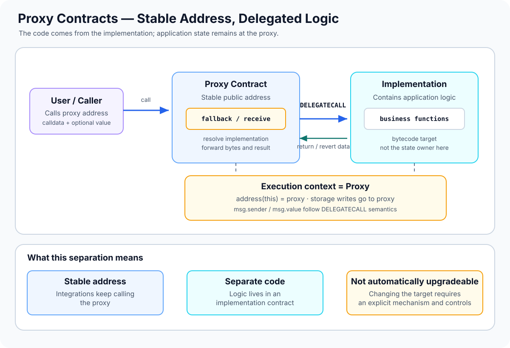

# Proxy Contracts: Separating Contract Address from Logic

> **Stage:** 04 — Smart Contract Architecture  
> **Priority:** 1  
> **Status:** Reviewed  
> **Last reviewed:** 2026-10-17

## 1. Overview

A **proxy contract** is a contract that receives calls and forwards their execution to code located at another contract address. In common EVM proxy architectures, the proxy uses the `DELEGATECALL` opcode so that the implementation's code executes in the proxy's storage and account context.

This separates two things that are normally packaged together:

- **Proxy:** the stable address users and integrations call. It forwards calls and, depending on the design, may store or resolve the implementation address.
- **Implementation:** the contract containing the application logic. Its code is executed when the proxy delegates a call to it.

The key idea is that the implementation's code can run against the proxy's state. Therefore, calls made through the proxy can update state stored at the proxy address, rather than the implementation address.

A proxy is **not automatically upgradeable**. A proxy may permanently point to one implementation, while an upgradeable proxy architecture provides a controlled way to change which implementation receives delegated calls.



## 2. Why It Matters to a Developer

Proxy architecture is widely used when developers need a stable contract address while evolving the code behind it. It also appears in systems that create many instances cheaply or share logic between deployed contracts.

Understanding proxies helps you:

- reason about why `address(this)` and storage refer to the proxy during delegated execution;
- understand why the implementation's constructor does not initialize the proxy's storage;
- review initialization, access control, and storage-layout compatibility;
- trace calls and revert data through a fallback function;
- distinguish the basic proxy pattern from upgrade mechanisms such as Transparent and UUPS;
- investigate contract behavior on-chain, where the proxy address may not contain the application's full logic.

## 3. How a Proxy Call Works

A typical delegated call follows this path:

1. A user or another contract calls the **proxy address**.
2. Solidity's normal function dispatch may handle a function implemented directly by the proxy. Otherwise, calls commonly reach its `fallback()`; empty-calldata calls may reach `receive()`.
3. The proxy determines the target implementation address. The address may be stored in a dedicated storage slot, obtained from a beacon, or fixed by the proxy design.
4. The proxy uses `DELEGATECALL` to execute the implementation's code using the original calldata.
5. The implementation logic reads or writes state in the **proxy's storage context**.
6. The proxy forwards the returned bytes or revert data to the original caller.

The proxy usually does not need to declare a Solidity wrapper for every function in the implementation. Its fallback can forward arbitrary calldata, allowing the implementation to define the application's callable interface.

### The execution-context rule

For a normal `CALL`, code executes in the target contract's account context. For `DELEGATECALL`, code comes from the target address, but the caller's execution context is preserved:

| Property during delegated execution | Effective context |
|---|---|
| Executed code | Implementation's bytecode |
| `address(this)` | Proxy address |
| Persistent storage reads/writes | Proxy storage |
| `msg.sender` | The sender of the call that entered the current context |
| `msg.value` | The value associated with the current message call |
| ETH balance context | Proxy account |

For the common transaction path where a user calls the proxy directly, the implementation sees that user as `msg.sender`. If another contract calls the proxy, the implementation sees that calling contract instead. Do not assume `msg.sender` is always an externally owned account.

This context preservation is the main reason proxies can keep state at a stable address while borrowing implementation code.

## 4. A Minimal Forwarding Sketch

The following abstract contract illustrates the forwarding mechanism. It deliberately leaves implementation-address resolution to a derived contract and is **not a production-ready proxy**: it omits upgrade authorization, initialization policy, and a specified storage-slot scheme.

```solidity
// SPDX-License-Identifier: MIT
pragma solidity ^0.8.24;

abstract contract ProxySketch {
    function _implementation()
        internal
        view
        virtual
        returns (address);

    fallback() external payable {
        _delegate(_implementation());
    }

    receive() external payable {
        _delegate(_implementation());
    }

    function _delegate(address implementation) internal virtual {
        assembly {
            calldatacopy(0, 0, calldatasize())

            let success := delegatecall(
                gas(),
                implementation,
                0,
                calldatasize(),
                0,
                0
            )

            returndatacopy(0, 0, returndatasize())

            switch success
            case 0 {
                revert(0, returndatasize())
            }
            default {
                return(0, returndatasize())
            }
        }
    }
}
```

The assembly copies the incoming calldata, performs `DELEGATECALL`, copies the returned bytes, and then either returns those bytes or reverts with the implementation's revert data. The `return` and `revert` instructions exit the current EVM frame; they do not continue execution after `_delegate`.

A real proxy must also resolve the implementation safely and follow a well-reviewed design. For upgradeable proxies, use established implementations and tooling rather than treating this sketch as deployable infrastructure.

## 5. Where the Implementation Address Lives

A proxy must know which code to execute. Common designs include:

- **Fixed implementation:** the target is fixed by the proxy's design and cannot be changed through an upgrade function.
- **ERC-1967 implementation slot:** the implementation address is stored in a standardized, dedicated slot intended to avoid collisions with ordinary Solidity state variables.
- **Beacon:** the proxy refers to a beacon contract, which provides the implementation address; multiple proxies can follow the same beacon.
- **Minimal clone:** a small deployed contract forwards calls to a target implementation using a compact bytecode pattern. Standard ERC-1167 clones are generally not upgradeable after deployment.

These are related but distinct choices. ERC-1967 specifies storage slots for proxy metadata; it does not by itself supply authorization or guarantee that a proxy can be upgraded. Similarly, a proxy that uses `DELEGATECALL` is not automatically a safe upgradeable system.

## 6. Constructors and Initialization

A frequent mistake is assuming that deploying an implementation initializes the state used through the proxy.

A constructor runs when the implementation contract itself is deployed. Its storage writes affect the implementation's storage, **not the proxy's storage**. Later delegated calls use the proxy's storage, so state required by the proxied application must be initialized in that context.

Upgradeable designs commonly use an external initializer function instead of relying on the implementation constructor for proxy state. The deployment flow must ensure that initialization occurs safely—ideally atomically with proxy deployment when the architecture allows it—and that the initializer cannot be replayed by an unauthorized caller.

The implementation contract itself should also be protected against unsafe initialization when appropriate. Initialization and access-control requirements depend on the concrete proxy pattern and libraries used; they should not be improvised from the forwarding mechanism alone.

## 7. Proxy Pattern vs. Upgradeability

A proxy is the indirection layer. **Upgradeability** is an additional capability that changes the implementation address under controlled conditions.

Common upgradeable designs include:

- **Transparent Proxy:** distinguishes administrative calls from ordinary user calls to reduce ambiguity between proxy management functions and implementation functions.
- **UUPS:** puts upgrade logic in the implementation, while the proxy provides the delegated execution path.
- **Beacon Proxy:** resolves the implementation through a beacon that can be updated to affect multiple proxies.

These patterns have different authorization and dispatch rules. They are covered separately in the next articles: Transparent Proxies, UUPS Proxies, and Beacon Proxies.

Minimal clones are a different use case: they reduce deployment cost by reusing implementation code, but ordinary ERC-1167 clones do not provide an upgrade mechanism by default.

## 8. Common Mistakes and Security Considerations

1. **Assuming implementation storage is used.** A delegated function reads and writes the proxy's storage. Inspect the storage context, not just the source file containing the function.
2. **Treating a proxy as automatically upgradeable.** The ability to forward calls and the authority to change the target are separate design features.
3. **Relying on the implementation constructor to initialize proxy state.** The constructor affects the implementation contract's own storage. Use a properly protected initializer for the proxy context.
4. **Ignoring storage collisions.** Proxy metadata and implementation state must use compatible, non-conflicting storage locations. Established proxy standards such as ERC-1967 reserve dedicated slots for proxy metadata.
5. **Leaving upgrades unprotected.** If an unauthorized party can change the implementation, they may be able to replace application behavior and gain control over proxy-held assets or state.
6. **Failing to validate upgrade targets.** A wrong or incompatible implementation can cause reverts, corrupt state interpretation, or permanently break access to functionality.
7. **Overlooking selector clashes and dispatch rules.** The proxy and implementation can expose functions with the same four-byte selector. The exact routing rules depend on the proxy pattern.
8. **Assuming `msg.sender` becomes the implementation address.** Under `DELEGATECALL`, the current message sender is preserved. This differs from a normal `CALL`.
9. **Failing to forward return and revert data correctly.** A low-level proxy must propagate both successful return bytes and failure data; swallowing failures can make behavior misleading.
10. **Calling the implementation address directly when testing proxy behavior.** Direct calls operate on implementation storage and may behave differently from calls through the proxy.
11. **Leaving initialization open.** An uninitialized proxy may allow an attacker to claim ownership or configure critical state before the intended deployer does.
12. **Treating a successful upgrade transaction as proof of compatibility.** Tests should cover storage preservation, access control, initialization, expected behavior, revert paths, and interactions with integrations.

## 9. Developer Review Checklist

Before integrating or reviewing a proxy, verify that you can answer:

- [ ] Which address is the user-facing proxy, and which address supplies the implementation code?
- [ ] How is the implementation address resolved and who, if anyone, can change it?
- [ ] Does the delegated code execute against proxy storage and balance context?
- [ ] How is proxy state initialized, and can initialization be repeated or taken over?
- [ ] Are proxy metadata slots separated from application storage?
- [ ] What are the exact dispatch rules for proxy functions, fallback, receive, and implementation selectors?
- [ ] Are return and revert bytes forwarded correctly?
- [ ] Are upgrades authorized, and is the new implementation compatible with existing state?
- [ ] Are tests executed through the proxy address rather than only against the implementation?

## 10. Key Takeaways

- A proxy separates the stable user-facing address from the code that handles application logic.
- Common EVM proxies use `DELEGATECALL`, executing implementation code with the proxy's storage and account context.
- During delegated execution, `address(this)` is the proxy; `msg.sender` and `msg.value` follow delegate-call context rules.
- An implementation constructor does not initialize the proxy's storage.
- A proxy does not necessarily support upgrades. Upgrade authorization, target validation, and storage compatibility are separate concerns.
- ERC-1967 standardizes locations for proxy metadata but is not a complete upgrade-security system.
- Always test the application's behavior through the proxy and review initialization, dispatch, and upgrade authority.

## References

1. **[Solidity Documentation — Delegatecall and Low-Level Calls](https://docs.solidity.org/en/latest/units-and-global-variables.html#special-variables-and-functions)** — Solidity's execution-context variables; combine this with the EVM semantics of `DELEGATECALL`.
2. **[Ethereum Yellow Paper](https://ethereum.github.io/yellowpaper/paper.pdf)** — EVM message-call execution semantics, including `DELEGATECALL`.
3. **[ERC-1967 — Proxy Storage Slots](https://eips.ethereum.org/EIPS/eip-1967)** — standardized storage locations for implementation, beacon, and admin metadata, plus events for monitoring changes.
4. **[OpenZeppelin Contracts — Proxy API](https://docs.openzeppelin.com/contracts/5.x/api/proxy)** — reviewed proxy building blocks and the distinction between ERC-1967, Transparent, UUPS, and Beacon designs.
5. **[OpenZeppelin Upgrades — Proxy Pattern](https://docs.openzeppelin.com/upgrades-plugins/proxies)** — proxy forwarding, initialization considerations, and selector-clash behavior.
6. **[ERC-1167 — Minimal Proxy Contract](https://eips.ethereum.org/EIPS/eip-1167)** — standard minimal proxy bytecode for forwarding calls to a fixed implementation.
7. **[ERC-1822 — Universal Upgradeable Proxy Standard](https://eips.ethereum.org/EIPS/eip-1822)** — background for UUPS-style upgradeability, discussed in a separate article.
