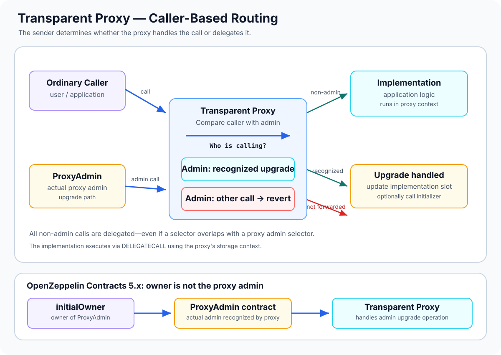

# Transparent Proxies: Separating Administration from Application Calls

> **Stage:** 04 — Smart Contract Architecture  
> **Priority:** 1  
> **Status:** Reviewed  
> **Last reviewed:** 2026-10-17

## 1. Overview

A **Transparent Proxy** is an upgradeable proxy pattern designed to avoid ambiguity between proxy-management calls and calls intended for the implementation contract. It does this by deciding whether to handle a call at the proxy or forward it to the implementation based on **who called the proxy**.

The core rule is:

- **If the caller is the proxy's admin:** the proxy processes calls it recognizes as administrative calls, such as an upgrade. Other calls from that admin are not forwarded to the implementation.
- **If the caller is not the proxy's admin:** the proxy forwards the call to the implementation, even if the calldata's four-byte selector matches a proxy-management function.

The implementation's code still runs through `DELEGATECALL`, so its application state is stored in the proxy's storage context. Transparency is about **call routing and administration**; it does not change the basic delegate-call storage model.

This article uses the **OpenZeppelin Contracts 5.x** implementation for version-specific details. Other implementations and older OpenZeppelin versions may expose or arrange administrative interfaces differently, so verify the exact library version used by a project.

## 2. Why It Matters to a Developer

Transparent proxies are important when a protocol needs to keep a stable contract address while allowing controlled implementation upgrades. The pattern helps avoid one class of selector-clash problem, but it also introduces a deliberate restriction: the proxy's actual admin cannot use that same proxy address as an ordinary implementation caller.

A developer needs to understand this pattern in order to:

- identify which address users interact with and which address is authorized to upgrade it;
- understand why an admin transaction may fail where the same transaction from an ordinary account is forwarded;
- distinguish the proxy's admin from the owner of the `ProxyAdmin` contract in OpenZeppelin Contracts 5.x;
- review selector routing, upgrade authorization, initialization, and storage compatibility;
- avoid unsafe combinations of Transparent and UUPS upgrade mechanisms;
- monitor implementation changes using ERC-1967 storage slots and events.

## 3. How Transparent Routing Works

A call to a Transparent Proxy follows this high-level decision process:

1. The caller submits calldata to the proxy address.
2. The proxy checks the caller against its actual admin identity.
3. If the caller is the admin, the proxy handles only the administrative calls it explicitly recognizes. An unrecognized call is rejected rather than forwarded to the implementation.
4. If the caller is not the admin, the proxy forwards the call to the implementation using `DELEGATECALL`.
5. The implementation executes in the proxy's context and the proxy returns the result or revert data to the original caller.

### Routing table

| Caller | Calldata matches an administrative selector | Result |
|---|---|---|
| Proxy admin | Yes, and the proxy recognizes the operation | Proxy handles the administrative operation, such as an upgrade |
| Proxy admin | No recognized administrative operation | The proxy does not forward it; the call reverts |
| Any non-admin caller | Yes | Forwarded to the implementation |
| Any non-admin caller | No | Forwarded to the implementation |

This caller-based rule is the distinguishing feature of the Transparent Proxy pattern. It lets an implementation expose a function whose selector happens to match the proxy's administrative selector without ordinary callers automatically being intercepted by the proxy. The actual admin, however, cannot call that colliding implementation function through this proxy.

Function selectors are only four bytes. Different function signatures can theoretically produce the same selector, which is why proxy dispatch rules must be understood rather than inferred from function names alone.

## 4. OpenZeppelin Contracts 5.x: ProxyAdmin as an Intermediary

In OpenZeppelin Contracts 5.x, `TransparentUpgradeableProxy` creates a dedicated `ProxyAdmin` contract during construction. The supplied `initialOwner` becomes the owner of that new `ProxyAdmin`; the newly deployed `ProxyAdmin` contract itself is the proxy's actual admin.

These are different roles:

- **Owner of ProxyAdmin:** the account or governance contract allowed to call the administrative functions on `ProxyAdmin`.
- **ProxyAdmin contract:** the address recognized as the proxy's admin. It sends the administrative call to the proxy.
- **Implementation:** the target that supplies application code for non-admin calls.

The usual upgrade path is therefore:

1. A configured owner account or governance process calls `ProxyAdmin.upgradeAndCall(...)`.
2. The `ProxyAdmin` contract calls the Transparent Proxy as its admin.
3. The proxy recognizes the administrative operation and updates the implementation according to the ERC-1967 mechanism.
4. If initialization data was supplied, the upgrade flow can also invoke the designated function on the new implementation through the proxy context.

The owner EOA is not itself the proxy's admin in this OpenZeppelin 5.x design. Because it calls the proxy from an address other than the actual admin contract, a direct call from that owner account is normally routed to the implementation just like a non-admin caller. Use the intended `ProxyAdmin` interface for upgrades.

**Version warning:** older OpenZeppelin versions have different admin arrangements and APIs. Never assume a v4 deployment and a v5 deployment use exactly the same constructor semantics or management flow. Inspect the dependency version and deployed bytecode/interface before interacting with an existing proxy.

## 5. Upgrade Path and ERC-1967

OpenZeppelin's Transparent Proxy uses the ERC-1967 implementation storage slot to record which logic contract receives delegated calls. ERC-1967 also defines standardized slots for other proxy metadata, including the admin slot, and recommends events when these values change.

The proxy's upgrade mechanism is separate from the implementation's business functions. In OpenZeppelin Contracts 5.x, the external administrative interface is `ITransparentUpgradeableProxy.upgradeToAndCall(newImplementation, data)`, used by `ProxyAdmin` to request an upgrade and optionally call an initialization function.

A subtle ABI detail: OpenZeppelin's `TransparentUpgradeableProxy` implements its upgrade dispatch through an internal mechanism. Its Solidity contract type does not directly expose the administrative function in the ordinary compiler-generated ABI. Integrators typically use the intended `ProxyAdmin` contract or the `ITransparentUpgradeableProxy` interface as appropriate to the library version.

An upgrade transaction can succeed while leaving a system unsafe if the new implementation changes the meaning of existing storage, breaks authorization assumptions, or leaves newly added state uninitialized. Routing correctness alone does not prove upgrade safety.

## 6. A Conceptual Example

Imagine an implementation with application functions such as `balanceOf(address)` and `transfer(address,uint256)`. The proxy also needs an administrative route for upgrading the implementation.

- A user's call to `balanceOf` is forwarded to the implementation; the implementation reads state from the proxy's storage.
- A user's call to a selector that overlaps the proxy's upgrade selector is still forwarded to the implementation under the Transparent routing rule.
- The proxy's actual admin sends the recognized upgrade operation, which the proxy handles itself.
- If the proxy admin tries to call `transfer` through the proxy, that call is not forwarded and will fail.

In an OpenZeppelin Contracts 5.x deployment, the owner account should generally perform upgrades through its `ProxyAdmin` contract rather than attempting to act as the proxy's actual admin directly.

This example is conceptual; production deployment should use the library's supported deployment and upgrade tooling instead of a hand-written proxy dispatcher.

## 7. Transparent Proxy vs. UUPS

Both patterns can use ERC-1967 storage and `DELEGATECALL`, but their upgrade control lives in different places:

- **Transparent Proxy:** the proxy contains the administrative dispatch and upgrade mechanism; the actual admin's calls are treated specially by the proxy.
- **UUPS Proxy:** upgrade authorization and upgrade code live in the implementation. The proxy itself can be a more minimal ERC-1967 proxy that delegates calls.

One serious integration concern is placing a UUPS-capable implementation behind a Transparent Proxy. Because non-admin callers are forwarded, an implementation's UUPS upgrade function may be reachable through the proxy. If its authorization checks allow a caller to upgrade, the Transparent Proxy's own admin separation does not automatically block that route. Whether this is exploitable depends on the implementation and its access-control logic; review the combined system, not just the proxy type.

Avoid mixing proxy patterns casually. Understand every path that can write the implementation slot, and test authorization through the deployed proxy address.

## 8. Security and Operational Considerations

1. **Protect the upgrade owner.** The owner of `ProxyAdmin` can usually direct upgrades. Use governance or a properly secured multisig when appropriate, and protect ownership transfers.
2. **Do not use the proxy admin for application calls.** In the Transparent pattern, calls made by the actual admin are not forwarded as ordinary user calls. In OpenZeppelin 5.x, this normally means avoiding direct application calls from the `ProxyAdmin` contract itself.
3. **Understand the actual admin address.** The `initialOwner` supplied to the OpenZeppelin 5.x constructor owns `ProxyAdmin`; it is not the proxy's actual admin address.
4. **Test selector collisions and routing.** Test the same relevant calldata from an ordinary account and from the admin path. Do not infer behavior solely from a function's name.
5. **Validate storage compatibility before upgrading.** The new implementation must interpret existing proxy storage correctly. Preserve the existing layout according to the upgrade tooling's rules.
6. **Initialize state safely.** Implementation constructors initialize implementation storage, not proxy storage. Use the supported initializer flow, and prevent unauthorized or repeated initialization.
7. **Review all implementation-slot write paths.** A UUPS upgrade function in the implementation may be reachable through a Transparent Proxy for non-admin callers. Audit authorization and avoid accidental dual upgrade paths.
8. **Use well-reviewed implementations.** A custom fallback dispatcher can introduce subtle routing, storage, or return-data bugs. Prefer supported library implementations and matching upgrade tooling.
9. **Monitor upgrade events and proxy metadata.** Review ERC-1967 `Upgraded` and related events, confirm the new implementation address, and retain a verifiable deployment history.
10. **Do not extend the proxy casually.** Adding functions to a Transparent Proxy implementation can change dispatch behavior and risk making the intended administrative operation inaccessible. Follow the library's extension guidance.
11. **Verify the deployed version.** Constructor arguments, admin management, and ABI behavior can differ across major library versions.
12. **Test the whole deployed path.** Exercise application functions, failed calls, initializer restrictions, and upgrade authorization through the proxy, not only against the implementation contract directly.

## 9. Developer Review Checklist

- [ ] Explain why the proxy routes calls differently according to the caller.
- [ ] Demonstrate that non-admin callers are forwarded even when a selector matches a proxy administrative selector.
- [ ] Demonstrate that the actual admin cannot fall back to an arbitrary implementation function.
- [ ] Distinguish the owner of `ProxyAdmin` from the actual admin of an OpenZeppelin Contracts 5.x Transparent Proxy.
- [ ] Identify the library version and confirm the corresponding API and deployment procedure.
- [ ] Verify the authorized upgrade path and every path that can change the implementation address.
- [ ] Validate storage compatibility and initialization before an upgrade.
- [ ] Check whether the implementation includes UUPS upgrade logic and how its authorization behaves through the proxy.
- [ ] Monitor ERC-1967 metadata and upgrade events.
- [ ] Run tests from both ordinary callers and the administrative path.

## 10. Key Takeaways

- Transparent Proxies separate administrative calls from application calls based on the caller address.
- Non-admin calls are forwarded to the implementation—even if the selector overlaps with an administrative selector.
- The actual proxy admin cannot make arbitrary application calls through the proxy; unrecognized calls from that admin are not forwarded.
- In OpenZeppelin Contracts 5.x, a newly created `ProxyAdmin` contract is the proxy admin, while `initialOwner` owns that `ProxyAdmin`.
- ERC-1967 supplies standardized metadata slots, but it does not by itself provide complete upgrade safety.
- UUPS logic placed behind a Transparent Proxy can introduce an additional upgrade path; authorization must be reviewed across the combined system.
- Use version-matched tools, protect upgrade authority, preserve storage compatibility, and test through the proxy address.

## References

1. **[OpenZeppelin Contracts 5.x — Proxy API](https://docs.openzeppelin.com/contracts/5.x/api/proxy)** — Transparent Proxy routing, `ProxyAdmin`, `upgradeToAndCall`, immutable admin behavior, and differences from UUPS.
2. **[OpenZeppelin Upgrades — The Proxy Pattern](https://docs.openzeppelin.com/upgrades-plugins/proxies)** — caller-based transparent routing and the selector-clash problem.
3. **[ERC-1967 — Proxy Storage Slots](https://eips.ethereum.org/EIPS/eip-1967)** — standardized implementation/admin/beacon storage slots and upgrade event recommendations.
4. **[OpenZeppelin Upgrades — FAQ](https://docs.openzeppelin.com/upgrades-plugins/faq)** — proxy ownership, storage compatibility, and common operational issues.
5. **[Proxy Contracts](05-proxy-contracts.md)** — prior article explaining the general proxy pattern and `DELEGATECALL` context.
