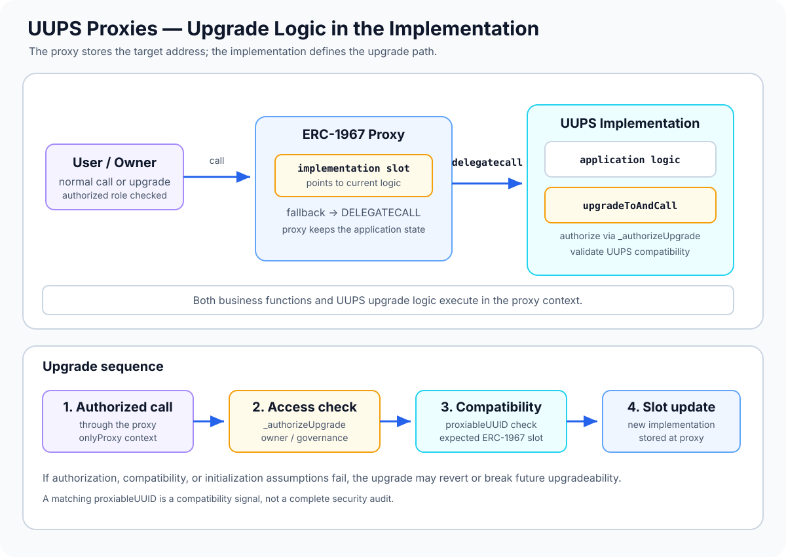

# UUPS Proxies: Upgrade Logic Lives in the Implementation

> **Stage:** 04 — Smart Contract Architecture  
> **Priority:** 1  
> **Status:** Reviewed  
> **Last reviewed:** 2026-10-17

## 1. Overview

**UUPS** stands for *Universal Upgradeable Proxy Standard*. In the UUPS pattern, a proxy provides the stable address and delegates calls to an implementation, while the **upgrade mechanism itself lives in the implementation contract**. The proxy is commonly an ERC-1967 proxy, which stores the current implementation address in a standardized storage slot.

This is the main distinction from a Transparent Proxy:

- **UUPS:** the implementation contains the upgrade function and its authorization logic.
- **Transparent Proxy:** the proxy has its own administrative dispatch and upgrade mechanism.

OpenZeppelin's `ERC1967Proxy` is not upgradeable by itself. It becomes upgradeable when its implementation includes a mechanism such as `UUPSUpgradeable` and correctly authorizes upgrades. UUPS reduces the upgrade-related logic required in the proxy, but places more responsibility on the implementation code and its upgrade authorization.



This article uses **OpenZeppelin Contracts Upgradeable 5.x** for implementation-specific terminology and examples. Always match the installed library version and upgrade tooling to the actual contract being deployed.

## 2. Why It Matters to a Developer

UUPS is a common upgradeability architecture and a good example of how EVM execution context, storage layout, access control, and implementation validation interact.

Understanding it helps you:

- explain why the proxy can remain at a stable address while its implementation changes;
- locate upgrade authority in `_authorizeUpgrade`, rather than assuming the proxy owns an independent admin interface;
- understand how `onlyProxy` and `notDelegated` restrict the context in which UUPS functions run;
- recognize the role of `proxiableUUID()` in checking that an implementation uses the expected implementation slot;
- avoid accidentally removing the upgrade mechanism during an upgrade;
- validate upgrade authorization, initialization, storage compatibility, and the full deployment path.

## 3. How a UUPS Upgrade Works

A typical UUPS setup uses an ERC-1967 proxy and a UUPS-capable implementation:

1. Deploy the implementation contract containing the application logic and UUPS upgrade mechanism.
2. Deploy an ERC-1967 proxy pointing to that implementation. Supply encoded initializer data so the initial state is configured in the proxy's storage during deployment.
3. Users call the proxy address. The proxy delegates those calls to the implementation.
4. An authorized account calls the implementation's upgrade entry point **through the proxy**.
5. The implementation's authorization hook, usually `_authorizeUpgrade(address)`, checks whether that caller may upgrade.
6. The UUPS mechanism validates the candidate implementation's compatibility according to the library's UUPS checks, then updates the ERC-1967 implementation slot in the proxy's storage.
7. If upgrade call data was provided, the mechanism can call a setup or reinitializer function on the new implementation through the proxy context.

The upgrade transaction is executed against the proxy address, so writing the implementation slot changes which code that proxy uses. Calling the same UUPS upgrade function directly on the implementation address is not the normal proxy-upgrade path and is rejected by OpenZeppelin's `onlyProxy` check.

## 4. The Role of `UUPSUpgradeable`

OpenZeppelin's UUPS module provides several pieces that work together.

### `upgradeToAndCall`

This entry point requests an implementation upgrade and can execute an additional call after the upgrade, commonly to initialize newly added state. In OpenZeppelin Contracts 5.x, `upgradeToAndCall(address,bytes)` is the standard upgrade entry point.

The upgrade flow invokes the authorization hook and performs the UUPS implementation-compatibility check before changing the implementation. The additional call is executed in the proxy's context, which is essential when it writes application storage.

### `_authorizeUpgrade(address newImplementation)`

This is the **project-specific authorization hook**. It must be overridden to restrict who can upgrade the contract. A common policy uses `onlyOwner`; a production protocol might use a multisig or governance contract.

Leaving this hook unprotected, weakening it accidentally, or relying on the wrong owner initialization can allow an attacker to replace the contract's logic.

### `onlyProxy`

This modifier checks that the function is being executed through delegate-call context and that the proxy's current implementation points to the implementation contract containing this UUPS code. It helps prevent the upgrade entry point from being used as though the implementation contract itself were the proxy.

### `proxiableUUID()` and `notDelegated`

`proxiableUUID()` reports the storage slot the implementation expects to use for the implementation address. OpenZeppelin uses it to check that a candidate implementation is compatible with the expected UUPS slot.

The function is guarded so it cannot be successfully invoked through a proxy context. This is important: if a proxy delegated its own compatibility query back to itself, it could create a dangerous self-reference and exhaust gas.

The compatibility check is a safeguard, not a complete audit. A contract may implement the expected UUID while still having incorrect authorization, incompatible application storage, or malicious application logic.

## 5. Example: A UUPS Upgradeable Contract

The example below illustrates the structure used with OpenZeppelin Contracts Upgradeable 5.x. It is a teaching example, not a complete deployment project.

```solidity
// SPDX-License-Identifier: MIT
pragma solidity ^0.8.24;

import {Initializable} from
    "@openzeppelin/contracts-upgradeable/proxy/utils/Initializable.sol";
import {OwnableUpgradeable} from
    "@openzeppelin/contracts-upgradeable/access/OwnableUpgradeable.sol";
import {UUPSUpgradeable} from
    "@openzeppelin/contracts-upgradeable/proxy/utils/UUPSUpgradeable.sol";

contract VaultV1 is Initializable, OwnableUpgradeable, UUPSUpgradeable {
    uint256 public storedValue;

    /// @custom:oz-upgrades-unsafe-allow constructor
    constructor() {
        _disableInitializers();
    }

    function initialize(address initialOwner) public initializer {
        __Ownable_init(initialOwner);
    }

    function setStoredValue(uint256 newValue) external onlyOwner {
        storedValue = newValue;
    }

    function _authorizeUpgrade(address newImplementation)
        internal
        override
        onlyOwner
    {}
}
```

Key points:

- `initialize` configures the **proxy's** owner and state when called through the proxy. A constructor alone would only initialize the implementation contract's storage.
- `_disableInitializers()` protects the implementation instance from being initialized directly. The proxy still needs its own initializer call.
- `onlyOwner` restricts upgrade requests to the owner recorded in proxy storage. That owner must be initialized securely.
- `_authorizeUpgrade` is deliberately not a general public function; the UUPS upgrade path calls this internal hook before changing implementations.

The NatSpec annotation shown above is used by OpenZeppelin's upgrade tooling to acknowledge the implementation constructor that disables initializers. Follow the validation workflow for your installed version rather than copying annotations blindly.

A deployable project also needs a compatible ERC-1967 proxy, correctly encoded initialization data, dependency versions, and tests using the chosen Foundry or Hardhat upgrade tooling. The snippet has not been compiled or run as part of this article.

## 6. UUPS vs. Transparent Proxies

Both patterns commonly use ERC-1967's implementation slot and delegate calls to the implementation, but they put upgrade logic in different places.

| Aspect | UUPS | Transparent Proxy |
|---|---|---|
| Upgrade mechanism | In the implementation | In the proxy's administrative dispatch |
| Authorization policy | Implementation hook such as `_authorizeUpgrade` | Proxy admin path, typically managed through `ProxyAdmin` in OpenZeppelin 5.x |
| Upgrade-related proxy code | Minimal ERC-1967 proxy can be used | Proxy includes transparent admin/upgrade dispatch |
| Can a faulty upgrade remove future upgradeability? | Yes, if upgrade logic is removed or disabled by a future implementation | Proxy's own upgrade dispatch remains, although bad implementation code can still break application behavior |
| Main review focus | Implementation authorization, UUPS compatibility checks, and upgrade-code preservation | Admin identity, transparent call routing, and upgrade authorization |

Neither pattern is automatically safe. The choice changes which contract contains the upgrade mechanism and which authorization path must be reviewed.

### An important mixing hazard

A UUPS-compatible implementation can use the same ERC-1967 implementation slot as a Transparent Proxy. If such an implementation is placed behind a Transparent Proxy, non-admin callers may be forwarded to the implementation's UUPS upgrade function. Therefore, the Transparent Proxy's admin separation does **not** automatically disable UUPS upgrade logic in the implementation.

Whether this creates an exploitable route depends on the implementation's authorization checks and the exact composition. Avoid combining patterns without a deliberate design and tests.

## 7. Storage and Initialization Rules Still Apply

UUPS does not eliminate the ordinary risks of upgradeable contracts.

- **Proxy storage is persistent state.** New implementation code reads and writes the storage belonging to the proxy.
- **Constructors do not initialize proxy state.** Use initializer functions and encode initial setup data into proxy deployment when possible.
- **Storage layout must remain compatible.** Reordering or changing existing state variables can cause new code to interpret old values incorrectly. Use storage validation tooling and follow the layout rules of the framework in use.
- **New state may require a reinitializer.** Any post-upgrade setup must have controlled access and protection against unintended replay.
- **Upgrade permission does not prove the new implementation is safe.** Validate code, storage compatibility, initializer behavior, and all externally reachable functions before approving the change.

For the general delegate-call storage model, see [Proxy Contracts](05-proxy-contracts.md). For caller-based admin dispatch, see [Transparent Proxies](06-transparent-proxies.md).

## 8. Common Mistakes and Security Considerations

1. **Leaving `_authorizeUpgrade` unprotected.** Treat upgrade authorization as a critical security boundary. Verify the actual owner or governance role stored in proxy state.
2. **Calling the UUPS upgrade function on the implementation directly.** In OpenZeppelin's implementation, `onlyProxy` requires the appropriate delegate-call context through a proxy that currently points to this implementation.
3. **Forgetting the initializer.** A proxy with uninitialized ownership or application state may be claimed or misconfigured by another account.
4. **Assuming implementation constructors initialize the proxy.** Constructors execute during implementation deployment and do not initialize the proxy's storage.
5. **Removing upgrade logic in a future implementation.** If a new version drops the UUPS upgrade entry point or its authorization path, future upgrades may become impossible.
6. **Bypassing the compatibility check.** Custom upgrade code that skips UUPS validation can allow an incompatible implementation to be installed.
7. **Treating `proxiableUUID()` as a security audit.** Matching the expected slot only addresses a specific compatibility property; it does not prove the implementation is benign or storage-compatible.
8. **Breaking storage layout.** A new implementation must preserve the meaning and location of existing state according to the project's upgrade rules.
9. **Confusing code context and storage context.** The logic comes from the implementation, while `address(this)`, balance, and storage operations operate in the proxy context during delegate call.
10. **Misunderstanding ownership.** The `onlyOwner` check must read the intended owner from proxy storage and the initializer must set that owner correctly.
11. **Mixing UUPS with Transparent Proxy without reviewing all upgrade paths.** A non-admin caller might reach implementation-level upgrade logic when forwarded by a Transparent Proxy.
12. **Testing only the implementation.** Tests must deploy a proxy, initialize it, call functions through the proxy, authorize and reject upgrades, and confirm state is preserved after upgrading.
13. **Ignoring upgrade-and-call behavior.** If extra call data is supplied, review the target function, value behavior, access conditions, and failure handling.
14. **Relying on version assumptions.** OpenZeppelin 4.x and 5.x have API differences. Check the installed version and its documentation before adapting examples.

## 9. Developer Review Checklist

- [ ] Explain why UUPS upgrade logic is in the implementation rather than the proxy.
- [ ] Identify the ERC-1967 proxy and the implementation contract.
- [ ] Trace an authorized upgrade from caller through `_authorizeUpgrade` to the implementation-slot update.
- [ ] Explain the purpose of `onlyProxy`, `notDelegated`, and `proxiableUUID()`.
- [ ] Initialize the proxy securely and disable direct initialization of the implementation where appropriate.
- [ ] Verify the authorization policy and test both allowed and denied callers.
- [ ] Validate the candidate implementation and storage compatibility before upgrading.
- [ ] Confirm future implementations preserve a safe upgrade path.
- [ ] Test upgrade-and-call initialization and expected revert behavior.
- [ ] Audit for unintended UUPS upgrade routes if the implementation is paired with a different proxy pattern.

## 10. Key Takeaways

- UUPS means the upgrade mechanism lives in the implementation; the proxy provides delegated execution and the ERC-1967 implementation slot.
- A basic ERC-1967 proxy is not upgradeable unless the implementation provides a safe, authorized upgrade mechanism.
- `_authorizeUpgrade` is the critical project-specific hook for access control.
- `onlyProxy` restricts upgrade execution to the expected proxy context; `proxiableUUID()` helps validate the implementation slot and is protected from proxy-context invocation.
- Constructors initialize the implementation instance, not proxy state. Use secure initialization and disable direct implementation initialization when appropriate.
- A successful UUPS compatibility check does not guarantee correct authorization, safe business logic, or compatible storage.
- Review every upgrade path, test through the proxy, and use version-matched OpenZeppelin upgrade tooling.

## References

1. **[OpenZeppelin Contracts 5.x — Proxy API: UUPSUpgradeable](https://docs.openzeppelin.com/contracts/5.x/api/proxy#UUPSUpgradeable)** — `onlyProxy`, `notDelegated`, `proxiableUUID`, `upgradeToAndCall`, and `_authorizeUpgrade`.
2. **[OpenZeppelin Upgrades — Proxy Pattern](https://docs.openzeppelin.com/upgrades-plugins/proxies)** — proxy storage context, implementation separation, storage collisions, and upgrade patterns.
3. **[OpenZeppelin Upgrades — FAQ](https://docs.openzeppelin.com/upgrades-plugins/faq)** — why upgrade functions must exist in a UUPS implementation and the risk of accidentally disabling future upgrades.
4. **[ERC-1822 — Universal Upgradeable Proxy Standard](https://eips.ethereum.org/EIPS/eip-1822)** — original UUPS terminology and the role of implementation compatibility checks.
5. **[ERC-1967 — Proxy Storage Slots](https://eips.ethereum.org/EIPS/eip-1967)** — standardized storage locations used by common proxy implementations.
6. **[Proxy Contracts](05-proxy-contracts.md)** — general proxy forwarding and delegate-call execution context.
7. **[Transparent Proxies](06-transparent-proxies.md)** — caller-based administrative dispatch and its differences from UUPS.
