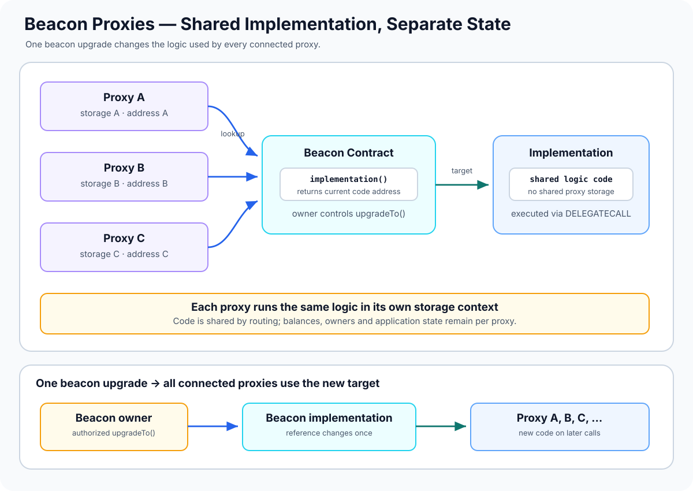

# Beacon Proxies: Upgrading Many Proxies Through One Beacon

> **Stage:** 04 — Smart Contract Architecture  
> **Priority:** 1  
> **Status:** Reviewed  
> **Last reviewed:** 2026-10-17

## 1. Overview

A **Beacon Proxy** is a proxy that obtains its implementation address from a separate **beacon contract**. Rather than storing an implementation address independently as the main routing source in each proxy, many proxy instances can refer to the same beacon. The beacon exposes an `implementation()` function that returns the logic contract address to use.

The core architecture has three parts:

- **Beacon Proxy:** the stable address each user or integration calls. It forwards calls using `DELEGATECALL`.
- **Beacon:** the shared address that reports which implementation the proxy should use.
- **Implementation:** the contract containing application logic executed in each proxy's own storage context.

An authorized beacon upgrade can change the implementation returned by the beacon, affecting all proxies that use that beacon—without submitting a separate upgrade transaction to every proxy. This makes the pattern useful for systems managing many similar contract instances.



This article describes the pattern using **OpenZeppelin Contracts 5.x** for implementation-specific details. Other implementations may manage beacon addresses, initialization, and upgrades differently.

## 2. Why It Matters to a Developer

Beacon Proxies are useful when a protocol creates many instances that should run the same code version while keeping separate state. Examples can include account instances, vaults, or product instances created by a factory.

Understanding Beacon Proxies helps you:

- distinguish a proxy's own address from its beacon and implementation addresses;
- explain how one beacon upgrade can change the behavior of many proxies;
- reason about why each proxy still has separate storage and balances;
- audit beacon ownership, implementation validation, and upgrade events;
- understand the ERC-1967 beacon slot and how explorers or monitoring systems resolve the implementation;
- evaluate the trade-off between operational efficiency and a shared upgrade risk.

## 3. How the Beacon Pattern Works

A typical system works like this:

1. Deploy an implementation contract containing application logic.
2. Deploy a beacon that stores or otherwise resolves the current implementation address. In OpenZeppelin's `UpgradeableBeacon`, the owner is authorized to upgrade this address.
3. Deploy one or more `BeaconProxy` instances configured to use that beacon. Each proxy can be initialized with its own parameters.
4. A user calls one proxy address.
5. The proxy asks its configured beacon for the current implementation address, then uses `DELEGATECALL` to execute that implementation's code.
6. Application state reads and writes occur in the calling proxy's storage context.
7. To upgrade the shared implementation, an authorized owner calls the beacon's upgrade function. Proxies connected to that beacon then use the new implementation on subsequent delegated calls.

The beacon supplies **which code address** to use; it does not hold the application state for every proxy. If there are 500 proxies using one beacon, they are 500 separate storage contexts even though their delegated logic comes from the same implementation address.

## 4. The `IBeacon` Interface

A beacon compatible with the standard pattern exposes an implementation lookup function:

```solidity
interface IBeacon {
    function implementation() external view returns (address);
}
```

The function must return an address that can be used as a delegate-call target. Under ERC-1967, the result **should not depend on `msg.sender`**; otherwise, different proxies could receive different implementation addresses from the same beacon depending on who is making the query.

A correct implementation lookup is a critical dependency. If the beacon returns an invalid, unintended, or malicious implementation address, the connected proxies can all break or execute unexpected logic. OpenZeppelin's `UpgradeableBeacon` validates that an upgrade target is a contract, but having code at an address does not prove that the code is safe or storage-compatible.

## 5. What Is Stored Where?

Beacon architecture separates routing metadata from application state.

| Component | Main responsibility | State or data it controls |
|---|---|---|
| Beacon Proxy | Stable entry point and delegate-call forwarding | Its own application storage; configured beacon reference |
| Beacon | Resolve the current implementation | Current implementation address and upgrade ownership, depending on design |
| Implementation | Execute application logic | Code; its own direct storage is separate from storage used through proxies |

### ERC-1967 beacon slot

ERC-1967 defines a standardized beacon storage slot:

`0xa3f0ad74e5423aebfd80d3ef4346578335a9a72aeaee59ff6cb3582b35133d50`

This slot identifies the beacon associated with a proxy. When a beacon is used, the ERC-1967 implementation slot should be empty; clients determine the logic target by reading the beacon address and then calling `implementation()` on that beacon.

In **OpenZeppelin Contracts 5.x**, `BeaconProxy` stores the beacon address in an immutable variable for efficient runtime access and also records it in the ERC-1967 beacon slot for observability. Because the immutable address is the one used internally for routing, using implementation logic to alter the beacon slot can create an inconsistency between the value seen by off-chain tools and the beacon actually used by the proxy. Do not write to proxy metadata slots from implementation code.

The `implementation()` result is not the application's storage owner. It is only the address of the code target.

## 6. Upgrading the Beacon

With OpenZeppelin's `UpgradeableBeacon`, the owner can call `upgradeTo(newImplementation)`. The beacon validates the candidate as a contract and emits an `Upgraded` event when the implementation changes.

At a high level, the upgrade path is:

1. The authorized owner submits an upgrade transaction to the beacon.
2. The beacon checks the caller's ownership permission and validates the new implementation address according to its rules.
3. The beacon updates the implementation address and emits its upgrade event.
4. Each connected Beacon Proxy uses the new implementation on later calls.

There is no need to change each proxy's address or send an upgrade transaction to every proxy separately. This is the operational advantage of the pattern.

However, "one upgrade affects all proxies" also means the blast radius is shared. A faulty implementation can break every connected instance, and the beacon owner becomes a critical trust boundary. An owner, governance process, or private key that is compromised may be able to change behavior across the whole group.

## 7. Initialization and Per-Proxy State

Beacon Proxies commonly use the same implementation but initialize each instance with different application state.

For example, two vault proxies might point to the same implementation while storing different owners, assets, or configuration values in their respective proxy storage. During deployment, `BeaconProxy` can accept initialization calldata; in OpenZeppelin's implementation, nonempty data is delegated to the current implementation to initialize that proxy's storage context.

The implementation constructor does **not** initialize each proxy's state. Each proxy needs its own correctly protected initialization flow. Depending on the system, initialization data may be supplied atomically when the proxy is deployed, preventing another transaction from claiming an uninitialized instance first.

Do not initialize all instances with shared privileged values unintentionally. Factory logic, encoded constructor data, authorization, and replay protection should be reviewed together.

## 8. Beacon Proxies vs. Transparent and UUPS Proxies

| Aspect | Beacon Proxy | Transparent Proxy | UUPS Proxy |
|---|---|---|---|
| Where implementation address is resolved | Shared beacon contract | Each proxy's implementation metadata | Each proxy's implementation metadata |
| Where upgrade logic is typically handled | Beacon contract | Proxy's administrative mechanism | Implementation contract |
| Scope of a routine upgrade | All proxies using the beacon | A single proxy per upgrade | A single proxy per upgrade |
| Per-instance storage | Separate storage per proxy | Separate storage per proxy | Separate storage per proxy |
| Main operational concern | Shared beacon authority and fleet-wide compatibility | Admin routing and authorization | Implementation upgrade authorization and preserving upgrade logic |

A beacon pattern is not merely a cheaper variant of Transparent or UUPS. It introduces an extra contract and shared upgrade control, which can simplify fleet management but increases the impact of a bad beacon upgrade.

The relevant earlier articles are [Proxy Contracts](05-proxy-contracts.md), [Transparent Proxies](06-transparent-proxies.md), and [UUPS Proxies](07-uups-proxies.md).

## 9. Common Mistakes and Security Considerations

1. **Confusing the beacon with the implementation.** The beacon answers which implementation to use; it is not usually the contract containing application functions.
2. **Assuming all proxies share application state.** Proxies may share code via a beacon, but each proxy retains its own storage context and balance.
3. **Underestimating the blast radius of upgrades.** A bad implementation can affect every proxy attached to that beacon. Test compatibility across representative instances before changing it.
4. **Failing to protect beacon ownership.** The beacon owner can generally change the logic for the whole fleet. Use a deliberately chosen governance or multisig model where warranted.
5. **Checking only that an implementation address contains code.** A contract at the target address may still be malicious, incompatible, or semantically incorrect.
6. **Breaking storage compatibility.** Existing proxies keep their data; new implementation code must interpret that data correctly across all relevant instances.
7. **Ignoring per-proxy initialization.** Each proxy needs its own safe initialization even when every instance uses the same implementation. Uninitialized proxies may be claimed or misconfigured.
8. **Making the beacon lookup depend on the caller.** ERC-1967 states that `implementation()` should not depend on `msg.sender`. Caller-dependent routing can make behavior inconsistent across proxies.
9. **Writing to the ERC-1967 beacon slot from implementation code.** In OpenZeppelin Contracts 5.x, the runtime beacon reference is immutable; altering the reported slot can mislead tools and create inconsistent metadata.
10. **Monitoring only the proxy address.** Implementation changes occur at the beacon. Monitor beacon ownership and `Upgraded` events, and resolve the implementation address when investigating behavior.
11. **Assuming a shared upgrade is atomic across application state.** The beacon changes one shared target reference; it does not migrate all proxies' application storage for you. Any state migration must be deliberately designed and executed.
12. **Testing only one instance.** Proxies may have different historical state, initializer parameters, or roles. Check storage compatibility and behavior across the fleet before an upgrade.
13. **Using the beacon as a trustless validation service.** The beacon selects code but does not prove its safety. Independent review, upgrade validation, tests, and monitoring remain necessary.
14. **Confusing beacon proxies with minimal clones.** Both can help many instances reuse code, but their addressing and upgrade mechanisms differ. A standard ERC-1167 minimal clone normally points to a fixed implementation rather than a shared upgradeable beacon.

## 10. Developer Review Checklist

- [ ] Identify the proxy, beacon, and implementation addresses.
- [ ] Explain how `implementation()` determines the code used for a delegated call.
- [ ] Confirm the beacon returns a valid implementation independently of `msg.sender`.
- [ ] Identify who owns the beacon and can change the implementation.
- [ ] Confirm each proxy has independent storage and a protected initialization flow.
- [ ] Inspect the ERC-1967 beacon slot and the implementation lookup result when investigating a deployment.
- [ ] Validate storage compatibility for every relevant proxy instance before upgrading the beacon.
- [ ] Monitor beacon ownership and upgrade events, not only individual proxy metadata.
- [ ] Test both a successful upgrade and rejected unauthorized or invalid upgrades.
- [ ] Assess the fleet-wide impact and rollback/incident plan for a bad implementation.

## 11. Key Takeaways

- A Beacon Proxy gets its implementation address from a separate beacon contract.
- Many proxies can use one beacon, allowing the implementation used by the group to be changed through a single beacon upgrade.
- Shared code does not mean shared application storage: each proxy executes delegated code in its own storage context.
- ERC-1967 defines a beacon slot and recommends that `implementation()` not depend on `msg.sender`.
- In OpenZeppelin Contracts 5.x, the beacon address is immutable for runtime routing; changing the ERC-1967 beacon slot from implementation code can make observable metadata inconsistent with actual routing.
- The beacon's owner and its selected implementation are critical security boundaries because a bad upgrade can affect the whole fleet.
- Validate upgrade safety and storage compatibility across all affected instances; a beacon upgrade does not automatically migrate per-proxy state.

## References

1. **[OpenZeppelin Contracts 5.x — Proxy API](https://docs.openzeppelin.com/contracts/5.x/api/proxy#BeaconProxy)** — `BeaconProxy`, `IBeacon`, `UpgradeableBeacon`, immutable beacon behavior, initialization, and beacon upgrades.
2. **[ERC-1967 — Proxy Storage Slots](https://eips.ethereum.org/EIPS/eip-1967)** — standardized beacon slot, how clients resolve the implementation through a beacon, and the requirement that `implementation()` should not depend on `msg.sender`.
3. **[OpenZeppelin Upgrades Plugins — Proxy Patterns](https://docs.openzeppelin.com/upgrades-plugins)** — deployment and upgrade operations for beacon proxies compared with Transparent and UUPS proxies.
4. **[Proxy Contracts](05-proxy-contracts.md)** — general proxy forwarding and delegate-call storage context.
5. **[Transparent Proxies](06-transparent-proxies.md)** — proxy-admin routing and individual proxy upgrades.
6. **[UUPS Proxies](07-uups-proxies.md)** — implementation-resident upgrade logic and authorization.
