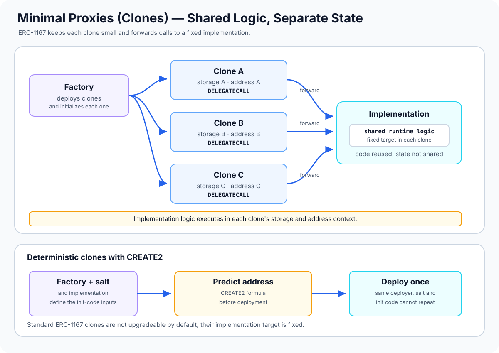

# Minimal Proxies (Clones): Reusing Logic with Low-Cost Deployments

> **Stage:** 04 — Smart Contract Architecture  
> **Priority:** 1  
> **Status:** Reviewed  
> **Last reviewed:** 2026-10-17

## 1. Overview

A **minimal proxy**, commonly called a **clone**, is a small contract that forwards calls to a fixed implementation address using `DELEGATECALL`. Instead of deploying a full copy of the implementation's runtime code for every instance, a factory can deploy a short forwarding contract that reuses the same implementation code.

The Ethereum standard **[ERC-1167](https://eips.ethereum.org/EIPS/eip-1167)** specifies a standard minimal bytecode pattern for this purpose. The target implementation address is embedded into the clone's runtime bytecode, so standard ERC-1167 clones are designed to forward to a fixed target rather than provide a built-in upgrade mechanism.

A common clone system has two parts:

- **Implementation:** the contract that contains the reusable logic.
- **Clone:** an individual contract address that forwards calls to the implementation while using the clone's own storage and account context.

A factory commonly deploys the implementation once, then creates many clones with separately initialized state. This is useful for account instances, vaults, staking positions, game entities, and other designs where many contracts share the same logic but need distinct state.



## 2. Why It Matters to a Developer

Clones can reduce the deployment cost of creating many similar contract instances. They also introduce a specific execution model that developers need to understand.

- **Lower deployment cost:** each clone deploys a small forwarding bytecode instead of the full logic contract's bytecode.
- **Shared logic:** a bug fix usually requires deploying a new implementation and deciding how new instances should use it; existing standard clones continue targeting the implementation embedded when they were deployed.
- **Independent state:** each clone has its own storage, balances, and address even though the implementation code is shared.
- **Factory-based creation:** a factory can deploy and initialize a clone within one transaction, reducing the chance that an uninitialized clone is claimed by another caller.
- **Deterministic addresses:** clones deployed with `CREATE2` can have their addresses predicted in advance if the implementation, deployer, salt, and creation-code hash are known.

The trade-off is that calls include forwarding overhead compared with executing the full contract directly, and all clones rely on the behavior of the same implementation address.

## 3. How an ERC-1167 Clone Works

A typical call follows this path:

1. A user calls the clone's address.
2. The clone's minimal runtime bytecode forwards the call data to its fixed implementation using `DELEGATECALL`.
3. The implementation code executes in the clone's context.
4. Storage reads and writes affect the clone's storage, not the implementation's storage.
5. The clone relays the implementation's return data or revert data to the caller.

Because execution uses `DELEGATECALL`:

| Property during clone execution | Context |
|---|---|
| Code being executed | Fixed implementation's bytecode |
| `address(this)` | Clone address |
| Persistent storage | Clone's storage |
| ETH balance context | Clone's balance |
| `msg.sender` | Sender of the message that called the clone |
| Implementation target | Address embedded in the standard clone bytecode |

As with other delegate-call patterns, values such as `msg.sender` and `msg.value` follow the current message-call context. If a factory calls a clone's initializer, the initializer sees the factory as its immediate caller; the factory should pass the intended user or owner explicitly as an argument when required.

## 4. Deploying Clones with OpenZeppelin

OpenZeppelin's `Clones` library provides functions for creating standard minimal proxies. In OpenZeppelin Contracts 5.x, import it from:

```solidity
import {Clones} from "@openzeppelin/contracts/proxy/Clones.sol";
```

The primary methods are:

- `Clones.clone(implementation)`: deploys a clone using `CREATE`.
- `Clones.cloneDeterministic(implementation, salt)`: deploys a clone using `CREATE2` and a salt.
- `Clones.predictDeterministicAddress(...)`: predicts the address for a deterministic clone deployment.
- OpenZeppelin 5.x also offers immutable-argument variants; these are additional library patterns and should not be confused with the original minimal bytecode specified by ERC-1167.

The library does not automatically make a clone upgradeable. Standard clones have the implementation address embedded in their code, and an upgrade mechanism is not supplied by `clone` or `cloneDeterministic`.

### Example: A small implementation and factory

This illustrative example uses an initializer because the implementation's constructor does not initialize clone storage.

```solidity
// SPDX-License-Identifier: MIT
pragma solidity ^0.8.24;

import {Clones} from "@openzeppelin/contracts/proxy/Clones.sol";

contract AccountImplementation {
    bool private initialized;
    address public owner;
    uint256 public number;

    // Lock the implementation's own storage.
    // Clones have separate storage and start with initialized == false.
    constructor() {
        initialized = true;
    }

    function initialize(address owner_, uint256 number_) external {
        require(!initialized, "Already initialized");
        require(owner_ != address(0), "Zero owner");

        initialized = true;
        owner = owner_;
        number = number_;
    }

    function setNumber(uint256 number_) external {
        require(msg.sender == owner, "Not owner");
        number = number_;
    }
}

contract AccountFactory {
    address public immutable implementation;

    event CloneCreated(address indexed clone, address indexed owner);

    constructor() {
        implementation = address(new AccountImplementation());
    }

    function createAccount(uint256 initialNumber)
        external
        returns (address clone)
    {
        clone = Clones.clone(implementation);

        // The implementation sees the factory as msg.sender during this call,
        // so the intended owner is passed explicitly.
        AccountImplementation(clone).initialize(msg.sender, initialNumber);

        emit CloneCreated(clone, msg.sender);
    }
}
```

In this example, the factory deploys one implementation and uses it for every clone. Each clone's initializer sets that clone's owner and number in the clone's own storage. The implementation constructor sets `initialized = true` only in the implementation's storage; it does not set the flag in newly deployed clones.

The factory creates and initializes each clone in one transaction. If initialization reverts, the transaction also reverts, so the just-created clone deployment is rolled back. A production system should additionally consider access policy for factory functions, expected ownership, input validation, reentrancy around any added external interactions, and tests for the chosen library version.

This code is a teaching example and has **not** been compiled or run in Foundry or Hardhat as part of this article.

## 5. Initialization Is Per Clone

Standard clones do not copy the implementation contract's storage values. They execute its code against fresh storage at each clone address. As a result:

- Constructor writes and state-variable initializers performed when deploying the implementation do not initialize clones.
- Each clone typically needs an initializer function to set owner, configuration, and other instance state.
- An initializer should be callable only once for each clone.
- The implementation itself should be protected from unsafe direct initialization where appropriate.
- A factory should normally initialize the clone as part of the same transaction that creates it.

If a factory deploys a clone and returns its address before initializing it in a later transaction, another account may call the initializer first unless the design prevents that. This can let an attacker set the owner or configuration of the instance.

A clone's storage is independent, but state encoded in the shared implementation's code is shared. For example, Solidity `immutable` values are embedded in implementation bytecode; every clone delegating to that implementation observes those same immutable values. Use per-clone storage or an intentional immutable-arguments design when configuration must differ by instance.

## 6. Deterministic Clones with CREATE2

`Clones.cloneDeterministic(implementation, salt)` uses the EVM's `CREATE2` opcode rather than ordinary `CREATE`. This makes it possible to predict the clone address before deployment, provided the inputs are known.

The `CREATE2` address is derived from:

`keccak256(0xff ++ deployerAddress ++ salt ++ keccak256(initCode))[12:]`

Where:

- `deployerAddress` is the address of the contract or account executing `CREATE2`. In a factory design, this is usually the factory address.
- `salt` is a caller-supplied `bytes32` value chosen by the factory or caller.
- `initCode` is the exact creation bytecode used by `CREATE2`; for a deterministic clone it depends on the clone creation code and implementation address.

Changing the deployer, salt, or creation-code hash changes the predicted address. The same deployer, salt, and init code cannot be used to deploy a second contract at the same address; a repeated deployment attempt reverts.

OpenZeppelin provides `predictDeterministicAddress` helpers so developers should generally use the library's matching prediction function rather than manually reconstructing clone bytecode hashes. Address prediction only tells you where a contract would be deployed; it does not prove that it is deployed, initialized, safe, or controlled by the intended owner.

## 7. Minimal Clones vs. Other Proxy Patterns

| Pattern | Where the implementation target is resolved | Typical upgrade model | Primary use |
|---|---|---|---|
| ERC-1167 minimal clone | Fixed address embedded in clone bytecode | Not upgradeable by default | Cheap deployment of many similar instances |
| Transparent Proxy | Proxy metadata plus caller-aware admin routing | Upgrade through proxy's admin mechanism | A stable address with controlled per-proxy upgrades |
| UUPS Proxy | ERC-1967 implementation slot | Upgrade logic in implementation | A stable address with implementation-controlled upgrades |
| Beacon Proxy | Shared beacon contract | Change beacon's implementation for many proxies | Manage a fleet of similar instances together |

A clone is a good choice when the logic target should stay fixed and low deployment cost is important. It is not a drop-in replacement for an upgradeable proxy.

More complex systems can deliberately point a clone at a contract that performs additional dynamic routing, but that is a separate architecture layered on top of the minimal clone. Do not assume a standard ERC-1167 clone can change its target through the `Clones` library.

## 8. Common Mistakes and Security Considerations

1. **Assuming clones are upgradeable.** Standard ERC-1167 embeds a fixed implementation address. Deploy a new clone or choose an explicit upgradeable architecture if the target must change.
2. **Skipping initialization.** A clone begins with its own fresh storage. Important ownership or configuration may remain unset until initialized.
3. **Initializing in a separate public transaction.** An attacker may initialize the clone first. Prefer atomic deployment and initialization through a factory, or another enforced initialization procedure.
4. **Assuming the implementation's constructor initializes clone state.** It changes implementation storage only. Initializer calls through the clone write to clone storage.
5. **Leaving an implementation or clone initialization path unprotected.** The implementation and each clone have different storage. Locking the implementation does not mean clones are already initialized.
6. **Failing to verify the implementation address has code.** OpenZeppelin's deterministic clone helpers do not necessarily validate that the target contains code. A clone pointing to an address without code may behave unexpectedly, and an initialization call may appear successful without performing the intended setup.
7. **Using the wrong caller context in factories.** When the factory calls the clone, the initializer sees the factory as `msg.sender`. Pass the expected end user or owner explicitly if that is the intended value.
8. **Treating shared implementation logic as per-instance configuration.** All clones execute the same implementation bytecode, including its embedded immutable values. Put mutable per-instance values in clone storage or use a specifically supported immutable-arguments design.
9. **Reusing a CREATE2 salt unintentionally.** The same deployer, salt, and init-code combination cannot be deployed twice at the same address. Define salt derivation and duplicate handling deliberately.
10. **Assuming a predicted address is proof of a deployed clone.** Prediction is deterministic computation, not a deployment or a security check. Verify code existence and expected initialization separately.
11. **Ignoring implementation bugs.** All clones that share an implementation inherit its logic and bugs. A defect may affect the entire set of instances even though their storage remains separate.
12. **Assuming the lowest deployment cost means every call is cheaper.** Clones reduce deployment bytecode, but each call includes forwarding overhead. Measure deployment and runtime costs for the actual use case.
13. **Testing only the implementation.** Test clone creation, initialization, per-instance storage isolation, return and revert forwarding, unauthorized access, and deterministic address behavior through the clone address.
14. **Mixing library variants without checking assumptions.** Standard ERC-1167 clones, deterministic clones, and immutable-argument clones have different deployment and configuration characteristics. Use matching deployment and prediction helpers.

## 9. Developer Review Checklist

- [ ] Explain how ERC-1167 clones use a small bytecode stub to forward calls.
- [ ] Identify the fixed implementation address embedded in the clone.
- [ ] Demonstrate that `address(this)` and state storage refer to the clone during delegated execution.
- [ ] Initialize every clone exactly once and preferably atomically during factory creation.
- [ ] Ensure implementation and clone initialization states are understood independently.
- [ ] Confirm the implementation target contains code and has been reviewed.
- [ ] Predict CREATE2 addresses with the same deployer, salt, and library implementation used for deployment.
- [ ] Handle duplicate salts and verify deployment status before relying on a predicted address.
- [ ] Test isolation between two clones using the same implementation.
- [ ] Compare clone deployment savings against per-call forwarding cost and operational requirements.

## 10. Key Takeaways

- ERC-1167 standardizes a minimal proxy that forwards calls to a fixed implementation address.
- Clones lower the cost of deploying many instances of shared logic; they do not deploy a full copy of the implementation bytecode each time.
- Delegate-call execution keeps storage and account context at each clone address, so each clone has independent application state.
- Standard clones are not upgradeable by default because the implementation address is fixed in their bytecode.
- Each clone must be initialized independently; implementation constructor state is not copied into clone storage.
- `CREATE2` supports predictable clone addresses through the deployer, salt, and init-code hash.
- Safe clone factories should validate targets, initialize atomically, test storage isolation, and understand the shared risk of implementation bugs.

## References

1. **[ERC-1167 — Minimal Proxy Contract](https://eips.ethereum.org/EIPS/eip-1167)** — canonical minimal forwarding bytecode, fixed implementation target, return/revert propagation, and motivation for low-cost deployment.
2. **[OpenZeppelin Contracts 5.x — Proxy API: Clones](https://docs.openzeppelin.com/contracts/5.x/api/proxy#Clones)** — `clone`, `cloneDeterministic`, address prediction, and immutable-argument variants.
3. **[EIP-1014 — Skinny CREATE2](https://eips.ethereum.org/EIPS/eip-1014)** — deterministic contract address derivation and collision behavior for CREATE2.
4. **[OpenZeppelin Upgrades — Writing Upgradeable Contracts](https://docs.openzeppelin.com/upgrades-plugins/writing-upgradeable)** — initializer design, repeated-initialization prevention, and locking implementation contracts.
5. **[Proxy Contracts](05-proxy-contracts.md)** — delegate-call execution context and the separation between code and storage.
6. **[Beacon Proxies](08-beacon-proxies.md)** — comparison with proxies that resolve implementations through a shared beacon.
