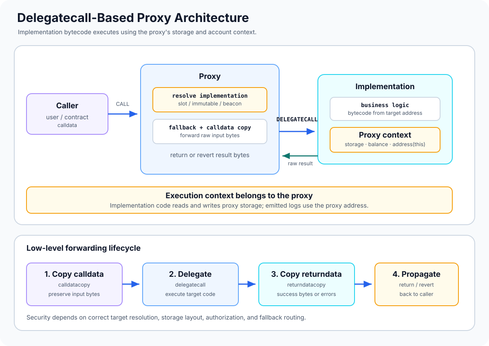

# Delegatecall-Based Proxy Architecture: How the EVM Executes Forwarded Logic

> **Stage:** 04 — Smart Contract Architecture  
> **Priority:** 1  
> **Status:** Reviewed  
> **Last reviewed:** 2026-10-17

## 1. Overview

A **delegatecall-based proxy** is a contract architecture in which one contract receives a call and executes code located at another address using the EVM opcode `DELEGATECALL`. The receiving contract is usually called the **proxy**; the contract that supplies the code is the **implementation** or **logic contract**.

The defining property is that code and execution context are separated:

- **Code source:** the implementation's bytecode.
- **Execution and storage context:** the proxy's account context.

This allows a user-facing proxy address to keep its state and balance while forwarding the logic for supported calls to a separate implementation. If an upgrade mechanism changes the implementation address, the same proxy address can execute different code later. However, `DELEGATECALL` alone does not make a proxy upgradeable; the proxy needs a deliberate way to resolve or change its implementation.

This article focuses on the low-level execution architecture shared by many proxy patterns, not on one specific administrative pattern. See [Proxy Contracts](05-proxy-contracts.md), [Transparent Proxies](06-transparent-proxies.md), [UUPS Proxies](07-uups-proxies.md), [Beacon Proxies](08-beacon-proxies.md), and [Minimal Proxies (Clones)](09-minimal-proxies-clones.md) for specialized designs.



## 2. Why It Matters to a Developer

Understanding this architecture makes it possible to reason about what a proxy call actually does at the EVM level, rather than treating it as a normal function call.

It helps you:

- explain why an implementation function can update state owned by the proxy;
- understand why `address(this)`, the storage context, and emitted event address refer to the proxy during delegated execution;
- trace calldata, return data, revert data, and nested calls through the proxy boundary;
- recognize why a storage-layout mismatch can corrupt state;
- audit implementation-address resolution and the code trusted to run through `DELEGATECALL`;
- understand the common low-level assembly used by proxy implementations.

## 3. CALL vs. DELEGATECALL

The difference between `CALL` and `DELEGATECALL` is the foundation of this architecture.

| Property | `CALL` to a target contract | `DELEGATECALL` to an implementation |
|---|---|---|
| Bytecode that executes | Target contract's bytecode | Target contract's bytecode |
| Storage/account context | Target contract | Calling contract (the proxy) |
| `address(this)` while target code runs | Target address | Proxy address |
| `msg.sender` in the new execution frame | Calling contract's address | Preserved from the caller's current frame |
| `msg.value` in the new execution frame | Value explicitly supplied to the call | Preserved from the caller's current frame |
| Persistent state writes | Target's storage | Proxy's storage |
| ETH balance context | Target account | Proxy account |

The exact value of `msg.sender` depends on who called the current frame. If a user directly calls a proxy, implementation code reached through `DELEGATECALL` sees that user as `msg.sender`. If another contract called the proxy, the delegated code sees that calling contract. It is not correct to assume that `msg.sender` is always an externally owned account.

This is different from a normal call to the implementation address. Calling the implementation directly runs it in its own account context and accesses its own storage, which may produce behavior very different from calling through the proxy.

## 4. The Execution Flow

A conventional fallback-driven proxy call can be understood as a sequence of steps:

1. The user or another contract sends a message call to the proxy address.
2. Solidity dispatches any function implemented directly by the proxy. If no function matches the calldata, the proxy's `fallback()` may run. An empty-calldata transfer may instead reach `receive()` if one is defined and payable.
3. The proxy resolves the implementation address. The source depends on the pattern: a dedicated storage slot, an immutable address, or a beacon lookup are common choices.
4. The proxy copies or otherwise supplies the incoming calldata to `DELEGATECALL`.
5. The EVM executes implementation bytecode with the proxy's storage and account context.
6. The delegated execution returns data or fails with revert data.
7. The proxy returns those bytes or reverts with the returned error data, so the original caller receives the implementation's outcome.

Important nuance: not every proxy forwards every possible call through fallback. A proxy can implement its own functions, and pattern-specific dispatch logic may process certain selectors before fallback. The exact routing behavior is part of the proxy's architecture and should be reviewed explicitly.

## 5. Anatomy of Low-Level Forwarding

A proxy fallback commonly needs to do four things:

1. Copy the complete incoming calldata.
2. execute `DELEGATECALL` against the selected implementation;
3. copy the returned data; and
4. return the bytes on success or revert with the implementation's failure data.

The following is a minimal **mechanics sketch**, not a production-ready proxy. It assumes that the implementation address has already been resolved and validated by the surrounding design.

```solidity
// SPDX-License-Identifier: MIT
pragma solidity ^0.8.24;

abstract contract DelegatecallForwarder {
    function _implementation()
        internal
        view
        virtual
        returns (address);

    fallback() external payable {
        _delegate(_implementation());
    }

    function _delegate(address implementation) internal {
        assembly {
            // Copy input bytes into memory.
            calldatacopy(0, 0, calldatasize())

            // Execute implementation code in this contract's context.
            let success := delegatecall(
                gas(),
                implementation,
                0,
                calldatasize(),
                0,
                0
            )

            // Read all bytes returned by the delegated call.
            returndatacopy(0, 0, returndatasize())

            // Preserve the implementation's result.
            switch success
            case 0 {
                revert(0, returndatasize())
            }
            default {
                return(0, returndatasize())
            }
        }
    }
}
```

This snippet illustrates how the forwarding boundary is implemented; it is not a complete deployable proxy because it deliberately omits a concrete implementation-address resolver, initialization policy, storage strategy, and any upgrade authorization.

### Why the assembly matters

- `calldatasize()` obtains the number of bytes sent to the proxy.
- `calldatacopy` copies those exact bytes into memory.
- `delegatecall` starts the delegated execution frame and yields a success flag.
- `returndatasize()` reports the size of the last call's return-data buffer.
- `returndatacopy` copies success data or revert data into memory.
- EVM `return` and `revert` terminate the current frame and propagate the data to the caller.

The proxy does not need to understand every ABI function implemented by the target. It can forward the raw calldata and propagate the raw result. This flexibility is useful, but it also means routing and validation cannot be inferred from the proxy's Solidity ABI alone.

## 6. Storage Context, Events, and Address Identity

During delegated execution, implementation code operates on the proxy's context.

### Storage

If implementation code executes `storedValue = 42`, the write goes to the proxy's storage slot for `storedValue` under the storage layout assumed by that code. The implementation's own storage remains unchanged by that delegated write.

This creates a strict requirement: the proxy's storage must be interpreted using a layout compatible with the implementation. If the implementation expects a variable in a slot that contains unrelated proxy or application state, a write can corrupt critical data such as ownership, configuration, or an implementation pointer.

### `address(this)` and ETH balance

Inside the implementation code reached through `DELEGATECALL`, `address(this)` is the proxy address. Operations that observe the current account's balance or interact with its account context therefore concern the proxy.

### Events

An event emitted by implementation code during delegate-call execution is emitted from the proxy's address. Indexers and explorers typically associate the log with the proxy address, even though the event definition and code may come from the implementation.

### Sender and value

`msg.sender` and `msg.value` are preserved from the calling frame for `DELEGATECALL`. If an application relies on either value for authorization or accounting, its logic must be correct for the actual calling path. The proxy does not automatically transform a user into the implementation address.

## 7. Resolving the Implementation Address

The EVM `DELEGATECALL` opcode does not decide which implementation is correct; it simply executes code at the target address in the caller's context. A proxy design must resolve that address.

Common options include:

- **ERC-1967 implementation slot:** the proxy reads a dedicated storage slot to find its current implementation.
- **Immutable target:** a clone-style design embeds a fixed implementation address in runtime bytecode.
- **Beacon lookup:** the proxy asks a beacon for the implementation address.
- **Custom resolver:** a protocol uses its own routing rules, which require especially careful review.

These choices lead to different security and upgrade behaviors. An ERC-1967 proxy with an upgrade path can change its implementation slot under its defined authorization rules. An ERC-1167 minimal clone normally forwards to a fixed address. A beacon proxy resolves the current target through a shared beacon. The use of `DELEGATECALL` is common to these architectures, but it is not itself the upgrade mechanism.

A robust design must ensure that the target is appropriate for the intended proxy, that the address cannot be changed by an unauthorized party, and that any upgrade candidate is compatible with the existing storage state.

## 8. Security Boundaries and Threat Model

`DELEGATECALL` is powerful because implementation code has access to the proxy's context. It must be treated as a trust boundary.

### Untrusted implementation code

A malicious or vulnerable implementation can write to the proxy's storage, change ownership-related slots, modify application balances or accounting, and potentially overwrite proxy metadata slots if it knows their locations. It can also execute external calls with the proxy's address as the account context. Selecting an implementation is therefore equivalent to trusting the code that will operate on the proxy's state and assets.

### Storage collisions

A proxy and implementation must not accidentally assign different meanings to the same storage slots. Established proxy standards such as ERC-1967 reserve dedicated slots for proxy metadata, but they do not automatically guarantee the rest of the application's layout is compatible across upgrades.

### Unprotected implementation changes

If the implementation address can be changed without proper authorization, an attacker may install malicious logic. The correct control depends on the proxy pattern: Transparent Proxy administration, UUPS authorization in the implementation, or beacon ownership each require a distinct review.

### Initialization

Implementation constructors run only for the implementation contract's own storage. Proxy state normally needs an initialization call executed through the proxy. An uninitialized proxy can expose access-control or configuration takeover paths.

### Fallback and selector routing

Functions defined directly on the proxy may take precedence over fallback delegation. If proxy-management selectors overlap with implementation selectors, the exact proxy pattern determines which code handles the call. Test routing from both ordinary callers and administrative identities.

### Reentrancy and external interactions

Delegated implementation code can make external calls and can be reentered through the proxy. Delegate-call architecture does not eliminate reentrancy risks. Apply checks-effects-interactions or a suitable guard where appropriate, and test cross-contract callbacks.

## 9. Common Mistakes

1. **Thinking `DELEGATECALL` is just a normal function call.** The code is borrowed, but storage and account context belong to the calling contract.
2. **Assuming all proxy calls reach the implementation.** Proxy-defined functions and pattern-specific routing may intercept some calls before fallback.
3. **Ignoring calldata and returndata.** A forwarding layer must correctly handle raw input, return values, and revert payloads.
4. **Swallowing implementation failures.** Returning a generic success or dropping revert data can make callers and monitoring systems misinterpret behavior.
5. **Using a mismatched storage layout.** Implementation reads and writes occur in the proxy's storage; slot assumptions must remain compatible.
6. **Trusting a target address without validation.** Confirm code existence, expected implementation identity, and the governance path controlling the target.
7. **Confusing implementation code with implementation state.** A state change executed through a proxy normally changes proxy storage, not implementation storage.
8. **Overlooking event identity.** Logs emitted during delegated execution are associated with the proxy address.
9. **Assuming delegatecall alone provides upgradeability.** The target may be fixed, or a separate resolver/authorization mechanism may be required.
10. **Testing only direct implementation calls.** Run behavior, access-control, event, revert, and storage tests through the real proxy address.
11. **Treating ERC-1967 as a complete security guarantee.** Standard metadata slots reduce one class of collision risk, but authorization, storage compatibility, and implementation safety still require review.
12. **Using a custom assembly proxy without auditing control flow.** Memory handling, return-data propagation, target resolution, and administrative routing all need careful verification.

## 10. Developer Review Checklist

- [ ] Describe the exact path from the caller to the proxy fallback and delegated execution.
- [ ] Explain the context differences between `CALL` and `DELEGATECALL`.
- [ ] Verify where the implementation address comes from and how it can change.
- [ ] Confirm calldata is forwarded correctly and returndata/revert data is propagated.
- [ ] Confirm implementation storage assumptions match the proxy's state layout.
- [ ] Check how `address(this)`, `msg.sender`, `msg.value`, balances, and events behave through the proxy.
- [ ] Review every function or selector handled directly by the proxy.
- [ ] Verify initialization and implementation-upgrade authorization.
- [ ] Test unauthorized access, reverts, callbacks, storage writes, and events through the proxy address.
- [ ] Ensure the implementation is trusted and the deployment has a documented upgrade/incident process.

## 11. Key Takeaways

- A delegatecall-based proxy separates the source of code from the account context in which that code executes.
- `DELEGATECALL` runs implementation code using the caller's storage and account context; `CALL` instead creates a frame in the target's account context.
- A conventional proxy forwards raw calldata and returns or reverts with the implementation's raw result.
- `DELEGATECALL` does not itself determine the target or provide an upgrade mechanism.
- Storage compatibility, authorization, initialization, and routing are critical security responsibilities of the full proxy architecture.
- Logs emitted by delegated code are associated with the proxy address, while the executed bytecode comes from the implementation.
- Use well-reviewed proxy components and test the actual deployed proxy path, not only the implementation in isolation.

## References

1. **[OpenZeppelin Contracts 5.x — Proxy API](https://docs.openzeppelin.com/contracts/5.x/api/proxy)** — proxy fallback behavior, delegated execution, implementation resolution, and return/revert propagation.
2. **[OpenZeppelin Contracts — Proxy.sol source](https://github.com/OpenZeppelin/openzeppelin-contracts/blob/master/contracts/proxy/Proxy.sol)** — implementation of calldata copying, `delegatecall`, returndata copying, and forwarding success or revert data.
3. **[Ethereum.org — EVM Opcodes](https://ethereum.org/en/developers/docs/evm/opcodes/)** — EVM opcode behavior for `DELEGATECALL`, `RETURN`, and `REVERT`.
4. **[ERC-1967 — Proxy Storage Slots](https://eips.ethereum.org/EIPS/eip-1967)** — standardized locations for proxy implementation, admin, and beacon metadata.
5. **[OpenZeppelin — Proxy Patterns](https://www.openzeppelin.com/news/proxy-patterns)** — explanation of delegated execution context and why storage changes affect the caller.
6. **[Proxy Contracts](05-proxy-contracts.md)** — general concepts and reasons to separate a proxy address from the implementation code.
7. **[Minimal Proxies (Clones)](09-minimal-proxies-clones.md)** — fixed-target clones and their forwarding design.
