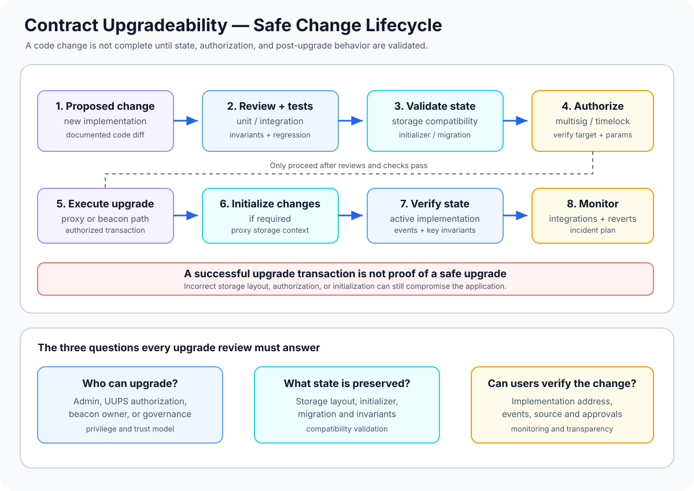

# Contract Upgradeability: Designing Safe Changes After Deployment

> **Stage:** 04 — Smart Contract Architecture  
> **Priority:** 1  
> **Status:** Reviewed  
> **Last reviewed:** 2026-10-17

## 1. Overview

**Contract upgradeability** is the ability to change a smart-contract application's behavior after deployment, while preserving a stable address and—when the architecture supports it—its existing state. Ordinary deployed EVM bytecode is immutable. Upgradeable systems introduce an explicit indirection or modularity mechanism so that new code can be selected without asking every user to switch to a new application address.

Upgradeable contracts commonly separate:

- **Proxy or routing layer:** the address that users and integrations call.
- **Implementation or modules:** the code that handles application functions.
- **Persistent state:** the storage and assets associated with the address users interact with.
- **Upgrade authority and process:** the rules that allow a new version to be installed and validated.

An upgrade is not just deploying new Solidity code. It is a stateful, privileged change to the behavior of a live system. The new code may interpret old storage, control assets already held by the contract, and interact with existing integrations. Upgradeability therefore creates a security and governance boundary that must be designed deliberately.



## 2. Why It Matters to a Developer

Upgradeability can enable bug fixes, protocol improvements, new features, and integration changes without requiring users to migrate to a new address. However, the power to change code can also undermine assumptions about immutability and introduce additional privileged attack paths.

A smart-contract developer should be able to:

- determine whether an application actually needs upgradeability;
- choose an upgrade pattern based on the number of instances, governance model, and operating constraints;
- preserve existing storage while changing implementation logic;
- initialize new state without exposing a takeover path;
- enforce upgrade authorization and candidate validation;
- test both the new implementation and the transition from the old version;
- communicate upgrade powers to users and monitor actual implementation changes.

The design question is not simply "Can this contract be upgraded?" It is "Who can change its behavior, under what conditions, what state will remain, and how can users verify that change?"

## 3. Why Upgrade a Contract?

Upgradeability may be considered when a system must evolve after launch. Common motivations include:

- **Security fixes:** patching a discovered vulnerability or replacing unsafe logic.
- **Protocol evolution:** adding functionality or changing a business rule as requirements mature.
- **Operational improvements:** improving gas use, integration behavior, or monitoring.
- **Modular product instances:** maintaining many instances that share logic while keeping a consistent code version.

Not every contract should be upgradeable. A fixed, immutable deployment may be more suitable when strong immutability guarantees are a core user promise, when the behavior is simple and stable, or when an upgrade authority would create an unacceptable trust assumption.

A system can also choose to deploy a new contract and migrate users or assets through an explicit migration process. That approach does not preserve the original address, but it may reduce the privileged control embedded in an upgradeable design.

The decision should be made before deployment because adding upgradeability later is not generally possible unless the already-deployed architecture deliberately includes a mechanism for it.

## 4. Main Upgradeability Architectures

Several patterns implement upgradeability, but they place implementation selection and upgrade logic in different components.

| Pattern | Where the target is managed | Typical scope | Main consideration |
|---|---|---|---|
| **Transparent Proxy** | Proxy administrative mechanism; commonly managed through `ProxyAdmin` | One proxy per upgrade | Caller-aware routing and admin separation |
| **UUPS Proxy** | Upgrade function and authorization live in the implementation | One proxy per upgrade | Implementation must preserve a safe future upgrade path |
| **Beacon Proxy** | A shared beacon provides the implementation address | Multiple proxies attached to one beacon | One upgrade can affect the whole group |
| **Diamond (EIP-2535)** | A selector-to-facet routing table maps functions to modules | A modular contract address | Fine-grained modularity, more complex routing and storage design |
| **Minimal clone (ERC-1167)** | Fixed implementation address embedded in clone bytecode | One clone at a time; fixed target by default | Low-cost deployment, but not upgradeable by default |

These patterns are not interchangeable. Transparent and UUPS proxies often suit applications needing individual proxy upgrades. Beacon proxies can simplify managing many instances together. Diamonds support a different kind of modular architecture. Standard minimal clones optimize deployment cost by targeting fixed implementation code.

For more detail, see [Proxy Contracts](05-proxy-contracts.md), [Transparent Proxies](06-transparent-proxies.md), [UUPS Proxies](07-uups-proxies.md), [Beacon Proxies](08-beacon-proxies.md), and [Minimal Proxies (Clones)](09-minimal-proxies-clones.md).

## 5. The Typical Upgrade Lifecycle

A safe upgrade process includes more than the transaction that changes an implementation address. A practical lifecycle contains these stages:

1. **Define the change.** Document what behavior changes, why it is needed, which contracts and state are affected, and what should remain compatible.
2. **Prepare the candidate implementation.** Make the code change and review its effect on authorization, external interfaces, storage, events, and protocol invariants.
3. **Compile and test reproducibly.** Use a pinned toolchain and dependencies. Run unit, integration, invariant, and fork tests appropriate to the system.
4. **Validate upgrade safety.** Compare storage layouts and run the upgrade tooling's safety checks. Investigate warnings rather than bypassing them reflexively.
5. **Review and authorize.** Apply the project's approval process, such as multisig review, a timelock, or governance, and confirm the candidate address and parameters.
6. **Deploy and execute the upgrade.** Deploy the new implementation if needed, then submit the proxy- or beacon-specific upgrade operation. If new state is required, initialize it through the intended secure upgrade path.
7. **Verify post-upgrade behavior.** Confirm the implementation address and emitted events, check key state values and invariants, and test important integrations against the upgraded instance.
8. **Monitor and respond.** Watch for unexpected reverts, accounting differences, access-control changes, or abnormal protocol behavior. Have a documented incident and recovery plan.

A successful transaction only proves that the EVM call completed successfully. It does not prove that the new implementation is correct, that storage has the intended meaning, or that every application invariant still holds.

## 6. Storage Compatibility: Code Changes, State Persists

In a proxy-based upgrade, the new implementation generally runs against storage that was written by the previous implementation. The physical storage slots do not automatically move or get rewritten just because source code has changed.

Consider a simplified contract version:

```solidity
contract VaultV1 {
    address public owner;   // slot layout position 0
    uint256 public balance; // slot layout position 1
}
```

If a new version changes the order or type of existing variables, the new code may read old bytes as a different value. The result can be incorrect accounting, broken access control, or irreversible corruption.

The following are dangerous without a carefully designed migration and a compatible storage model:

- reordering existing state variables;
- changing an existing variable's type;
- inserting a new variable before earlier variables;
- changing inheritance in a way that changes storage layout;
- reinterpreting packed variables or struct members;
- changing the layout of nested structs, mappings, or arrays.

Appending a new variable is often the ordinary approach for conventional Solidity storage layouts, but it is not a universal guarantee. Inheritance, storage gaps, namespaced storage, compiler behavior, and framework-specific rules can affect compatibility. Use storage-layout validation tools for the exact compiler, dependency, and upgrade framework in the project.

ERC-1967 reserves dedicated slots for proxy metadata such as the implementation address. This helps avoid collisions with ordinary application variables, but does not remove the need to keep the application's own layout compatible.

## 7. Initialization and New State

Proxy-based systems do not initialize proxy storage through the implementation's constructor. A constructor runs when the implementation contract is deployed and affects the implementation's own storage. The proxy therefore typically needs an initializer function to set its initial owner, configuration, and application state.

When a later version adds new state, the upgrade may require a **reinitializer** or another explicitly controlled migration step. The procedure must ensure:

- the new state is initialized at the intended time;
- the migration cannot be claimed by an unauthorized account;
- the initialization step cannot be replayed unexpectedly;
- parent initializer functions are called correctly where inheritance requires them;
- the implementation contract itself is protected from unsafe direct initialization where appropriate.

When using OpenZeppelin's upgradeable contracts, use the `@openzeppelin/contracts-upgradeable` variants for modules designed for proxy use, and follow the documentation for the installed major version. Constructor-based assumptions from ordinary contracts should not be copied into a proxy architecture without adjustment.

For first deployment, supplying encoded initializer data as part of proxy creation can avoid leaving the proxy uninitialized between transactions. For upgrades, a supported upgrade-and-call pattern can atomically change the implementation and execute setup logic in proxy context.

## 8. Upgrade Authority and Governance

An upgradeable system needs a policy defining who can change the code. The authority may be held by an EOA, a multisig, a timelock, a governance contract, or a deliberate combination of these.

The exact model depends on the threat model, but review should answer:

- Who can propose an upgrade?
- Who can approve or execute it?
- Is there a delay that allows users to inspect a proposed change?
- Can one compromised key immediately replace the implementation?
- Who can transfer or revoke upgrade authority?
- Are emergency upgrades possible, and what limits or review do they have?
- How can users determine the active implementation and approved upgrade history?

A multisig can reduce dependence on one key. A timelock can offer time for review. Governance can distribute authority. None of these mechanisms proves that the approved implementation is safe; they only define how the decision is made.

Upgradeability is part of the trust model of the application. Documentation should disclose upgrade privileges rather than presenting a stable address as though it guaranteed immutable behavior.

## 9. Validation and Testing

A disciplined upgrade review should validate both the candidate code and the transition from old code to new code.

### Before authorization

- Compile with pinned Solidity and dependency versions.
- Run unit and integration tests for the candidate.
- Compare the old and new storage layouts using the project's upgrade validation tooling.
- Review implementation constructors, initializers, and reinitializers.
- Review access control and every path that changes the implementation or beacon.
- Test expected revert paths and malformed input behavior.
- Check external interface and event compatibility where integrations depend on them.

OpenZeppelin's Upgrades Plugins and Upgrades Core can perform automated upgrade-safety and storage-layout checks when the contracts are compiled and configured for validation. These tools help detect known incompatibilities; they do not replace code review, economic analysis, invariant testing, or governance review.

### During and after upgrade

- Verify the proposed target address and transaction parameters.
- Confirm the expected upgrade event and current implementation address.
- Compare critical state values before and after the upgrade.
- Run smoke tests through the proxy address rather than only against the implementation.
- Test integration points such as tokens, oracles, vaults, and downstream contracts.
- Monitor protocol invariants and unexpected behavior after execution.

The old implementation should remain available as a verified historical artifact, and deployment records should capture source, compiler settings, dependency versions, transaction hashes, validation results, and approval references.

## 10. Rollback, Migration, and Recovery

There is no universal "undo upgrade" operation. A rollback may require installing a prior implementation again, if the architecture and authorization rules permit it and the old implementation remains compatible with the current state.

Reverting to old code is unsafe if the new version has already transformed state in a way that the old code cannot interpret. It can also fail to reverse external side effects such as token transfers, messages sent to other chains, or interactions with external protocols.

For state migrations, decide in advance whether the upgrade is:

- **Backward-compatible:** old state remains interpretable by the new version without a migration step.
- **Additive:** new state is introduced and initialized while existing values retain their meaning.
- **Transformative:** state is explicitly rewritten or converted, requiring careful authorization, testing, and recovery planning.

A migration plan should identify how partial failures are handled, whether the operation is atomic, what monitoring confirms success, and which recovery paths are actually supported. Do not promise users that a prior version can always be restored.

## 11. Common Mistakes and Security Considerations

1. **Adding upgradeability without a clear requirement.** Every upgrade mechanism adds privileged code and governance assumptions. Compare it against immutable deployment and migration before choosing it.
2. **Treating successful deployment as successful upgrade validation.** Deployment only installs code; compatibility and behavior need separate validation.
3. **Changing storage layout incompatibly.** New code must interpret existing storage correctly. Use the project's storage validation tooling and investigate any warning.
4. **Forgetting initialization or migration steps.** Newly added state may remain unset, or an exposed initializer may allow unauthorized configuration.
5. **Leaving the implementation itself uninitialized.** In OpenZeppelin's proxy-based patterns, lock implementation initialization where recommended by the chosen framework.
6. **Weakening upgrade authorization.** New code can accidentally broaden the set of callers allowed to upgrade or manage sensitive state.
7. **Ignoring future upgradeability.** In UUPS systems, removing or disabling the upgrade mechanism may prevent further upgrades. In beacon systems, the shared beacon owner controls the target for many instances.
8. **Assuming one pattern's controls protect another pattern.** A UUPS implementation behind a Transparent Proxy can expose additional upgrade routes for non-admin callers if authorization permits it.
9. **Assuming a timelock or multisig makes code safe.** Governance controls the upgrade decision but cannot guarantee the candidate implementation is correct.
10. **Testing only the new implementation directly.** The real system includes proxy routing, existing state, initialization history, and administrator behavior.
11. **Assuming rollback is always possible.** New state or external side effects can make a return to the previous implementation unsafe.
12. **Failing to publish upgrade information.** Users and integrators need to be able to verify the implementation address, source code, approvals, and upgrade history.
13. **Ignoring dependency and compiler changes.** Toolchain changes may alter validation results or storage assumptions. Reproducible builds and pinned versions help make reviews meaningful.
14. **Changing interfaces without a migration plan.** Integrations may depend on function selectors, return data, events, error behavior, or economic assumptions even when storage remains compatible.

## 12. Developer Review Checklist

- [ ] Explain why the project needs upgradeability instead of an immutable deployment or a migration to a new contract.
- [ ] Identify the proxy pattern and every address or contract that can change implementation routing.
- [ ] Document who can propose, approve, and execute upgrades.
- [ ] Confirm initialization and reinitialization are protected and occur in the correct storage context.
- [ ] Validate storage compatibility with the actual compiler and upgrade tooling.
- [ ] Test old-state preservation, new-state initialization, authorization, reverts, and protocol invariants.
- [ ] Review the complete upgrade transaction and candidate implementation address before execution.
- [ ] Verify emitted events and the active implementation address after the upgrade.
- [ ] Assess whether rollback or state migration is supported, and document its limitations.
- [ ] Publish enough deployment and governance information for users to verify the change.

## 13. Key Takeaways

- Contract upgradeability is a capability and a trust decision, not an automatic feature of all contracts or proxies.
- Proxy patterns preserve a stable entry-point address while selecting code through an explicit routing mechanism.
- Upgrade safety depends on authorization, storage compatibility, initialization, candidate validation, and correct execution of the migration.
- Transparent, UUPS, Beacon, Diamond, and minimal-clone patterns have different trade-offs; standard minimal clones are not upgradeable by default.
- A successful upgrade transaction does not prove the new version is correct or that existing state remains meaningful.
- Automated upgrade validation is useful, but tests, code review, governance review, and post-upgrade monitoring remain necessary.
- The ability to upgrade should be clearly disclosed because it affects users' assumptions about immutability and trust.

## References

1. **[OpenZeppelin — Upgrading Smart Contracts](https://docs.openzeppelin.com/contracts/5.x/learn/upgrading-smart-contracts)** — the motivation for upgrades, proxy architecture, initializers, storage layout restrictions, and upgrade workflow.
2. **[OpenZeppelin Upgrades Plugins](https://docs.openzeppelin.com/upgrades-plugins)** — deployment and upgrade tooling for Hardhat and Foundry, along with validation features.
3. **[OpenZeppelin Upgrades Core & CLI](https://docs.openzeppelin.com/upgrades-plugins/api-core)** — automated upgrade-safety and storage-layout validation.
4. **[Writing Upgradeable Contracts](https://docs.openzeppelin.com/upgrades-plugins/writing-upgradeable)** — initializer behavior, implementation locking, inheritance initialization, and storage-layout rules.
5. **[OpenZeppelin Upgrades FAQ](https://docs.openzeppelin.com/upgrades-plugins/faq)** — storage compatibility constraints and operational questions for proxy upgrades.
6. **[ERC-1967 — Proxy Storage Slots](https://eips.ethereum.org/EIPS/eip-1967)** — standardized proxy metadata slots and upgrade events.
7. **[Proxy Contracts](05-proxy-contracts.md)** — general proxy and implementation separation.
8. **[Transparent Proxies](06-transparent-proxies.md)** — caller-based proxy administration.
9. **[UUPS Proxies](07-uups-proxies.md)** — implementation-resident upgrade logic.
10. **[Beacon Proxies](08-beacon-proxies.md)** — shared implementation resolution for groups of proxies.
11. **Diamond Pattern (EIP-2535)** — modular contract architecture using facets, discussed separately.
