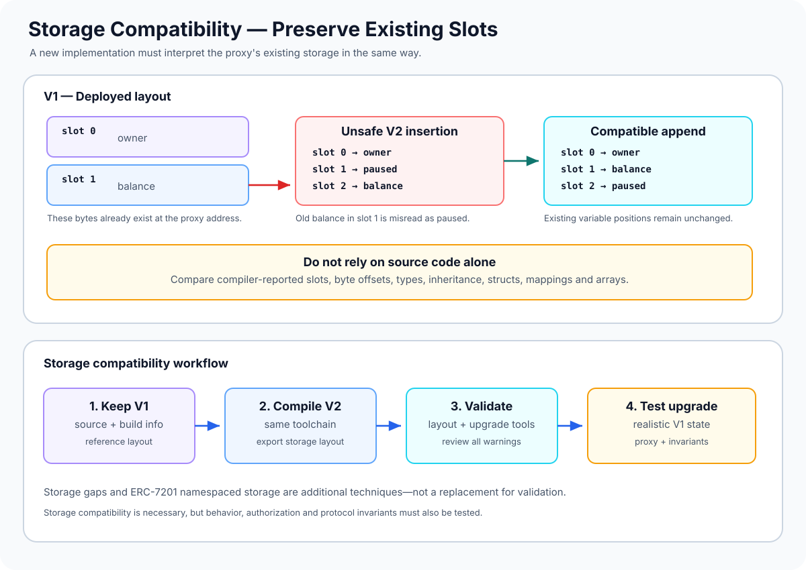

# Storage Compatibility: Preserving State Across Contract Upgrades

> **Stage:** 04 — Smart Contract Architecture  
> **Priority:** 1  
> **Status:** Reviewed  
> **Last reviewed:** 2026-10-17

## 1. Overview

**Storage compatibility** means that a new implementation interprets the persistent storage already written by an earlier implementation in a way that preserves the intended meaning of that state. It is one of the central safety requirements for proxy-based upgrades.

When a proxy delegates execution to an implementation, the implementation's code reads and writes the **proxy's storage**. Deploying a new implementation does not automatically migrate the bytes stored at the proxy address. If the new implementation assigns a different meaning to an existing slot or byte offset, previously valid state may be read incorrectly or overwritten.

For a conventional Solidity storage layout, variables are placed into slots according to declaration order, variable sizes, packing rules, and the inheritance linearization. A change to the declarations or inheritance hierarchy can therefore change where state is expected to live.

The practical rule is: **an upgrade must preserve the storage layout expected by existing state, or include a deliberately designed and tested migration.** Compiler output and upgrade-safety tooling should be used to compare the old and new layouts; intuition alone is not enough.



## 2. Why It Matters to a Developer

A storage-layout error can be more severe than a normal application bug because it may affect all state already stored in a deployed proxy. Depending on which slots shift or overlap, the result can include:

- ownership or role checks reading the wrong address;
- balances, shares, or accounting values being misinterpreted;
- configuration flags changing unexpectedly;
- mappings or dynamic arrays being read from an unintended location;
- proxy metadata being overwritten by unsafe low-level storage writes;
- an upgrade that cannot be safely reversed because the new code has already changed state.

A contract can compile successfully and still be incompatible with its previous deployed version. Compilation confirms that the new source is valid for the selected compiler; it does not prove that its storage layout can safely interpret an older proxy's state.

## 3. How Solidity Assigns Storage

For ordinary state variables, Solidity assigns storage starting from slot 0. A slot is 32 bytes. Depending on the type and declaration order, variables may share a slot through packing or occupy multiple slots. Mappings, dynamic arrays, structs, and inherited variables have additional layout rules.

The important inputs to a storage-layout comparison include:

- declaration order of state variables;
- variable types and their storage sizes;
- packing and byte offsets within slots;
- struct member order and types;
- mapping and dynamic-array declarations;
- inheritance hierarchy and C3-linearized order;
- compiler version and storage-layout rules;
- any custom base slot or namespaced storage scheme used by the project.

Constants and immutable values are not ordinary mutable storage variables in the same way as state variables, but changing them can still change application behavior. Storage compatibility is necessary for a safe upgrade, not sufficient for overall behavioral compatibility.

## 4. A Simple Example: Unsafe Insertion vs. Safe Append

Consider an implementation V1:

```solidity
// SPDX-License-Identifier: MIT
pragma solidity ^0.8.24;

contract VaultV1 {
    address public owner;   // conventionally begins at slot 0
    uint256 public balance; // begins at the next available slot
}
```

Now imagine that V2 inserts a new full-slot variable between the existing declarations:

```solidity
contract VaultV2Unsafe {
    address public owner;
    uint256 public paused;  // inserted before an existing variable
    uint256 public balance;
}
```

For this simplified example, `owner` occupies slot 0 in both versions. In V1, `balance` begins at slot 1. In V2, the new `paused` variable takes slot 1 and `balance` is now expected at slot 2. The proxy still contains V1's bytes: the old balance remains in slot 1, so V2 can interpret it as `paused` and read the balance from the wrong slot.

A simple append preserves the existing positions in this layout:

```solidity
contract VaultV2Append {
    address public owner;
    uint256 public balance;
    uint256 public paused; // added after existing state
}
```

This illustrates the general approach for a simple, non-inherited layout: keep existing declarations and their storage meaning unchanged, then add new state after them. It is **not a blanket guarantee** for every contract. Inheritance, packed variables, structs, storage gaps, custom storage bases, or namespaced storage all require checking the actual layout. In particular, adding a variable to a base contract can affect the positions of state declared by derived contracts.

## 5. Changes That Commonly Break Compatibility

### Reordering existing variables

Moving declarations changes where the compiler expects old values. A new implementation may read one variable's bytes as another variable.

### Changing a variable's type

Changing a type can affect its size, packing, interpretation, or the storage locations used by nested data structures. An address, boolean, integer, and struct are not interchangeable just because they can all be represented as bytes.

### Inserting variables into an existing layout

Inserting a variable before existing declarations can shift their positions. This includes changes made in a base contract if derived contracts have variables laid out after that base.

### Changing inheritance

Solidity lays out inherited state according to the contract's linearized inheritance order. Adding or rearranging base contracts can change storage order and packing. Review the compiled layout rather than assuming that a seemingly harmless inheritance change is safe.

### Changing struct definitions

Struct members are laid out according to their order and types. Existing structs stored directly, inside arrays, or as mapping values must be treated carefully. Changing struct layout can cause existing values to be interpreted incorrectly.

### Modifying packed values

Several small values can share a slot. Changes to types or the relative order of packed variables can change byte offsets and the meaning of bits already stored.

### Changing mapping or dynamic-array declarations

The data for mappings and dynamic arrays is located using hash-based derivation rooted in a designated storage slot. If that root slot changes, the new code will look in a different region of storage. It may appear that the mapping or array is empty even though the old data still exists elsewhere.

## 6. Storage Gaps

A **storage gap** is a reserved storage array commonly used in upgradeable base contracts to leave room for future variables without shifting the storage declared by derived contracts.

A simplified example:

```solidity
contract BaseV1 {
    uint256 public baseValue;
    uint256[49] private __gap;
}

contract BaseV2 {
    uint256 public baseValue;
    uint256 public addedValue;
    uint256[48] private __gap;
}
```

This sketch illustrates the intended accounting: the new variable consumes a slot that was previously reserved by the gap, and the gap is reduced so the reserved region keeps the intended size. It is not a universal drop-in layout recipe; the exact size and layout must be validated with the project's inheritance tree, types, compiler, and upgrade tooling.

Storage gaps can help a base contract evolve without pushing derived state downward. They do not make arbitrary changes safe. Do not change the gap size by guesswork or insert variables outside the reserved region without comparing layouts.

## 7. Namespaced Storage and ERC-7201

An alternative is **namespaced storage**, standardized by [ERC-7201](https://eips.ethereum.org/EIPS/eip-7201). Instead of relying only on one sequential layout shared through an inheritance tree, each module groups its state into a struct associated with a designated namespace storage location.

OpenZeppelin's upgradeable contracts use the `@custom:storage-location erc7201:<NAMESPACE_ID>` annotation with namespaced storage for many modules in Contracts Upgradeable 5.x.

Namespaced storage can reduce the risk that adding state to one module shifts state in another module's layout, and it can make certain inheritance changes safer when the relevant contracts consistently use namespaces. However, it does **not** make every edit safe:

- members inside a namespace still have a layout and compatibility requirements;
- a namespace identifier must remain stable for that module's state;
- two unrelated modules must not accidentally use the same namespace;
- low-level writes and incorrect namespace roots can still corrupt state;
- compiler and upgrade-tool support must match the chosen pattern.

ERC-7201 is a storage organization convention and location formula, not a complete upgrade framework. The annotation documents a namespace; the compiler does not enforce the entire design simply because the comment exists.

## 8. Proxy Metadata and Application Storage

Upgradeable proxies commonly store implementation and administrative metadata in designated slots specified by [ERC-1967](https://eips.ethereum.org/EIPS/eip-1967). These slots are chosen to reduce collision risk with the ordinary sequential layout used by application state variables.

This separation is important, but do not treat ERC-1967 as proof that a whole contract is storage-compatible. The standard addresses proxy metadata locations. Application variables still need compatible layouts, and custom assembly or incorrectly chosen storage slots can bypass the intended separation.

When investigating an upgrade, verify both:

1. **Proxy metadata:** the expected implementation, admin, or beacon address and the intended upgrade path.
2. **Application state:** the compiler-reported layout of the old and new implementation, including inherited state, struct members, packed offsets, and any namespaced storage.

The code target and the storage layout form one combined architecture: a correct implementation address pointing to incompatible code can still break the application.

## 9. How to Validate Compatibility

A reliable workflow compares the exact old and new implementations using the same project configuration.

1. **Keep the reference version.** Retain the previous source, compiler settings, dependency versions, and build artifacts needed for comparison.
2. **Compile reproducibly.** Pin the Solidity compiler and relevant dependencies. Storage-layout output depends on the compiler and declarations.
3. **Export the storage layout.** Solidity's standard JSON compiler output includes a `storage` list and type information, including slot and byte offset details.
4. **Compare old and new layouts.** Check labels, slots, offsets, types, structs, inherited declarations, and namespace identifiers. Do not rely on source diffs alone.
5. **Run upgrade validation tools.** OpenZeppelin Upgrades Core and the Hardhat/Foundry Upgrades Plugins can detect many incompatible changes when configured with the correct reference implementation.
6. **Read every warning.** Do not skip storage checks merely to get an upgrade to pass. If a change is intentionally unsafe for the tool, understand the reason, document the design, and build specific migration tests.
7. **Test the transition.** Deploy V1, initialize it, populate meaningful state, upgrade to V2 on a test network or fork, then verify old state and new features through the proxy address.
8. **Test authorization and invariants.** Ensure only authorized upgrade paths can change the implementation, and verify invariants such as total shares, balances, ownership, roles, and accounting relationships after upgrade.

OpenZeppelin validation is a valuable automated check, but it is not a proof of complete correctness. Tools need the intended previous implementation as a reference, and they cannot establish that every business rule remains correct after a change.

## 10. Storage Compatibility Is Not the Same as Behavioral Compatibility

Even when storage layout is compatible, an upgrade can still be unsafe or disruptive. For example, new code may preserve the same owner slot but change the authorization conditions, alter the meaning of a balance, change fee calculations, or stop emitting events expected by integrations.

A complete review therefore examines both categories:

- **Storage compatibility:** will the new code read and write the intended existing state locations?
- **Behavioral compatibility:** will the new code preserve the intended protocol rules, external interfaces, authorization, event behavior, and economic invariants—or document and safely migrate any intentional changes?

A storage-layout validator primarily addresses the first category. Unit tests, integration tests, invariant tests, code review, and governance review are needed for the second.

## 11. Common Mistakes and Security Considerations

1. **Only checking that the code compiles.** Compilation does not prove that a new implementation is compatible with old proxy storage.
2. **Reordering or changing existing state variables.** Old values remain in their original slots; the new code may interpret them incorrectly.
3. **Assuming "append only" is universally safe.** Inheritance, packing, namespaces, structs, and reserved gaps require validation of the actual layout.
4. **Adding a variable to a base contract without checking derived contracts.** State in derived contracts may shift or pack differently.
5. **Changing mapping roots or dynamic-array slots.** Existing data can become unreachable to the new implementation because it computes different storage locations.
6. **Reducing a storage gap by an arbitrary amount.** A gap needs to be adjusted according to the actual added storage and validated layout.
7. **Assuming ERC-7201 removes all storage risks.** Changes within a namespace, namespace collisions, and incorrect accessors can still break compatibility.
8. **Ignoring compiler and dependency changes.** Always compare the layouts generated by the actual versions used to build both implementations.
9. **Running validation without a reference implementation.** A tool needs the prior layout for a meaningful compatibility comparison.
10. **Bypassing warnings without a documented reason.** An unsafe allowance should be treated as an explicit risk acceptance that requires compensating review and tests.
11. **Checking only proxy metadata.** A correct implementation slot does not prove that the implementation understands the proxy's application state.
12. **Assuming storage compatibility guarantees correct behavior.** Authorization, accounting, economic assumptions, and integration interfaces may change even when slots remain compatible.
13. **Testing only default-zero state.** Populate V1 with realistic and boundary-case values before upgrading. Empty storage can hide errors.
14. **Ignoring rollback constraints.** A migration can write values that previous code cannot interpret, so reverting to an earlier implementation may no longer be safe.
15. **Manually writing reserved slots without a complete design.** Incorrect assembly writes can overwrite application state or proxy metadata.

## 12. Developer Review Checklist

- [ ] Preserve the exact source and build configuration of the currently deployed implementation.
- [ ] Generate storage-layout output for both old and new implementations.
- [ ] Compare slot, offset, type, struct, and inheritance changes.
- [ ] Confirm that existing variables keep their storage meaning.
- [ ] Validate changes to mappings, dynamic arrays, packed variables, and inherited state.
- [ ] Review storage gaps and adjust them only according to the actual layout.
- [ ] Review ERC-7201 namespace IDs and namespace struct changes if namespaced storage is used.
- [ ] Verify ERC-1967 proxy metadata is separated from application storage.
- [ ] Run OpenZeppelin or equivalent storage compatibility validation using the correct reference version.
- [ ] Deploy V1 with meaningful data and test the V1-to-V2 transition through a proxy.
- [ ] Verify initialization of any new state and test access-control restrictions.
- [ ] Check behavioral, accounting, and integration invariants in addition to storage layout.
- [ ] Document any intentional migration and whether rollback is still safe.

## 13. Key Takeaways

- Storage compatibility ensures that new code interprets previously stored state correctly.
- Proxy upgrades replace the code being executed; they do not automatically move or rewrite the proxy's existing storage.
- Variable order, types, packing, structs, mappings, arrays, and inheritance can affect storage layout.
- Appending variables is a common safe approach for simple sequential layouts, but it must be confirmed against the full compiled layout.
- Storage gaps reserve space for compatible evolution of base contracts; they are not a license for arbitrary changes.
- ERC-7201 namespaced storage helps separate modules' state but still requires stable namespace IDs and compatible member layouts.
- Use compiler layout output, a correct reference implementation, automated validation, realistic upgrade tests, and behavioral invariant checks.
- Correct storage layout is necessary, but it is not sufficient to prove an upgrade safe.

## References

1. **[Solidity Documentation — Layout of State Variables in Storage](https://docs.solidity.org/en/latest/internals/layout_in_storage.html)** — slot allocation, packing, mapping and array layout, inheritance ordering, and compiler storage-layout output.
2. **[OpenZeppelin — Writing Upgradeable Contracts](https://docs.openzeppelin.com/upgrades-plugins/writing-upgradeable)** — storage compatibility constraints, storage gaps, initialization, and namespaced storage.
3. **[OpenZeppelin Upgrades Core & CLI](https://docs.openzeppelin.com/upgrades-plugins/api-core)** — automated upgrade-safety and storage-layout validation and the need for a reference implementation.
4. **[OpenZeppelin Upgrades FAQ](https://docs.openzeppelin.com/upgrades-plugins/faq)** — common storage compatibility rules and upgrade safety questions.
5. **[ERC-7201 — Namespaced Storage Layout](https://eips.ethereum.org/EIPS/eip-7201)** — namespaced storage location conventions and namespace structure.
6. **[ERC-1967 — Proxy Storage Slots](https://eips.ethereum.org/EIPS/eip-1967)** — standardized implementation, admin, and beacon metadata slots.
7. **[Contract Upgradeability](11-contract-upgradeability.md)** — the broader upgrade lifecycle, authorization, migration, and validation process.
8. **[Delegatecall-Based Proxy Architecture](10-delegatecall-based-proxy-architecture.md)** — why delegated implementation code reads and writes proxy storage.
