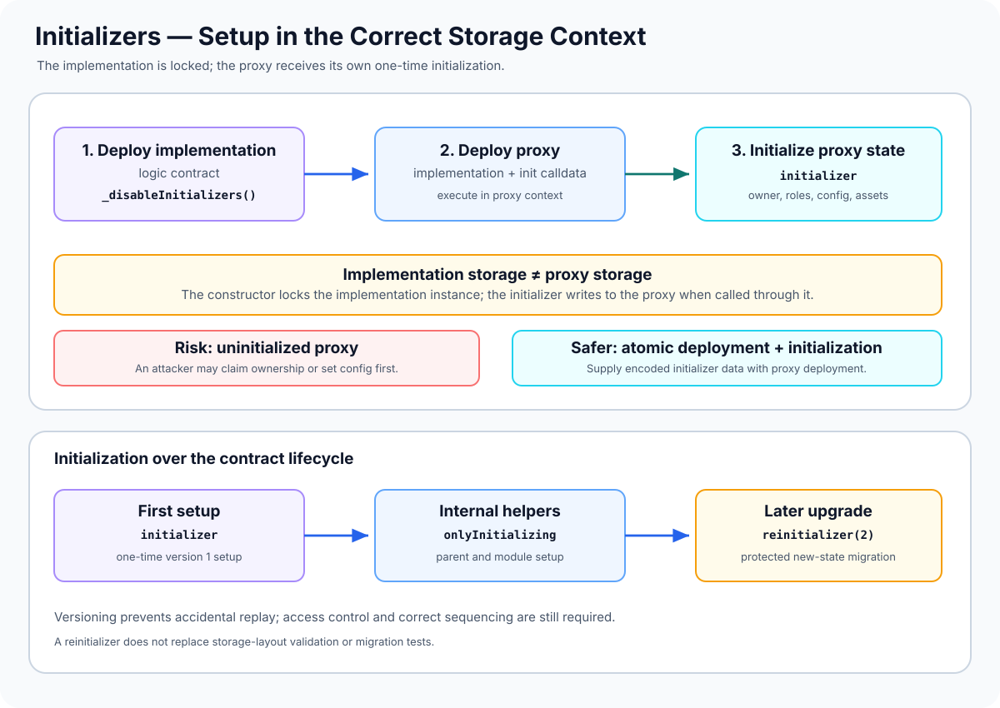

# Initializers: Safely Setting Up Proxy-Based Contracts

> **Stage:** 04 — Smart Contract Architecture  
> **Priority:** 1  
> **Status:** Reviewed  
> **Last reviewed:** 2026-10-17

## 1. Overview

An **initializer** is a function that performs setup normally carried out by a constructor, but executes after deployment. Initializers are commonly used with proxy-based contracts because the implementation's constructor runs only when the implementation is deployed; it does not initialize the proxy's storage.

In an upgradeable design, application logic is deployed as an implementation and called through a proxy. Because implementation code executes in the proxy's context via `DELEGATECALL`, an initializer called through the proxy writes initial values into the proxy's storage.

OpenZeppelin's `Initializable` utility provides three commonly used modifiers:

- **`initializer`:** protects an initial setup function so it can be called at most once in the relevant contract context.
- **`reinitializer(version)`:** protects a later setup step with a version number, for example when an upgrade adds new state that needs initialization.
- **`onlyInitializing`:** allows internal initialization helpers to run only while an initializer or reinitializer is in progress.

A related protection is **`_disableInitializers()`**, often called from the implementation's constructor to lock that implementation instance against direct initialization. The proxy still needs its own initialization.



This article uses **OpenZeppelin Contracts Upgradeable 5.x** terminology. Other versions and frameworks can differ; check the installed release before adapting code or deployment scripts.

## 2. Why It Matters to a Developer

Incorrect initialization is a common risk in proxy systems. If the intended owner, roles, asset address, or protocol parameters are not set correctly, the application may be unusable—or another account may be able to take control before the intended setup happens.

A developer needs to understand initializers to:

- transfer constructor-based setup into a proxy-compatible initialization path;
- initialize the proxy rather than accidentally changing only implementation storage;
- make sure an initialization function cannot be called repeatedly;
- initialize parent contracts correctly in an inheritance hierarchy;
- lock the implementation against direct takeover;
- initialize newly added state after an upgrade without replaying old setup steps;
- ensure deployment and initialization occur atomically where possible.

## 3. Constructor vs. Initializer

For a conventional contract, a constructor runs once during deployment and initializes that contract's storage. In a proxy design, the implementation and the proxy are separate deployed accounts.

When an implementation constructor writes `owner = deployer`, it writes to the implementation's storage. Later, when the proxy delegates calls to that implementation, the code accesses the proxy's storage instead. The proxy does not inherit the constructor's stored values.

The usual approach is therefore:

1. Deploy the implementation contract.
2. Deploy a proxy pointing to the implementation.
3. Execute an initializer through the proxy to set the proxy's state.
4. Interact with the proxy address using the implementation's ABI.

Where supported, initialization calldata should be passed as part of proxy deployment so setup executes through the proxy during the same transaction. This avoids leaving an exposed window in which another account can initialize the proxy first.

### Important exception: locking the implementation

An upgradeable implementation often still has a constructor, but its purpose is to call `_disableInitializers()` and lock that implementation instance—not to set the application's proxy state.

That constructor affects the implementation's own initialization state. Through `DELEGATECALL`, the proxy has a different storage context and must be initialized separately.

## 4. The Main OpenZeppelin Initializer Tools

### `initializer`

Mark the external or public setup entry point that configures the first version of the contract. Once the version has been consumed in that storage context, a second call reverts.

Do not expose multiple independently callable functions with `initializer` unless that is a deliberately designed scheme supported by the framework's documented behavior. Usually one entry point calls the necessary internal parent and module initializers.

### `reinitializer(version)`

A reinitializer creates a later setup step associated with a version number. For example, after an upgrade adds a new module or state variable, `reinitializer(2)` can initialize the new state once, provided the contract's stored initialization version is lower than 2.

The version numbers are an application migration plan, not an automatic detection of implementation version. Developers or operators must run the intended reinitializer in the right order. Skipping from a lower version to a higher one can consume that higher version, so document the sequence carefully.

A reinitializer does not itself prove the caller is authorized to perform the migration. Pair it with appropriate access control or execute it through a trusted atomic upgrade-and-call path.

### `onlyInitializing`

Use `onlyInitializing` on internal helpers that should run only as part of an active initializer or reinitializer. It is useful for module and parent setup functions so they cannot be called independently as public setup methods.

### `_disableInitializers()`

This internal function locks the implementation contract so no future initializer or reinitializer can initialize that implementation instance. OpenZeppelin recommends calling it from the constructor of an implementation designed to be used through a proxy.

Do not call it from the proxy's ordinary initializer: doing so would lock the proxy's initialization state as well and prevent the intended setup flow.

## 5. Example: Initializing a Proxy-Compatible Contract

The example uses OpenZeppelin Contracts Upgradeable 5.x. It shows a first initializer, an internal helper, an implementation-locking constructor, and a later versioned migration.

```solidity
// SPDX-License-Identifier: MIT
pragma solidity ^0.8.24;

import {
    Initializable
} from "@openzeppelin/contracts-upgradeable/proxy/utils/Initializable.sol";
import {
    OwnableUpgradeable
} from "@openzeppelin/contracts-upgradeable/access/OwnableUpgradeable.sol";

contract Vault is Initializable, OwnableUpgradeable {
    address public asset;
    uint256 public feeBps;

    /// @custom:oz-upgrades-unsafe-allow constructor
    constructor() {
        // Locks this implementation instance, not proxy storage.
        _disableInitializers();
    }

    function initialize(address initialOwner, address asset_)
        external
        initializer
    {
        __Ownable_init(initialOwner);
        __Vault_init(asset_);
    }

    function __Vault_init(address asset_)
        internal
        onlyInitializing
    {
        require(asset_ != address(0), "Zero asset");
        asset = asset_;
        feeBps = 30;
    }

    function initializeV2(uint256 newFeeBps)
        external
        reinitializer(2)
        onlyOwner
    {
        require(newFeeBps <= 1_000, "Fee too high");
        feeBps = newFeeBps;
    }
}
```

What this example demonstrates:

- `initialize` sets the owner and initial application state in the storage context where it is called.
- When called through a proxy, `__Ownable_init` and `__Vault_init` write to the proxy's storage.
- `__Vault_init` is internal and protected by `onlyInitializing`, so it is available only during an active initialization flow.
- The constructor calls `_disableInitializers()` to lock the implementation contract itself.
- `initializeV2` illustrates a one-time migration step for a later version and also checks `onlyOwner`.

This is a teaching example, not a complete deployment project. In a production system, V2 initialization must be coordinated with the actual upgrade transaction and version history; the exact upgrade tooling, inheritance hierarchy, and validation annotations should be checked against the installed OpenZeppelin version. The code has **not** been compiled or run in Foundry or Hardhat as part of this article.

## 6. Initializing Inherited Contracts

Solidity constructors automatically run according to Solidity's inheritance rules. Initializer functions are ordinary functions with modifiers; the compiler does not automatically call all parent initializers for you.

When a contract inherits from multiple upgradeable modules, the top-level initializer must call the appropriate parent initialization functions. For example, an access-control or token module may need its name, symbol, owner, or role configuration to be set through its dedicated initializer.

Important rules:

- Call each required parent initializer exactly as intended by the framework.
- Follow the initializer ordering expected by Solidity's linearized inheritance and the upgrade tooling.
- Do not call the same parent initializer twice. In multiple inheritance, a parent may already be initialized by another parent initializer.
- Keep setup helpers internal and use `onlyInitializing` where appropriate.
- Run OpenZeppelin Upgrades validation to detect missing or repeated parent initializers and ordering problems where the validator supports those checks.

Do not assume that calling one initializer for a derived contract automatically initializes all its bases. Review the exact source of the upgradeable modules being inherited.

## 7. Initialization Data at Deployment

A proxy constructor can accept encoded initialization data and execute it against the implementation through the proxy context. In OpenZeppelin's ERC-1967-based proxy, the constructor's data argument is commonly used for this purpose.

This supports atomic deployment:

1. The deployer specifies the implementation address.
2. The deployer encodes the desired `initialize(...)` function call.
3. The proxy is deployed with that initialization data.
4. The proxy delegates the call to the implementation to initialize proxy storage during deployment.

Atomic initialization is strongly preferred when configuration or ownership is security-sensitive. If the proxy is deployed first and the initializer is called in a separate later transaction, an attacker may be able to submit the initializer first unless an additional protection prevents it.

For a factory that deploys clones, the same principle applies: create the clone and initialize its storage within the same transaction where possible.

## 8. Reinitializers During Upgrades

An upgrade may add a new variable or module that needs initial state. For example, V2 may introduce a fee recipient or a new accounting flag. A `reinitializer(2)` function can set that data once after the original version has already been initialized.

But the upgrade transaction must deliberately coordinate three things:

- the new implementation becomes active;
- the new state is initialized using the correct proxy storage context;
- the migration is authorized and executed at the intended point in the upgrade process.

When supported by the selected upgrade pattern, an atomic upgrade-and-call operation can execute the new setup function as part of the upgrade transaction. Verify the actual proxy pattern and tool API: not every architecture exposes the same mechanism.

Do not treat reinitializers as a substitute for storage-layout compatibility. A reinitializer can set newly introduced state, but it cannot automatically repair old values that the new implementation reads from the wrong slots.

### Version numbering is operational state

Initialization versions are stored per contract context. The implementation's initialization version and the proxy's version are not the same storage instance. Locking the implementation does not mark each proxy as initialized; each proxy maintains its own initialization state.

If several reinitializers are present, define the allowed sequence, restrict who can call them, and ensure operators know which version must be applied during each upgrade.

## 9. Common Mistakes and Security Considerations

1. **Leaving a proxy uninitialized.** An attacker may call the public initializer first and claim ownership or set malicious configuration.
2. **Relying on the implementation constructor for proxy state.** The constructor writes to implementation storage, not proxy storage.
3. **Leaving the implementation itself uninitialized.** A directly callable implementation can be taken over in its own context and may create risks depending on the design. Lock it with `_disableInitializers()` when recommended.
4. **Calling `_disableInitializers()` in the wrong context.** It belongs in the implementation constructor for the standard lock pattern, not in the proxy's regular initializer.
5. **Omitting parent initializers.** The derived contract can have unset parent state, such as missing ownership, token metadata, or role configuration.
6. **Calling a parent initializer multiple times.** Repeating setup can revert or create incorrect state, especially in multiple inheritance.
7. **Assuming constructor inheritance rules apply to initializers.** Initializer calls need to be explicitly arranged and checked.
8. **Making initialization helpers externally callable without protection.** Helpers intended only for setup should not expose arbitrary reconfiguration after deployment.
9. **Treating `reinitializer(2)` as automatic upgrade detection.** The version modifier only guards that migration step; the upgrade process still has to schedule and execute it properly.
10. **Leaving a reinitializer publicly accessible without a policy.** Even if it can run only once, an attacker may call it first and set sensitive state unless access control or an atomic upgrade path prevents this.
11. **Assuming every upgrade tool validates every reinitializer automatically.** OpenZeppelin's Upgrades Plugins do not treat every reinitializer as an initializer by default; check the validation rules and annotations for the version you use.
12. **Initializing a clone through the wrong caller context.** If a factory invokes the initializer, `msg.sender` in the initializer is the factory. Pass the intended owner explicitly where needed.
13. **Reusing initialization versions carelessly.** The version is part of persistent state. Plan the sequence and do not reuse an already-consumed version for a different migration.
14. **Assuming a successful initializer makes the contract safe.** Input validation, authorization, storage compatibility, and protocol invariants still need tests.
15. **Failing to initialize atomically.** A gap between deployment and setup can expose sensitive configuration unless access is explicitly guarded.

## 10. Developer Review Checklist

- [ ] Explain why proxy storage is not initialized by the implementation constructor.
- [ ] Mark the one-time initial setup with `initializer`.
- [ ] Use `onlyInitializing` for internal setup helpers as appropriate.
- [ ] Lock the implementation with `_disableInitializers()` where the framework recommends it.
- [ ] Pass initialization calldata during proxy deployment when supported.
- [ ] Explicitly call and validate all required parent initializers.
- [ ] Check that no parent initializer is repeated and that ordering is correct.
- [ ] Protect versioned reinitializers and document the upgrade sequence.
- [ ] Test that an initializer cannot run twice and that unauthorized accounts cannot run privileged migrations.
- [ ] Verify that the implementation and each proxy maintain separate initialization state.
- [ ] Run framework validation and test deployment, initialization, and upgrade paths through the proxy address.
- [ ] Check constructor, initializer, and reinitializer assumptions against the installed library version.

## 11. Key Takeaways

- Initializers replace constructor-based state setup for a contract instance whose storage belongs to a proxy.
- `initializer` protects the first setup step; `reinitializer(version)` guards later versioned setup; `onlyInitializing` restricts internal helpers to an active setup process.
- The implementation constructor does not initialize proxy storage.
- `_disableInitializers()` is commonly called from the implementation constructor to lock the implementation against direct initialization.
- Parent initializers must be handled explicitly and carefully, especially with multiple inheritance.
- Pass initialization data during deployment where possible to avoid exposing an uninitialized proxy.
- Reinitializers need deliberate access control and migration sequencing; they do not fix an incompatible storage layout.
- Validate and test the real deployment and upgrade path using the project's exact toolchain and library version.

## References

1. **[OpenZeppelin Contracts 5.x — Proxy API: Initializable](https://docs.openzeppelin.com/contracts/5.x/api/proxy#Initializable)** — `initializer`, `reinitializer`, `onlyInitializing`, `_disableInitializers`, initialization versions and events.
2. **[OpenZeppelin — Writing Upgradeable Contracts](https://docs.openzeppelin.com/upgrades-plugins/writing-upgradeable)** — replacing constructors with initializers, locking implementation contracts, inheritance and parent initialization validation.
3. **[OpenZeppelin Contracts 5.x — ERC1967Proxy](https://docs.openzeppelin.com/contracts/5.x/api/proxy#ERC1967Proxy)** — using deployment calldata to initialize proxy storage through the implementation.
4. **[OpenZeppelin Contracts 5.x — Using with Upgrades](https://docs.openzeppelin.com/contracts/5.x/upgradeable)** — using upgradeable package variants and handling multiple inheritance and initializer calls.
5. **[OpenZeppelin Upgrades Core & CLI](https://docs.openzeppelin.com/upgrades-plugins/api-core)** — automated upgrade validation related to initializers and storage layouts.
6. **[Contract Upgradeability](11-contract-upgradeability.md)** — the broader upgrade lifecycle, authorization, migration, and validation.
7. **[Storage Compatibility](12-storage-compatibility.md)** — preserving the meaning of existing proxy storage.
8. **[Proxy Contracts](05-proxy-contracts.md)** — the separation between implementation code and proxy storage context.
